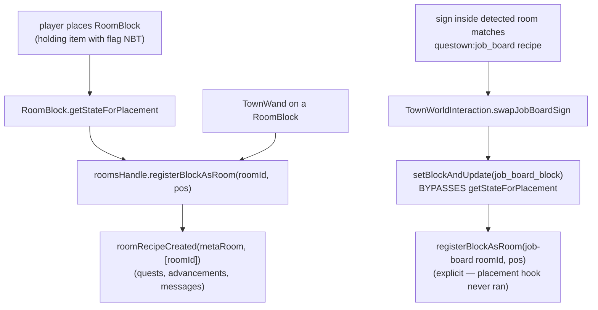

# Block-rooms: a single block that registers as a room

A `RoomBlock` is a town sub-block whose *presence* is the room: placing it next
to a flag registers a one-block "block-room" (id
`questown:block_room/block.<description-id>`) with the flag's rooms handle, the
same record a walled room gets. Mineshaft, fishing station, and the job board
are block-rooms.

## Registration paths

The swap path is the trap: `setBlockAndUpdate` never calls
`getStateForPlacement`, so any block-room a swap installs must be registered
explicitly at the swap site (see
`docs/solutions/conventions/setblockandupdate-side-effect-bypass-2026-04-24.md`).

## Shared entity and the orphan drop

All block-rooms share `BlockAsRoomEntity` (`TilesInit.BLOCK_AS_ROOM`); a block
joins the family via `BlockAsRoomEntity.register(...)` in `BlocksInit`, not by
declaring its own block-entity type.

When the flag is removed, orphaned sub-blocks drop themselves with the flag
position stored on the item's NBT so they can re-attach. The dropped item comes
from `RoomBlock.getOrphanDropItem()`, which defaults to the block's own item.
The job board overrides it to drop an oak sign, because the board item is born
from a sign (holding a sign near the flag converts it), so orphaning returns
the player's original investment.

## The bread oven: its own BE type (the shared-entity exception)

`BreadOvenBlock` is NOT a `RoomBlock` and does NOT join the
`BlockAsRoomEntity` family — it is a processing block with its own block-entity
type (`TilesInit.BREAD_OVEN`, `BreadOvenBlockEntity`):

- **Slots** (0 wheat, 1 coal, 2 bread) live in the BE's NBT-persisted
  `Container` storage; `resolveContainer` in `MinecraftWorldAccess` treats any
  `BlockEntity implements Container` as a job container, so the cook-shaped
  job slot rules (`insert_into_slot_0/1`, `questown:take_from_slot_2`) drive
  it.
- **Bake arithmetic** (`BreadOvenBake`: 1 wheat + 1 coal -> 1 bread over
  `BAKE_TICKS=1000`, partial-progress reset on any slot change) is shared by
  the realtime BE (`advanceBakeOneTick`/`advanceBake`) and the warp lane
  (`WarpWorldAccess.advanceBreadOven` → same `BreadOvenBake` instance bound to
  the in-memory slot snapshot). Keep it that way — a second copy of the
  arithmetic in either lane is the parity footgun.
- **`bake_state` visual**: content-derived. `BreadOvenBlockEntity.syncVisualState()`
  keeps the block property in sync with the slots (0 empty / 1 wheat only /
  2 filled / 3 baking / 4 bread ready); the townie's work-state index no
  longer drives it (the old `StatefulJobBlock.setProcessingState` path was
  removed in the 2026-10-10 cook-shape migration, so
  `TownWorkStatusStore`'s `instanceof StatefulJobBlock` probe skips the oven).
- **Destruction**: `BreadOvenBlock.onRemove` drops slot contents via
  `Containers.dropItemStack`; `getDrops` returns the block item only.
- **Unit-testability trap**: `BreadOvenBlockEntity` cannot be constructed in a
  plain unit test — its constructor resolves `TilesInit.BREAD_OVEN`, whose
  supplier constructs the mod's `BreadOvenBlock` (`Block.<init>` writes
  `BuiltInRegistries`, frozen after `Bootstrap.bootStrap()`). The bake
  arithmetic is therefore tested registry-free through `BreadOvenBakeTest`;
  the warp-lane branch stays pinned by the `assertThrows` marker in
  `WarpWorldAccessTest`.
