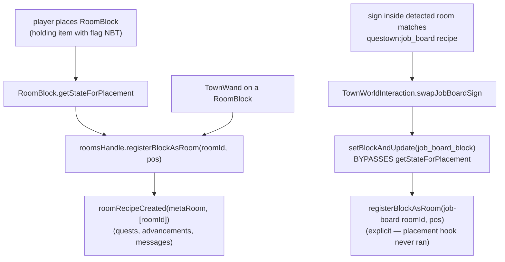

# Block-rooms: a single block that registers as a room

A `RoomBlock` is a town sub-block whose *presence* is the room: placing it next
to a flag registers a one-block "block-room" (id
`questown:block_room/block.<description-id>`) with the flag's rooms handle, the
same record a walled room gets. Mineshaft, fishing station, and the job board
are block-rooms.

## Registration paths

The swap path is the trap: `setBlockAndUpdate` never calls
`getStateForPlacement`, so any block-room a swap installs must be registered
explicitly at the swap site (see
`docs/solutions/conventions/setblockandupdate-side-effect-bypass-2026-04-24.md`).

## Shared entity and the orphan drop

All block-rooms share `BlockAsRoomEntity` (`TilesInit.BLOCK_AS_ROOM`); a block
joins the family via `BlockAsRoomEntity.register(...)` in `BlocksInit`, not by
declaring its own block-entity type.

When the flag is removed, orphaned sub-blocks drop themselves with the flag
position stored on the item's NBT so they can re-attach. The dropped item comes
from `RoomBlock.getOrphanDropItem()`, which defaults to the block's own item.
The job board overrides it to drop an oak sign, because the board item is born
from a sign (holding a sign near the flag converts it), so orphaning returns
the player's original investment.
