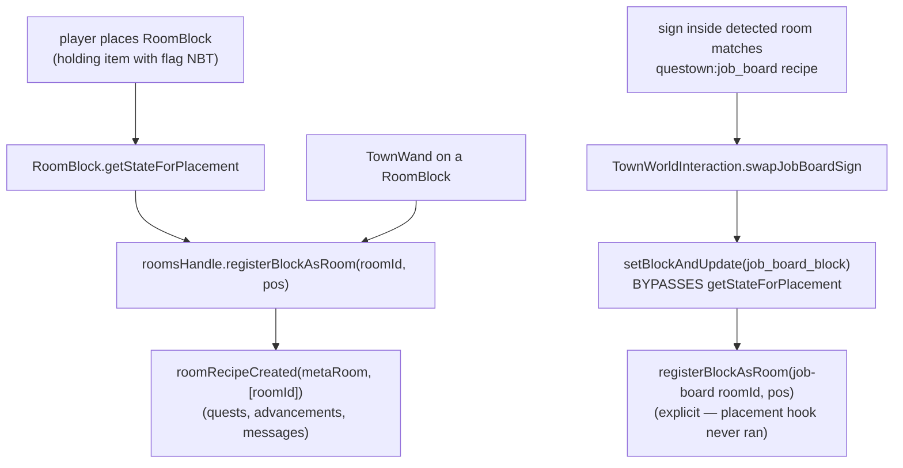

# Block-rooms: a single block that registers as a room

A `RoomBlock` is a town sub-block whose *presence* is the room: placing it next
to a flag registers a one-block "block-room" (id
`questown:block_room/block.<description-id>`) with the flag's rooms handle, the
same record a walled room gets. Mineshaft, fishing station, and the job board
are block-rooms.

## Registration paths

The swap path is the trap: `setBlockAndUpdate` never calls
`getStateForPlacement`, so any block-room a swap installs must be registered
explicitly at the swap site (see
`docs/solutions/conventions/setblockandupdate-side-effect-bypass-2026-04-24.md`).

## Shared entity and the orphan drop

All block-rooms share `BlockAsRoomEntity` (`TilesInit.BLOCK_AS_ROOM`); a block
joins the family via `BlockAsRoomEntity.register(...)` in `BlocksInit`, not by
declaring its own block-entity type.

When the flag is removed, orphaned sub-blocks drop themselves with the flag
position stored on the item's NBT so they can re-attach. The dropped item comes
from `RoomBlock.getOrphanDropItem()`, which defaults to the block's own item.
The job board overrides it to drop an oak sign, because the board item is born
from a sign (holding a sign near the flag converts it), so orphaning returns
the player's original investment.

## Job board facing: blockstates re-bases the model's X-axis front

The board model (`models/block/job_board_block.json`) authors the slab
**thin along X** (the two readable faces are the ±X faces; the slab leans via
a z-axis rotation), while the FACING rendering convention is Z-fronted (the
stock `south:0, west:90, north:180, east:270` variant table). Net effect:
whatever the `FACING` state says, the readable face renders **90° off** —
the 2026-10-11 and 2026-10-15 playtest reports ("rotated 90 west", "rotated
90 left"; both consistent with a constant 90° offset). The state logic is
canonical and was right all along: `JobBoardBlock.getStateForPlacement` sets
`FACING = ctx.getHorizontalDirection().getOpposite()` (face the placer — the
sign/bed convention; computed twice, both sites). The fix (2026-10-15) re-bases
the blockstates variants instead of touching the state code or re-authoring the
model: a client-side resource change.

**The rotation sign was verified against the vanilla oracle, not derived:**
villa 1.20.6 `blockstates/furnace.json` + the `block/orientable` template
(front face on the model's **−Z**) reads `north:0, east:90, south:180,
west:270` — so a `y:90` rotation carries the north face to the **east**
(clockwise viewed from above), the opposite of the stock-math sign. With the
board's readable face on **−X**, that gives `west:0, north:90, east:180,
south:270`. The first re-base attempt used the wrong sign (`south:90,
north:270`); the 2026-10-15 03:13 playtest report confirmed it: "Facing west,
placement was correct. But when I was facing south it pointed the wrong way"
— exactly one sign flip, south/north transposed. Swapped; all four facings
now satisfy `readable face == FACING == the placer's side`.

Check before assuming: other asymmetric FACING block-rooms (bread oven, food
display, fishing station, axe rack) may share the model-axis mismatch —
verify each model's authored front axis against its blockstates table.

# The bread oven: its own BE type (the shared-entity exception)

`BreadOvenBlock` is NOT a `RoomBlock` and does NOT join the
`BlockAsRoomEntity` family — it is a processing block with its own block-entity
type (`TilesInit.BREAD_OVEN`, `BreadOvenBlockEntity`):

- **Slots** (0 wheat, 1 coal, 2 bread) live in the BE's NBT-persisted
  `Container` storage; `resolveContainer` in `MinecraftWorldAccess` treats any
  `BlockEntity implements Container` as a job container, so the cook-shaped
  job slot rules (`insert_into_slot_0/1`, `questown:take_from_slot_2`) drive
  it.
- **Bake arithmetic** (`BreadOvenBake`: 1 wheat + 1 coal -> 1 bread over
  `BAKE_TICKS=1000`, partial-progress reset on any slot change) is shared by
  the realtime BE (`advanceBakeOneTick`/`advanceBake`) and the warp lane
  (`WarpWorldAccess.advanceBreadOven` → same `BreadOvenBake` instance bound to
  the in-memory slot snapshot). Keep it that way — a second copy of the
  arithmetic in either lane is the parity footgun.
- **`bake_state` visual**: content-derived. `BreadOvenBlockEntity.syncVisualState()`
  keeps the block property in sync with the slots (0 empty / 1 wheat only /
  2 filled / 3 baking / 4 bread ready); the townie's work-state index no
  longer drives it (the old `StatefulJobBlock.setProcessingState` path was
  removed in the 2026-10-10 cook-shape migration, so
  `TownWorkStatusStore`'s `instanceof StatefulJobBlock` probe skips the oven).
- **Destruction**: `BreadOvenBlock.onRemove` drops slot contents via
  `Containers.dropItemStack`; `getDrops` returns the block item only.
- **Unit-testability trap**: `BreadOvenBlockEntity` cannot be constructed in a
  plain unit test — its constructor resolves `TilesInit.BREAD_OVEN`, whose
  supplier constructs the mod's `BreadOvenBlock` (`Block.<init>` writes
  `BuiltInRegistries`, frozen after `Bootstrap.bootStrap()`). The bake
  arithmetic is therefore tested registry-free through `BreadOvenBakeTest`;
  the warp-lane branch stays pinned by the `assertThrows` marker in
  `WarpWorldAccessTest`.

## Job board orphan drop: the sign override was stale (2026-10-15)

`JobBoardBlock` overrode `RoomBlock.getOrphanDropItem()` to return
`Items.OAK_SIGN` — "born from a vanilla sign (sign -> job board conversion
at the flag)". That conversion no longer exists (the override was the only
OAK_SIGN reference left in the block/flag code; the board is placed directly
from its own item since the 2026-10-15 "job-board placement completes the
JOB_BOARD quest" work). Breaking a board therefore dropped a plain sign
(user report 2026-10-15 03:12:02) instead of the `job_board_block` item.
The orphan path (`BlockAsRoomEntity.dropWhenOrphaned`) already stamps the
flag NBT onto the dropped item via `TownFlagBlock.StoreParentOnNBT`, so the
fix was just deleting the override (the base `asItem()` drop, NBT-stamped,
re-attaches to the same flag on re-placement).

## Broken board drops its registration (`onRemove`, 2026-10-15 playtest)

Breaking a placed job board left the flag's persisted `jobBoards` entry
pointing at air: every world load logged `Registered job board was not
found in world at ...` (ERROR) and the board's room kept being treated as
registered. `JobBoardBlock.onRemove` (5-arg, `Level` form - the sibling
`AxeRackBlock`/`BreadOvenBlock` pattern; 1.20.6 has no 4-arg ServerLevel
variant) fires only on a real removal (`!state.is(newState.getBlock())`,
i.e. not a state replacement) and iterates `TownFlags.all()`, calling
`TownFlagBlockEntity.removeJobsBoard(pos)` -> `TownWorkHandle.removeJobBoard`
+ `setChanged()`. Load-time fallout is downgraded to INFO ("dropping stale
entry") in `TownWorkHandle`: entries that fail to re-register simply fall
out of persistence on the next save, so the load log is a heal report, not
an error.

## Sub-blocks must not self-destruct while the flag is merely away (2026-10-18)

`TownFlagSubBlocks.tick` (run by each sub-block's own BE tick listener) removes the block after
`FlagSubBlockRetentionTicks` (20) ticks without a `parentTick` from a flag that is not INACTIVE —
the "flag was destroyed" path. Symptom (day1 after the overnight absence, 3 of 4 runs on
2026-10-18): the job board vanished the moment the town reloaded, the flag then logged "Job board
registration ... no longer matches a board; dropping stale entry", and `TownFlagSubBlocks`
ERRORed "Giving up on detecting sub block ... wrong entity type: null".

**Root cause (found via the INFO removal line):** a reloaded flag is a NEW block entity with a NEW
`TownFlagSubBlocks`. A sub-block whose chunk stayed loaded through the absence still had its tick
listener on the OLD instance, whose counters the new flag never resets — so ~20 ticks after the
flag came back, the old instance judged the (live, ticking) flag dead and removed the board.
Fix: `TownFlagBlockEntity.onChunkUnloaded` retires its instance (`retire()`; a retired instance's
`tick` is a no-op). A destroyed flag only gets `setRemoved`, so orphan removal still runs for it.
The reloaded flag re-registers its boards on its own instance (`TownWorkHandle.registerJobBoard`).

Hardening added on the way (each closed a window the first diagnosis suspected, none was the
cause on its own): `tick` treats a flag whose chunk is not block-ticking
(`Level.shouldTickBlocksAt`) like INACTIVE and no longer force-loads the flag's chunk via
`getBlockState`; `AbstractTownFlagTicker` feeds sub-blocks while initializers run;
`registerJobBoard` / `initialize` retry while the board's chunk is unloaded. The removal logs at
INFO so a future self-destruct is visible. Not unit-pinned (the retention path reads `Config`,
which throws in unit tests); verified by repeated day1 runs with zero removals.

## No item-on-flag conversions (2026-10-19)

Dev: "Lets fully remove the 'use item on flag block' interaction. Everything important (and not
experimental) can be crafted via the menu." `TownFlagBlock.convertItemInHand` is gone (stick <->
wand, room-block stamping, town door / false wall / fence gate / plate / hospital bed /
clipboard swaps, the exotic-wood flagpole, and the diamond / gold-block / potato debug actions).
Using the flag with an item now just opens the flag UI. The two pieces the game depended on moved
to the crafting tab (`FlagCraftMessage`): the **mineshaft** (stone stairs -> flag-stamped mineshaft;
a RoomBlock only registers its room when its stamped parent resolves) and the `WandGet`
advancement (journal entry 003), which only the conversion used to fire. Still unresolved: the
**fishing station** is also a stamped RoomBlock with no crafting-tab recipe (asked the dev).

## Unlinked flag blocks: fail the placement, never drop a copy (2026-10-22)

`WelcomeMatBlock`, `JobBoardBlock` and `HospitalBedBlock` need a flag link in the item's NBT.
Without one, `getStateForPlacement` returns `null`, and vanilla `BlockItem.place` then fails
without consuming the stack. It used to return AIR and spawn an `ItemEntity` copy. Placing AIR
on air fails too, so the player kept the stack and also got the drop: a survival duplication.
The placer gets an on-screen line saying why (`TownFlagBlock.tellPlacerNotLinked`). Pinned by
`flag/unlinked_placement_no_dupe` (held + dropped = 1 for a mat and a board; it was 2 before the
fix).
