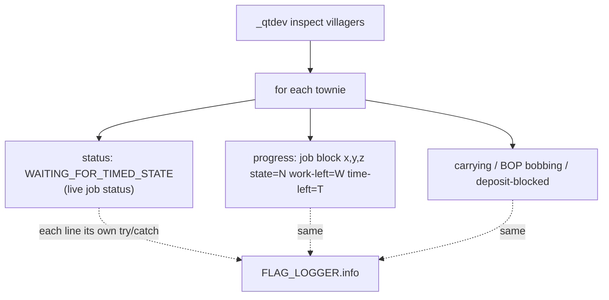

# commands — the `_qtdev inspect villagers` eyes-level readout

`_qtdev inspect villagers` is the headless box's substitute for watching a
townie: with no capturable window, the evidence for a behaviour report has to
come from the server log, so the command dumps a per-villager block of
best-effort "what a player would see" lines. Each line is wrapped in its own
try/catch so a half-initialised field can never fail the whole inspect.

## Flow

## The `progress:` line — mid-trip vs trip cut short

The line exists to tell a leaver who is genuinely mid-trip from one whose trip
was cut short. Both show `status: WAITING_FOR_TIMED_STATE`; only the progress
line disambiguates:

- `time-left` counting down → the work timer is still running, the trip is
  live.
- recalled to `RELAXING` with `time-left` still positive → the trip was cut
  short (the evening branch recalled him despite unfinished timed work).

Chain: `VisitorMobEntity.getWorkProgressDebug()` narrows the job to a
`DeclarativeJob`, then `DeclarativeJob.getWorkProgressDebug(town)` reads the
ticker's current `workSpot`, then pulls `State` (processingState, work-left)
and `getTimeToNextState` (time-left) from the town's real work-status handle —
`null` owner UUID when the job has `SpecialRules.SHARED_WORK_STATUS`. Returns
`null` (line omitted) when the job has no work spot yet.

This is dev-only observability; it is how the town-leaver night-return bug was
confirmed (see
`.scratch/warp-night-handling/town-leaver-returns-empty-at-night.md`).
