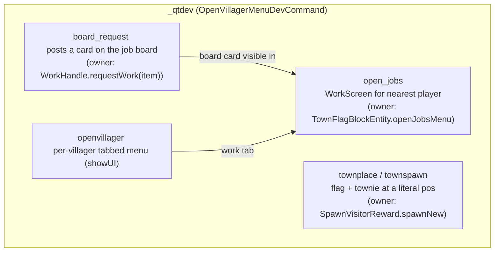

# Dev command set (`_qtdev` and friends)

This directory holds the console command set (v1.19.2 oracle repo; the 1.20.6
wip mirror lives in the Questown repo). The commands are thin dev drivers over
owner paths - they place, spawn, or open what the game already owns, and the
board/job drives exist so a headless capture can reach a card-rich fixture
without a player click.

## Board-drive notes

- `board_request` takes the vanilla `ItemArgument` (resolved against the
  `CommandBuildContext` passed from `CommandInit` - see
  `DevFlagDebugToggleCommand` for the two-arg `register` shape in this file set).
  A `word()` literal misparses `minecraft:` ids over the console FIFO
  ("Expected whitespace to end one argument", observed 2026-10-01); use the
  item argument, never the word form, for item ids.
- A job board card is a **work request** on the flag (`WorkHandle`), not a
  townie: `open_jobs` draws cards from the request list, so a board with zero
  requests renders a zero-card WorkScreen (not a bug - the fixture just needs a
  `board_request` first).
- The work-screen parity bank pair is driven by `board_request` + `open_jobs`
  on both branches; the wip capture is banked, the golden side is parked on
  the 1.19.2 client death-overlay state (wip issue
  `.scratch/work-board-request/golden-client-death-overlay.md`).
