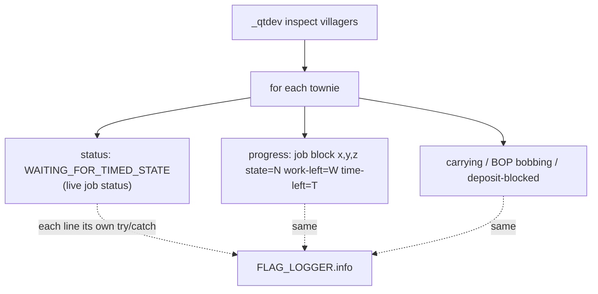

# commands — the `_qtdev inspect villagers` eyes-level readout

`_qtdev inspect villagers` is the headless box's substitute for watching a
townie: with no capturable window, the evidence for a behaviour report has to
come from the server log, so the command dumps a per-villager block of
best-effort "what a player would see" lines. Each line is wrapped in its own
try/catch so a half-initialised field can never fail the whole inspect.

## Flow

## The `progress:` line — mid-trip vs trip cut short

The line exists to tell a leaver who is genuinely mid-trip from one whose trip
was cut short. Both show `status: WAITING_FOR_TIMED_STATE`; only the progress
line disambiguates:

- `time-left` counting down → the work timer is still running, the trip is
  live.
- recalled to `RELAXING` with `time-left` still positive → the trip was cut
  short (the evening branch recalled him despite unfinished timed work).

Chain: `VisitorMobEntity.getWorkProgressDebug()` narrows the job to a
`DeclarativeJob`, then `DeclarativeJob.getWorkProgressDebug(town)` reads the
ticker's current `workSpot`, then pulls `State` (processingState, work-left)
and `getTimeToNextState` (time-left) from the town's real work-status handle —
`null` owner UUID when the job has `SpecialRules.SHARED_WORK_STATUS`. Returns
`null` (line omitted) when the job has no work spot yet.

This is dev-only observability; it is how the town-leaver night-return bug was
confirmed (see
`.scratch/warp-night-handling/town-leaver-returns-empty-at-night.md`).

## The `_qtdev` fixture drive set (QtDevClickCommand)

The same `qtdev` literal carries a small fixture-drive set for headless
capture; each is a thin wrapper over the owner's method (no re-implemented
action paths, no permission gates):

- `townplace <pos>` / `townspawn <pos>` - place the flag, spawn one townie at
  its `pos` (the spawner resolves the flag block entity *at that pos*, so pass
  the flag coordinates again, not a nearby air block).
- `openvillager <tab>` - the flag right-click villager menu on a named tab
  (`stats`, `quests`, `economics`, ...); `economics` is the screen that shows
  a `blitFace` portrait (left of the Food row) - the face-scale oracle target.
- `open_jobs` / `board_request <item>` - open the job board / post one work
  request. `board_request` wraps `WorkHandle.requestWork(item)`, the same call
  the AddWork confirm flow makes, so a headless capture can drive a card-rich
  board. A blank board is not a render bug: a card only exists per request, and
  the card icon only when the request's ingredient is non-null. Known pre-
  existing edge (golden-identical code): the request's change listener runs
  `updateWorkersAfterRequestChange`, which NPEs on a DOWNTIME townie's null
  `getStatusForServer()` - the NPE lands *after* the request is posted, so the
  card still appears (a server-log stack, not a drive failure).
- `inspect villagers <flag-pos>` - the eyes-level readout above. The flag pos
  argument is the flag coordinates, not a search radius.

The 1.19.2 golden branch carries only `openvillager`, `townspawn` (pos form),
and (mirrored 2026-10-01) `open_jobs`; it has **no** `board_request`, so a
card-rich work board on the golden side must be driven through the AddWork
confirm flow or the same command mirrored over (the golden's `WorkScreen`
card path is otherwise the same).
