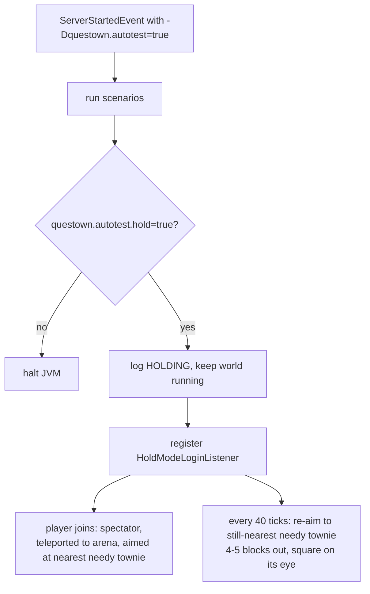

# commands/test — hold mode (visual inspection after a suite)

The autotest harness normally halts the JVM when the last scenario reports
(`/tmp/...log` shows `RESULT: N/N passed`). Hold mode keeps the world alive
afterwards so a dev client can join and *see* the end state — built for
headless screenshot verification (`grim`) of things a unit test cannot judge
(e.g. the need bubbles of ADR-0011).

## Flow

- **Skip the halt** — `AutoTestRunner.HOLD` branch near the end of the tick
  listener. The world keeps ticking; `session.lock` still applies, so kill the
  old held server before launching another `runServer`.
- **Interface** — the `-Pautojoin` Gradle property makes `runClient` connect
  straight to `localhost:25565` (`--server/--port` args), bypassing the title
  screen — no mouse/keyboard needed on the client, which matters because
  dev-box input injection (wtype) does not reach the GLFW window.
- **Aim matters as much as position** — the bubble focus contest is an angular
  cone (dot >= 0.9), so the tracker recomputes yaw/pitch from the villager's
  live position. A fixed yaw goes stale the moment the roster wanders.
- **Hysteresis of scenario state** — need bubbles can clear themselves as the
  world keeps living past the assertions (e.g. a villager eventually finding
  viable work). Verify soon after HOLD, don't sit on the held world for hours.
- Fake players (`[AutoTest]`) are excluded from both the login teleport and the
  per-tick re-aim via the bracketed-name check.
- **Aim preference order** — a scenario may post its own target via the System
  property `questown.autotest.aim.door` ("x,y,z" offset from the arena origin,
  set in a postSpawnAction). When present it wins over needy townies; without
  it, a post-scenario needy townie will steal the aim and the thing the
  scenario asserted on (a dead door, say) may never reach the screen. Used by
  `flag/dead_door_bubbled`.

## Launch discipline (hold mode)

- Env: `JAVA_HOME=$HOME/.gradle/jdks/jdk-17.0.20+8 LANG=C.UTF-8` — the wrong
  JDK breaks Gradle's Groovy compile; a POSIX locale fails javac with
  "unmappable character for encoding US-ASCII".
- Before relaunching: `pkill -f '[G]radlew runClient'`, `pkill -f '[G]radlew
  runServer'`, `pkill -f 'questown[.]autotest'` — always bracket one char or
  the pattern self-matches your own bash argv and kills your shell. A **held**
  server (one launched with `-Dquestown.autotest.hold=true`) **catches SIGTERM
  and survives `pkill`** — after `pkill`, re-check with `pgrep -af '[r]unServer'`
  and `kill -9 <pid>` the java child (the `gradlew` wrapper dies, the server JVM
  does not) if it is still up. Then
  `rm -rf run/world` and confirm port 25565 is free (a surviving held server
  kills the new one with "Address already in use", and holds `session.lock`).
  Note: any `runServer` launch with `-Dquestown.autotest=true` now wipes
  `run/world` itself before boot (gradle `doFirst`), so the manual wipe is
  only needed when relaunching a *non-autotest* server over a locked world.
- Order: server → wait for "HOLDING: server left running" → client
  (`runClient -Pautojoin`). Never join mid-run. Background the launch in the bash
  tool with a bare `nohup ... &` + only an `echo` (a `sleep`/`tail`/`disown` in the
  same call kills the process — see the global `~/.pi/agent/AGENTS.md` "This machine"
  note); the "wait for HOLDING" is a separate check call, not a foreground loop.
- Before using a Minecraft API in hold-mode/test code, grep an existing call
  site — 1.19.2 lacks several 1.20+ methods (`ServerChunkCache.getLoadedChunks`,
  `Level.getBlockEntities`). Scanning `level.getChunk(cx, cz).getBlockEntities()`
  over the arena works.

## Before/after repro (a scenario that bites only the fix)

To confirm a fix, run the *same* scenario twice: once with the working-tree fix (after), once without (before). A scenario only proves the fix if the two runs **differ**. Identical runs (both `throughFloor=false`, both min-Y the same) mean the layout does not exercise the mechanism, not that the fix is wrong — and that is the usual reason a repro "does not bite." A verified "the scenario did not bite" is not a verified "the bug cannot happen": the gap is usually the vehicle, not the phenomenon.

Two vehicle traps, seen this cycle:
- A job that **warps** its deliver (e.g. `organizer/fetch`) never walks its nav target, so a fetch scenario cannot confirm a `navTargetForContainer` fix. A **gatherer** walks (gate ↔ supply chests) and is the vehicle; but leavers are warp-only in the autotest, so that repro is a live / held-realtime, not a held-autotest scenario.
- A chest placed **off the room's scan level** (below it) is never registered as a container, so the job falls to `NO_SUPPLIES` and never navigates. Contained blocks are `yCoord` and `yCoord+1` only; a chest at `yCoord-1` is invisible to every job.

The before-fix run reverts the fixed file(s) to HEAD while keeping the scenario change, then restores — see "A before/after held run must not clobber the uncommitted fix" in `~/.pi/agent/references/questown-dev-launch.md` for the restore method (saved patch or stash, **never** `git checkout`).

The layout that finally bit (`nav/roof_gatherer`, 2026-09): chest at `yCoord+1` (registered) on a plank, its interact spot filled by a head-height grass ledge with a one-block roof hole above it, and a three-step staircase up to the roof. Pre-fix the target (the interact spot at chest height) has no standable interior node, and the ledge top is the only Manhattan-1 node, so the best-effort path goes over the roof and the townie stands on the grass above the chest. Post-fix the pinned target (scan level) has standable interior floor neighbours, so the path goes through the door. A raised chest alone (intact interior floor) never bites: the interior floor spot is always Manhattan-1 from the chest-height target, which beats the roof (Manhattan-2).

Two door traps hit while building it: townies cannot open wooden doors (no `InteractWithDoor` brain task; `useNearbyGates` opens fence gates only), so a closed door stalls the walk at the threshold; and an open door still leaves about 0.2 blocks of clearance beside its swung-open panel, which wedged the townie when the doorway sat on the walk line (the unstick ladder's pushes knock it into the panel). Put the door where the approach never clips the panel: the scenario uses a west-wall door facing EAST, open, hinge-left, with the welcome mat right outside.

Before/after evidence lives in the scenario's RESULT line (`[nav/roof_gatherer] RESULT: roofVisited=…, roomEntered=…`) plus the per-position tracker lines: before = `roofVisited=true, roomEntered=false` (stairs, roof, drop onto the ledge), after = `roofVisited=false, roomEntered=true` (west door, interior floor).

## Why a room-detection *gate* lives in `CrawlPerfTest`, not the perf autotest

A perf autotest scenario cannot gate the wall-walk crawl. The crawl runs inside
the flag-tick, and the flag-tick holds the single server thread. A shape that
makes the crawl O(n²) (a comb, ~12000 visited positions) stalls that thread — a
400×400 comb measured a 5641 ms / 112-tick-behind `Can't keep up` on the *fixed*
(HashSet) code — and the autotest fails on the global `TestExecutor` timeout
(`maxWaitTicks = 100 × villagerCount`, 20 townies = 2000 ticks: "Villager spawn
timed out"), *before* the scenario's own assertion runs. So the scenario fails on
correct code, not on a regression: the gate cannot bite without also failing.
The cost is real regardless of HashSet-vs-ArrayList, so an autotest budget on
this shape is structurally unsound. Keep the gate as the synchronous unit test
`CrawlPerfTest` (RoomRecipes — it drives the crawl directly, asserts `ms < 1000`,
and bites); the perf autotest's `plus_room` stays a measurement (always passes,
reports the `TickProfile`), never a gate.

## Driving the daily cycle and roster growth in a scenario

Two things a scenario often wants to force — the night-to-morning transition and
the villager roster growing — run off mechanisms that are easy to misread.

**Morning rewards fire from the day-time signal, not from campfire-sleep.**
`AbstractTownFlagTicker` calls `Signals.fromDayTime(getDayTime())` every tick;
when the signal flips to `Signals.MORNING`, `detectMorning` pushes a morning and
`onMorning` -> `morningTick` -> `handleMorning` runs the morning-reward queue
(`SpawnVisitorReward`, quest-completion rewards, etc.). `Signals.fromDayTime` is
pure: `dayTime % 24000 < 6000` is `MORNING`, `> 22000` is `NIGHT`. So
`time set night` then `time set day` flips the signal and fires the morning
rewards — **no campfire-sleep and no fake-player vanilla-sleep is required**. The
campfire-sleep `SleepFinishedTimeEvent` is *one* other trigger of `morningTick`,
not the only one; do not conclude that `morningTick` needs it. A fake
`[AutoTest]` player cannot vanilla-sleep, but `time set` still drives the cycle.

**The roster grows from quest-completion rewards, and the first villager needs
the tutorial batch.** Roster changes come from `SpawnVisitorReward`, queued by
quest-completion rewards (`MCRewardList` claimed via the asap-rewards queue). The
first villager is the `PHASE_KICKOFF` tutorial batch (`TownFlagTutorialAdapter`),
which only completes when *all* its quests complete: `special_quest.campfire`,
an item quest (e.g. `minecraft:wooden_sword`), `questown:store_room` (a chest
registered as a store room), `questown:job_board` (a job board block placed in a
registered room), and `special_quest.town_gate` (a welcome mat). A scenario that
registers doors and a campfire but never places a job board or a town-gate
welcome mat leaves that batch open, so **no villager ever spawns** — the roster
stays 0, not 1. Place every tutorial quest's object before expecting a roster.

**Room-recipe quests complete on *re-detection*, not the initial door scan.** A
registered door's room recipe is first computed when the door is detected, and
`recipe_created` broadcasts at that moment — but the tutorial-batch room quests
(`store_room`, `job_board`, `town_gate`) often do **not** complete on that first
pass (the quest is not yet in the active batch, or the room's top match differs
at first detection). They complete when the room is **re-detected** — a fresh
`roomRecipeCreated` from re-wand-clicking the door, or from placing the quest's
block in the room (pressure plate for `town_gate`, job board block for
`job_board`, chest for `store_room`). The completion fires on the *re-creation*,
not on a block toggle: a chest broken and re-added does not re-trigger
re-detection by itself (`TownRoomsMap.tick` only runs `MultiLevelRoomDetector`
while `pendingRooms != null`). So to drive the tutorial batch to completion,
re-wand-click each door (or place the quest's block in its room) — do not expect
the initial detection to close the quests, and do not read a `recipe_created`
broadcast as proof the quest completed (check the `done=` list, not the
broadcast). The `onboarding` flag on these quests is **dead** (set in
`TownQuests`, read only for NBT in `MCQuest`) — superset completion was never
wired; completion is exact-match on the top match, and only re-detection makes it
fire. Verified run: `store_room`/`job_board`/`town_gate` all stayed open after
initial detection, completed on re-detection/re-placement, and the roster then
went 1→2 via `SpawnVisitorReward`.

**A sign in a registered room converts to a job board, but only when the
`job_board` recipe enters the match.** The sign→job-board conversion
(`TownWorldInteraction.swapJobBoardSign`) is wired into the flag's recipe
`created` **and** `changed` events (`TownFlagBlockEntity`), not into the
quest-completion path. A sign completes the `job_board` **quest** whenever the
room matches the recipe (the quest is exact-match on the top match); the
conversion is a separate side effect that must fire on the event that carries
the sign into the match. The two can diverge: in a room whose top match is
another recipe (a chest's `store_room`), adding a sign makes the room match
*both* recipes, but the top match stays `store_room`, so the event is a
`roomRecipeChanged` (not `created`). Conversion used to run only on
`roomRecipeCreated`, so in that case the quest completed but the sign stayed an
`oak_sign` (the work handle's `hasAtLeastOneBoard()` stayed false, and the
chicken's `WAITING_FOR_SIGN` beat never advanced). Running `swapBlocks` on
`roomRecipeChanged` too fixes it: `swapJobBoardSign` only swaps *sign* blocks,
so it is idempotent and does not touch an already-converted board. Verified run:
chest-in-room + sign now converts (the beat advances, the board registers).

Note (cosmetic signs): this converts *any* sign a player places in a
recipe-matching room, so a decorative sign in a store room becomes a job board.
This is why the job board is planned to become a `RoomBlock` itself (see
`.scratch/job-board-room-block/`); once it is a block placed by its own item, a
sign no longer needs to be swapped in, and this conversion path can be dropped.

**An `UNMET_ITEM` need re-sets every flag-tick; a deposit only clears it if the
job scores > 0.** `TownPossibleWork` raises `UNMET_ITEM` whenever a job scores 0
(`registerUnmetNeeds`) and clears it when a viable job exists
(`clearUnmetItemNeeds`). A job scores 0 when it lacks its **job block** at the
job-block location *or* its ingredients at a container near that location. So a
food deposit into a random registered container does not clear the need if the
job's own job block (e.g. `welcome_mat_block` for `gatherer/gather`) is absent, or
the food is not at a container the job's base room can see. Depositing the right
item is necessary, not sufficient — the job block must exist first. `resolveItem`
in a scenario must also handle tag needs (e.g. `#questown:villager_food`): use
`ca.bradj.questown.gui.Ingredients.representativeItemStack` (the same resolver the
need bubble uses), not a bare `ResourceLocation`/`ForgeRegistries.ITEMS` lookup,
which returns null for a tag.

## The `village/self_sufficiency` watchtower seed

A self-driving realtime scenario that plays a just-past-onboarding town forward
and surfaces soft-locks (a watchtower, not a pass/fail gate). It differs from
`village/growth` in two load-bearing ways:

**Runs realtime, not warped.** `village/growth` warps with `time set` and structurally
cannot exercise leaver/timed-work behavior (which only ticks in realtime). The
watchtower must run realtime for the same reason — a warp skips exactly the
behavior it is meant to watch.

**The purpose is to measure food-locks, not to help the town win.** The town is
supposed to be completely run by its villagers; the watchtower measures how often
it food-locks (villagers stuck `UNMET_ITEM(#questown:villager_food)` with no cook
producing) under natural progression. Cooking jobs arrive from *random* job-change
quests as the town levels up — the scenario does not and must not staff a cook.
The agent/seed provides only what a player would: the room quests (the room-builder)
and the player-supplied sword quests (the real-player deposit path). Food is the
town's own jobs, never something the seed tops up on demand — a seed that feeds the
town on a timer hides the very lock the test exists to find. The seed is a one-time
bootstrap (opening food block + sword unblock + the initial job changes), not a supply.

**The seed is gated on the flag ticking, which needs a player.** `SpawnVisitorReward`
claims and the room scan both run on flag ticks; the flag ticks only with a player
nearby. In a held run the `runClient` observer may join late, so the seed phases
(`WAIT_FOR_ROOMS`, `WAIT_FOR_VILLAGERS`) poll for the roster/rooms rather than racing
ahead on a timer — a fixed timeout lets the seed race ahead with 0 villagers and rooms
undetected, then furnish outside a registered room where the jobs cannot see it.

**A chest counts only inside a *registered* room.** A job draws supplies from a
container that is a contained block of a registered room in `flag.getRoomHandle()
.getMatches(...)`; a chest outside a registered room is invisible to every job.
The seed therefore builds the store room as a closed rectangular shell (the wall
walk closes it cleanly; `flag.buildRoom`'s chicken shell leaks at this footprint,
leaving the room `NOT_ENCLOSED`) and registers its door, so the interior chest is a
registered container.

**A job with no work request has no work.** Work requests are *not* quests. They come
from the job board: a player posting a request, or a `ChangeJobReward` posting the
job's output item when a job-change quest completes. The seed assigns jobs via
`ChangeJobReward` *and* posts the work requests directly (`flag.getWorkHandle()
.requestWork` for each job's `initial_request` — mutton for the hunter, wheat seeds
for the gatherer), because without a posted request the job has nothing to produce
and its villager sits in `downtime`/`NO_JOBSITE` forever.

**A job change must also *unlock* the new root's works.** A townie's specific
works are unlocked once, at registration (`TownVillagerHandle.register` walks the
job's `defaultWork` and calls `learning.unlockJob` for each). The work-seeker and
`TownPossibleWork.registerUnmetNeeds` both call `getRandomWork(root, vh::isUnlocked)`,
and `isUnlocked` is an *exact* `JobID` match over the per-villager unlocked set (a
root meta-ID like the work-seeker's own ID never matches a specific work). So if a
`ChangeJobReward` changes a townie's root *after* registration, the new root's works
stay locked, `getRandomWork` returns an empty set, and the villager logs `No jobs
found for root ID` and soft-locks in `seeking_work` with a `NO_JOBSITE` status.
The fix lives on the owner, not the scenario: `ChangeJobReward`'s applier now unlocks
each of the new root's `defaultWork` (mirroring `register`), so any consumer of the
reward gets a townie that can actually work. (Unlocking the root meta-ID does not
help — `isUnlocked` never matches it.)

**Unlocking the works is not enough if the town can't reach the supplies.** With the
works unlocked, a fresh seed still soft-locked, but on the *second* half of the lock:
`status: NO_WORK_POSSIBLE` with `UNMET_ITEM`. The hunter needed a *sword* (its job
tool) and the gatherer needed *food* — items the seed does place in the store room's
chest — but the work-seeker looks for them in the job's base room (the
`special_quest.town_gate` meta room the jobs anchor to), not the separate store room.
That is the `NO_JOBSITE` vs `NO_SUPPLIES` distinction: `NO_JOBSITE` is a missing
*job site* (fixed by the unlock above); `NO_WORK_POSSIBLE` from `UNMET_ITEM` is a
missing *supply* at a container the job's base room can see.
**The sword quest opens only after the first villager, and closing is action-gated.**
A wooden/stone sword sitting in the store chest does not close the sword item quest:
the quest opens once the first villager arrives, and it completes only when the
sword is deposited *after* it is open (the real-player path, the same action a
player dropping the sword in the chest takes). Seeding the sword at furnish time
(before the quest opens) is ineffective, and a one-shot "complete the sword quest"
call there finds no open quest to close. The watch loop therefore re-checks every
cycle and satisfies the currently-open sword quest the real-player path (the
`complete_sword_quest` command's underlying method) once roster >= 1, which covers
the wooden sword and the later stone sword as each opens.

**An index into `interiorCells()` is not a stable position.** `flag.interiorCells()`
is recomputed on every call over all registered rooms' air cells, so an index
captured by one call can resolve to a different (air) cell on the next. The seed's
store chest originally landed one cell off its recorded position (run: chest at
-11,64,-11, recorded index pos -11,64,-10), so a raw `getBlockEntity(pos).setItem(...)`
write at the recorded pos was a silent no-op (the chest never filled) and the flow
tracker on that pos read an air cell (the daily report's `stock=0` was partly this
measurement bug, not just an empty chest). The fix: `placeBlockInInterior` now
returns the real cell it placed, and the seed captures that position in the same
call (board + chest), then seeds + flow-tracks it at watch start.

**The chest fill must not happen during furnish.** The flag's first tick restores
chest contents from its captured NBT state, which flushes a chest filled before the
flag is live. The seed therefore places the chest at furnish and writes the opening
food block at watch start, once, against the captured position (latched; if the
block entity is not a container yet the next cycle retries).

**Container flow is a polling diff against a seeded baseline, not an event.** A vanilla `Container`
exposes no change callback, so the watchtower's flow counter
(`ContainerFlowCounter` + `ContainerFlowTracker`) does not hook an
insert/remove seam. When the scenario starts tracking a container it first
snapshots whatever is already in it and records that as the seed baseline:
the first poll's diff (against an empty `previous`) is the seed being captured,
not real production — the counter's `totalProduced` subtracts the seed so a
starting inventory is not counted as flow (consumed is not capped by it; the
seed only blocks the catch-up insert). The tracker then snapshots each tracked
container's per-item totals on the daily-report cadence and diffs against the
last: a slot gain is `recordInsert`, a loss is `recordExtract`. The diff is *net
per slot*, so a two-item swap nets to zero and is not counted as a flow. The
tracker writes nothing to the world; it is pure read.

**The daily report shows per-day windows, not cumulative-since-town-start.** The
flow counter's `totalProduced`/`totalConsumed` are cumulative-since-tracked, so
the report stores the last-seen cumulative per report and reports the delta as
the day's production/consumption. The day-1 report (at watch start) is a
point-in-time baseline: zero windows for all four categories, non-zero only for
`stock` (the starting inventory). `stock` is always a point-in-time read with a
day-over-day delta against the previous report's `stock`.

**The flow counter is a standalone class, not an extension of `NoMCEconomics`.**
`NoMCEconomics` is a *demand/unmet-needs* tracker (it records what the town
wants, not what it moves). Growing it with production/consumption would conflate
two different questions and bloat a class that already feeds the UI's needs
screen. The flow counter is a new, self-contained class with its own
unit-testable core (`ContainerFlowCounter` is pure, no Minecraft imports) and a
thin Minecraft-facing tracker on top.

**Demand in the report is a windowed count, not the cumulative UI aggregate.**
`NoMCEconomics.getAggregatedItems(null)` returns the cumulative `aggregatedAll`,
which is *not a per-day number* and, because it is derived from the
`EvictingQueue`, is *pinned at the queue depth* (in a 5-day held run the report
read `demand=100` every day). The daily report instead uses
`NoMCEconomics.getUnmetNeedsWindowTotal()`, a bounded window over a
monotonically-increasing `unmetNeedsCumulative` counter (kept separate because
the queue itself evicts and does not grow monotonically). The counter's
`WindowTotal` is a small pure helper (unit-testable in `WindowTotalTest`);
each call to `getUnmetNeedsWindowTotal` returns the unmet needs registered since
the last call and advances the baseline — so the report uses it directly, with
the day-1 baseline consuming the pre-watch window (reported as zero).

**The room-builder builds on recipe id, not batch UUID.** A `MCQuestBatch`
carries several room quests (the kickoff batch holds `job_board`, `store_room`,
and `town_gate` under one batch UUID), so the builder dedups by recipe id, never
by batch UUID. A ROOM quest with a null batchUUID is a single-recipe room (the
campfire, the bedroom, the farm) that stands on its own; the builder builds it
on its recipe id alone. A batchUUID guard on the build path over-filtered these
single-recipe rooms (the builder skipped them), so the guard is not on the build
path; it is only on the dedup key.

**The watch loop drives open JOB_CHANGE quests, not just room quests.** The
room-builder closes room quests; a parallel driver (`driveJobChange`, on the same
200-tick cadence) closes the `JOB_CHANGE` quests the follow-up tutorial batches
open (the `hunter/sword` batch, then the food-job batch that unlocks cook/farmer). 
Each cycle it enumerates the flag's ACTIVE `JOB_CHANGE` quests and, for the first
not-yet-driven one, converts a townie into the wanted job via `ChangeJobReward`
(the seed's own bootstrap path: sets the root, unlocks the root's default works,
posts the work request) so `TownQuests.processJobChanges` adopts the townie and
closes the quest. It does not use the player's BOP path
(`spendBopToRequestJobChange`): a plain BOP resolves to a random root and cannot be
aimed at the quest's wanted job. The pick prefers a townie outside the hunter root
when one exists, so the conversion does not strip the raw-food survival chain and
confound the cook/farmer milestone the watch exists to measure. `jobChangeDriven`
guards by the wanted job (not the villager) and is pruned to the still-active
job-change quests each cycle, so a closed quest releases its entry and a later
identical quest can be driven again.

**The welcome mat is the town gate, not room furniture.** The `town_gate` quest's
recipe is the welcome mat, a standalone job block placed beside the flag and
registered (`flag.placeWelcomeMat`, which calls `registerWelcomeMat` ->
`roomsHandle.registerBlockAsRoom(SpecialQuests.TOWN_GATE, pos)`), not a block
inside a room shell. Placing it in a room via `buildRoomForRecipe` lays a mat in
room furniture where it does nothing. The mat is also *gated*: the town_gate
quest is only satisfiable after the campfire quest completes and the first night
passes (the town must be past the kickoff batch). The builder places it only
after `firstNightPassed` is set, so it does not register a mat the town is not
ready for.

**The watch loop sleeps through nights.** A realtime 5-day watch spends ~10 real
minutes per game day waiting for the night to pass. The watch loop detects
`level.isNight()` and skips to morning via `time set day` (the growth executor's
pattern: the day-time signal flip drives the flag's morning detection, no
fake-player vanilla sleep required). `firstNightPassed` is set on the first
sleep, which is the gate the welcome-mat placement waits on.

**Lock detectors run every tick during the watch phase.** The `checkLockDetectors()`
method implements five tripwires plus a forward-progress net, all log-and-dump
(never kill the run):

- **NO_JOBSITE / NO_SUPPLIES / NO_WORK_POSSIBLE** — per-villager production status
  tracked in `lockStatusTicks`; fires once at 2000 ticks (~100 s) with a
  `dumpLockContext` (job, need, unmet item, quest summary).
- **UNMET_ITEM** — per-villager `TownieNeed.UNMET_ITEM` tracked in
  `unmetItemTicks`; fires once at 2000 ticks with the missing item name.
- **ROOM_QUEST_OPEN_TOO_LONG** — each ACTIVE ROOM quest's first-seen tick is
  stored in `roomQuestOpenSince`; fires once at 120 000 ticks (~5 game days).
- **LEAVER_NEVER_RETURNING / LOW_ROSTER** — peak roster is tracked; a drop
  below peak (and separately below 50 % of peak) is timed from
  `rosterDropSinceTick` / `lowRosterTicks` and fires at 120 000 ticks.
- **NO_FORWARD_PROGRESS** — `advanceProgressNet()` is called from
  `emitDailyReport()` after each day's snapshot is written. It compares the
  new `lastSnapshot` against `prevDaySnapshot` on (roster, questsOpen,
  questsDone, stockTotal); unchanged days increment `noProgressDays`, any
  change resets it to 0. The detector fires once at 2 consecutive unchanged
  days. The daily report's "locks fired" line calls `activeLockSummary()` to
  list currently-tripped detectors compactly.

**Run-end milestone marker.** `trackMilestones()` runs every watch tick after
the daily report. It latches two booleans the first time a roster townie holds
a `cook` job (`cookUnlocked` — the food chain now produces cooked food, the
improvement target from the kestrel design) or a `farmer` job
(`farmerUnlocked`). The first sighting of each is logged as a `MILESTONE` line
with the current watch day. The daily report's milestone line and the
run-end `WATCH complete` block both surface the latched state, so the
improvement target is visible in both the per-day diff and the final summary.

