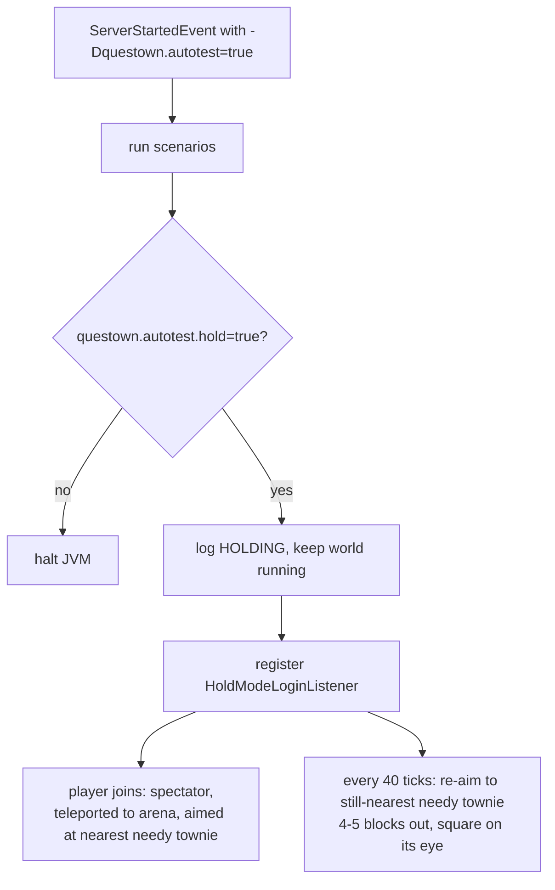

# commands/test — hold mode (visual inspection after a suite)

Choosing *which* scenario proves *which* behavior (realtime vs warped, what each
staffs, the three "warp" meanings): see `AUTOTESTS.md` (same directory).

The autotest harness normally halts the JVM when the last scenario reports
(`/tmp/...log` shows `RESULT: N/N passed`). Hold mode keeps the world alive
afterwards so a dev client can join and *see* the end state — built for
headless screenshot verification (`grim`) of things a unit test cannot judge
(e.g. the need bubbles of ADR-0011).

## Flow

- **Skip the halt** — `AutoTestRunner.HOLD` branch near the end of the tick
  listener. The world keeps ticking; `session.lock` still applies, so kill the
  old held server before launching another `runServer`.
- **Interface** — the `-Pautojoin` Gradle property makes `runClient` connect
  straight to `localhost:25565` (`--server/--port` args), bypassing the title
  screen — no mouse/keyboard needed on the client, which matters because
  dev-box input injection (wtype) does not reach the GLFW window.
- **Aim matters as much as position** — the bubble focus contest is an angular
  cone (dot >= 0.9), so the tracker recomputes yaw/pitch from the villager's
  live position. A fixed yaw goes stale the moment the roster wanders.
- **Hysteresis of scenario state** — need bubbles can clear themselves as the
  world keeps living past the assertions (e.g. a villager eventually finding
  viable work). Verify soon after HOLD, don't sit on the held world for hours.
- Fake players (`[AutoTest]`) are excluded from both the login teleport and the
  per-tick re-aim via the bracketed-name check.
- **A `FakePlayer` cannot be teleported on NeoForge.** `teleportTo` / `/tp @s`
  route through the pending-teleport path (`connection.teleport(...)`), and
  `FakePlayer.tick()` is empty, so the pending teleport never applies — the
  command reports success and the fake player never moves. Scripted player
  moves in the chicken-arc F-scenarios use `setPos` directly
  (`ChickenArcScriptedAction.MovePlayer`, added 2026-10-11 after `/tp @s`
  no-oped twice in a fixture).
- **Aim preference order** — a scenario may post its own target via the System
  property `questown.autotest.aim.door` ("x,y,z" offset from the arena origin,
  set in a postSpawnAction). When present it wins over needy townies; without
  it, a post-scenario needy townie will steal the aim and the thing the
  scenario asserted on (a dead door, say) may never reach the screen. Used by
  `flag/dead_door_bubbled`.

## Launch discipline (hold mode)

- Env: `JAVA_HOME=$HOME/.gradle/jdks/jdk-17.0.20+8 LANG=C.UTF-8` — the wrong
  JDK breaks Gradle's Groovy compile; a POSIX locale fails javac with
  "unmappable character for encoding US-ASCII".
- Before relaunching: `pkill -f 'runClient'` then `pkill -f 'questown[.]autotest'`
  (the server wrapper *and* the server JVM both carry `-Dquestown.autotest`, so
  one pattern takes both). Do **not** use the old `[G]radlew runClient` /
  `[G]radlew runServer` form: a held process's argv is `GradleWrapperMain
  runClient/runServer …`, not `gradlew …`, so it matches nothing and silently
  no-ops — the client JVM (a child, `… --launchTarget forgeclientuserdev …`) is
  not killed by the wrapper dying and lingers, so catch it by
  `pgrep -af 'forgeclientuserdev'` or pid. Keep the bracket in `questown[.]autotest`
  so the pattern does not self-match your own bash argv. A **held**
  server (one launched with `-Dquestown.autotest.hold=true`) **catches SIGTERM
  and survives `pkill`** — after `pkill`, re-check with
  `pgrep -af 'questown[.]autotest'` and `kill -9 <pid>` the server JVM if it
  is still up. Then
  `rm -rf run/world` and confirm port 25565 is free (a surviving held server
  kills the new one with "Address already in use", and holds `session.lock`).
  Note: any `runServer` launch with `-Dquestown.autotest=true` now wipes
  `run/world` itself before boot (gradle `doFirst`), so the manual wipe is
  only needed when relaunching a *non-autotest* server over a locked world.
- Order: server → wait for "HOLDING: server left running" → client
  (`runClient -Pautojoin`). Never join mid-run. Background the launch in the bash
  tool with a bare `nohup ... &` + only an `echo` (a `sleep`/`tail`/`disown` in the
  same call kills the process — see the global `~/.pi/agent/AGENTS.md` "This machine"
  note); the "wait for HOLDING" is a separate check call, not a foreground loop.
- Before using a Minecraft API in hold-mode/test code, grep an existing call
  site — 1.19.2 lacks several 1.20+ methods (`ServerChunkCache.getLoadedChunks`,
  `Level.getBlockEntities`). Scanning `level.getChunk(cx, cz).getBlockEntities()`
  over the arena works.

## Before/after repro (a scenario that bites only the fix)

To confirm a fix, run the *same* scenario twice: once with the working-tree fix (after), once without (before). A scenario only proves the fix if the two runs **differ**. Identical runs (both `throughFloor=false`, both min-Y the same) mean the layout does not exercise the mechanism, not that the fix is wrong — and that is the usual reason a repro "does not bite." A verified "the scenario did not bite" is not a verified "the bug cannot happen": the gap is usually the vehicle, not the phenomenon.

Two vehicle traps, seen this cycle:
- A job that **warps** its deliver (e.g. `organizer/fetch`) never walks its nav target, so a fetch scenario cannot confirm a `navTargetForContainer` fix. A **gatherer** walks (gate ↔ supply chests) and is the vehicle; but leavers are warp-only in the autotest, so that repro is a live / held-realtime, not a held-autotest scenario.
- A chest placed **off the room's scan level** (below it) is never registered as a container, so the job falls to `NO_SUPPLIES` and never navigates. Contained blocks are `yCoord` and `yCoord+1` only; a chest at `yCoord-1` is invisible to every job.

The before-fix run reverts the fixed file(s) to HEAD while keeping the scenario change, then restores — see "A before/after held run must not clobber the uncommitted fix" in `~/.pi/agent/references/questown-dev-launch.md` for the restore method (saved patch or stash, **never** `git checkout`).

The layout that finally bit (`nav/roof_gatherer`, 2026-09): chest at `yCoord+1` (registered) on a plank, its interact spot filled by a head-height grass ledge with a one-block roof hole above it, and a three-step staircase up to the roof. Pre-fix the target (the interact spot at chest height) has no standable interior node, and the ledge top is the only Manhattan-1 node, so the best-effort path goes over the roof and the townie stands on the grass above the chest. Post-fix the pinned target (scan level) has standable interior floor neighbours, so the path goes through the door. A raised chest alone (intact interior floor) never bites: the interior floor spot is always Manhattan-1 from the chest-height target, which beats the roof (Manhattan-2).

Two door traps hit while building it: townies cannot open wooden doors (no `InteractWithDoor` brain task; `useNearbyGates` opens fence gates only), so a closed door stalls the walk at the threshold; and an open door still leaves about 0.2 blocks of clearance beside its swung-open panel, which wedged the townie when the doorway sat on the walk line (the unstick ladder's pushes knock it into the panel). Put the door where the approach never clips the panel: the scenario uses a west-wall door facing EAST, open, hinge-left, with the welcome mat right outside.

Before/after evidence lives in the scenario's RESULT line (`[nav/roof_gatherer] RESULT: roofVisited=…, roomEntered=…`) plus the per-position tracker lines: before = `roofVisited=true, roomEntered=false` (stairs, roof, drop onto the ledge), after = `roofVisited=false, roomEntered=true` (west door, interior floor).

## Why a room-detection *gate* lives in `CrawlPerfTest`, not the perf autotest

A perf autotest scenario cannot gate the wall-walk crawl. The crawl runs inside
the flag-tick, and the flag-tick holds the single server thread. A shape that
makes the crawl O(n²) (a comb, ~12000 visited positions) stalls that thread — a
400×400 comb measured a 5641 ms / 112-tick-behind `Can't keep up` on the *fixed*
(HashSet) code — and the autotest fails on the global `TestExecutor` timeout
(`maxWaitTicks = 100 × villagerCount`, 20 townies = 2000 ticks: "Villager spawn
timed out"), *before* the scenario's own assertion runs. So the scenario fails on
correct code, not on a regression: the gate cannot bite without also failing.
The cost is real regardless of HashSet-vs-ArrayList, so an autotest budget on
this shape is structurally unsound. Keep the gate as the synchronous unit test
`CrawlPerfTest` (RoomRecipes — it drives the crawl directly, asserts `ms < 1000`,
and bites); the perf autotest's `plus_room` stays a measurement (always passes,
reports the `TickProfile`), never a gate.

## Post-spawn room fixtures live outside the arena flatten (seed hazard, 2026-10-15)

The flag-category room scenarios (`too_short_room_dead`,
`floating_chest_room`, `floating_furniture_over_half`,
`filled_storeroom_alive`) build their rooms in `withPostSpawnAction`, not in
`blueprint.blocks()`. The jobs-track arena flatten clears only
`TestArenaPreparer.buildVolume` (the blueprint's block bounding box ∪ the 15×15
base square), so those footprints keep their un-flattened random-seed terrain
(`level-seed=` empty, world wiped every boot). The walkability filter then
reads that terrain: a solid interior foot level gives `floorCells=0` and the
day-1 storeroom escape hatch accepts the room — which flipped the REJECTION
scenario `flag/floating_furniture_over_half` by seed (new [FAIL] in the
2026-10-15 full suite; the morning's "instrumented vs un-instrumented" 2/2 vs
2/2 split was two different world seeds, not a build effect). Both
rejection-asserting builders now clear their footprint (feet + head levels)
to air before building. Rule and the accept-vs-reject fragility asymmetry:
`AUTOTESTS.md` "Post-spawn rooms live outside the arena flatten". Ticket:
`.scratch/floaty-room-2026-10-15/floating-furniture-over-half.md`.

## Driving the daily cycle and roster growth in a scenario

Two things a scenario often wants to force — the night-to-morning transition and
the villager roster growing — run off mechanisms that are easy to misread.

**Morning rewards fire from the day-time signal, not from campfire-sleep.**
`AbstractTownFlagTicker` calls `Signals.fromDayTime(getDayTime())` every tick;
when the signal flips to `Signals.MORNING`, `detectMorning` pushes a morning and
`onMorning` -> `morningTick` -> `handleMorning` runs the morning-reward queue
(`SpawnVisitorReward`, quest-completion rewards, etc.). `Signals.fromDayTime` is
pure: `dayTime % 24000 < 6000` is `MORNING`, `> 22000` is `NIGHT`. So
`time set night` then `time set day` flips the signal and fires the morning
rewards — **no campfire-sleep and no fake-player vanilla-sleep is required**. The
campfire-sleep `SleepFinishedTimeEvent` is *one* other trigger of `morningTick`,
not the only one; do not conclude that `morningTick` needs it. A fake
`[AutoTest]` player cannot vanilla-sleep, but `time set` still drives the cycle.

**The roster grows from quest-completion rewards, and the first villager needs
the tutorial batch.** Roster changes come from `SpawnVisitorReward`, queued by
quest-completion rewards (`MCRewardList` claimed via the asap-rewards queue). The
first villager is the `PHASE_KICKOFF` tutorial batch (`TownFlagTutorialAdapter`),
which only completes when *all* its quests complete: `special_quest.campfire`,
an item quest (e.g. `minecraft:wooden_sword`), `questown:store_room` (a chest
registered as a store room), `questown:job_board` (a job board block placed in a
registered room), and `special_quest.town_gate` (a welcome mat). A scenario that
registers doors and a campfire but never places a job board or a town-gate
welcome mat leaves that batch open, so **no villager ever spawns** — the roster
stays 0, not 1. Place every tutorial quest's object before expecting a roster.

**Room-recipe quests complete on *re-detection*, not the initial door scan.** A
registered door's room recipe is first computed when the door is detected, and
`recipe_created` broadcasts at that moment — but the tutorial-batch room quests
(`store_room`, `job_board`, `town_gate`) often do **not** complete on that first
pass (the quest is not yet in the active batch, or the room's top match differs
at first detection). They complete when the room is **re-detected** — a fresh
`roomRecipeCreated` from re-wand-clicking the door, or from placing the quest's
block in the room (pressure plate for `town_gate`, job board block for
`job_board`, chest for `store_room`). The completion fires on the *re-creation*,
not on a block toggle: a chest broken and re-added does not re-trigger
re-detection by itself (`TownRoomsMap.tick` only runs `MultiLevelRoomDetector`
while `pendingRooms != null`). So to drive the tutorial batch to completion,
re-wand-click each door (or place the quest's block in its room) — do not expect
the initial detection to close the quests, and do not read a `recipe_created`
broadcast as proof the quest completed (check the `done=` list, not the
broadcast). The `onboarding` flag on these quests is **dead** (set in
`TownQuests`, read only for NBT in `MCQuest`) — superset completion was never
wired; completion is exact-match on the top match, and only re-detection makes it
fire. Verified run: `store_room`/`job_board`/`town_gate` all stayed open after
initial detection, completed on re-detection/re-placement, and the roster then
went 1→2 via `SpawnVisitorReward`. Note: `TownQuests.tick` also runs
`backfillSatisfiedQuests` every tick — open ROOM quests are re-evaluated against
`getRoomsMatching(wantedId)`, which consults *every* recipe in the room's match
(`getRecipeIDs()`), not just the top one. So a quest posted after its room
already matches (or whose top match is a *different* recipe in the same room)
completes within one tick of the backfill, not only on re-detection.

**A quest block must sit in an INTERIOR cell of the room space; wall cells are
invisible to recipe matching.** Recipe matching only sees blocks in the room's
space at `y ∈ [yCoord, yCoord+1]` (wall cells excluded — Questown calls
`RecipeDetection.getBlocksInRoom` with `includeWallBlocks=false`, and the
matcher's block scan is the space box itself). A block embedded in a wall
therefore never becomes a contained block, the room never matches that recipe,
and the quest stalls forever (the backfill's `getRoomsMatching` is empty for
it). The fixture that bit this: `VillageGrowthExecutor.placeJobBoard` placed
the pedestal at `chestOffsets.get(0).west()` — the chest sits at the room's
interior west-north corner, so `.west()` is the building's west **wall** column
(and `useItemOn` on its UP face embeds the board in the wall at `y+1`). The
room then matched `store_room` (chest, interior) but not `job_board`, and the
basics batch never closed. Fixed 2026-10-10 by placing the pedestal at
`.east()` (the interior cell next to the chest); the board lands at the
interior cell's `y+1`, still inside the match's `y` range. When a room quest
sits open with the quest block visibly in the world, check the block's cell
against the room's space first — a `setBlockAndUpdate` on a wall cell both
breaks the room *and* hides the block from the matcher.

**Job tools are taken out of the *registered containers* — a tool-hungry job
eats deposited quest items.** A job whose `work_states[0].tools` names a tag
(e.g. `hunter/sword`'s `#questown:swords`) makes its townie's supply logic
(`tryGetSupplies`, logged as `[PROBE:supplies] ... TOOK item=... (totalTakes=N)`
at WARN) pull an item from the town's registered chests on **every work cycle**
— and the sword is held/consumed per cycle, not once. `processItemQuests`
counts ITEM quests against *container stacks only* (items a townie already
holds are invisible), so a hunter cycling a work state will repeatedly swallow
the 4 `wooden_sword` an ITEM quest is waiting for, and the quest never closes
(2026-10-10 held run: 12 deposited over the run, 0–2 in the chest at any
moment, `totalTakes=222`). Two further traps compound it: (a) the village's
looting townies fill the 27-slot chests with biome loot within hours of game
time, so late deposits *silently fail* on a full container — the deposited
items vanish without any log; (b) `processItemQuests` runs every flag tick
while an ITEM quest is open (via `backfillSatisfiedQuests`), so a quest closes
on the tick the 4th sword lands *if it lands* — the race is against the
townie's supply walk, not against the flag tick. Agent-driven drives: empty
the target chest first (`data modify block <x> <y> <z> Items set value []`),
then deposit the quest count in one shot.

**Room walls must be solid at *feet and head*; the bedroom recipe wants two
beds.** `WallDetection.IsWall(level, pos, y)` is read at the door's own `y`
*and* the cell above it — a one-block-tall wall row is not a wall, and the
room detector reports `NOT_ENCLOSED` (the `look_room` probe prints `#` only
for feet-and-head solid cells; a bare block in a wall position prints as its
letter, not `#`). `build_room` lays two-tall shells, but hand-laid boxes must
`setblock` both `y` and `y+1` around the perimeter. The `questown:bedroom`
recipe is `#minecraft:beds` ×2 + `#questown:light_sources` ×1 — one bed does
not match (`2026-10-10` held run: the `NO_RECIPE` on a one-bed room sent the
drive looking for a detector bug that did not exist).

**The scenario's tick budget is in *ticks*, not minutes.** `MAX_TICKS =
24000 × 10` (10 in-game days). At the autotest default 200 t/s (auto-applied
on boot since 2026-10-15 - see AUTOTESTS.md "TPS") that is 1200 s ≈ 20 real
minutes; at a default 20 TPS it is 10 h. A held agent-driven run that spends
its days on chicken-arc debugging times out at roster 2 — the executor prints
`FAIL timed out after 240000 ticks` and leaves the world alive (hold mode
keeps the server up), so the world still works after the verdict but the run
is already recorded FAIL. Verify the flow, then re-run clean rather than
hand-driving a dead scenario past its target.

**A sign in a registered room converts to a job board, but only when the
`job_board` recipe enters the match.** The sign→job-board conversion
(`TownWorldInteraction.swapJobBoardSign`) is wired into the flag's recipe
`created` **and** `changed` events (`TownFlagBlockEntity`), not into the
quest-completion path. A sign completes the `job_board` **quest** whenever the
room matches the recipe (the quest is exact-match on the top match); the
conversion is a separate side effect that must fire on the event that carries
the sign into the match. The two can diverge: in a room whose top match is
another recipe (a chest's `store_room`), adding a sign makes the room match
*both* recipes, but the top match stays `store_room`, so the event is a
`roomRecipeChanged` (not `created`). Conversion used to run only on
`roomRecipeCreated`, so in that case the quest completed but the sign stayed an
`oak_sign` (the work handle's `hasAtLeastOneBoard()` stayed false, and the
chicken's `WAITING_FOR_SIGN` beat never advanced). Running `swapBlocks` on
`roomRecipeChanged` too fixes it: `swapJobBoardSign` only swaps *sign* blocks,
so it is idempotent and does not touch an already-converted board. Verified run:
chest-in-room + sign now converts (the beat advances, the board registers).

Note (cosmetic signs): this converts *any* sign a player places in a
recipe-matching room, so a decorative sign in a store room becomes a job board.
This is why the job board is planned to become a `RoomBlock` itself (see
`.scratch/job-board-room-block/`); once it is a block placed by its own item, a
sign no longer needs to be swapped in, and this conversion path can be dropped.

**An `UNMET_ITEM` need re-sets every flag-tick; a deposit only clears it if the
job scores > 0.** `TownPossibleWork` raises `UNMET_ITEM` whenever a job scores 0
(`registerUnmetNeeds`) and clears it when a viable job exists
(`clearUnmetItemNeeds`). A job scores 0 when it lacks its **job block** at the
job-block location *or* its ingredients at a container near that location. So a
food deposit into a random registered container does not clear the need if the
job's own job block (e.g. `welcome_mat_block` for `gatherer/gather`) is absent, or
the food is not at a container the job's base room can see. Depositing the right
item is necessary, not sufficient — the job block must exist first. `resolveItem`
in a scenario must also handle tag needs (e.g. `#questown:villager_food`): use
`ca.bradj.questown.gui.Ingredients.representativeItemStack` (the same resolver the
need bubble uses), not a bare `ResourceLocation`/`ForgeRegistries.ITEMS` lookup,
which returns null for a tag.

### The post-batch quest pipeline (two bugs found 2026-10-11, held village/growth)

Driving the new day-1 flow (campfire → mat → flag-UI → sleep → sign) through
roster 3 in a held `village/growth` run verified the day-1 chain end-to-end
(mat-gated arrival, basics batch, hunter-gatherer batch, two dawn spawns)
but the pipeline that runs **after** the hunter-gatherer batch closes is
broken on this branch; two issues are filed in
`.scratch/mat-gated-arrival/`:

- **JOB_UNLOCK post/lose ping-pong** (`job-unlock-quest-spam.md`): a townie
  whose root is stuck in `UNMET_ITEM` with an *oscillating*
  `getUnmetItem()` (gatherer flipping villager_food ↔ fishing_rods between
  work states) made `TownQuests.tickUnmetUnlockQuests` post a JOB_UNLOCK
  for one producer root, lose it next tick when the missing item flips, and
  re-post the other — forever. The lost path
  (`markRecipeAsLostByKey` → `MCQuest.lost()`) re-typed the quest as an
  ACTIVE *room* quest, so the "lost" entry stayed in the handle and counted
  as open (the run's open list reached ~107×2 of them in two minutes), and
  being no longer JOB_UNLOCK-typed it defeated the producer dedupe. Each
  post fired a "New quests are available!" broadcast.
  **FIXED 2026-10-11** (per-root dedupe): one open JOB_UNLOCK per stuck
  root, the root encoded on the quest (`setUnlockStuckRoot` →
  `fromRecipeID`, NBT-persisted); when the root's missing item flips
  producer the quest is retargeted in place (`MCQuest.retargetUnlock`), and
  when its root stops mapping to a viable producer it is withdrawn outright
  (`QuestBatch.withdrawQuest`, empty batch declined from the handle) — no
  placeholder. The decision is the pure `TownQuests.reconcileUnlockQuests`
  (pinned by `TownQuestsJobUnlockTest`); see `town/entity/COMPLEX.md`
  "Stuck townie -> JOB_UNLOCK quest". Not yet verified in a held run:
  the `village/growth` re-run to roster ≥ 5 is still pending.
- **Day-1 quests re-appear as open after the hunter-gatherer batch closes**
  (`day1-quests-reopen-after-batch.md`): **CLOSED 2026-10-11 as a
  misdiagnosis of the bug-1 spam — no separate defect.** A full-log scan of
  every KNOWN `open=`/`done=` dump in `run/autotest-village.log` (62
  distinct states, 01:47→02:08) shows each day-1/hunter-gatherer quest
  open ×1 pre-completion and done ×1 afterwards; the 217-entry open wall
  at 01:59:55 was 107×2 JOB_UNLOCK phantoms + the legitimate phase-2.5
  kitchen trio, and `Basics batch posted` occurs exactly once (01:51:04),
  so the reward-re-claim candidate never fired. See the issue's verdict.

Bug 1 is fixed (above) but unverified live; bug 2 is closed as a
misdiagnosis of bug 1. What actually blocked the run at roster 3: after
the hunter-gatherer batch closed, the stuck gatherer (`UNMET_ITEM`:
villager_food/fishing_rods/axes, no producer root unlocked) needed the
**JOB_UNLOCK driver beat** — spend a Block of Progress on the change-job
tab (agent-side `_qtdev change_job <villager>`) to unlock a producer
root, or supply the missing items. The 214-phantom handle buried the one
clean unlock quest, the agent never made the beat, the phase-2.5 kitchen
batch (posted 01:58:06) never closed, SpawnVisitor never fired again, and
the 240000-tick watch timed out at roster 3 (`FAIL
reached-5-villagers`). Re-run: drive that beat; the bug-1 fix keeps the
handle bounded so the quest stays visible.

## The `village/self_sufficiency` watchtower seed

**Stall diagnostic (DEV-DIAG, grep `stall score-dump`).** The watch loop's
heartbeat (`ticks % 400`) also runs a one-shot latch:
when 2+ townies sit in `seeking_work` for 3+ consecutive beats (~60s real),
it dumps `TownPossibleWork.scoreDump(root)` per stalled root (per-job
scores, gate-failure reasons, board requests) to the server log and never
fires again. Added because three fresh seeds (runs 10–12) sat in that
stall with no `hunter/sword` transition while comparable worlds (3b, 13)
hunted within ~90s, and the hold-mode server reads neither the console nor
the FIFO (`runServer` drops the task's `standardInput`; server `fd 0` is
`/dev/null`), so the only log-reachable window into the work-seeker's
scoring is the executor's own. Read-only except the latch state; healthy
worlds never trigger it (run 13). See `.scratch/gannet-top-need/top-need-measure.md`

A self-driving realtime scenario that plays a just-past-onboarding town forward
and surfaces soft-locks (a watchtower, not a pass/fail gate). It differs from
`village/growth` in two load-bearing ways:

**Runs realtime, not warped.** `village/growth` warps with `time set` and structurally
cannot exercise leaver/timed-work behavior (which only ticks in realtime). The
watchtower must run realtime for the same reason — a warp skips exactly the
behavior it is meant to watch.

**The purpose is to measure food-locks, not to help the town win.** The town is
supposed to be completely run by its villagers; the watchtower measures how often
it food-locks (villagers stuck `UNMET_ITEM(#questown:villager_food)` with no cook
producing) under natural progression. The seed spawns three villagers — roster 3 is
the threshold for the reworked onboarding tutorial phase 2.5
(`PHASE_JOB_CHANGE_FOOD`), which opens at this roster: the batch is the
cook's JOB_CHANGE, the `kitchen_small` room quest, and 8x `villager_food`
(so the cook now arrives through the reworked tutorial phase rather than a
random job-change quest). The kitchen ROOM quest is load-bearing: every
`cook/*` job requires room `kitchen_small` (see
`cook_simple_furnace_food.json`), so without it the staffed cook has no
selectable work and the batch can never complete; with it, the room-builder
builds the kitchen and the cook works under real ticks.
Roster 2 (the old seed) plateaued just below the threshold, so the phase never
opened. The agent/seed provides only what a player would: the room quests (the
room-builder) and the player-supplied sword quests (the real-player deposit path).
Food is the town's own jobs, never something the seed tops up on demand — a seed
that feeds the town on a timer hides the very lock the test exists to find. The
seed is a one-time bootstrap (opening food block + sword unblock + the initial job
changes, 2 of the 3 villagers assigned hunter/gatherer; the third unassigned so
phase 2.5 can staff it as cook), not a supply.

**Verified 2026-10-01 (one held realtime run, roster-3 seed).** The 2.5
batch opened with the `kitchen_small` ROOM quest; the room-builder built the
kitchen unaided; the cook was staffed and cycled `cook/extract` (the
smelt-warp work) and was the named producer of the cooked output — the
fix's signature (staff → kitchen built → cook works) held under real
ticks. The run then surfaced a storage soft-lock instead of completing the
batch: the cook's JOB_CHANGE and the 8x `villager_food` LOOT could not
close because every townie hit `NO_SPACE` ("every town chest is full") —
the seed's single store room plus the 144-block opening food block
saturate before the 2.5→3 gate (needs 2 JOB_CHANGE completions) opens the
phases that add more storage. The lock is a seed/progression capacity
question, distinct from the kitchen fix (the kitchen adds zero storage),
and is open as of that run.

**The seed is gated on the flag ticking, which needs a player.** `SpawnVisitorReward`
claims and the room scan both run on flag ticks; the flag ticks only with a player
nearby. In a held run the `runClient` observer may join late, so the seed phases
(`WAIT_FOR_ROOMS`, `WAIT_FOR_VILLAGERS`) poll for the roster/rooms rather than racing
ahead on a timer — a fixed timeout lets the seed race ahead with 0 villagers and rooms
undetected, then furnish outside a registered room where the jobs cannot see it.

**A chest counts only inside a *registered* room.** A job draws supplies from a
container that is a contained block of a registered room in `flag.getRoomHandle()
.getMatches(...)`; a chest outside a registered room is invisible to every job.
The seed therefore builds the store room as a closed rectangular shell (the wall
walk closes it cleanly; `flag.buildRoom`'s chicken shell leaks at this footprint,
leaving the room `NOT_ENCLOSED`) and registers its door, so the interior chest is a
registered container.

**A job with no work request has no work.** Work requests are *not* quests. They come
from the job board: a player posting a request, or a `ChangeJobReward` posting the
job's output item when a job-change quest completes. The seed assigns jobs via
`ChangeJobReward` *and* posts the work requests directly (`flag.getWorkHandle()
.requestWork` for each job's `initial_request` — mutton for the hunter, wheat seeds
for the gatherer), because without a posted request the job has nothing to produce
and its villager sits in `downtime`/`NO_JOBSITE` forever.

**A job change must also *unlock* the new root's works.** A townie's specific
works are unlocked once, at registration (`TownVillagerHandle.register` walks the
job's `defaultWork` and calls `learning.unlockJob` for each). The work-seeker and
`TownPossibleWork.registerUnmetNeeds` both call `getRandomWork(root, vh::isUnlocked)`,
and `isUnlocked` is an *exact* `JobID` match over the per-villager unlocked set (a
root meta-ID like the work-seeker's own ID never matches a specific work). So if a
`ChangeJobReward` changes a townie's root *after* registration, the new root's works
stay locked, `getRandomWork` returns an empty set, and the villager logs `No jobs
found for root ID` and soft-locks in `seeking_work` with a `NO_JOBSITE` status.
The fix lives on the owner, not the scenario: `ChangeJobReward`'s applier now unlocks
each of the new root's `defaultWork` (mirroring `register`), so any consumer of the
reward gets a townie that can actually work. (Unlocking the root meta-ID does not
help — `isUnlocked` never matches it.)

**Unlocking the works is not enough if the town can't reach the supplies.** With the
works unlocked, a fresh seed still soft-locked, but on the *second* half of the lock:
`status: NO_WORK_POSSIBLE` with `UNMET_ITEM`. The hunter needed a *sword* (its job
tool) and the gatherer needed *food* — items the seed does place in the store room's
chest — but the work-seeker looks for them in the job's base room (the
`special_quest.town_gate` meta room the jobs anchor to), not the separate store room.
That is the `NO_JOBSITE` vs `NO_SUPPLIES` distinction: `NO_JOBSITE` is a missing
*job site* (fixed by the unlock above); `NO_WORK_POSSIBLE` from `UNMET_ITEM` is a
missing *supply* at a container the job's base room can see.
**The sword quest opens only after the first villager, and closing is action-gated.**
A wooden/stone sword sitting in the store chest does not close the sword item quest:
the quest opens once the first villager arrives, and it completes only when the
sword is deposited *after* it is open (the real-player path, the same action a
player dropping the sword in the chest takes). Seeding the sword at furnish time
(before the quest opens) is ineffective, and a one-shot "complete the sword quest"
call there finds no open quest to close. The watch loop therefore re-checks every
cycle and satisfies the currently-open sword quest the real-player path (the
`complete_sword_quest` command's underlying method) once roster >= 1, which covers
the wooden sword and the later stone sword as each opens.

**An index into `interiorCells()` is not a stable position.** `flag.interiorCells()`
is recomputed on every call over all registered rooms' air cells, so an index
captured by one call can resolve to a different (air) cell on the next. The seed's
store chest originally landed one cell off its recorded position (run: chest at
-11,64,-11, recorded index pos -11,64,-10), so a raw `getBlockEntity(pos).setItem(...)`
write at the recorded pos was a silent no-op (the chest never filled) and the flow
tracker on that pos read an air cell (the daily report's `stock=0` was partly this
measurement bug, not just an empty chest). The fix: `placeBlockInInterior` now
returns the real cell it placed, and the seed captures that position in the same
call (board + chest), then seeds + flow-tracks it at watch start.

**The chest fill must not happen during furnish.** The flag's first tick restores
chest contents from its captured NBT state, which flushes a chest filled before the
flag is live. The seed therefore places the chest at furnish and writes the opening
food block at watch start, once, against the captured position (latched; if the
block entity is not a container yet the next cycle retries).

**Container flow is a polling diff against a seeded baseline, not an event.** A vanilla `Container`
exposes no change callback, so the watchtower's flow counter
(`ContainerFlowCounter` + `ContainerFlowTracker`) does not hook an
insert/remove seam. When the scenario starts tracking a container it first
snapshots whatever is already in it and records that as the seed baseline:
the first poll's diff (against an empty `previous`) is the seed being captured,
not real production — the counter's `totalProduced` subtracts the seed so a
starting inventory is not counted as flow (consumed is not capped by it; the
seed only blocks the catch-up insert). The tracker then snapshots each tracked
container's per-item totals on the daily-report cadence and diffs against the
last: a slot gain is `recordInsert`, a loss is `recordExtract`. The diff is *net
per slot*, so a two-item swap nets to zero and is not counted as a flow. The
tracker writes nothing to the world; it is pure read.

**The daily report shows per-day windows, not cumulative-since-town-start.** The
flow counter's `totalProduced`/`totalConsumed` are cumulative-since-tracked, so
the report stores the last-seen cumulative per report and reports the delta as
the day's production/consumption. The day-1 report (at watch start) is a
point-in-time baseline: zero windows for all four categories, non-zero only for
`stock` (the starting inventory). `stock` is always a point-in-time read with a
day-over-day delta against the previous report's `stock`.

**The flow counter is a standalone class, not an extension of `NoMCEconomics`.**
`NoMCEconomics` is a *demand/unmet-needs* tracker (it records what the town
wants, not what it moves). Growing it with production/consumption would conflate
two different questions and bloat a class that already feeds the UI's needs
screen. The flow counter is a new, self-contained class with its own
unit-testable core (`ContainerFlowCounter` is pure, no Minecraft imports) and a
thin Minecraft-facing tracker on top.

**Demand in the report is a windowed count, not the cumulative UI aggregate.**
`NoMCEconomics.getAggregatedItems(null)` returns the cumulative `aggregatedAll`,
which is *not a per-day number* and, because it is derived from the
`EvictingQueue`, is *pinned at the queue depth* (in a 5-day held run the report
read `demand=100` every day). The daily report instead uses
`NoMCEconomics.getUnmetNeedsWindowTotal()`, a bounded window over a
monotonically-increasing `unmetNeedsCumulative` counter (kept separate because
the queue itself evicts and does not grow monotonically). The counter's
`WindowTotal` is a small pure helper (unit-testable in `WindowTotalTest`);
each call to `getUnmetNeedsWindowTotal` returns the unmet needs registered since
the last call and advances the baseline — so the report uses it directly, with
the day-1 baseline consuming the pre-watch window (reported as zero).

**The room-builder builds on recipe id, not batch UUID.** A `MCQuestBatch`
carries several room quests (the kickoff batch holds `job_board`, `store_room`,
and `town_gate` under one batch UUID), so the builder dedups by recipe id, never
by batch UUID. A ROOM quest with a null batchUUID is a single-recipe room (the
campfire, the bedroom, the farm) that stands on its own; the builder builds it
on its recipe id alone. A batchUUID guard on the build path over-filtered these
single-recipe rooms (the builder skipped them), so the guard is not on the build
path; it is only on the dedup key.

**The room-builder places every recipe ingredient, and latches on quest
completion, not at build.** A room recipe can carry several ingredients (bedroom
= a light source + 2 beds; big_bedroom = a light + 4 beds). The room matcher is a
superset test (`NoMCRomRecipe.foundMatchRecipe`: the room's block multiset must
contain the recipe's) and completion funnels through the room's top match (see
`.scratch/storeroom-quest-completion/`). The builder therefore resolves *every*
ingredient of the recipe to a placeable block (`resolveRecipeBlocks`, one entry
per ingredient slot) and `buildRoomForRecipe` places each in its own interior
cell (the center, then the spaced cells). A shell carrying only the first
ingredient — the light, no beds — never contains the recipe, so the quest never
closed; that was the bedroom bug. The builder also latches the recipe as
completed on *quest completion*, not at build time: after building it adds the
recipe to `builtRoomsAwaiting` and skips it (the "waiting for re-detection" line)
until the sweep at the top of `driveRoomBuilder` sees the quest is COMPLETE and
moves the recipe to `completedRoomRecipes`. This mirrors the town_gate
welcome-mat path; latching at build time would skip the quest before re-detection
could close it.

**The watch loop drives open JOB_CHANGE quests, not just room quests.** The
room-builder closes room quests; a parallel driver (`driveJobChange`, on the same
200-tick cadence) closes the `JOB_CHANGE` quests the follow-up tutorial batches
open (the `hunter/sword` batch, then the food-job batch that unlocks cook/farmer). 
Each cycle it enumerates the flag's ACTIVE `JOB_CHANGE` quests and, for the first
not-yet-driven one, converts a townie into the wanted job via `ChangeJobReward`
(the seed's own bootstrap path: sets the root, unlocks the root's default works,
posts the work request) so `TownQuests.processJobChanges` adopts the townie and
closes the quest. It does not use the player's BOP path
(`spendBopToRequestJobChange`): a plain BOP resolves to a random root and cannot be
aimed at the quest's wanted job. The pick prefers a townie outside the hunter root
when one exists, so the conversion does not strip the raw-food survival chain and
confound the cook/farmer milestone the watch exists to measure. `jobChangeDriven`
guards by the wanted job (not the villager) and is pruned to the still-active
job-change quests each cycle, so a closed quest releases its entry and a later
identical quest can be driven again.

**The welcome mat is the town gate, not room furniture.** The `town_gate` quest's
recipe is the welcome mat, a standalone job block placed beside the flag and
registered (`flag.placeWelcomeMat`, which calls `registerWelcomeMat` ->
`roomsHandle.registerBlockAsRoom(SpecialQuests.TOWN_GATE, pos)`), not a block
inside a room shell. Placing it in a room via `buildRoomForRecipe` lays a mat in
room furniture where it does nothing. The builder places the mat the moment the
town_gate quest is open: the quest completes on re-detection whenever a mat is
registered, with no night-cycle requirement (verified day-1, before any night).
The one real hazard is a mat laid before the quest is open, which the quest never
picks up — that is why the seed does not pre-place one. (An earlier
`firstNightPassed` gate on the placement gated on nothing the quest required;
it only delayed the mat until after the first night.)

**The watch loop sleeps through nights.** A realtime 5-day watch spends ~10 real
minutes per game day waiting for the night to pass. The watch loop detects
`level.isNight()` and skips to morning via `time set day` (the growth executor's
pattern: the day-time signal flip drives the flag's morning detection, no
fake-player vanilla sleep required). `firstNightPassed` is set on the first
sleep, which is the gate the welcome-mat placement waits on.

**Lock detectors run every tick during the watch phase.** The `checkLockDetectors()`
method implements five tripwires plus a forward-progress net, all log-and-dump
(never kill the run):

- **NO_JOBSITE / NO_SUPPLIES / NO_WORK_POSSIBLE** — per-villager production status
  tracked in `lockStatusTicks`; fires once at 2000 ticks (~100 s) with a
  `dumpLockContext` (job, need, unmet item, quest summary).
- **UNMET_ITEM** — per-villager `TownieNeed.UNMET_ITEM` tracked in
  `unmetItemTicks`; fires once at 2000 ticks with the missing item name.
- **ROOM_QUEST_OPEN_TOO_LONG** — each ACTIVE ROOM quest's first-seen tick is
  stored in `roomQuestOpenSince`; fires once at 120 000 ticks (~5 game days).
- **LEAVER_NEVER_RETURNING / LOW_ROSTER** — peak roster is tracked; a drop
  below peak (and separately below 50 % of peak) is timed from
  `rosterDropSinceTick` / `lowRosterTicks` and fires at 120 000 ticks.
- **NO_FORWARD_PROGRESS** — `advanceProgressNet()` is called from
  `emitDailyReport()` after each day's snapshot is written. It compares the
  new `lastSnapshot` against `prevDaySnapshot` on (roster, questsOpen,
  questsDone, stockTotal); unchanged days increment `noProgressDays`, any
  change resets it to 0. The detector fires once at 2 consecutive unchanged
  days. The daily report's "locks fired" line calls `activeLockSummary()` to
  list currently-tripped detectors compactly.

**Run-end milestone marker.** `trackMilestones()` runs every watch tick after
the daily report. It latches two booleans the first time a roster townie holds
a `cook` job (`cookUnlocked` — the food chain now produces cooked food, the
improvement target from the kestrel design) or a `farmer` job
(`farmerUnlocked`). The first sighting of each is logged as a `MILESTONE` line
with the current watch day. The daily report's milestone line and the
run-end `WATCH complete` block both surface the latched state, so the
improvement target is visible in both the per-day diff and the final summary.

## The fullness check scopes to the assigned townies (2026-10-15)

`checkFullnessIfNeeded` no longer asserts on every townie in the flag's
`getVillagerJobs()`. The scenario's `assignJob()` phase snapshots
`assignmentTownies` (the handle contents at that moment), and the check
asserts on `current ∩ assignmentTownies` — the pure part is
`TestExecutor.scenarioTownieTargets(current, assignmentTownies)`, pinned
by `TestExecutorFullnessScopeTest`. Intersection (not subtraction) is the
load-bearing choice: the snapshot contains the scenario's *own* townies
(a subtraction would have excluded them); strays register into the handle
*after* the assignment phase (the handle is already at the expected count
when the spawn wait passes — a spawn-time snapshot misses them), so they
fall out of the intersection. A townie present at assignment got the
scenario's job and was drained by it, so it is in scope. Respawn flows
re-run `assignJob()` (REASSIGN_JOB), refreshing the snapshot. Null
snapshot (no assignment snapshot taken for this flow) falls back to all
townies. Why it matters: strays carry their old job, whose post-extract
rules have no HUNGER_FILL, so they can never satisfy the assertion —
ticket `.scratch/autotest-suite/eating-pair-deterministic-fullness-fail.md`
(also carries the corrected forensics: the −12 %/−16 % lines are the
scenario's *own* diner, the 88 %/84 % lines the stray).

### village/growth drives the onboarding hunter job change (2026-10-17)

Since the 2026-10-17 arrival-gate rework (`town/entity/COMPLEX.md` "Second-villager
hold"), the second villager waits on the raw-food LOOT quest, which only a hunter
completes. `VillageGrowthExecutor.act()` therefore gained `spendBopOnOpenJobChange()`:
while a JOB_CHANGE quest is open and the flag holds a BOP, it calls the owner's
`TownFlagBlockEntity.spendBopToRequestJobChange` (the change-job-tab spend; the
onboarding guarantee routes it to `hunter/sword`). Verified 2026-10-17 (200 t/s):
roster 1 → BOP spend → hunter next morning → stone sword taken → Raw Mutton
completes the LOOT quest → roster 2 the following morning, with "Holding 1 queued
villager arrival(s)" on the two mornings before.

**Still short of 5:** the third villager is the hunter-gatherer batch reward, and
that batch includes a BEDROOM quest the driver cannot build (no bed placement);
the first-work-request quest is also never posted. A HEAD baseline (before the
rework) stalled earlier — at roster 2 with raw food, the hunter change and the
bedroom all open — so `village/growth` was not reaching 5 before this change either.
Ticket: `.scratch/playtest-2026-10-17/growth-driver-needs-bedroom.md`.

### village/day1 — the day-1 beats as checks (2026-10-17)

The playtests were re-walking day 1 by hand to re-check the same beats. `village/day1`
runs `VillageGrowthExecutor` in day1 mode (constructor flag; `AutoTestRunner` sets it when
`only` matches `village/day1`): the same real-player driver, plus `furnishNextRoomQuest`
(for an open ROOM quest not handled elsewhere, clear a spare building's chest and place
each recipe ingredient's block via item-use — bedroom, kitchen_small),
`postFirstWorkRequest` (the board's owner path `WorkHandle.requestWork`) and
`spendBopOnOpenJobChange` (spends on a villager `TownFlagBlockEntity.wantsJobChangeFrom`
marks — the change-profession red-dot rule — so the cook change goes to a gatherer, not
the hunter). `Day1BeatChecks` observes each tick and records the named checks (toast via
`TownFlagBlockEntity.hasShownCampReadyToast` for the fake player; arrivals against the
raw-food LOOT quest's completion at that moment; the FIRST_WORK_REQUEST quest's first
appearance against the roster; the first cook's job). It stops at the cook beat
(`day1-reached-cook-beat`) or at `MAX_TICKS` (FAIL). PASS = every check passed.

First run 2026-10-17: 28/28 in ~8 min. Not covered yet: a save/reload mid-run (the
arrival-gate restart bypass — needs a chunk unload/reload to replay the real load order),
the playtest's narrow store room (chest walk target; unit-pinned by `InteractionSpotsTest`),
and the GUI (red dot, fonts, click targets).

#### village/day1 reload step (2026-10-17)

Once, on the day after villager 1 arrives (raw food still open), the driver releases every
forced chunk (`level.getForcedChunks()`), sets `spawnChunkRadius` to 0
(`Compat.setSpawnChunkRadius` — the origin sits in the spawn chunks), moves the fake player
4000 blocks away, waits until `!level.isLoaded(flagPos)`, then returns and re-forces the
same chunks and waits for the flag and its villagers. Checks:
`reload-flag-chunk-unloaded`, `reload-villagers-restored`; `Day1BeatChecks` pauses arrival
counting meanwhile. **Trap:** `ServerPlayer.teleportTo` does nothing for a fake player
(NeoForge's `FakePlayerNetHandler` overrides `teleport` as a no-op) — move it with
`moveTo` + `ServerChunkCache.move(player)` or the chunks never unload. The flag BE survives
this reload (only the villager entities reload), so it is a chunk-reload test, not a full
server restart.

**Overnight absence (2026-10-17, missed-morning check).** Once the chunk is unloaded the driver
jumps the clock to the next day's noon (`skipToNextNoon`, past the 6000-tick morning window) and
stays away **6 s of wall time** (`ABSENCE_WALL_MS`) before returning. The wall wait is
load-bearing twice over: `TownFlagState` tells an absence from a sleep or `/time` jump by the
wall time since the flag's last tick (5 s), and at 200 t/s a 30-tick away phase is ~0.15 s — the
first version returned that fast and both the fixed and the pre-fix code failed the check the same
way ("still gatherer"). With the wait, the flag BE really unloads and re-initializes (the
"survives this reload" note above held only for the instant return). New check
`missed-morning-applies-job-change`: the villager the job-change BOP was spent on (day 2, "in the
morning") has left the gatherer root within 400 ticks of the return. Red-verified with
`runMissedMorning` removed (still gatherer after 401 ticks); green: hunter after ~20 ticks.

The real reload immediately exposed a second bug: `villager-2-only-after-raw-food` failed on both
the fixed and pre-fix runs — the quest load replay dropped the onboarding marker, opening the
arrival gate (`town/quests/COMPLEX.md` "Load replay keeps onboarding…"). One run also logged
`Giving up on detecting sub block at (-19,65,-15) … wrong entity type: null` plus `Job board
registration … no longer matches a board in the world; dropping stale entry` right after the
re-initialization (the board's chunk not loaded yet); seen once in four runs, not chased.

#### village/day1 log tripwire (2026-10-17)

day1-8 passed 31/31 while its log carried `Work block at (0,64,0) stuck in state 2 … reseeding to
fresh` (the flag eating spot: the diner stall the player then hit as the "carrot take/put loop"),
another reseed, and a `Clobbered time` ERROR. The beat checks only assert that each beat
*eventually* happens inside a 10-day budget, so a stall the 20000-tick `reseedStuckBlocks`
self-heal rescues is invisible to them.

`LogTripwire` (day1 mode only) attaches a log4j appender to the root logger at WARN for the run
and records, from Questown's own loggers only (`Questown*` / `ca.bradj.questown*`), every
self-heal reseed (message contains "reseeding to fresh") and every ERROR. `checkResults` adds two
checks — `no-stuck-work-spot-reseeds[n]` and `no-questown-errors[n]` — and prints the first 5 of
each. Classifier pinned by `LogTripwireTest`.

A third check, `no-back-to-back-quest-announcements[n]` (2026-10-17 round 6: "New quests are
available!" then, a second later, "New quest is available: post your first work request…"):
the appender listens at INFO and treats a `TownMessages` broadcast/queue line whose payload starts
`New quest` as a quest announcement; two inside `ANNOUNCEMENT_BURST_TICKS` (100 game ticks, the
broadcast spacing) fail. The window is game time (`attach(level::getGameTime)`), not "no message
in between": in the day1 driver an unrelated `quest_completed` line lands between the two in the
same tick, so the first, adjacency-based version stayed green with the duplicate reintroduced.

First run with it (day1-9, HEAD 8c26fe78): 31/33. The flag spot no longer reseeds (diner fix);
the job board at (-19,65,-15) reseeds from state 1 five times (seeking_work), and two
`Clobbered time on block at (1,64,0) from 1990 to 2000` ERRORs — both open, see
`.scratch/autotest-suite/day1-coverage-gaps-2026-10-17.md`.

#### loot/gatherer_becomes_hunter (2026-10-17)

Pins the playtest's stale-state stall: a gatherer that changes root to hunter:sword keeps its
per-villager job-block store unless the root change clears it (`SimpleVillagerHandle.changeJobForVillager`
→ `Delegator.resetWorkStatus`). The gatherer's terminal state 3 on the welcome mat reads, to the
hunter, as a finished hunt with no spot needing a sword, so the hunter sits in COLLECTING_SUPPLIES
taking the sword and dropping it ("Trying to drop too quickly", >2000 takes in 4800 ticks).

Setup (`gathererBecomesHunterBlueprint`): the `loot_on_extract` oracle (raw-food LOOT quest must
complete inside 4800 realtime ticks) on a welcome-mat town whose supply room sits at (-8,-2),
~9 blocks from the mat. The post-spawn action moves the villager to the supply room's door,
writes state 3 at the mat into its store (what gather leaves behind), then changes the job to
hunter:sword through the real `changeJobForVillager`.

Two preconditions are load-bearing — each one alone let the pre-fix code pass:
- **The villager must not be in the mat's room.** `tryChoosingItemlessWork` extracts a
  completed product immediately when `getEntityCurrentJobSite` is that room; the stale state
  then becomes one free hunt instead of a stall.
- **The supply chest must be away from the mat.** With the default supply room at (4,-2) the trip
  to fetch the sword walks the hunter into the mat's room and it extracts. The playtest town's
  chest was ~10 blocks from the gate. (A supply room at (-12,4) was never detected as a room — cause not
  investigated — so the hunter sat at NO_JOBSITE: a different failure.)

Red-verified: with the `resetWorkStatus` call removed, 0/1 (the take/drop loop); with it, 1/1
(3 sword takes, quest complete).

## `hunter/sword [one_day_yield]` — a warp yield ceiling (2026-10-18)

The job warp scenarios only asserted a floor (`wildcardExpectation`: `*` ≥ 1), so the warp
out-producing realtime 2–4× passed every run. This variant reuses `hunterBlueprint()` with
`*` delta 1..8 over the default 24000-tick warp (always 11500 productive ticks): 8 is the most
generous hunter tier's realtime day (`sword_full_day`, 4 one-item rolls per 6000 ticks). The
`*` delta nets out eaten food, so it bounds the loot from above. Red 21 / green 3 around the
`WarpCycleBudget` fix (`town/COMPLEX.md` "Warp cycle budget").

## day1: `one-arrival-per-day` and `cook-starter-job-unlocked` (2026-10-18)

`Day1BeatChecks.checkOneArrivalPerDay` counts arrivals per in-game day (`dayTime / 24000`). The
existing roster-step checks saw 1->2->3 as two single arrivals, since asap rewards apply one per
tick. `checkCook` asserts every job in `ServerJobsRegistry.getDefaultWork(cook)` is unlocked
for the first cook (the BOP root change used to unlock only `cook/extract`). See
`town/entity/COMPLEX.md` for both fixes.

## village executor sleeps through nights (2026-10-19)

The class doc already claimed it; nothing did it, so every night ran tick by tick (~11 000 idle
ticks per day). `sleepThroughTheNightIfDark` (PLAY phase only, so never during the reload
steps) sleeps as soon as vanilla allows a player to (`level.isNight()`): the clock moves to the
next morning with vanilla's own arithmetic and the town gets `TownFlags.onSleepFinished`, the
morning step `SleepFinishedTimeEvent` drives on a real sleep. Only the campfire cosmetics (temp
bed, extinguish) are skipped. Applies to village/growth as well as day1.

## `cook/fuel [fuelled_output_ready]` (2026-10-19)

Realtime (1500 ticks, skipWarp) reproduction of the playtest cook blocker: the kitchen furnace is
seeded with 8 coal in its fuel slot and 5 cooked beef in its output (setup hook); the cook starts
on `cook/fuel` with the cook root's default work unlocked (post-spawn); PASS = at least 3 cooked
beef in the chest. A diagnostic custom assertion logs the end job/status/held items, the furnace
slots, each cook job's slot-precondition result and the furnace's work state in the cook's store.
See `jobs/COMPLEX.md` "The cook could not extract".
