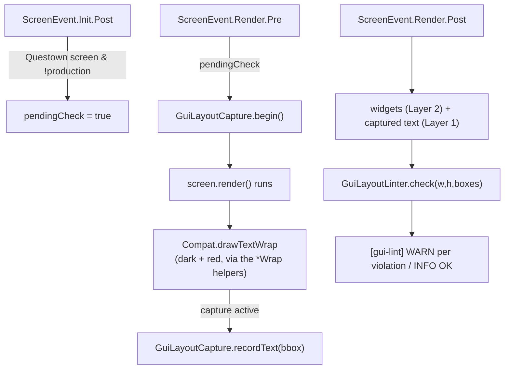
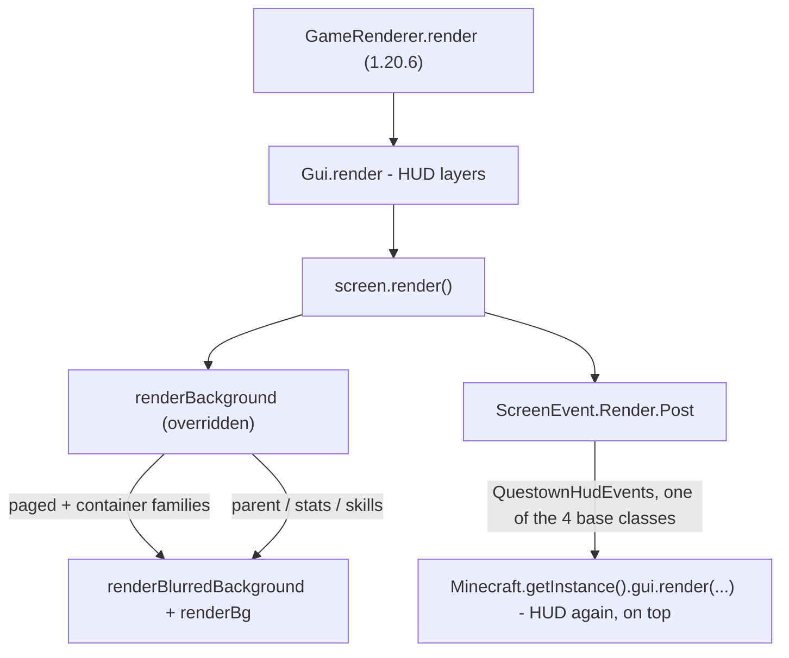

# GUI layout validation + flow layout

Two cooperating pieces: a **layout linter** that flags overlapping/overflowing GUI
elements, and a **flow-layout** screen pattern that avoids producing them. See the
convention doc `docs/solutions/conventions/gui-layout-flow-and-linter.md` for the rules;
this map is the mechanism.

## The linter (dev-only, client)

- **Layer 2** (`collectWidgetBoxes`): widget geometry — off-screen, button-label-overflow.
- **Layer 1** (`GuiLayoutCapture` + the `drawTextWrap` hook): each wrapped-text
  block's real bbox; dark and red (warning) text both route through `drawTextWrap`
  (via `drawDarkTextWrap` / `drawRedTextWrap`), so both are captured. Text bleeding
  into another element shows up as an **overlap**.
- Both feed ONE `GuiLayoutLinter.check` (pure, JUnit-tested in `GuiLayoutLinterTest`).
- Runs once per screen open (Init sets a flag; the first Render pair captures + checks).
- Inert in shipped jars (`FMLEnvironment.production`) and never loaded on a server
  (`@Mod.EventBusSubscriber(value = Dist.CLIENT)`). `GuiLayoutCapture` holds no client types
  so the shared `Compat` layer can call it safely.

## 1.19.2 render-layering parity (1.20.6)

In 1.20.6 `GameRenderer.render` draws the HUD layers (hearts, hunger, XP,
hotbar, chat) **before** the current screen; in 1.19.2 the HUD was drawn
**after** the screen, so the 1.19.2 menus show the HUD on top of their
background. The vanilla 1.20.6 container background is an opaque full-canvas
gradient, which therefore hides the HUD entirely on 1.20.6.

Two cooperating pieces restore the 1.19.2 look for the screen families that
match the 1.19.2 golden captures (`tools/porttest/`):

- `AbstractPagedCardScreen.renderBackground` and `CompatContainerScreen.renderBackground`
  both draw `renderBlurredBackground` + `renderBg`: the 1.19.2 golden blurs the
  world behind *every* container/paged window (its `Screen.renderBackground` is
  the blur path when a level is present). Before the 2026-10-01 fix the paged
  family skipped the blur (`renderBg` only) and the container family inherited
  the 1.20.6 vanilla opaque gray gradient (`renderTransparentBackground`) - the
  "some tabs blur, some are flat gray" split the oracle caught.
- `InventoryAndStatusScreen` / `VillagerStatsScreen` / `VillagerAdvancementsScreen`
  override `renderBackground` to the blurred world (the 1.19.2 default-blur
  look) instead of the opaque gradient / menu texture.
- `QuestownHudEvents` re-renders the HUD after the screen for those four base
  classes, restoring the 1.19.2 layering where the HUD sits above the menu
  background. The blur is semi-transparent, so the HUD drawn *before* the screen
  also stays visible through it - which is why the container family needs no
  `QuestownHudEvents` entry of its own.
  - **The crosshair is suppressed in that re-render.** The re-render calls the
    full `Gui` layer stack, and in 1.20.6 the crosshair is a layer gated only by
    `!hideGui` (vanilla does *not* skip it for open screens), so re-rendering the
    HUD would pop the crosshair back on top of the menu (the day-1 playtest's
    "crosshair renders above menus"). `QuestownHudEvents` sets a `reRenderingHud`
    flag around the pass and cancels just the `VanillaGuiLayers.CROSSHAIR` layer
    via `RenderGuiLayerEvent.Pre` during it; the normal pre-screen pass is
    untouched (flag false → the crosshair renders as vanilla would, then the
    opaque/blur background covers it).
- The two `*ConfirmScreen` keep their own flat gray `renderBackground`: their
  golden equivalents are opaque gray, so matching them is correct - do not
  "unify" them onto the blur.
- Verified with the `tools/porttest/` capture oracle on 2026-10-01 (work =
  container family, quests = paged family): both captures show the out-of-focus
  world at the screen edges; the six golden-bank screens are gated and banked
  post-fix, heart/hotbar rows matching via `run.sh diff`.

## 1.20.6 blit UV: the 7-arg `GuiGraphics.blit` divides by 256

1.20.6 changed the GUI blit pipeline to normalized UV: the quad's UVs are
`u / maxU`, `v / maxV`. The 7-arg `blit(rl, x, y, u, v, w, h)` overload
**defaults maxU/maxV to 256**, so a 16x16 texture blit samples only the
texture's top-left 1/16 (one pixel) and stretches it across the tile. In
1.19.2 the equivalent `PoseStack.blit` used raw texture-pixel UVs, so the
ported call that looked identical renders as a solid color on 1.20.6.

Caught in the port-test oracle: the skills-pane background
(`VillagerAdvancementsContent.drawContents` tiles `stone.png`) rendered as one
solid 0x8F gray (stone.png pixel (0,0)) instead of the mottled texture.
Fix: pass the texture dimensions, the way vanilla's own 1.20.6
`AdvancementTab.drawContents` does -
`blit(rl, x, y, 0.0F, 0.0F, 16, 16, 16, 16)` (9-arg form). In this 7-arg form
blits into 256x256 atlas textures are correct as-is because maxU/maxV default
to 256. A different overload normalizes differently: the
`VillagerStatsScreen` bar fix below was a 10-arg call with the bar height
landing in the maxU slot.

## 1.20.6 `Util.blitFace`: display size is a gui-pose scale, not a blit argument

The 1.19.2 `blitFace` passed `faceWidth * scale` as the blit draw size - the
8x8 face region sampled and *stretched* to 8*scale. In 1.20.6 the
`GuiGraphics.blit` width/height arguments are the **source region blitted 1:1**
(see the 7-arg section above): passing `faceWidth * scale` there samples
`scale`x more of the 64x64 skin and squishes the face into the box (the port
regression - a smeared, shifted head, not a magnified one).

The 1.20.6 equivalent of "display at 8*scale" is a gui-pose scale around the
blit: `pose().translate(x, y); pose().scale(scale, scale, 1); blit(tex, 0, 0,
8, 8, faceWidth, faceWidth, 64, 64)` (nearest-neighbor keeps the pixel blocks
distinct). Same seam rule as every other 1.20.6 pose note in this file: gui
pose only, never the global modelview stack.

Oracle check (2026-10-01, economics screen "Food" row face icon vs the 1.19.2
golden bank): same left/top origin (canvas 246,294 on both), same 12x9
non-flat footprint, same 8x8 source structure magnified - wip 12x9 at 2x
nearest-neighbor blocks, matching the golden; the wider wip mask in a naive
bbox probe is the row's item icon to the right, not the face.

## 1.20.6 Ingredient: `CODEC_NONEMPTY` throws on an empty ingredient

`gui/Ingredients.toJson` serializes an `Ingredient` to the `{"items":[...]}`
shape the job-request and work-request readers (`isTag`, `getName`, `toString`)
parse. On 1.19.2 the built-in `Ingredient.toJson()` returned `{"items":[]}`
for an empty ingredient; 1.20.6 only exposes the validating `CODEC_NONEMPTY`,
which throws (`IllegalStateException`, "Item array cannot be empty") on the same
input. So an empty ingredient in a work job took the whole card down
(`putRequestedItemFirst -> isTag`, the skills pane). `toJson` now guards
`item.isEmpty()` and returns the golden's `{"items":[]}` shape, so those readers
fall through as on 1.19.2 instead of throwing.

## VillagerStatsScreen stat bars: the two half-bands and the 10-arg blit trap

Each stat bar (EXP, HUNGER) is two 82px half-bands, 0-50% and 50-100%, drawn
as a 5px track with a 5px green fill over it. The golden (1.19.2) art carries
one half-band at u0 and a second at u100 with a capped right end; the wip rebake had only the u0 band (u100 onward transparent in `bars.png`) and a
10-arg `gui.blit` whose maxU slot held the bar height (5), so the right half
drew as a bare repeat of the left band and the track span read about 80px
short: pre-fix capture, track x236..299 + x315..378 against the golden's
x236..395 with a dark #09100c column at its right end.

Fix (2026-10-13, dev-accepted):

- rebaked `bars.png` with both half-bands: left at u0..94, right at u100..181
  with its 1px dark end column at u181; track rows v64..68, fill rows v69..73
  (v74 down is the purple bands; the fill sits at v69 like the golden, not
  v70, which would bleed a purple row in).
- `renderBar` now calls `Util.blit` (maxU/maxV fixed at 256, the shape the
  verified tab-icon fix uses) at u1/u100 for the track (v64) and the fill
  (v69), with the existing leftWidth/rightWidth split: left half 0-50%, right
  half 50-100%.
- Live pixel check (grim capture of the 1.20.6 client window, 2026-10-13):
  band spans 5 rows, green fill from the bar's left edge, stripe track across
  the rest, a dark #09100c column at the right end, then the window background
  #c6c6c6.
- Accepted deviation: the right end renders as a squared 1px cap, not the
  golden's rounded corner (dev-accepted on the same date; not re-baked).

## 1.20.6 scissor clip: `enableScissor(x, y, right, bottom)`

In 1.19.2 the advancement pane was clipped per-class (the z+-950 / colorMask
juggling around the translate); the 1.20.6 port removed that hack and added no
replacement, so `VillagerAdvancementsContent`'s 16x16 stone-tile loop
(`i1 -1..15`, `j1 -1..8`) draws well past the 234x113 pane: the pre-fix
capture shows the right band x444-470 86% stone-grey and the bottom band
y408-424 93%, against 0% on the 1.19.2 golden.

The 1.20.6 clip is `GuiGraphics.enableScissor`, and its last two arguments
are the absolute canvas RIGHT and BOTTOM edges, **not** width/height: the
bytecode builds `ScreenRectangle(x, y, p3 - x, p4 - y)`. Passing
width/height (the natural reading) makes a 34x-172 degenerate rect and the
scissor swallows the pane content entirely: the frame and tabs still draw,
and the pane interior shows the dimmed world straight through. A capture like
that looks like the bleed was fixed (the bleed pixels are indeed gone), but
the pane is empty; check the interior stone fraction against the golden
(about 0.86) before trusting it.

Applied in `VillagerAdvancementsScreen.renderInside`, around the pose
push/translate block: `enableScissor(bgX + 9, bgY + 18, bgX + 9 + 234,
bgY + 18 + 113)` then `disableScissor()`. Verified on a fresh creative-mode
capture: pane interior stone fraction 0.788 (pre-fix bank 0.905, golden
0.864), both bleed bands 0.000, and the tile to window-frame to world
transitions clean on the right, bottom and top edges.

## 1.19.2 to 1.20.6 `blit` port: the z argument vanishes, the rest shift

The 1.19.2 golden tab icons call
`GuiComponent.blit(PoseStack, x, y, int z, float u, float v, int w, int h,
texW, texH)`: the all-int 10-arg form resolves to the float u/v overload
(pinned from the 1.19.2 mapped-jar bytecode), and `z` is depth, which has no
slot in the 1.20.6 `GuiGraphics.blit`. The port dropped `z` but misread the
surviving arguments, and the two affected icons rendered blank (the other
four tabs drew, so it read like a texture-load issue at first):

- stats: golden `(x+13, y+11, 0, 0, 0, 9, 9, 256, 256)` = u=0, v=0, 9x9;
  the wip call had v=9, a transparent atlas row.
- skills: golden `(adjX, adjY, 0, 17, 7, 30, 30, 256, 256)` = u=17, v=7,
  30x30 at 50% scale; the wip call had u=0, v=17, 7x30.

menu.png is byte-identical in both repos, so only the UV region is in play.
Pixel evidence (tab cells on the capture): pre-fix bank 0 colored pixels in
both cells (pure tab-base grey); post-fix 27 green icon px (stats, menu.png
(0,0)-(9,9)) and 36 white/shaded px (skills, menu.png (17,7)-(47,37)).

## Render-argument absorption (CompatScreen / CompatContainerScreen)

The strangler's standing goal: a version switch should touch the seam family, not the 29 gui
screens. The render pipeline was the part the seam could not absorb before. Each leaf still
overrode `render(GuiGraphics, ...)` (1.19.2: `render(PoseStack, ...)`) directly, so every screen
named the render-argument type. Two base classes now own those version-bound override signatures,
and the leaves express the draw order through version-neutral hooks over `RenderContext`.

`RenderContext` (record: `font`, `itemRenderer`, `gui`) is the faithful pass-through handle: each
method invokes the exact 1.20.6 `GuiGraphics`/JEI/widget method with the same arguments, so
rendering is preserved by construction (`ctx.fill` → `gui.fill`, `ctx.drawNineNine` →
`NineNine.draw(gui, ...)`, `ctx.renderWidget(button)` → `button.render(gui, ...)`, `ctx.centered` →
`gui.drawCenteredString`). A two-arg constructor fills `font` from the running client so the eleven
pre-existing `new RenderContext(itemRenderer, gui)` call sites keep compiling unchanged.

The hooks reproduce the decompiled 1.20.6 chain. `Screen.render` = `renderBackground(virtual)` +
widgets; `AbstractContainerScreen.render` = `renderBackground(→renderBg) + widgets + slots +
renderLabels`. So both bases reduce to `renderPrologue → super.render → renderScreenContent`, with
the per-screen background/labels folded into the vanilla hooks the base already overrides:

- **`CompatScreen`** (plain `Screen` leaves): `renderPrologue` (a full-canvas fill) → `super.render`
  (which calls `renderBackground` → `renderScreenSurface` — the panel, e.g. `ctx.drawNineNine` — then
  the renderable widgets) → `renderScreenContent` (text, item icons).
- **`CompatContainerScreen`** (`AbstractContainerScreen` leaves): `renderPrologue` (per-frame state,
  e.g. the button active flag) → `super.render` (which calls `renderBackground` → `renderBgContent`
  — the NineNine panel + inventory slots — then the widgets, the slots, and `renderLabelsContent`)
  → `renderScreenContent` (the screen-specific content).

`super.render` already re-invokes the version-bound `renderBackground`/`renderBg`, so a leaf's
direct `this.renderBackground(...)` / `super.render(...)` calls are dropped. The original drew the
NineNine panel a second time there; folding to once is pixel-identical.

`showTooltip(Component | List<Component>)` on both bases exposes the 1.20.6
`setTooltipForNextRenderPass` (its single-`Component` overload is `protected`, so a screen in another
package cannot call it — only a `Screen` subclass can; that is why a base class, not a static
`Compat` method, carries this). `Compat.button(...)` and `Compat.componentText(...)` are the
remaining render-side seams (the `Button.builder` construction and the `getVisualOrderText()` call,
each named only in the seam family, not the leaves).

`tools/strangler-check` admits the two base classes (`gui/CompatScreen`, `gui/CompatContainerScreen`)
to the seam family alongside the existing `gui/RenderUtil` and `gui/RenderContext`.

Proven on the `fillGradient` + NineNine pattern by migrating one screen of each tier
(RelocationConfirmScreen → `CompatScreen`, JobUnlockConfirmScreen → `CompatContainerScreen`) plus
WorkRequestConfirmScreen, and the **paged cluster** (2026-10-13): `AbstractPagedCardScreen`
(added to the gate's `SEAM_FILES` - its `renderTooltip(GuiGraphics,int,int)` hook is the one spot that
carries the render argument to `ctx.gui()`) with its four leaves `QuestsScreen`, `TownEconomicsScreen`,
`VillagerEconomicsScreen`, `MultiStatusScreen` onto `CompatContainerScreen` - paged surface via
`renderBgContent`/`renderScreenContent`, leaf extras via `renderScreenExtras`. All marker-free, `./gradlew
stranglerCheck` green, grandfather set 113 → 108; gui-lint OK on Quests/MultiStatus/TownEconomics via the
`qtdiag flagtab` hook (the console FIFO was a dead pipe on that launch), and the `Util.blit` 8→10-arg fix
verified by vision (the "flat grey box" status-icon bug the 8-arg form reintroduces - see the 10-arg
javadoc in `mc/Util.java` and the AGENTS.md blit note).
WorkRequestConfirmScreen also fixes the
idiom for the seam helper that still takes the render argument: `Ingredients.render`
takes a `RenderContext` and reaches the raw graphics through `ctx.gui()` (so the leaf
names `RenderContext`, never `GuiGraphics`), while `RenderUtil.highlight` keeps taking
the argument as `ctx.gui()` (a record accessor, no type named in the leaf; `RenderUtil`
itself is a gate seam file), and `Compat.drawDarkText` collapses to `ctx.darkText`.

`Ingredients` de-grandfathered (2026-10-13): `render` takes `RenderContext`, and the
three `Registries.ITEM` tag constructions route through `Compat.itemTag(ResourceLocation)`
(the `net.minecraft.core.registries` seam keeps the registry access; the helper name dodges
the gate's package marker). `QuestsScreen`, `WorkRequestConfirmScreen` and `ItemJobsScreen`
pass `ctx`/`rc` directly. `compileJava --rerun-tasks` green; `strangler-check` green, the
grandfather set 85 → 84; held run gui-lint OK on `ItemJobsScreen`; vision confirmed the
`Jobs:` panel, card rows with real item art (no flat boxes), and the title/nav/button row.
Bank drive (fresh fixture world) against `goldens/1.19.2/`: all six screens in
fixture-drift range, `quests` at 0.83% (the prior round's pass line was 0.89%). The
`check` content gate's "active tab" heuristic misfires on this fixture's `quests`
(world-state dependent: which quest category is active shifts with the world); the pixel
diff is the parity signal here, and it clears.

`VillagerAdvancementsScreen` + `VillagerAdvancementsContent` + `VillagerAdvancementsWidget`
de-grandfathered (2026-10-13, 84 → 81): the screen is now a `CompatScreen` and the
1.19.2 `render` sandwich decomposes onto the compat hooks - `renderBlurredBackground`
in `renderScreenSurface` (the surface runs where `Screen.renderBackground` used to
paint, so the HUD-over-blur layering `QuestownHudEvents` depends on is unchanged),
window + pane + tooltips in `renderScreenContent`. All three files name
`RenderContext`, never `GuiGraphics`: `fill`/`drawString(int)` through `ctx.fill`/
`ctx.text`, blits through `ctx.gui().blit` (the 256×256 `widgets.png` and vanilla
`window.png` are both byte-identical in the 1.19.2 and 1.20.6 client jars, so the
7-arg blits sample the same UV in both), pose blocks through `ctx.pose()`, and the
scissor clip through `ctx.gui().enableScissor`/`disableScissor` (absolute canvas
edges, verified from the `ScreenRectangle` ctor). One naming trap survived the port:
`renderTooltips`'s 3rd/4th params are the pane origin (i, j), not the mouse, and the
tooltip translate is pane-based - it now reads `paneX`/`paneY`, so the swap is
obvious instead of a latent bug. `QuestownHudEvents` matches by class name and
stays unharmed. Evidence: `compileJava --rerun-tasks` green, gate green at 81,
`[gui-lint] VillagerAdvancementsScreen (634x675) — OK`, `check.sh` content gate PASS
on all seven canonical screens (active tab vision-confirmed), and `run.sh diff` with
every screen in fixture-drift range (`skills` - the screen rendered by this leaf - at
0.51% full-frame).

The render-layering family is resolved (2026-10-13, 81 → 79): `QuestownHudEvents`
(the HUD-over-blur redraw this package's screens depend on) and
`GuiLayoutCheckClientEvents` (the dev gui-lint) are both `@EventBusSubscriber`
neoforged wiring and now live in `loader/neo` (the seam package - the same home
`ItemsInteract` and `NeoMouseScrollDispatch` already hold). A package move of
the wiring only: the bus is package-independent, so both still register
(verified live - the gui-lint line fires and the porttest content gate confirms
the HUD-over-blur layering on the affected screens). Neither file's logic
changed; the layering it keeps is still the one `run.sh` diffs against
`tools/porttest/goldens/`. The only `gui/` neoforged files (81 → 79) are resolved, and `gui/` is now
leak-free (2026-10-13, 79 → 77). `AbstractVillagerMenu` no longer wraps its
inventories in a neoforged `InvWrapper` or builds `SlotItemHandler`s:
both were the item-handler surface, and the three neoforged imports
(`IItemHandler`/`SlotItemHandler`/`InvWrapper`) are gone. The menus hold the
original vanilla `Container`/`Inventory` directly and build plain vanilla
`Slot(container, index, x, y)` slot boxes; this is provably equivalent because
the menu's custom `quickMoveStack`/`moveItemStackTo` only use
`Slot.set/get/mayPlace` and never the handler's `insertItem`/`extractItem`
(verified with `jmembers`: `Slot(Container,int,int,int)` and
`Container.getContainerSize()` are the 1.20.6 vanilla API; `Container` is not
a strangler marker). `LockableInventoryWrapper` was **deleted**: a neoforged
`InvWrapper` subclass with zero references in main or test (dead code that
could only be de-grandfathered by removing it). Evidence: `compileJava` +
`compileTestJava --rerun-tasks` green; 968 tests (only the deliberate
`ChickenArcHintsTest.todo_` marker red); strangler-check green at 77;
gui-lint OK on every affected menu (InventoryAndStatus, Quests,
VillagerStats, VillagerEconomics, VillagerBlockofProgress, Work); and the
slot-rendering `parent` (inventory) tab pixel-diffing against the 1.19.2
golden at a 0.0447% center-rect (slot region) delta - the slots render
identically to the golden branch.
The SAFE-tier confirm screens (VillagerBlockofProgressScreen,
TownBlockofProgressScreen, CreateStockRequestScreen, WorkScreen, AddWorkScreen,
FlagCraftingScreen, JobChangeConfirmScreen)
and the render-argument helpers `IngredientRenderer` / `StatusGraphic` / `Tabs` are done,
as is `VillagerStatsScreen` (2026-10-13: onto `CompatContainerScreen` - the stat bars and
two-half-band art are verbatim `Util.blit`/`ctx.darkText` calls - gui-lint OK, vision
confirmed the bars + HUD-over-blur layering, bank diff in fixture-drift range), and
`InventoryAndStatusScreen` (2026-10-13: `render`/`renderBg` onto the base hooks, the
`Button.builder` quest-button onto `Compat.button`, the status-tooltip
`Component::getVisualOrderText` lambda onto a `Compat::componentText` map into
`showTooltip(List<FormattedCharSequence>)` - gui-lint OK, vision confirmed tabs/status
icon/slots/Quests button + HUD over blur, bank diff in drift range), and `ItemJobsScreen`
(2026-10-13, below).

`PagedCardScreen` + `ItemJobsScreen` onto `RenderContext` (2026-10-13): the delegate's
public surface now takes `RenderContext` (`renderBg`, `afterRender` - dropped its `Font`
parameter, `renderButtons`, the per-card `CardRenderer` interface, and the page-number
`fill` consumer), so the composing `ItemJobsScreen` leaf names no render-argument type at
all (onto `CompatScreen`: panel in `renderScreenSurface`, content + `Compat.button` + the
`Compat.componentText` tooltip in the neutral hooks) - **fixing a live 1.20.6 draw-order
regression in the process**: a vanilla 1.20.6 `Screen.render` draws its background *inside
`render`*, so the leaf's old sandwich (background, panel, `super.render`→background again)
painted the paged panel under the second background; in 1.19.2 `Screen.render` draws no
background at all, so the golden never hit it. The compat base makes the panel sit between
surface and renderables - the golden's relative order - and that is why this leaf's
verification is a fresh held run (gui-lint OK; vision confirmed the panel, `Jobs:` title,
Page 1/14 nav, Add-To-Work-Requests button and the card rows) rather than a bank diff -
there is no correct 1.20.6 pixels to compare against. The four Abstract leaves are
re-verified intact in the same run (gui-lint OK on Quests/TownEconomics/VillagerEconomics/
MultiStatus; bank diffs in fixture-drift range). Opener added for the headless drive:
`_qtdev show_item_jobs` (thin wrapper over the `OpenJobMessage` owner call; see
`commands/COMPLEX.md`).

Render-argument helpers taking `RenderContext` (2026-10-13): `IngredientRenderer.render`,
`StatusGraphic.render`, and `Tabs.draw` (plus the inlined notification-dot `fill`) now take
`RenderContext` directly instead of `GuiGraphics` - the version-neutral record is the same
admitted type the screens use, so no new seam API. Callers (`TownEconomicsScreen`,
`VillagerEconomicsScreen`, `InventoryAndStatusScreen`) pass `ctx` rather than `ctx.gui()`.
Every draw call underneath is verbatim (`Compat.renderItemAndDecorations`, the 10-arg
`ClientAccess`/32×32 `blit`, the 4×4 notification dot), so these landed without a fresh
held-run gui-lint - the same rationale as the player-head item (pass-through, not layout).
Grandfather set 93 → 89; the gate also stopped counting `.md` files (their prose names
markers on purpose), which dropped `gui/COMPLEX.md` from the list. The carried-over live pass
on `VillagerEconomicsScreen` was done in the same run: gui-lint OK + vision (real item art in
the ingredient grid) on 2026-10-13.

FlagCraftingScreen (flow layout + craft tooltips + tabs) and JobChangeConfirmScreen (early-
return + tabs tooltip + centered text) are the two remaining SAFE-tier leaves with non-trivial
toobar/tooltip interaction; both are done via the same two-tier pattern.

## Player-head profile: `Compat.resolvablePlayerHead` (components, not NBT)

A player head whose face resolves to a villager's UUID is a version surgery, and *where it is
named* is the trap. The component stack builds it as `head.set(DataComponents.PROFILE, new
ResolvableProfile(...))`; both `DataComponents` and `net.minecraft.world.item.component.
ResolvableProfile` are strangler markers, so a leaf must not name them. `QuestRemoveConfirmScreen`
(the one screen that needed it, now a `CompatContainerScreen` leaf) calls `Compat.resolvablePlayerHead(UUID)`, and the exact 3-arg construction `ResolvableProfile(Optional.empty(),
Optional.of(uuid), new PropertyMap())` plus `new ItemStack(Items.PLAYER_HEAD)` lives in `mc/Compat`
- the seam family the gate admits. Off the grandfather list (108 -> 107), `strangler-check` green,
`compileJava` executed; the layout is inherited from the base-class migration and the sibling
confirm screens (already gui-linted), and the only pixel delta is a verbatim item construction
rather than a new layout, so this landed without a fresh held-run capture.

## Flow layout (FlagCraftingScreen)

`computeLayout()` stacks blocks top-to-bottom, advancing the `y` cursor past each block's
**real** wrapped height (`font.split(text, width).size() * lineHeight + pad`) and sizing the
panel to the total. `init()` (widgets) and `render()` (text) both read the same computed
offsets, so a longer/translated string pushes everything down instead of overlapping —
overlap-proof by construction. This replaced hardcoded Y positions + a 56px wrap width that
overran their rows.

## Villager menu wire: `VillagerMenusPayload` carries UUID + slot locks

Opening any villager menu (quests / stats / economics / BOP / job-change) goes
server → `VillagerMenus.write` → `openScreen` → client
`VillagerMenus.fromNetwork`, where **one payload decodes into all six menus**.
The payload carries the villager's **UUID and slot locks**: the client builds
purely from wire data and must never need the local entity. Before this, the
client resolved the townie by raw entity id and read the UUID/slot locks off
it — a townie despawned between the packet send and the read NPE'd the screen
open ("Failed to open a screen") and disconnected the client (`.scratch/
work-board-request/quests-menu-null-townie-client-crash.md`). `entityId` still
rides the wire as a **best-effort** pointer: `VillagerStatsMenu.attach(e)` wires
live stats updates when the local entity happens to still be present; without
it the menu degrades to the wire's static stats data instead of crashing.

- `entityId` (best-effort pointer) → `attach` if present, else static wire data.
- Payload layout: id, uuid, jobId, invSize, quests, flagPos, stats, 2 booleans,
  slot locks — read order must match write; econ is wire-dead (`none()` both ends).
- `VillagerMenusPayloadTest` pins the round-trip; the menu-construction half is
  not unit-testable (registry-bound menu types).

## Skills-tab level gate: `showSkillsTab` rides the same wire (2026-10-13)

The third boolean on `VillagerMenusPayload` is `showSkillsTab` - false when the
townie's level has unlocked no job yet (`Work.getAvailableAtLevel` vs
`SimpleVillagerHandle.getLevel`, the gate's job-side half is documented in
`jobs/COMPLEX.md` "available_at_level"). Every tabbed villager menu
(InventoryAndStatus / Stats / Economics / BOP / JobChangeConfirm / Quests)
carries the flag; `getEnabledTabs()` returns `VillagerTabs.hideSkills(tabs)`
when it is false, and `VillagerTabs.forMenu` **also** gates the SKILLS screen
fn on `menu.showSkillsTab()` - the double gate is deliberate (a menu that
forgets the `getEnabledTabs` conditional still loses the tab at `forMenu`).
Flag menus (not per-townie) keep the default `VillagerTabsEmbedding.
showSkillsTab() = true`. The SKILLS menuShow consumer in
`TownVillagerUIs` never opens a tabbed menu (it sends
`OpenVillagerAdvancementsMenuMessage` with the already-filtered unlockable set),
so no flag change there.

## Lit-dead tabs: `selected` is the current-pane marker, gated tabs are hidden (2026-10-14)

`Tab.selected` (the lit highlight) is set to `fn == null` in `VillagerTabs.build`: a menu
excludes its OWN pane from `getEnabledTabs()` (`VillagerTabs.except(ownTab)`), so the current
pane's tab renders lit and no-op = "you are here" (the 1.19.2 golden's mechanism, unchanged).
Two defects made three tabs lit-and-dead on a level-1 townie's inventory pane (user report,
playtest 2026-10-14): (1) the skills gate made `skillFn` null for EVERY tab, so the skills
tab rendered lit like the current pane instead of being absent - `build()` now omits the
skills tab entirely when `showSkillsTab` is false (the BOP pattern: conditional `b.add`, the
row reflows left); the skills pane's own menu keeps the tab lit via `showSkillsTab()==true`
there. (2) Pre-existing since the 1.20.1 migration (also in the golden): the change_root tab
borrowed `skillScreenFn == null` for its selected flag, so any null skills fn lit change_root
too - now `changeRootScreenFn == null`, lit only when the change-root pane is open.

## MultiStatusScreen: full-card click opens the villager UI in management-only mode (2026-10-14)

The flag's villagers-tab card had no card-body click handler - only the 32x32 status icon
sent `OpenJobMessage` (present since the 1.19.2 golden; the "click a card to open that
villager" ask predates it). `mouseClicked` now falls through, after the status-icon check,
to a whole-card hit-test (same pattern as `QuestsScreen.openLessonForClickedCard` on the
quest tab - user's reference) that sends `OpenVillagerMenuMessage(STATS, showInventoryTab=false)`
for that townie: the opened menu hides its inventory tab and lands on the stats pane
(management view, not the inventory; user ruling, `villager-card-opens-management-only-screen`).
Right-clicking the townie itself still opens the full menu (inventory included) via
`Jobs.openInventoryAndStatusScreen` -> `showUI(., ., .)` (3-arg default, inventory on).

The `showInventoryTab` flag rides the same wire as `showSkillsTab`: `OpenVillagerMenuMessage`
carries it to `VillagerHolder.showUI(., ., ., showInventoryTab)` (the 4-arg overload; the
3-arg form defaults true) -> `TownVillagerUIsHandle` -> `TownVillagerUIs.showUI` (INVENTORY
type requests are redirected to STATS when the flag is false, so a management-only session
never lands on a pane whose tab no longer exists) -> `ShowerData` -> the six tabbed menus'
`getEnabledTabs()` return `VillagerTabs.hideInventory(tabs)` when it is false. The flag
also crosses the server->client payload (`VillagerMenusPayload.showInventoryTab`, written
in `VillagerMenus.write`) so re-opened panes keep the same tab set, and
`VillagerTabs.makeOpenFn` threads it into every tab click so a management-only session
stays management-only across pane navigation. Pinned in
`VillagerTabsHideInventoryTest` (the hideInventory helper) and `VillagerMenusPayloadTest`
(payload round-trip); the menu-ctor filtering is registry-bound, held-run-covered.

The status icon keeps its `OpenJobMessage` (smaller box wins the overlap).

## Day-1 playtest: quest deep-links, localized job names, arrival copy

- **Welcome-mat quest → crafting tab.** `QuestsScreen.openLessonForClickedCard`
  branches on `SpecialQuests.TOWN_GATE.equals(quest.getWantedId())` and fires
  `Tabs.openTab("tooltips.crafting")` before falling back to the book lesson.
  `Tabs.openTab(titleKey)` looks the tab up by its tooltip key and runs its
  `onClick` (the same `OpenFlagMenuMessage` a tab click sends); returns false
  when the tab is absent (e.g. the villager-scoped menu) so the book fallback
  still runs. Hardcoded per the playtest ask; the follow-up "tell me more about
  this quest" logic generalizes it.
- **JOB_UNLOCK/JOB_CHANGE cards no longer print bare ids.** `UIQuest.getName`
  (JOB_UNLOCK) and `QuestsScreen.renderJobUnlockTooltip`/`renderJobQuestTooltip`
  now pass `translatable("jobs." + rootId)` instead of the raw `jobId`/`rootId`
  strings — the root jobs carry lang keys (`jobs.baker` = "Baker"). The flavor
  text on `TownQuests.postUnlockQuest` still inlines raw ids (it is a stored
  String, not a Component).
- **First-arrival copy.** `MultiStatusScreen`'s morning-arrival sentinel picks
  `gui.status.villager_arriving_morning.first` ("A new villager arrives in the
  morning") when `syncedData.villagerStatuses` is empty, else the existing
  "...and one more in the morning".
- **Flag-craft mat carries parent NBT.** `FlagCraftMessage.craftWelcomeMat`
  stamps `TownFlagBlock.StoreParentOnNBT(mat, flagPos)` before handing the item
  over: `WelcomeMatBlock` placement reads the parent from that NBT and drops an
  unstamped mat as unregistered. `WelcomeMatParentNbtTest` pins the stamp
  round-trip.
- **Job board crafts in the same menu (2026-10-12, `job-board-should-be-roomblock`).**
  The board was a `RoomBlock` all along; the friction was acquisition (the only
  path was build a walled sign-room so room detection could convert it). The flag
  crafting menu now has a third row: `FlagCraftMessage` recipe index 2
  (`craftJobBoard`) consumes any `#minecraft:signs` item (mirroring the
  `#questown:job_board_inputs` recipe tag) and hands a stamped
  `ItemsInit.JOB_BOARD_BLOCK` — placement (`JobBoardBlock.getStateForPlacement`)
  resolves the parent flag from the stamped NBT and self-registers the one-block
  room, no radius check (the NBT binds it to the flag it was crafted at, same
  contract as the mat). The sign→board room path stays as an optional
  alternative. The screen change is one extra `ICON_ROW_HEIGHT` in
  `FlagCraftingScreen.computeLayout()` (flow layout, overlap-proof by
  construction); button-greying uses `countMatching(ItemTags.SIGNS)` like its
  siblings.

## Day-1 playtest batch 2: dead tooltip override, BOP "earned by", empty job board

- **Status-card tooltips never rendered (two playtest items, one root).** In
  1.20.6 `AbstractContainerScreen.render` no longer calls the `renderTooltip`
  override — the 1.19.2 hook is a dead path — so `AbstractPagedCardScreen`
  overrode a method nothing calls and the per-card hover text (the status
  cards in the villager menu, and the `?`-status cards) never drew. Fix: the
  dead `renderTooltip` override is gone; `renderScreenContent` ends with
  `this.renderTooltipContent(ctx, mouseX, mouseY)`, which feeds
  `setTooltipForNextRenderPass` — still drawn by the final `Screen.renderWithTooltip`.
  Items: `villager-menu-status-icons-no-tooltips`,
  `hover-text-missing-question-mark-status`.
- **The BOP screen says why the block is there.** The flag-menu payload's
  `int bopCount` is now `ImmutableList<String> bopRootJobs` (the deposited BOP's
  job roots, e.g. `[baker, baker]`), threaded `TownFlagBlockEntity.depositedBopRootJobs()`
  → `FlagMenus`/`TownBlockofProgressMenu` → `TownBlockofProgressScreen`, which
  renders an "Earned by: Baker x2" line under the block (`menu.block_of_progress.earned_by`,
  roots as `jobs.<root>` keys, counts collapsed to `xN`).

# Flag tab selection: the open tab is now highlighted (2026-10-11 evening)

The flag menu tabs were never highlighted: `FlagTabs.build` set the `Tab.selected`
field to `(fn == null)` (i.e. "is this tab disabled"), which is `false` for every
enabled tab, so `Tabs.draw` (which picks the highlight art from `selected()`) never
highlighted anything. Now `FlagTabs` takes an `activeTabKey` and sets
`selected = activeTabKey.equals(titleKey)`; each of the 5 flag screens passes its
own key via a new `FlagTabs.forMenu(menu, activeTabKey)` overload
(`tooltips.quests` / `.villagers` / `.economics` / `.blocks_of_progress` / `.crafting`),
so the open tab is highlighted. `QuestsScreen.forTown` marks quests; `forVillager`
uses `VillagerTabs` (untouched).

First-open tab: `TownFlagBlock`'s right-click path now opens the **QUESTS** tab when
`getInfo().hasIncompleteQuests()` (after the BOP-full branch, before the BOP
pre-select), so a fresh flag opens on the quests the player can see instead of the
empty multi-status overview.
- **Empty job board is no longer a blank pane.** `WorkScreen` draws two wrapped
  lines (`job_board.empty.1`/`job_board.empty.2`) when `work.isEmpty()`,
  replacing the empty scroll area with an explanation of what requests do.
- **Free-food claim on the economics tab.** The `#questown:villager_food`
  unmet-need card in `TownEconomicsScreen` shows a red "Free food →" line while
  `FlagInfo.bonusFoodAvailable()` is set (the full sentence is a third tooltip
  line); clicking anywhere on that card sends `ClaimFreeFoodMessage`. The
  economics tab's red dot is driven by the same flag
  (`FlagTabs` passes `fi.bonusFoodAvailable()` to both the tab and
  `computeTabDecisions`). `FlagInfo` gained the `bonusFoodAvailable` boolean
  (wire position: after `bopFull`).

## Day-1 playtest batch 3 (2026-10-13): room-block tooltips, board empty state, crafting tooltips

- **Room-block quests get a place-verb tooltip.** `QuestsScreen.renderCardTooltip`
  handles `TOWN_GATE` and `EMPTY_ROOM` in a fixed two-line branch placed
  **BEFORE the flavor-text check** (the flavor is set server-side at post time
  and shadows the switch below it - that shadowing is exactly why the
  empty-room card first shipped showing the generic `room_quest` line, user
  report 2026-10-14): line 1 = `menu.quests.roomblock.welcome_mat` / `menu.
  quests.roomblock.empty_room`, line 2 = grey `menu.quests.roomblock.
  click_crafting` via `Compat.translatableStyled`. Both cards deep-link to the
  crafting tab on click (`openLessonForClickedCard`), which is what the grey
  line promises - the empty-room card needs the Town Wand, which is crafted
  there. Remaining room blocks fall through the ROOM switch:
  `JOB_BOARD` or `RoomBlock.isBlockRoom(id)` → `menu.quests.roomblock.town` with
  `RoomRecipes.getName(wantedId)` (free placement: "in your town"); campfire keeps
  its own branch. The quest is about *placing a functional block*, not holding an
  item.
- **Job-board quest card joined the mat format (2026-10-14 playtest).** User chat:
  "Job board quest's tooltip should use the same format as the welcome mat's
  (click to see crafting)." `JOB_BOARD` moved INTO the fixed two-line branch above
  (key `menu.quests.roomblock.job_board` + grey click-crafting line) and into the
  crafting deep-link in `openLessonForClickedCard`; the now-dead server-side flavor
  text in `addBasicsBatch` was retired so the lang key is the single source of
  copy. The `roomblock.town` fallback now serves only the remaining block rooms.
- **Job-board quest card shows the board, not a sign.** `UIQuest.fromLevel` overrides
  the `SpecialQuests.JOB_BOARD` rMap entry with
  `RoomRecipes.standard(JOB_BOARD, NonNullList.withSize(1, Ingredient.of(JOB_BOARD_BLOCK)))`
  (the blueprint recipe `questown:job_board.json` is a sign-room recipe and leaked its
  ingredient onto the card); the builder uses `buildKeepingLast()` for the deliberate
  duplicate.
- **The board's empty state points at the top unmet need.**
  `TownFlagBlockEntity.topUnmetNeedName()` (economics aggregate, max timesNeeded,
  resolved through `Ingredients.fromString`/`getName` so tag keys like
  `#minecraft:coals` read as "Coal"); `TownWorkHandle.openMenuRequested` writes it as
  a trailing `writeUtf` slot when `requestedResults` is empty; `WorkScreen`'s empty
  state renders `job_board.empty.top_need` ("A townie in town needs %s...Use the +
  button") instead of the generic teaser when non-empty. Testable without mod-load:
  only the Utf slot + constructor contract (`TownWorkContainerTopNeedTest`) — the
  full ForClientSide round trip pushes Ingredients through Neo's registry ID codec,
  which refuses a registry Neo has not marked synced (vanilla `BuiltInRegistries.ITEM`
  is never synced outside a running mod-load).
- **Flag-crafting tab: shared border + item tooltips.** `FlagCraftingScreen.background`
  switched to `JEI.getRecipeGuiBackground()` (the darker `getRecipeBackground()`
  was crafting-tab-only and read as a faded border mismatch); 1.20.6 gives free
  tooltips only to container slots, so `renderRecipeRow` now calls
  `showTooltip(Compat.getItemName(stack))` when the cursor is inside the 16x16 input
  (`x + MARGIN`) or output (`x + 50`) icon box.
- **Campfire sleep: the bed lands on the player's side.** Vanilla's
  `ServerPlayer.startSleepInBed` → `bedInRange` → `isReachableBedBlock` rejects a bed
  >3 blocks (x/z) / >2 (y) from the player (`TOO_FAR_AWAY`); the old
  `findSafeSleepPosition` picked the first safe direction in
  `Direction.Plane.HORIZONTAL` order (always NORTH), so a player on the opposite
  side of the fire saw the bed 4-6 blocks away and every attempt failed. Now it
  scores all safe candidates by `playerPos.distanceToSqr(head)` and takes the closest;
  the 2-arg overload (test seam `placeTempBedForTest`) delegates with the campfire
  centre → first-safe-side, preserving the autotest scenario. `CampfireSleepSideTest`
  pins the side choice on a mocked open-air level.
- **The empty-room card shows an oak door (2026-10-13 night, user call).**
  `empty_room` has zero ingredients, so `renderRecipeCardIcons` drew an empty
  strip. When the strip is empty and the wanted id is `SpecialQuests.EMPTY_ROOM`,
  it now renders a single `Ingredient.of(Items.OAK_DOOR)` — the block you point
  the Town Wand at.
- **The welcome-mat card tooltip names the click action (2026-10-13 night, user copy).**
  Re-worded `menu.quests.roomblock.welcome_mat` ("Craft a welcome mat and place
  it where you'd like people to enter/exit your village.") with the grey
  click-to-craft line; 1.20.6's `Component` interface has no `withStyle` —
  only `MutableComponent` does, and `Compat.literal` returns the interface —
  hence `translatableStyled` + `Style.EMPTY.applyFormat(ChatFormatting.GRAY)`
  (the FlagCraftingScreen grey-line pattern).

## Leaver-return progress bar (G3, 2026-10-12): the payload carries an absolute tick

The villagers-menu leaver-return bar (`MultiStatusScreen.renderLeaverReturnBar`)
is driven **without a push channel**: `StatusPacket` gained
`leaverReturnTick` (absolute server tick at which the leaver's timed trip
ends; 0 = not away on a timed trip) + `leaverReturnTotal` (the trip's
declared duration). The server stamps it in
`FlagMenus.createStatusPacket` → `VisitorMobEntity.getLeaverReturn()` →
`DeclarativeJob.getLeaverReturn` (gate-mat timer read, see jobs/COMPLEX.md).
The client re-derives the fraction every frame from
`Minecraft.getInstance().level.getGameTime()` (container screens re-render
continuously, so the bar ticks down live; LAN clock skew of a few ticks is
harmless — clamped). A status-change re-sync then drops the bar when the
trip ends. `StatusPacket.equals/hashCode` deliberately exclude the two new
fields so the smoothing queue's majority vote is unaffected. The 3-arg
convenience constructor keeps the inventory-status call site
(`InventoryAndStatusMenu`) leaver-free. The bar is a 30×3 fill under the
32×32 status art (inside the art's footprint — no new card geometry, so no
layout change; gui-lint check rides the user's first menu open).

## Status tooltips: unauthored keys fall back, never render raw (2026-10-14)

`JobTooltips.buildStandardTooltipKeys` builds
`tooltips.villagers.job.<cat>.status_N.<STATUS>` keys, but en_us.json only
authores some category × status pairs (the diner has just NO_SUPPLIES /
NO_JOBSITE; the fisher has none at all). A missing pair surfaced the **raw
i18n key** to the player (2026-10-14 playtest, user chat 04:02:30: "Diner
tooltip is showing i18n key").

The fix is the vanilla `Component.translatableWithFallback(key, fallback,
args)` (seam: `Compat.translatableWithFallback`): when the specific key is
absent the client renders the `JobTooltips.FALLBACK_LINE_1/2` last-resort
lines instead of the key. The fallback is resolved client-side at render
time, so no `I18n.has` probing is needed (server-side I18n state would
differ). Pinned by `JobTooltipsFallbackTest` (red-verified: pre-fix the
components carry no fallback and the equals-assertion fails). New statuses
or jobs still get specific copy by adding lang keys — the fallback is only
the last resort.

## Economics pane's enabled-tab list omitted change_root (2026-10-14)

A tab renders selected when its open-fn is null (the `selected = fn == null`
marker, section above), and a tab's fn is null exactly when the open pane's
`getEnabledTabs()` omits that tab's type. Every villager pane builds its list
as `VillagerTabs.except(ownTab)` EXCEPT `VillagerEconomicsMenu`, which used a
hand-rolled `ImmutableList.of(INVENTORY, STATS, QUESTS, SKILLS, BOP)` — no
`CHANGE_ROOT`. With the economics pane open, the "switch job" tab therefore
rendered selected alongside the economics tab (2026-10-14 playtest: "the
'switch job' tab also appears selected").

Fix: `ENABLED_TABS = VillagerTabs.except(ECONOMICS)` like every sibling.
Pinned by `VillagerEconomicsMenuEnabledTabsTest` — the list is a private
static on a registry-bound menu (the constructor needs a Forge harness), so
the test reads the field reflectively; the initializer is pure string math,
safe in a unit JVM. Red-verified by stash: pre-fix code fails the
change_root-presence and sibling-invariant cases.

## Item- and loot-quest cards show progress (n/target) (2026-10-14, LOOT 2026-10-15)

2026-10-14 playtest (in-game chat 04:26:16): "The 'Create N items' Quests
should probably show an indication like (3/8)".

The card (`UIQuest.getName()`, ITEM and LOOT cases) appends "(deposited/target)"
capped at the target when the snapshot carries `deposited` (new nullable
field; wire: `writeInt` with -1 == null). `deposited` is only ever set for
open ITEM or LOOT quests.

Server side: `TownQuests.openQuestProgress()` returns wantedId -> progress
for both types: ITEM = matching-item count across
`TownContainers.getAllStacks(...)`, using the same ingredient matching as
the completion path (`questMatchesStack`) so the displayed count is the one
that completes the quest; LOOT = the quest's own extraction total (the
2026-10-15 accumulation counter - containers are irrelevant, the extracted
food may have been eaten or cooked since). Wired into the two surfaces that
render the main quest card list: `TownFlagMenus.showUI` (flag QUESTS tab) and
`TownQuestsHandle.showQuestsUI`, via the new `QuestsHolder.openQuestProgress()`.
The secondary villager/visitor surfaces (`TownVillagerUIs` batch cards) use the
two-arg `fromLevel` and stay progress-less. Pinned by `UIQuestItemProgressTest`
(wire round-trip + capped name; red is by-construction - the field did not
exist pre-fix, so the test cannot compile against it) and
`UIQuestLootProgressTest` (the "(n/8)" shape on the LOOT card, capped at the
target).

## Flag quest-card tooltips carry "Villager N" (2026-10-15)

The `quests.job_owner` tooltip on the flag quest cards (`QuestsScreen`,
`QuestRemoveConfirmScreen`) shows "Villager N" instead of the truncated UUID.
The UUID->name map rides the flag-menu wire: `TownVillagerHandle.
displayNamesForAll()` (exposed on the `VillagerHolder` seam via
`TownVillagerHandles`) is appended by `TownQuestsContainer.write` (after the
two summary booleans) and `TownRemoveQuestsContainer.write` (after the batch
UUID) via `AbstractQuestsContainer.writeVillagerNames` (varInt count, then
UUID+Utf pairs), and read back in `FlagMenus.fromNetwork` /
`TownRemoveQuestsContainer.read` via `AbstractQuestsContainer.
readVillagerNames`. `VillagerMenusPayload` (the single-villager BOP payload)
was NOT touched - it already carries the one name it needs. Resolution:
`AbstractQuestsContainer.villagerLabelFor(names, uuidString)` - map hit ->
the display name, miss or malformed owner string -> `UtilClean.truncateMiddle`
(the historical form). The server-side `createMenu` containers also take the
map (server menus never render the tooltip, but the shape stays symmetric).
Codec order + resolution pinned in `FlagMenusVillagerNamesTest` (a drift in
the append position would corrupt the whole menu-open payload, not just the
tooltip). No gui-lint impact: tooltip text only, zero layout change.

## Quest card titles: single-line, no fit guard (2026-10-15)

`QuestsScreen.renderCardContent` draws the card title as ONE line —
`ctx.text(recipeName.getString(), idX, card.coords().topYPadded(), …)` — with
no width check; the card is fixed-height (`UNSCALED_CARD_HEIGHT = 42`), so the
only overflow escape is to keep the title short. The budget:
`PagedCardScreen.CARD_WIDTH = 156` px, `BIG_PADDING = 10` per side, and the
top-right removal button claims the last 13 px of the top row → ~121 px usable
for a title. The 2026-10-15 first-work-request card reported "text bleeding
past the card boundaries" (`.scratch/playtest-2026-10-15/
first-work-request-card-text-overflow.md`): its title lang key
`menu.quests.first_work_request` was 45 chars (~215 px). Fix was the string,
not the renderer: the card title is now "Post a work request"; the full
sentence stays on the hover tooltip (the quest flavor, `MCQuest.firstWorkRequest`)
and the post-time chat broadcast. Follow-up candidate (deferred): a small
ellipsis-fit helper at the draw site for data-driven titles
(`RoomRecipes.getName` room names, `quests.upgrade` "%s -> %s").
 (Same day, second user call: the LOOT quest name `menu.quests.food` is now
"Raw Food" — user chat 03:23:24, after a LOOT completion broadcast read
"Quest complete: Food"; the key drives the card title and the
post/complete/lost broadcasts, `.scratch/playtest-2026-10-15/
loot-quest-named-raw-food.md`.)

**Superseded 2026-10-17:** one key could not name both LOOT quests (user: "The first
loot quest should be entitled Raw Food ... but the second loot quest (which asks for 8x)
should be titled 'Food'"). `UIQuest.lootNameKey(wantedId)` picks by the quest's wanted
tag: `questown:villager_simple_furnace_food_raw` (the hunter's 1x quest) →
`menu.quests.raw_food` "Raw Food"; anything else (the cook's 8x `#questown:villager_food`)
→ `menu.quests.food` "Food". The card and `TownMessages.questCompleted/questLost` use it.
Pinned by `UIQuestLootCardNameTest.raw_food_loot_card_name_is_raw_food_key`.

## Card progress suffix spacing: " (" not "(" (2026-10-15)

`UIQuest.getName` appended the ITEM/LOOT progress suffix with no leading
space ("Carrots(0/4)", "Raw Food(0/4)" - user report 03:07:06: "needs a
space before its (0/4) indicator"). The literal now starts with a space in
both the ITEM and LOOT cases. Pure render text; no layout change.

(The spacing commit itself missed the two card-shape test suites -
`UIQuestItemProgressTest.card_name_appends_progress_capped_at_target` and
`UIQuestLootProgressTest` asserted the old no-space literal and went red.
Fixed to pin the spaced form: "menu.common.quantity (3/8)",
"menu.quests.food (3/8)", "(8/8)".)

## Playtest 2026-10-15: JOB_CHANGE cards hide the BOP icon

User ruling ("we can just not render the BOP"): `QuestsScreen.renderRecipeCardIcons`
and `QuestRemoveConfirmScreen.renderRecipeCardIcons` set `ingredients` to
`ImmutableList.of()` before the empty-room check when
`recipe.getType() == Quest.QuestType.JOB_CHANGE` — the card keeps its title
and the 32x32 job art, and only the grey BOP square disappears. The
ingredients still gate the quest's completeness (`quest.canComplete` /
`quest.complete` consult `recipe.getIngredients()` directly), so hiding them
on screen does not unblock the card.

## Playtest 2026-10-15: skills pane respects showInventoryTab

The management-only flag now rides the whole skills-pane chain. Every
other tabbed villager menu filters `getEnabledTabs()` on it, but
`VillagerAdvancementsScreen`'s embedding returned `VillagerTabs.all()` —
a flag-menu session that navigated to the skills tab saw the inventory tab
resurrect (2026-10-15: "the flag menu -> villager menu screen still shows
the inventory tab"). `TownVillagerUIs` SKILLS router passes
`d.showInventoryTab()` into `OpenVillagerAdvancementsMenuMessage` (new wire
field, appended after `showBlockOfProgressTab`) ->
`ClientAccess.openVillagerAdvancements` -> screen ctor -> embedding's
`getEnabledTabs()` returns `VillagerTabs.hideInventory(VillagerTabs.all())`
when false.

## Playtest 2026-10-15: wide hit region for the board auto-request toggle

The 03:04 playtest report ("no tooltip / checkbox doesn't toggle") turned
out to be a hit-area problem, not a wiring one: the server log proves the
round-trip works (03:55: "Board auto-request set to false/true by Dev"),
and the toggle was reachable only inside a 16x17 box around the 9px glyph —
hovering the label did nothing. `WorkScreen` now measures the label
(`font.width`) and registers the whole glyph+label span in a `wideRegions`
map (same per-frame dedupe style as `removes`); the hover highlight +
tooltip and `mouseClicked` both use the wide region (checked before the
16x17 `removes` loop).

## Tutorial toast lifetime: shown at evening, hidden on sleep (2026-10-15 → 2026-10-17)

Vanilla's `TutorialToast` is a *persistent* toast: it stays on screen until
something calls `hide()`. "Your camp is ready" (`tutorial.campfire_ready`,
"Use wand on campfire") is an evening instruction, and two playtests broke it
from opposite sides: 10-15 it was still up after the first campfire sleep;
10-17 a 20 s wall-clock cap (the 10-15 fix) let it fire on the afternoon quest
completion and vanish unseen. Now:

- **When it shows (server):** `TownFlagBlockEntity.showCampReadyToastIfDue()`
  runs on every evening/night flag tick (`AbstractTownFlagTicker` →
  `tickEvening` → `TownFlagTicker`) and from `CampfireReadyReward` (a quest
  completed after dusk). It sends the toast per player
  (`TownMessages.sendTutorialToast`) when the campfire quest is complete
  (`TownQuests.isCampfireQuestComplete`), the player is awake, has not yet
  been shown it this session (`campReadyToastShown`, transient), and has not
  completed `questown:first_campfire_sleep` (`Compat.hasCompletedAdvancement`
  — the advancement is the persisted "already slept" bit, so a restart
  re-shows it only to players who still need it).
- **When it hides (client):** `ClientAccess.tickTutorialToasts()` (called from
  `CampfireSleepClientEvents.onClientTick`) hides the active toast once
  `mc.player.isSleeping()`; a new show replaces the old one; the flag-menu
  `dismissTutorialToast()` path is unchanged. No wall-clock cap.

## Quest-card and villager-tab deep links (2026-10-17 playtest round 2)

Four chat requests, one theme: a card or tab should take the player to where its
ask is answered.

- **JOB_CHANGE card → villagers tab.** `QuestsScreen.openLessonForClickedCard`
  opens `tooltips.villagers` via `Tabs.openTab` (falls back to the BOP lesson when
  the tab is absent — the flag menu hides it before the first villager). The tooltip
  (`jobChangeTooltip`, static; `renderCardTooltip` takes `villagersTabShown` from
  `Tabs.hasTab`) is the card's flavor/job line plus a grey
  `menu.quests.job_change.click_villagers` hint only while the tab exists.
- **ITEM/LOOT card icon → "jobs that make this item".** `renderRecipeCardIcons`
  records each icon's top-left → `Ingredient` in `itemIconClicks` (cleared at the top
  of `renderBgContent`, so a page change leaves no stale targets); `mouseClicked`
  checks those boxes (same ±4 px hover box as the strip's highlight) and calls the
  container's owner method `AbstractQuestsContainer.sendOpenItemJobs` →
  `OpenItemJobsMessage` → `TownVillagerUIs.showItemJobsUI` (the work-request
  screen's existing path). A tag icon (raw food) resolves producers for the tag.
  Icon tooltip gains `menu.quests.item.click_item_jobs`. (Closes the
  `RenderUtil.stripOfRequestableItems` "handle clicks" TODO for quest cards.)
- **Change-profession tab red dot.** Rule: `TownQuests.wantsJobChangeFrom(job)` —
  an incomplete JOB_CHANGE quest exists AND the villager is on the `gatherer` root
  (pinned by `TownQuestsJobChangeAttentionTest`). Server: `TownVillagerUIs.openMenu`
  computes it (`wantsJobChange`) into the new trailing
  `VillagerMenusPayload.changeRootAttention` (round-trip in
  `VillagerMenusPayloadTest`). Client: `VillagerMenus.doFromNetwork` records it in
  `VillagerTabs.CHANGE_ROOT_ATTENTION` (per villager UUID; each tab click re-opens the
  menu, so it refreshes on every open) and `VillagerTabs.forMenu` sets the
  `change_root` tab's `hasNotification`. Only the client renders tabs, so the flag
  rides the payload rather than all five tabbed menu constructors.
- **Pending-change text font.** `JobChangeConfirmScreen`'s "This villager will change
  profession in the morning" was a white shadowed `drawCenteredString` (same in the
  1.19.2 golden — a design change, not a port regression); it now uses
  `RenderContext.centeredDark` (0x404040, no shadow), the body-text look of the rest
  of the screen.

## Job names reach the player as the profession, not the id (2026-10-17)

The JOB_CHANGE card read "Villager job: simple_furnace_food" / "Villager job: sword"
(`UIQuest` passed the bare `jobId`) and the `messages.jobs.changed` broadcast carried
`JobID.toNiceString()` ("cook:simple_furnace_food"). Both now use the profession's
`jobs.<root>` key: the card via `extractRootJobName` (the JOB_UNLOCK card already did),
the broadcast via `Jobs.getRootNameComponent`. Pinned by `UIQuestJobChangeCardNameTest`.
The onboarding cook quest also names a registered job now
(`TownQuests.ONBOARDING_COOK_JOB` = cook/extract), so the job change no longer hits
`ServerJobsRegistry`'s "No work found" ERROR fallback.

## Villagers-tab red dot until first opened (2026-10-17 playtest round 5)

The flag's villagers tab appears with the first arrival (`TownFlagBlockEntity.getInfo`,
`showVillagers`), and from then until a player opens it, it carries a red dot.

- State: `TownFlagBlockEntity.villagersTabSeen`, persisted via `TownFlagTileData`
  (`villagers_tab_seen`). The field defaults **true** so a town saved before it existed shows
  no dot; `onFlagPlace` sets it false for a new flag.
- Decision: `FlagInfo.villagersTabAttention(showVillagersTab, villagersTabSeen)` (pure), sent
  as the trailing `FlagInfo` wire boolean; `FlagTabs.build` / `computeTabDecisions` use it as
  the villagers tab's `hasNotification`.
- Clear: `TownFlagMenus.showUI` calls `markVillagersTabSeen()` for the VILLAGERS type *before*
  `getInfo()`, so the screen that opens is already dot-free.
- Town-level, not per-player: any player opening the tab clears it for all.
- Test: `VillagersTabAttentionTest`. Ticket:
  `.scratch/playtest-2026-10-17/villagers-tab-red-dot-until-first-open.md`.

## BOP tab: initial focus and a dot that clears on first withdrawal (2026-10-17 round 5)

- **Initial focus** is the pure `FlagTabs.initialFlagTab(bopFull, bopTabUnseen,
  questsTabAttention)`, called by `TownFlagBlock.use`: a full flag or an unseen BOP tab opens
  BOP, then incomplete quests open QUESTS, else the multi-status overview. "Unseen" is
  `FlagInfo.bopTabAttention()` AND no `first_bop_view` advancement
  (`TownFlagBlock.shouldPreSelectBopTab`). Before this, incomplete quests outranked the unseen
  BOP tab.
- **Dot**: `FlagInfo.bopTabAttention` (trailing wire boolean) = `!TownFlagBlockEntity.bopWithdrawn`;
  replaces the hardcoded `true`. `bopWithdrawn` is set by `TownFlagBOPItemHandler.eject` (a
  player's take; spending a BOP on a job change is not a withdrawal) and persisted via
  `TownFlagTileData` (`bop_withdrawn`). Town-level: any player's take clears it for everyone.
  `FlagInfo.dumb` / `withQuestNotification` keep `true` (the old behaviour) for their callers.
- Test: `BopTabAttentionTest`. Ticket:
  `.scratch/playtest-2026-10-17/bop-tab-focus-and-dot-clears-on-withdraw.md`.
