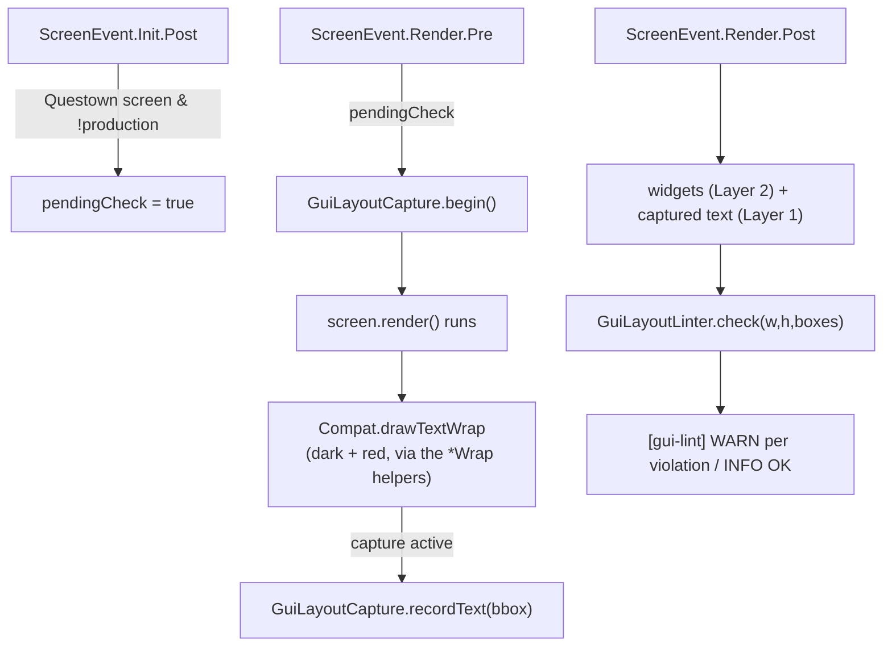
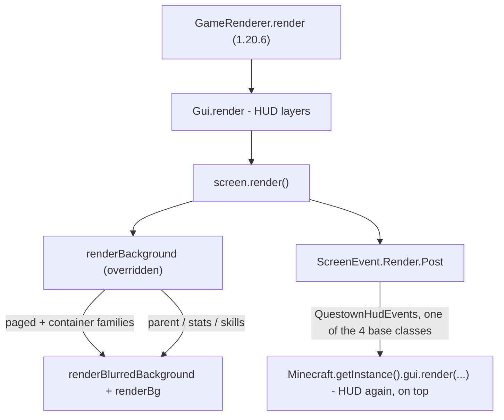

# GUI layout validation + flow layout

Two cooperating pieces: a **layout linter** that flags overlapping/overflowing GUI
elements, and a **flow-layout** screen pattern that avoids producing them. See the
convention doc `docs/solutions/conventions/gui-layout-flow-and-linter.md` for the rules;
this map is the mechanism.

## The linter (dev-only, client)

- **Layer 2** (`collectWidgetBoxes`): widget geometry — off-screen, button-label-overflow.
- **Layer 1** (`GuiLayoutCapture` + the `drawTextWrap` hook): each wrapped-text
  block's real bbox; dark and red (warning) text both route through `drawTextWrap`
  (via `drawDarkTextWrap` / `drawRedTextWrap`), so both are captured. Text bleeding
  into another element shows up as an **overlap**.
- Both feed ONE `GuiLayoutLinter.check` (pure, JUnit-tested in `GuiLayoutLinterTest`).
- Runs once per screen open (Init sets a flag; the first Render pair captures + checks).
- Inert in shipped jars (`FMLEnvironment.production`) and never loaded on a server
  (`@Mod.EventBusSubscriber(value = Dist.CLIENT)`). `GuiLayoutCapture` holds no client types
  so the shared `Compat` layer can call it safely.

## 1.19.2 render-layering parity (1.20.6)

In 1.20.6 `GameRenderer.render` draws the HUD layers (hearts, hunger, XP,
hotbar, chat) **before** the current screen; in 1.19.2 the HUD was drawn
**after** the screen, so the 1.19.2 menus show the HUD on top of their
background. The vanilla 1.20.6 container background is an opaque full-canvas
gradient, which therefore hides the HUD entirely on 1.20.6.

Two cooperating pieces restore the 1.19.2 look for the screen families that
match the 1.19.2 golden captures (`tools/porttest/`):

- `AbstractPagedCardScreen.renderBackground` and `CompatContainerScreen.renderBackground`
  both draw `renderBlurredBackground` + `renderBg`: the 1.19.2 golden blurs the
  world behind *every* container/paged window (its `Screen.renderBackground` is
  the blur path when a level is present). Before the 2026-10-01 fix the paged
  family skipped the blur (`renderBg` only) and the container family inherited
  the 1.20.6 vanilla opaque gray gradient (`renderTransparentBackground`) - the
  "some tabs blur, some are flat gray" split the oracle caught.
- `InventoryAndStatusScreen` / `VillagerStatsScreen` / `VillagerAdvancementsScreen`
  override `renderBackground` to the blurred world (the 1.19.2 default-blur
  look) instead of the opaque gradient / menu texture.
- `QuestownHudEvents` re-renders the HUD after the screen for those four base
  classes, restoring the 1.19.2 layering where the HUD sits above the menu
  background. The blur is semi-transparent, so the HUD drawn *before* the screen
  also stays visible through it - which is why the container family needs no
  `QuestownHudEvents` entry of its own.
- The two `*ConfirmScreen` keep their own flat gray `renderBackground`: their
  golden equivalents are opaque gray, so matching them is correct - do not
  "unify" them onto the blur.
- Verified with the `tools/porttest/` capture oracle on 2026-10-01 (work =
  container family, quests = paged family): both captures show the out-of-focus
  world at the screen edges; the six golden-bank screens are gated and banked
  post-fix, heart/hotbar rows matching via `run.sh diff`.

## 1.20.6 blit UV: the 7-arg `GuiGraphics.blit` divides by 256

1.20.6 changed the GUI blit pipeline to normalized UV: the quad's UVs are
`u / maxU`, `v / maxV`. The 7-arg `blit(rl, x, y, u, v, w, h)` overload
**defaults maxU/maxV to 256**, so a 16x16 texture blit samples only the
texture's top-left 1/16 (one pixel) and stretches it across the tile. In
1.19.2 the equivalent `PoseStack.blit` used raw texture-pixel UVs, so the
ported call that looked identical renders as a solid color on 1.20.6.

Caught in the port-test oracle: the skills-pane background
(`VillagerAdvancementsContent.drawContents` tiles `stone.png`) rendered as one
solid 0x8F gray (stone.png pixel (0,0)) instead of the mottled texture.
Fix: pass the texture dimensions, the way vanilla's own 1.20.6
`AdvancementTab.drawContents` does -
`blit(rl, x, y, 0.0F, 0.0F, 16, 16, 16, 16)` (9-arg form). In this 7-arg form
blits into 256x256 atlas textures are correct as-is because maxU/maxV default
to 256. A different overload normalizes differently: the
`VillagerStatsScreen` bar fix below was a 10-arg call with the bar height
landing in the maxU slot.

## 1.20.6 `Util.blitFace`: display size is a gui-pose scale, not a blit argument

The 1.19.2 `blitFace` passed `faceWidth * scale` as the blit draw size - the
8x8 face region sampled and *stretched* to 8*scale. In 1.20.6 the
`GuiGraphics.blit` width/height arguments are the **source region blitted 1:1**
(see the 7-arg section above): passing `faceWidth * scale` there samples
`scale`x more of the 64x64 skin and squishes the face into the box (the port
regression - a smeared, shifted head, not a magnified one).

The 1.20.6 equivalent of "display at 8*scale" is a gui-pose scale around the
blit: `pose().translate(x, y); pose().scale(scale, scale, 1); blit(tex, 0, 0,
8, 8, faceWidth, faceWidth, 64, 64)` (nearest-neighbor keeps the pixel blocks
distinct). Same seam rule as every other 1.20.6 pose note in this file: gui
pose only, never the global modelview stack.

Oracle check (2026-10-01, economics screen "Food" row face icon vs the 1.19.2
golden bank): same left/top origin (canvas 246,294 on both), same 12x9
non-flat footprint, same 8x8 source structure magnified - wip 12x9 at 2x
nearest-neighbor blocks, matching the golden; the wider wip mask in a naive
bbox probe is the row's item icon to the right, not the face.

## 1.20.6 Ingredient: `CODEC_NONEMPTY` throws on an empty ingredient

`gui/Ingredients.toJson` serializes an `Ingredient` to the `{"items":[...]}`
shape the job-request and work-request readers (`isTag`, `getName`, `toString`)
parse. On 1.19.2 the built-in `Ingredient.toJson()` returned `{"items":[]}`
for an empty ingredient; 1.20.6 only exposes the validating `CODEC_NONEMPTY`,
which throws (`IllegalStateException`, "Item array cannot be empty") on the same
input. So an empty ingredient in a work job took the whole card down
(`putRequestedItemFirst -> isTag`, the skills pane). `toJson` now guards
`item.isEmpty()` and returns the golden's `{"items":[]}` shape, so those readers
fall through as on 1.19.2 instead of throwing.

## VillagerStatsScreen stat bars: the two half-bands and the 10-arg blit trap

Each stat bar (EXP, HUNGER) is two 82px half-bands, 0-50% and 50-100%, drawn
as a 5px track with a 5px green fill over it. The golden (1.19.2) art carries
one half-band at u0 and a second at u100 with a capped right end; the wip rebake had only the u0 band (u100 onward transparent in `bars.png`) and a
10-arg `gui.blit` whose maxU slot held the bar height (5), so the right half
drew as a bare repeat of the left band and the track span read about 80px
short: pre-fix capture, track x236..299 + x315..378 against the golden's
x236..395 with a dark #09100c column at its right end.

Fix (2026-10-13, dev-accepted):

- rebaked `bars.png` with both half-bands: left at u0..94, right at u100..181
  with its 1px dark end column at u181; track rows v64..68, fill rows v69..73
  (v74 down is the purple bands; the fill sits at v69 like the golden, not
  v70, which would bleed a purple row in).
- `renderBar` now calls `Util.blit` (maxU/maxV fixed at 256, the shape the
  verified tab-icon fix uses) at u1/u100 for the track (v64) and the fill
  (v69), with the existing leftWidth/rightWidth split: left half 0-50%, right
  half 50-100%.
- Live pixel check (grim capture of the 1.20.6 client window, 2026-10-13):
  band spans 5 rows, green fill from the bar's left edge, stripe track across
  the rest, a dark #09100c column at the right end, then the window background
  #c6c6c6.
- Accepted deviation: the right end renders as a squared 1px cap, not the
  golden's rounded corner (dev-accepted on the same date; not re-baked).

## 1.20.6 scissor clip: `enableScissor(x, y, right, bottom)`

In 1.19.2 the advancement pane was clipped per-class (the z+-950 / colorMask
juggling around the translate); the 1.20.6 port removed that hack and added no
replacement, so `VillagerAdvancementsContent`'s 16x16 stone-tile loop
(`i1 -1..15`, `j1 -1..8`) draws well past the 234x113 pane: the pre-fix
capture shows the right band x444-470 86% stone-grey and the bottom band
y408-424 93%, against 0% on the 1.19.2 golden.

The 1.20.6 clip is `GuiGraphics.enableScissor`, and its last two arguments
are the absolute canvas RIGHT and BOTTOM edges, **not** width/height: the
bytecode builds `ScreenRectangle(x, y, p3 - x, p4 - y)`. Passing
width/height (the natural reading) makes a 34x-172 degenerate rect and the
scissor swallows the pane content entirely: the frame and tabs still draw,
and the pane interior shows the dimmed world straight through. A capture like
that looks like the bleed was fixed (the bleed pixels are indeed gone), but
the pane is empty; check the interior stone fraction against the golden
(about 0.86) before trusting it.

Applied in `VillagerAdvancementsScreen.renderInside`, around the pose
push/translate block: `enableScissor(bgX + 9, bgY + 18, bgX + 9 + 234,
bgY + 18 + 113)` then `disableScissor()`. Verified on a fresh creative-mode
capture: pane interior stone fraction 0.788 (pre-fix bank 0.905, golden
0.864), both bleed bands 0.000, and the tile to window-frame to world
transitions clean on the right, bottom and top edges.

## 1.19.2 to 1.20.6 `blit` port: the z argument vanishes, the rest shift

The 1.19.2 golden tab icons call
`GuiComponent.blit(PoseStack, x, y, int z, float u, float v, int w, int h,
texW, texH)`: the all-int 10-arg form resolves to the float u/v overload
(pinned from the 1.19.2 mapped-jar bytecode), and `z` is depth, which has no
slot in the 1.20.6 `GuiGraphics.blit`. The port dropped `z` but misread the
surviving arguments, and the two affected icons rendered blank (the other
four tabs drew, so it read like a texture-load issue at first):

- stats: golden `(x+13, y+11, 0, 0, 0, 9, 9, 256, 256)` = u=0, v=0, 9x9;
  the wip call had v=9, a transparent atlas row.
- skills: golden `(adjX, adjY, 0, 17, 7, 30, 30, 256, 256)` = u=17, v=7,
  30x30 at 50% scale; the wip call had u=0, v=17, 7x30.

menu.png is byte-identical in both repos, so only the UV region is in play.
Pixel evidence (tab cells on the capture): pre-fix bank 0 colored pixels in
both cells (pure tab-base grey); post-fix 27 green icon px (stats, menu.png
(0,0)-(9,9)) and 36 white/shaded px (skills, menu.png (17,7)-(47,37)).

## Render-argument absorption (CompatScreen / CompatContainerScreen)

The strangler's standing goal: a version switch should touch the seam family, not the 29 gui
screens. The render pipeline was the part the seam could not absorb before. Each leaf still
overrode `render(GuiGraphics, ...)` (1.19.2: `render(PoseStack, ...)`) directly, so every screen
named the render-argument type. Two base classes now own those version-bound override signatures,
and the leaves express the draw order through version-neutral hooks over `RenderContext`.

`RenderContext` (record: `font`, `itemRenderer`, `gui`) is the faithful pass-through handle: each
method invokes the exact 1.20.6 `GuiGraphics`/JEI/widget method with the same arguments, so
rendering is preserved by construction (`ctx.fill` → `gui.fill`, `ctx.drawNineNine` →
`NineNine.draw(gui, ...)`, `ctx.renderWidget(button)` → `button.render(gui, ...)`, `ctx.centered` →
`gui.drawCenteredString`). A two-arg constructor fills `font` from the running client so the eleven
pre-existing `new RenderContext(itemRenderer, gui)` call sites keep compiling unchanged.

The hooks reproduce the decompiled 1.20.6 chain. `Screen.render` = `renderBackground(virtual)` +
widgets; `AbstractContainerScreen.render` = `renderBackground(→renderBg) + widgets + slots +
renderLabels`. So both bases reduce to `renderPrologue → super.render → renderScreenContent`, with
the per-screen background/labels folded into the vanilla hooks the base already overrides:

- **`CompatScreen`** (plain `Screen` leaves): `renderPrologue` (a full-canvas fill) → `super.render`
  (which calls `renderBackground` → `renderScreenSurface` — the panel, e.g. `ctx.drawNineNine` — then
  the renderable widgets) → `renderScreenContent` (text, item icons).
- **`CompatContainerScreen`** (`AbstractContainerScreen` leaves): `renderPrologue` (per-frame state,
  e.g. the button active flag) → `super.render` (which calls `renderBackground` → `renderBgContent`
  — the NineNine panel + inventory slots — then the widgets, the slots, and `renderLabelsContent`)
  → `renderScreenContent` (the screen-specific content).

`super.render` already re-invokes the version-bound `renderBackground`/`renderBg`, so a leaf's
direct `this.renderBackground(...)` / `super.render(...)` calls are dropped. The original drew the
NineNine panel a second time there; folding to once is pixel-identical.

`showTooltip(Component | List<Component>)` on both bases exposes the 1.20.6
`setTooltipForNextRenderPass` (its single-`Component` overload is `protected`, so a screen in another
package cannot call it — only a `Screen` subclass can; that is why a base class, not a static
`Compat` method, carries this). `Compat.button(...)` and `Compat.componentText(...)` are the
remaining render-side seams (the `Button.builder` construction and the `getVisualOrderText()` call,
each named only in the seam family, not the leaves).

`tools/strangler-check` admits the two base classes (`gui/CompatScreen`, `gui/CompatContainerScreen`)
to the seam family alongside the existing `gui/RenderUtil` and `gui/RenderContext`.

Proven on the `fillGradient` + NineNine pattern by migrating one screen of each tier
(RelocationConfirmScreen → `CompatScreen`, JobUnlockConfirmScreen → `CompatContainerScreen`) plus
WorkRequestConfirmScreen, and the **paged cluster** (2026-10-13): `AbstractPagedCardScreen`
(added to the gate's `SEAM_FILES` - its `renderTooltip(GuiGraphics,int,int)` hook is the one spot that
carries the render argument to `ctx.gui()`) with its four leaves `QuestsScreen`, `TownEconomicsScreen`,
`VillagerEconomicsScreen`, `MultiStatusScreen` onto `CompatContainerScreen` - paged surface via
`renderBgContent`/`renderScreenContent`, leaf extras via `renderScreenExtras`. All marker-free, `./gradlew
stranglerCheck` green, grandfather set 113 → 108; gui-lint OK on Quests/MultiStatus/TownEconomics via the
`qtdiag flagtab` hook (the console FIFO was a dead pipe on that launch), and the `Util.blit` 8→10-arg fix
verified by vision (the "flat grey box" status-icon bug the 8-arg form reintroduces - see the 10-arg
javadoc in `mc/Util.java` and the AGENTS.md blit note).
WorkRequestConfirmScreen also fixes the
idiom for the seam helper that still takes the render argument: `Ingredients.render`
takes a `RenderContext` and reaches the raw graphics through `ctx.gui()` (so the leaf
names `RenderContext`, never `GuiGraphics`), while `RenderUtil.highlight` keeps taking
the argument as `ctx.gui()` (a record accessor, no type named in the leaf; `RenderUtil`
itself is a gate seam file), and `Compat.drawDarkText` collapses to `ctx.darkText`.

`Ingredients` de-grandfathered (2026-10-13): `render` takes `RenderContext`, and the
three `Registries.ITEM` tag constructions route through `Compat.itemTag(ResourceLocation)`
(the `net.minecraft.core.registries` seam keeps the registry access; the helper name dodges
the gate's package marker). `QuestsScreen`, `WorkRequestConfirmScreen` and `ItemJobsScreen`
pass `ctx`/`rc` directly. `compileJava --rerun-tasks` green; `strangler-check` green, the
grandfather set 85 → 84; held run gui-lint OK on `ItemJobsScreen`; vision confirmed the
`Jobs:` panel, card rows with real item art (no flat boxes), and the title/nav/button row.
Bank drive (fresh fixture world) against `goldens/1.19.2/`: all six screens in
fixture-drift range, `quests` at 0.83% (the prior round's pass line was 0.89%). The
`check` content gate's "active tab" heuristic misfires on this fixture's `quests`
(world-state dependent: which quest category is active shifts with the world); the pixel
diff is the parity signal here, and it clears.

`VillagerAdvancementsScreen` + `VillagerAdvancementsContent` + `VillagerAdvancementsWidget`
de-grandfathered (2026-10-13, 84 → 81): the screen is now a `CompatScreen` and the
1.19.2 `render` sandwich decomposes onto the compat hooks - `renderBlurredBackground`
in `renderScreenSurface` (the surface runs where `Screen.renderBackground` used to
paint, so the HUD-over-blur layering `QuestownHudEvents` depends on is unchanged),
window + pane + tooltips in `renderScreenContent`. All three files name
`RenderContext`, never `GuiGraphics`: `fill`/`drawString(int)` through `ctx.fill`/
`ctx.text`, blits through `ctx.gui().blit` (the 256×256 `widgets.png` and vanilla
`window.png` are both byte-identical in the 1.19.2 and 1.20.6 client jars, so the
7-arg blits sample the same UV in both), pose blocks through `ctx.pose()`, and the
scissor clip through `ctx.gui().enableScissor`/`disableScissor` (absolute canvas
edges, verified from the `ScreenRectangle` ctor). One naming trap survived the port:
`renderTooltips`'s 3rd/4th params are the pane origin (i, j), not the mouse, and the
tooltip translate is pane-based - it now reads `paneX`/`paneY`, so the swap is
obvious instead of a latent bug. `QuestownHudEvents` matches by class name and
stays unharmed. Evidence: `compileJava --rerun-tasks` green, gate green at 81,
`[gui-lint] VillagerAdvancementsScreen (634x675) — OK`, `check.sh` content gate PASS
on all seven canonical screens (active tab vision-confirmed), and `run.sh diff` with
every screen in fixture-drift range (`skills` - the screen rendered by this leaf - at
0.51% full-frame).

The render-layering family is resolved (2026-10-13, 81 → 79): `QuestownHudEvents`
(the HUD-over-blur redraw this package's screens depend on) and
`GuiLayoutCheckClientEvents` (the dev gui-lint) are both `@EventBusSubscriber`
neoforged wiring and now live in `loader/neo` (the seam package - the same home
`ItemsInteract` and `NeoMouseScrollDispatch` already hold). A package move of
the wiring only: the bus is package-independent, so both still register
(verified live - the gui-lint line fires and the porttest content gate confirms
the HUD-over-blur layering on the affected screens). Neither file's logic
changed; the layering it keeps is still the one `run.sh` diffs against
`tools/porttest/goldens/`. The only `gui/` neoforged files (81 → 79) are resolved, and `gui/` is now
leak-free (2026-10-13, 79 → 77). `AbstractVillagerMenu` no longer wraps its
inventories in a neoforged `InvWrapper` or builds `SlotItemHandler`s:
both were the item-handler surface, and the three neoforged imports
(`IItemHandler`/`SlotItemHandler`/`InvWrapper`) are gone. The menus hold the
original vanilla `Container`/`Inventory` directly and build plain vanilla
`Slot(container, index, x, y)` slot boxes; this is provably equivalent because
the menu's custom `quickMoveStack`/`moveItemStackTo` only use
`Slot.set/get/mayPlace` and never the handler's `insertItem`/`extractItem`
(verified with `jmembers`: `Slot(Container,int,int,int)` and
`Container.getContainerSize()` are the 1.20.6 vanilla API; `Container` is not
a strangler marker). `LockableInventoryWrapper` was **deleted**: a neoforged
`InvWrapper` subclass with zero references in main or test (dead code that
could only be de-grandfathered by removing it). Evidence: `compileJava` +
`compileTestJava --rerun-tasks` green; 968 tests (only the deliberate
`ChickenArcHintsTest.todo_` marker red); strangler-check green at 77;
gui-lint OK on every affected menu (InventoryAndStatus, Quests,
VillagerStats, VillagerEconomics, VillagerBlockofProgress, Work); and the
slot-rendering `parent` (inventory) tab pixel-diffing against the 1.19.2
golden at a 0.0447% center-rect (slot region) delta - the slots render
identically to the golden branch.
The SAFE-tier confirm screens (VillagerBlockofProgressScreen,
TownBlockofProgressScreen, CreateStockRequestScreen, WorkScreen, AddWorkScreen,
FlagCraftingScreen, JobChangeConfirmScreen)
and the render-argument helpers `IngredientRenderer` / `StatusGraphic` / `Tabs` are done,
as is `VillagerStatsScreen` (2026-10-13: onto `CompatContainerScreen` - the stat bars and
two-half-band art are verbatim `Util.blit`/`ctx.darkText` calls - gui-lint OK, vision
confirmed the bars + HUD-over-blur layering, bank diff in fixture-drift range), and
`InventoryAndStatusScreen` (2026-10-13: `render`/`renderBg` onto the base hooks, the
`Button.builder` quest-button onto `Compat.button`, the status-tooltip
`Component::getVisualOrderText` lambda onto a `Compat::componentText` map into
`showTooltip(List<FormattedCharSequence>)` - gui-lint OK, vision confirmed tabs/status
icon/slots/Quests button + HUD over blur, bank diff in drift range), and `ItemJobsScreen`
(2026-10-13, below).

`PagedCardScreen` + `ItemJobsScreen` onto `RenderContext` (2026-10-13): the delegate's
public surface now takes `RenderContext` (`renderBg`, `afterRender` - dropped its `Font`
parameter, `renderButtons`, the per-card `CardRenderer` interface, and the page-number
`fill` consumer), so the composing `ItemJobsScreen` leaf names no render-argument type at
all (onto `CompatScreen`: panel in `renderScreenSurface`, content + `Compat.button` + the
`Compat.componentText` tooltip in the neutral hooks) - **fixing a live 1.20.6 draw-order
regression in the process**: a vanilla 1.20.6 `Screen.render` draws its background *inside
`render`*, so the leaf's old sandwich (background, panel, `super.render`→background again)
painted the paged panel under the second background; in 1.19.2 `Screen.render` draws no
background at all, so the golden never hit it. The compat base makes the panel sit between
surface and renderables - the golden's relative order - and that is why this leaf's
verification is a fresh held run (gui-lint OK; vision confirmed the panel, `Jobs:` title,
Page 1/14 nav, Add-To-Work-Requests button and the card rows) rather than a bank diff -
there is no correct 1.20.6 pixels to compare against. The four Abstract leaves are
re-verified intact in the same run (gui-lint OK on Quests/TownEconomics/VillagerEconomics/
MultiStatus; bank diffs in fixture-drift range). Opener added for the headless drive:
`_qtdev show_item_jobs` (thin wrapper over the `OpenJobMessage` owner call; see
`commands/COMPLEX.md`).

Render-argument helpers taking `RenderContext` (2026-10-13): `IngredientRenderer.render`,
`StatusGraphic.render`, and `Tabs.draw` (plus the inlined notification-dot `fill`) now take
`RenderContext` directly instead of `GuiGraphics` - the version-neutral record is the same
admitted type the screens use, so no new seam API. Callers (`TownEconomicsScreen`,
`VillagerEconomicsScreen`, `InventoryAndStatusScreen`) pass `ctx` rather than `ctx.gui()`.
Every draw call underneath is verbatim (`Compat.renderItemAndDecorations`, the 10-arg
`ClientAccess`/32×32 `blit`, the 4×4 notification dot), so these landed without a fresh
held-run gui-lint - the same rationale as the player-head item (pass-through, not layout).
Grandfather set 93 → 89; the gate also stopped counting `.md` files (their prose names
markers on purpose), which dropped `gui/COMPLEX.md` from the list. The carried-over live pass
on `VillagerEconomicsScreen` was done in the same run: gui-lint OK + vision (real item art in
the ingredient grid) on 2026-10-13.

FlagCraftingScreen (flow layout + craft tooltips + tabs) and JobChangeConfirmScreen (early-
return + tabs tooltip + centered text) are the two remaining SAFE-tier leaves with non-trivial
toobar/tooltip interaction; both are done via the same two-tier pattern.

## Player-head profile: `Compat.resolvablePlayerHead` (components, not NBT)

A player head whose face resolves to a villager's UUID is a version surgery, and *where it is
named* is the trap. The component stack builds it as `head.set(DataComponents.PROFILE, new
ResolvableProfile(...))`; both `DataComponents` and `net.minecraft.world.item.component.
ResolvableProfile` are strangler markers, so a leaf must not name them. `QuestRemoveConfirmScreen`
(the one screen that needed it, now a `CompatContainerScreen` leaf) calls `Compat.resolvablePlayerHead(UUID)`, and the exact 3-arg construction `ResolvableProfile(Optional.empty(),
Optional.of(uuid), new PropertyMap())` plus `new ItemStack(Items.PLAYER_HEAD)` lives in `mc/Compat`
- the seam family the gate admits. Off the grandfather list (108 -> 107), `strangler-check` green,
`compileJava` executed; the layout is inherited from the base-class migration and the sibling
confirm screens (already gui-linted), and the only pixel delta is a verbatim item construction
rather than a new layout, so this landed without a fresh held-run capture.

## Flow layout (FlagCraftingScreen)

`computeLayout()` stacks blocks top-to-bottom, advancing the `y` cursor past each block's
**real** wrapped height (`font.split(text, width).size() * lineHeight + pad`) and sizing the
panel to the total. `init()` (widgets) and `render()` (text) both read the same computed
offsets, so a longer/translated string pushes everything down instead of overlapping —
overlap-proof by construction. This replaced hardcoded Y positions + a 56px wrap width that
overran their rows.

## Villager menu wire: `VillagerMenusPayload` carries UUID + slot locks

Opening any villager menu (quests / stats / economics / BOP / job-change) goes
server → `VillagerMenus.write` → `openScreen` → client
`VillagerMenus.fromNetwork`, where **one payload decodes into all six menus**.
The payload carries the villager's **UUID and slot locks**: the client builds
purely from wire data and must never need the local entity. Before this, the
client resolved the townie by raw entity id and read the UUID/slot locks off
it — a townie despawned between the packet send and the read NPE'd the screen
open ("Failed to open a screen") and disconnected the client (`.scratch/
work-board-request/quests-menu-null-townie-client-crash.md`). `entityId` still
rides the wire as a **best-effort** pointer: `VillagerStatsMenu.attach(e)` wires
live stats updates when the local entity happens to still be present; without
it the menu degrades to the wire's static stats data instead of crashing.

- `entityId` (best-effort pointer) → `attach` if present, else static wire data.
- Payload layout: id, uuid, jobId, invSize, quests, flagPos, stats, 2 booleans,
  slot locks — read order must match write; econ is wire-dead (`none()` both ends).
- `VillagerMenusPayloadTest` pins the round-trip; the menu-construction half is
  not unit-testable (registry-bound menu types).
