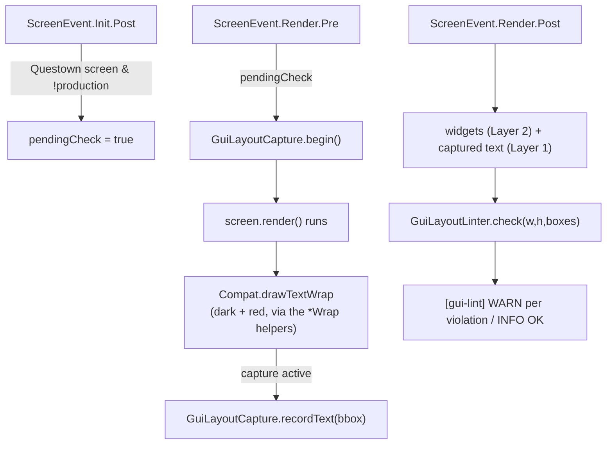
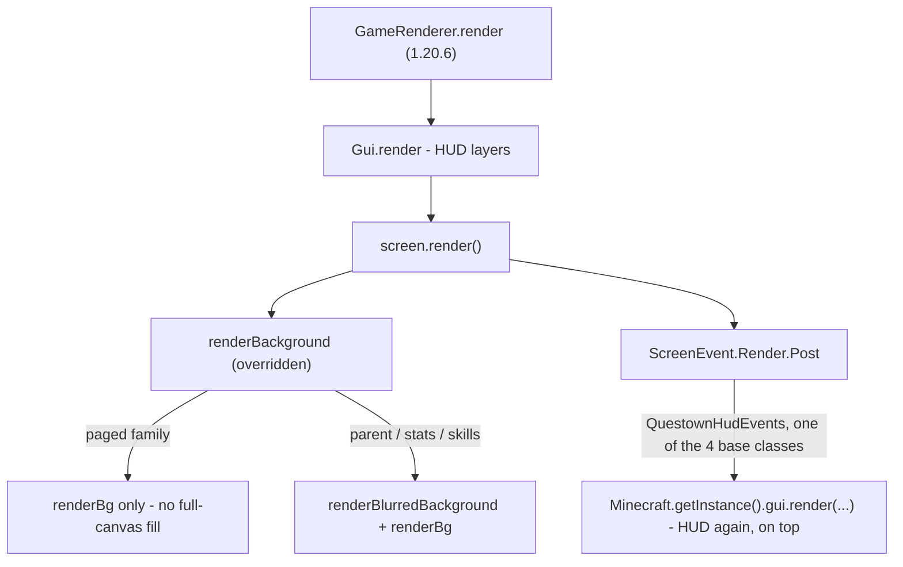

# GUI layout validation + flow layout

Two cooperating pieces: a **layout linter** that flags overlapping/overflowing GUI
elements, and a **flow-layout** screen pattern that avoids producing them. See the
convention doc `docs/solutions/conventions/gui-layout-flow-and-linter.md` for the rules;
this map is the mechanism.

## The linter (dev-only, client)

- **Layer 2** (`collectWidgetBoxes`): widget geometry — off-screen, button-label-overflow.
- **Layer 1** (`GuiLayoutCapture` + the `drawTextWrap` hook): each wrapped-text
  block's real bbox; dark and red (warning) text both route through `drawTextWrap`
  (via `drawDarkTextWrap` / `drawRedTextWrap`), so both are captured. Text bleeding
  into another element shows up as an **overlap**.
- Both feed ONE `GuiLayoutLinter.check` (pure, JUnit-tested in `GuiLayoutLinterTest`).
- Runs once per screen open (Init sets a flag; the first Render pair captures + checks).
- Inert in shipped jars (`FMLEnvironment.production`) and never loaded on a server
  (`@Mod.EventBusSubscriber(value = Dist.CLIENT)`). `GuiLayoutCapture` holds no client types
  so the shared `Compat` layer can call it safely.

## 1.19.2 render-layering parity (1.20.6)

In 1.20.6 `GameRenderer.render` draws the HUD layers (hearts, hunger, XP,
hotbar, chat) **before** the current screen; in 1.19.2 the HUD was drawn
**after** the screen, so the 1.19.2 menus show the HUD on top of their
background. The vanilla 1.20.6 container background is an opaque full-canvas
gradient, which therefore hides the HUD entirely on 1.20.6.

Two cooperating pieces restore the 1.19.2 look for the screen families that
match the 1.19.2 golden captures (`tools/porttest/`):

- `AbstractPagedCardScreen.renderBackground` draws only `renderBg` (the
  1.19.2 paged screens had no full-canvas background), so the world and the
  HUD drawn earlier stay visible around the window.
- `InventoryAndStatusScreen` / `VillagerStatsScreen` / `VillagerAdvancementsScreen`
  override `renderBackground` to the blurred world (the 1.19.2 default-blur
  look) instead of the opaque gradient / menu texture.
- `QuestownHudEvents` re-renders the HUD after the screen for those four base
  classes, restoring the 1.19.2 layering where the HUD sits above the menu
  background. Without it the blurred-world background (opaque) would cover the
  HUD just like the gradient did.
- Scoped to the four base classes that match the golden set; the other mod
  screens (WorkScreen, JobChangeConfirmScreen, ...) still inherit the vanilla
  background and still hide the HUD - extending them means adding the class
  to `QuestownHudEvents` plus the same `renderBackground` override.
- Verified with the `tools/porttest/` capture oracle: all six screens re-shot,
  gated, and banked post-fix; the heart/hotbar rows now match the golden
  positions (`run.sh diff`).

## 1.20.6 blit UV: the 7-arg `GuiGraphics.blit` divides by 256

1.20.6 changed the GUI blit pipeline to normalized UV: the quad's UVs are
`u / maxU`, `v / maxV`. The 7-arg `blit(rl, x, y, u, v, w, h)` overload
**defaults maxU/maxV to 256**, so a 16x16 texture blit samples only the
texture's top-left 1/16 (one pixel) and stretches it across the tile. In
1.19.2 the equivalent `PoseStack.blit` used raw texture-pixel UVs, so the
ported call that looked identical renders as a solid color on 1.20.6.

Caught in the port-test oracle: the skills-pane background
(`VillagerAdvancementsContent.drawContents` tiles `stone.png`) rendered as one
solid 0x8F gray (stone.png pixel (0,0)) instead of the mottled texture.
Fix: pass the texture dimensions, the way vanilla's own 1.20.6
`AdvancementTab.drawContents` does -
`blit(rl, x, y, 0.0F, 0.0F, 16, 16, 16, 16)` (9-arg form). In this 7-arg form
blits into 256x256 atlas textures are correct as-is because maxU/maxV default
to 256. A different overload normalizes differently: the
`VillagerStatsScreen` bar fix below was a 10-arg call with the bar height
landing in the maxU slot.

## VillagerStatsScreen stat bars: the two half-bands and the 10-arg blit trap

Each stat bar (EXP, HUNGER) is two 82px half-bands, 0-50% and 50-100%, drawn
as a 5px track with a 5px green fill over it. The golden (1.19.2) art carries
one half-band at u0 and a second at u100 with a capped right end; the wip rebake had only the u0 band (u100 onward transparent in `bars.png`) and a
10-arg `gui.blit` whose maxU slot held the bar height (5), so the right half
drew as a bare repeat of the left band and the track span read about 80px
short: pre-fix capture, track x236..299 + x315..378 against the golden's
x236..395 with a dark #09100c column at its right end.

Fix (2026-10-13, dev-accepted):

- rebaked `bars.png` with both half-bands: left at u0..94, right at u100..181
  with its 1px dark end column at u181; track rows v64..68, fill rows v69..73
  (v74 down is the purple bands; the fill sits at v69 like the golden, not
  v70, which would bleed a purple row in).
- `renderBar` now calls `Util.blit` (maxU/maxV fixed at 256, the shape the
  verified tab-icon fix uses) at u1/u100 for the track (v64) and the fill
  (v69), with the existing leftWidth/rightWidth split: left half 0-50%, right
  half 50-100%.
- Live pixel check (grim capture of the 1.20.6 client window, 2026-10-13):
  band spans 5 rows, green fill from the bar's left edge, stripe track across
  the rest, a dark #09100c column at the right end, then the window background
  #c6c6c6.
- Accepted deviation: the right end renders as a squared 1px cap, not the
  golden's rounded corner (dev-accepted on the same date; not re-baked).

## 1.20.6 scissor clip: `enableScissor(x, y, right, bottom)`

In 1.19.2 the advancement pane was clipped per-class (the z+-950 / colorMask
juggling around the translate); the 1.20.6 port removed that hack and added no
replacement, so `VillagerAdvancementsContent`'s 16x16 stone-tile loop
(`i1 -1..15`, `j1 -1..8`) draws well past the 234x113 pane: the pre-fix
capture shows the right band x444-470 86% stone-grey and the bottom band
y408-424 93%, against 0% on the 1.19.2 golden.

The 1.20.6 clip is `GuiGraphics.enableScissor`, and its last two arguments
are the absolute canvas RIGHT and BOTTOM edges, **not** width/height: the
bytecode builds `ScreenRectangle(x, y, p3 - x, p4 - y)`. Passing
width/height (the natural reading) makes a 34x-172 degenerate rect and the
scissor swallows the pane content entirely: the frame and tabs still draw,
and the pane interior shows the dimmed world straight through. A capture like
that looks like the bleed was fixed (the bleed pixels are indeed gone), but
the pane is empty; check the interior stone fraction against the golden
(about 0.86) before trusting it.

Applied in `VillagerAdvancementsScreen.renderInside`, around the pose
push/translate block: `enableScissor(bgX + 9, bgY + 18, bgX + 9 + 234,
bgY + 18 + 113)` then `disableScissor()`. Verified on a fresh creative-mode
capture: pane interior stone fraction 0.788 (pre-fix bank 0.905, golden
0.864), both bleed bands 0.000, and the tile to window-frame to world
transitions clean on the right, bottom and top edges.

## 1.19.2 to 1.20.6 `blit` port: the z argument vanishes, the rest shift

The 1.19.2 golden tab icons call
`GuiComponent.blit(PoseStack, x, y, int z, float u, float v, int w, int h,
texW, texH)`: the all-int 10-arg form resolves to the float u/v overload
(pinned from the 1.19.2 mapped-jar bytecode), and `z` is depth, which has no
slot in the 1.20.6 `GuiGraphics.blit`. The port dropped `z` but misread the
surviving arguments, and the two affected icons rendered blank (the other
four tabs drew, so it read like a texture-load issue at first):

- stats: golden `(x+13, y+11, 0, 0, 0, 9, 9, 256, 256)` = u=0, v=0, 9x9;
  the wip call had v=9, a transparent atlas row.
- skills: golden `(adjX, adjY, 0, 17, 7, 30, 30, 256, 256)` = u=17, v=7,
  30x30 at 50% scale; the wip call had u=0, v=17, 7x30.

menu.png is byte-identical in both repos, so only the UV region is in play.
Pixel evidence (tab cells on the capture): pre-fix bank 0 colored pixels in
both cells (pure tab-base grey); post-fix 27 green icon px (stats, menu.png
(0,0)-(9,9)) and 36 white/shaded px (skills, menu.png (17,7)-(47,37)).

## Flow layout (FlagCraftingScreen)

`computeLayout()` stacks blocks top-to-bottom, advancing the `y` cursor past each block's
**real** wrapped height (`font.split(text, width).size() * lineHeight + pad`) and sizing the
panel to the total. `init()` (widgets) and `render()` (text) both read the same computed
offsets, so a longer/translated string pushes everything down instead of overlapping —
overlap-proof by construction. This replaced hardcoded Y positions + a 56px wrap width that
overran their rows.
