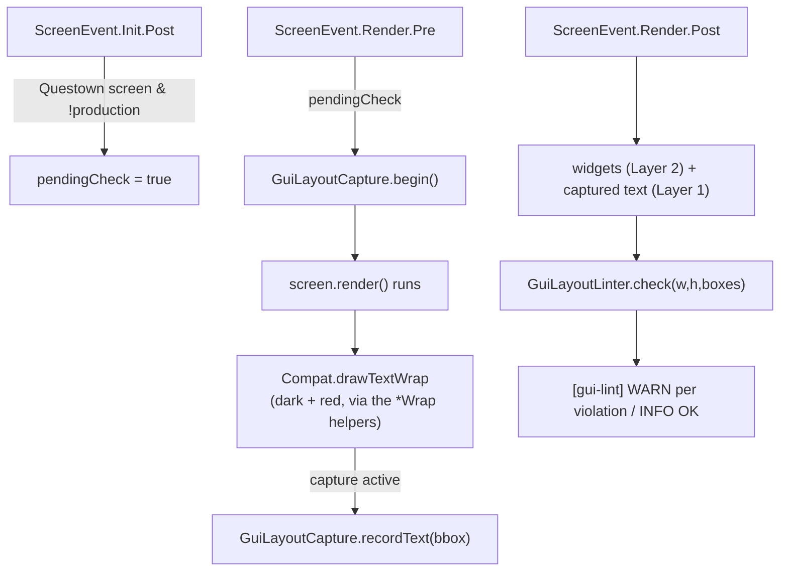
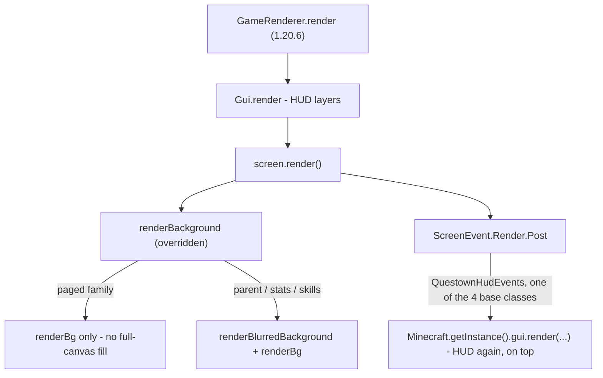

# GUI layout validation + flow layout

Two cooperating pieces: a **layout linter** that flags overlapping/overflowing GUI
elements, and a **flow-layout** screen pattern that avoids producing them. See the
convention doc `docs/solutions/conventions/gui-layout-flow-and-linter.md` for the rules;
this map is the mechanism.

## The linter (dev-only, client)

- **Layer 2** (`collectWidgetBoxes`): widget geometry — off-screen, button-label-overflow.
- **Layer 1** (`GuiLayoutCapture` + the `drawTextWrap` hook): each wrapped-text
  block's real bbox; dark and red (warning) text both route through `drawTextWrap`
  (via `drawDarkTextWrap` / `drawRedTextWrap`), so both are captured. Text bleeding
  into another element shows up as an **overlap**.
- Both feed ONE `GuiLayoutLinter.check` (pure, JUnit-tested in `GuiLayoutLinterTest`).
- Runs once per screen open (Init sets a flag; the first Render pair captures + checks).
- Inert in shipped jars (`FMLEnvironment.production`) and never loaded on a server
  (`@Mod.EventBusSubscriber(value = Dist.CLIENT)`). `GuiLayoutCapture` holds no client types
  so the shared `Compat` layer can call it safely.

## 1.19.2 render-layering parity (1.20.6)

In 1.20.6 `GameRenderer.render` draws the HUD layers (hearts, hunger, XP,
hotbar, chat) **before** the current screen; in 1.19.2 the HUD was drawn
**after** the screen, so the 1.19.2 menus show the HUD on top of their
background. The vanilla 1.20.6 container background is an opaque full-canvas
gradient, which therefore hides the HUD entirely on 1.20.6.

Two cooperating pieces restore the 1.19.2 look for the screen families that
match the 1.19.2 golden captures (`tools/porttest/`):

- `AbstractPagedCardScreen.renderBackground` draws only `renderBg` (the
  1.19.2 paged screens had no full-canvas background), so the world and the
  HUD drawn earlier stay visible around the window.
- `InventoryAndStatusScreen` / `VillagerStatsScreen` / `VillagerAdvancementsScreen`
  override `renderBackground` to the blurred world (the 1.19.2 default-blur
  look) instead of the opaque gradient / menu texture.
- `QuestownHudEvents` re-renders the HUD after the screen for those four base
  classes, restoring the 1.19.2 layering where the HUD sits above the menu
  background. Without it the blurred-world background (opaque) would cover the
  HUD just like the gradient did.
- Scoped to the four base classes that match the golden set; the other mod
  screens (WorkScreen, JobChangeConfirmScreen, ...) still inherit the vanilla
  background and still hide the HUD - extending them means adding the class
  to `QuestownHudEvents` plus the same `renderBackground` override.
- Verified with the `tools/porttest/` capture oracle: all six screens re-shot,
  gated, and banked post-fix; the heart/hotbar rows now match the golden
  positions (`run.sh diff`).

## Flow layout (FlagCraftingScreen)

`computeLayout()` stacks blocks top-to-bottom, advancing the `y` cursor past each block's
**real** wrapped height (`font.split(text, width).size() * lineHeight + pad`) and sizing the
panel to the total. `init()` (widgets) and `render()` (text) both read the same computed
offsets, so a longer/translated string pushes everything down instead of overlapping —
overlap-proof by construction. This replaced hardcoded Y positions + a 56px wrap width that
overran their rows.
