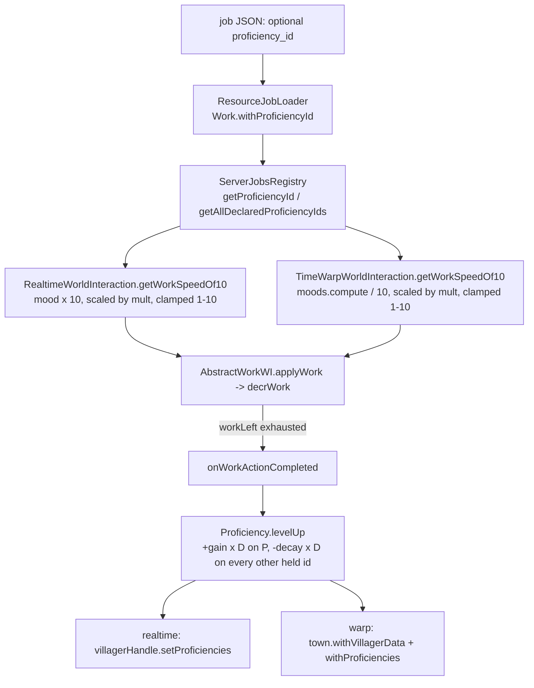
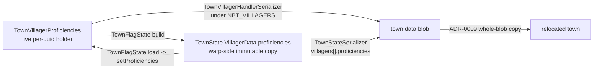
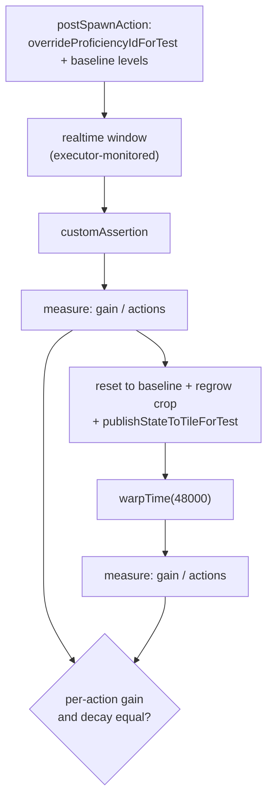

# Job proficiency — a both-paths work-speed multiplier

A per-**townie**, per-**proficiency-id** level in `[0,1]` that scales how fast a townie
completes work. It is applied on the **realtime** path *and* the **warp** path at the one
place they converge, and it levels once per **completed work action**. Design in
`docs/adr/0010-job-proficiency-both-paths-multiplier.md`; vocabulary in `CONTEXT.md`
("Proficiency"). Storage is documented in the second map below, not in `town/`.

**Inert on purpose, not merely incomplete**: no job JSON declares `proficiency_id`, so the
declared-id pool is empty, seeds are empty, and every multiplier is `1×`. It must stay that
way until the speed band is re-centered (last section) — until then, turning the feature on
can only subtract.

## Read + write: one seam, two paths

- Both overrides call the **same** two `RealtimeWorldInteraction` helpers —
  `proficiencyMultiplier` (`Proficiency.multiplierFor(level, MIN, MAX)`; `1×` for a null
  proficiency-id) and `applyProficiencyToWorkSpeed` (the 1–10 clamp, see below) — and that
  sharing is what makes effective speed path-symmetric.
- `D` is the WI's `interval` = job JSON `cooldown_ticks` = `WorkWorldInteractions.actionDuration`.
  Leveling is therefore **per completed action, not per tick**, and warp credits **N actions**
  for free because it re-enters the same `applyWork`.
- **Timer jobs** (gatherer/baker) advance on timed states and never reach `decrWork`, so they —
  and any job without a proficiency-id — are inert **by construction**, with no job-type branch.

## Storage: two lanes, one bridge

- Mirrors the mood/effects split exactly: live holder for realtime, `VillagerData` field for
  warp, `TownFlagState` bridging both directions each warp round-trip. Both lanes persist, and
  the warp-side copy is the one that wins on load — same authority the mood lanes use.
- **Seeding** happens at `TownVillagerHandle.register` (`Proficiency.seed` — UUID-seeded RNG,
  `PROFICIENCY_SEED_COUNT` distinct ids drawn from the declared pool), guarded by `isSeeded`;
  the warp-wake path then **overwrites the seed** with the persisted map, so loaded and
  relocated townies keep their levels.
- **Relocation needs no bespoke code** — both lanes ride the town data blob. The
  `flag/relocate_nearby` autotest stamps a known level pre-move and asserts it post-move
  (check 9), rather than assuming the copy carried it.

## The acceptance gate

`farmer/harvest_wheat [proficiency_parity]` is the ADR-0010 gate: the same work must move
proficiency by the same amount live or offline. Both windows measure the **same villager** —
the executor's realtime window, then an explicit `warpTime` inside the assertion — because the
executor kills and respawns the roster between its own warp and realtime phases, which would
leave the two halves describing different townies.

- Work is counted as **completed actions of proficiency-bearing jobs**
  (`AbstractWorldInteraction.getProficiencyBearingActionsForTest`), not produced items: a
  villager's held stack and a chest stack don't count alike. Normalizing per action is what lets
  two unequal windows be compared — and it is what makes a stale-data bug show up as a
  mismatch rather than as two identical numbers.
- The gate asserts **both paths did non-zero work** before comparing. Without that, zero work on
  either side makes every ratio vacuously equal — the one way this test could pass while
  measuring nothing.
- Three seams exist only for this gate: the proficiency-id override (shipped JSON declares none,
  so the leveling code is otherwise unreachable), the action counter, and
  `publishStateToTileForTest` — warp advances the **tile's stored state**, so a test that mutates
  a villager and warps must publish first or it silently measures the pre-mutation world.
- Two of those seams are **process-global** (a static counter and a static override map), so a
  scenario that left one set would skew the *next* scenario's numbers instead of failing it.
  `TestExecutor`'s constructor clears both. Cleaning on construction rather than teardown is the
  point: a scenario that throws mid-run cannot poison its successor, because the successor
  cleans up before it starts.

## Speed band saturation — the open blocker

`getWorkSpeedOf10` feeds `State.decrWork`, whose contract is **1–10**. The multiplier scales that
number, so the product is clamped by `applyProficiencyToWorkSpeed`. The clamp itself is not
negotiable: without it a well-fed townie past level ~0.33 computes 11+ and throws *inside the warp
loop*, whose handler downgrades the crash into a silently lost visit.

The **saturation** it causes is a defect, not the intended ceiling. Proficiency and mood compete
for the same band: at neutral mood (base 7) the reachable spread is a fair ~4–10, but at max mood
(base 10) every bit of upside is clamped away and only the 0.5× floor remains — so mastery is
worth *less* the better you treat a townie, which inverts what this feature exists to do.
ADR-0010's **Amendment (2026-07-26)** rules on this: re-center the band before any job JSON
declares a `proficiency_id`. Whether that means lowering the well-fed base or widening the
`decrWork` band is deliberately still open there; both have wide balance blast radius.

## Why `getProficiencyId()` defaults to null

`AbstractWorldInteraction.getProficiencyId()` returns null unless overridden, so a *new* subclass
is silently proficiency-inert rather than failing. That is deliberate, and it was re-confirmed
rather than assumed: the default is what keeps JUnit's world-interaction doubles away from
`ServerJobsRegistry`, which they never initialize, and "no proficiency-id" is already a
first-class state here (timer jobs and untagged jobs are inert **by design**) — so null is not an
accident-shaped value in this feature.

The cost is real but small: exactly two production subclasses resolve an id
(`RealtimeWorldInteraction`, `TimeWarpWorldInteraction`), and a hypothetical *third* execution
path that forgot to override would grant a flat 1× forever with nothing failing. Making the method
abstract would not actually prevent that — the path of least resistance in a new subclass is
`return null`, the same silence with a compiler prompt in front of it. The mechanism that *would*
prevent it is a test asserting every concrete production world-interaction resolves its id through
`ServerJobsRegistry`. That is worth adding when content-tagging makes the feature live, not while
it is inert.

## Reading an LZCD dependency before `populate()` — the `describe()` NPE trap

`LZCD.Dependency` nodes (`hasSupplies`, `hasSpace`, `containsWorkableBlocksAtAnyState`,
`RoomsWithWorkableStatefulBlocks`, …) compute lazily: `populate()` fills the `value`
(`Populated<WithReason<Boolean>>`) field, and **only then** is `value` — and therefore
`describe()` (which reads `value.value()`) — valid.

The `JobStatuses` decision tree evaluates branches in order and short-circuits, so a node
on an *unevaluated* branch is never populated in that compute pass. Any code that reads
such a node "just for a log string" without populating first NPEs — and if that happens
inside an entity tick, the `ReportedException: Ticking entity` takes the whole server down
(observed 2026-10-06: a dev-probe in `DeclarativeJobTicker.getStateComputer` read
`containsWorkableBlocksAtAnyState().describe()` for a `NO_JOBSITE` cook, where the tree had
chosen the supplies branch and never touched the workable branch).

Rule: a dependency read for display is safe only via `populate()` first (read-only — it
recomputes from town state, no side effects), or guard a null `value`.
`RoomsWithWorkableStatefulBlocks.describe()` is now null-safe as defense-in-depth.

# Where the job plumbing lives (2026-10-09 declarative consolidation)

The legacy `*Clean` helpers are gone — the jobs logic now canonically lives in
`jobs/declarative/` (plan: `docs/plans/2026-10-09-001-refactor-declarative-jobs-consolidation-plan.md`):

| Was | Now |
|-----|-----|
| `jobs/JobsClean.shouldTakeItem` / `hasNonSupplyItems` / `tryTakeContainerItems` / `SuppliesTarget` | `declarative/SupplyItems` |
| `jobs/JobsClean.rooms` / `isUnfinishedTimeWorkPresent` / `getStatesWithUnfinishedWork` / `getEntityCurrentJobSite` / `findJobSite` | `declarative/DeclarativeJobs` (static) |
| `jobs/ContainersClean` (+ `Block`/`JobSite`) | `declarative/ContainersClean` |
| `jobs/WorkWorldInteractions` (+ `ALWAYS_EMPTY_RESULT_GENERATOR`) | `declarative/WorkWorldInteractions` |

Two `DeclarativeJobs.rooms` overloads now coexist in-class: the original MC-specialized
(`Integer, RoomsNeedingVillagerInput<MCRoom,…>, WorkStatusHandle, Predicate`) is a thin
delegate to the moved generic one. A future dedupe should inline the generic body into the
MC specialization (callers are `MCRoom`/`BlockPos`/`WorkStatusHandle` typed) and drop the
generic overload — the opposite preserves the least-used signature.
`JobsCleanTest` / `JobsCleanShouldTakeItemTest` names historically refer to `SupplyItems` — the class is `declarative.SupplyItems`.

## Work-only state 0 — the start-gate trio (2026-10-09, cook/stick stall)

A job whose state 0 declares **only `work`** (cook/extract: `"work": 0.1`, no tools,
no ingredients) used to be unloadable / unstartable; the stick in its JSON was a load
workaround ("//TODO: Make jobs work without tools"). Three independent gates each
rejected a work-only state-0 block; all three were fixed in one commit and the stick was
removed from `data/questown/questown_jobs/cook_extract.json`:

1. **Loader** (`ResourceJobLoader.workStates`): `valid = valid || i != 0` made work-only
   state 0 throw `IllegalJobDefinition` — and with `CrashOnInvalidJobs = true` (the
   default and the run-config value) that is a server crash at job load, so the de-stick
   and this gate fix must ship together. cook/extract is the only work-only state-0 job
   in the data (every other work state also declares a tool).
2. **Room visibility** (`RoomsStatusLogic.compute` work bucket, `!requiresTools` only):
   the per-state filter was `State::hasWorkLeft`; a fresh/finished block of a
   work-declared state (workLeft 0 — cook's 0.1 floors to int 0) made the room
   *invisible* (empty `rooms-needing-input` map → `NO_JOBSITE`). The bucket now admits
   any state that declares work (`workDeclaredAt`, key presence even at floored 0)
   while still requiring `canClaim` (lock-in: `matExcludedByCanClaim`, 2026-10-07).
   Time-wait blocks can't match: a completed work state advances its processing state
   before the timer starts, and time states declare no work.
3. **Itemless-work admission** (`DeclarativeJobs.getStatesWithUnfinishedWork`, fed to
   `TickTownProvider.getStatesWithUnfinishedItemlessWork` → the status circuit's root
   "work without items" branch): the filter was `workLeft() > 0`; a fresh work-only
   block never reported itself. It now also admits `workDeclaredAt(state)`.

Why it matters end-to-end: with (2)+(3) the room is visible AND the state is reported,
so `tryChoosingItemlessWork` returns `fromJobBlockState(0)` (a working status); the
zero-work `tryWork` advances the block straight to `maxState`, and extraction fires at
`action >= maxState` (the post-extract `getResetFunc` resets the block to fresh — so
"block back at state 0" after a finished cycle is *correct*, not a stall). Supply-item
status for work-only states is `NOT_REQUIRED` (`getSupplyItemStatuses`), so the
"use items" branch can never fire for them — the itemless branch is the only entry.

Pinned by: `RoomsStatusLogicTest.compute_workOnlyState0_freshBlock_yieldsWorkOnlyBucket`
(the (2) contract, `dueToWorkOnly=true`), `CookEquivalenceTest.
cook_extract_workOnly_state0_emptyInventory_shouldExtractProduct` (the end-to-end cycle,
work-only JSON, empty inventory), `JobIntegrationTest.cook_extract_shouldLoadCorrectly`
(the de-stick'd data shape). Timer-wait regression tripwires: the baker/fisher
equivalence suites (`JobIntegrationTest`, `TickerAdvancerEquivalenceTest`).

## Equivalence tests: equivalence is not completion (2026-10-09, hollow cook tests)

The `…tickerAndAdvancer_shouldProduceEquivalentResults` suites compare two simulation
sides field-by-field (`EquivalenceTestFramework.SimulationResult`: inventoryItems,
productExtracted, jobBlockState, workRemaining) and assert only that the fields are
*equal on both sides*. The "advancer" side is the same `DeclarativeJobTicker` sampled at
`ImportantTicks`'s sparse warp ticks (framework line ~342), so shared-code regressions
stall both sides identically and "equivalent" passes vacuously. Proven live: with the
tags unresolvable (below), `cook_fish` and `cook_fuel` both ran 200/50 ticks to
`productExtracted=false, jobBlockState=0, workRemaining=0` and the tests were green.

Two contracts now hold:

1. **Every equivalence test also asserts the terminal effect on BOTH sides** —
   `assertTrue(tickerResult.productExtracted() && advancerResult.productExtracted())`
   (added to all four cook tests; `cook_fish`/`cook_fuel` are the first tests in the
   family ever to have carried a non-vacuous assertion).
2. **Job tool/ingredient keys that are tags (`#ns:name`) resolve to real item sets in
   the harness** — `TestTagResolver` (test-only), wired at both predicate-building sites:
   `TestWorldInteraction.itemPred` (what `getChecks()` serves the ticker) and
   `TestTickerDependencies.buildPredicateMap` (`asChecks()`). Resolution order: the
   classpath resource `data/<ns>/tags/items/<name>.json` (vanilla: singular `item`)
   — so `#questown:*` reads the mod's own tag files, and `#c:*`/`#forge:*` read the
   copies inside the NeoForge universal jar (which *is* on the test classpath).
   Nested `#` entries expand recursively; NeoForge's weighted-object entry form
   (`{"id": …, "required": false}`) is read by its `id`, optional entries skipped.
   Vanilla tag data that no jar on the classpath provides is **vendored** under
   `src/test/resources/data/…` (as of 2026-10-09: `minecraft:{coals,logs,planks,
   saplings}`, `forge:mushrooms` — the coals/mushrooms contents verified against
   real data files; the 8-wood logs/planks/saplings sets are BELIEVED-from-knowledge
   of the vanilla 1.20.6 composition, extend as needed). An unresolvable tag
   throws instead of leaving the gate unsatisfiable.
   Test inventories may carry **tag references as items** (`TestItem("#minecraft:coals")`
   stands for "some member of that tag" — the pre-existing declarative tests seed
   this way): a tag gate matches the same tag or an intersecting tag's item; a
   literal gate matches a tag item iff the literal is a member; an empty slot
   matches nothing. The literal-equality default (`item.value.equals("#…")`) was
   the vacuous-stall bug: a tag tool could never match a literal item, both sides
   idled identically, equivalence passed. Pinned by `TestTagResolverTest`
   (8 cases: literal/tag gates, tag-as-item equality + intersection, nested
   expansion, the empty-slot and throw contracts, dependency-jar namespaces).

Scope note: `#c:*` (common-convention) tags and unvendored vanilla tags are
unresolvable on purpose — a loud throw in the test beats a silent stall.
