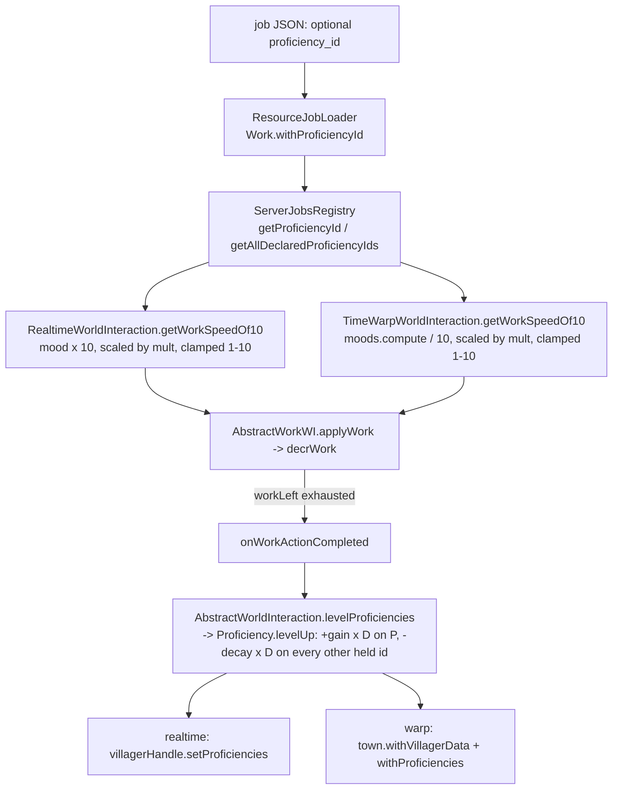
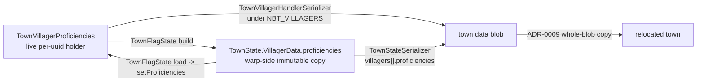
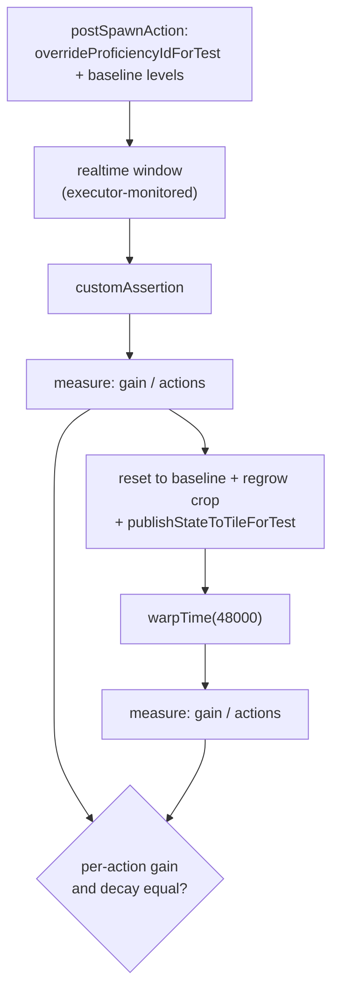

# Job proficiency — a both-paths work-speed multiplier

A per-**townie**, per-**proficiency-id** level in `[0,1]` that scales how fast a townie
completes work. It is applied on the **realtime** path *and* the **warp** path at the one
place they converge, and it levels once per **completed work action**. Design in
`docs/adr/0010-job-proficiency-both-paths-multiplier.md`; vocabulary in `CONTEXT.md`
("Proficiency"). Storage is documented in the second map below, not in `town/`.

**Inert on purpose, not merely incomplete**: no job JSON declares `proficiency_id`, so the
declared-id pool is empty, seeds are empty, and every multiplier is `1×`. It must stay that
way until the speed band is re-centered (last section) — until then, turning the feature on
can only subtract.

## Read + write: one seam, two paths

- Both `getWorkSpeedOf10` overrides call the **same** two base-class
  (`AbstractWorldInteraction`) helpers —
  `proficiencyMultiplier` (`Proficiency.multiplierFor(level, MIN, MAX)`; `1×` for a null
  proficiency-id) and `applyProficiencyToWorkSpeed` (the 1–10 clamp, see below) — and that
  sharing is what makes effective speed path-symmetric. Both `onWorkActionCompleted`
  lanes likewise funnel their leveling through the shared `levelProficiencies` seam: a
  config-wiring 3-arg overload over a pure 4-arg overload that JUnit can drive
  (the mod config is never loaded under the test LoaderApi).
- `D` is the WI's `interval` = job JSON `cooldown_ticks` = `WorkWorldInteractions.actionDuration`.
  Leveling is therefore **per completed action, not per tick**, and warp credits **N actions**
  for free because it re-enters the same `applyWork`.
- **Timer jobs** (gatherer/baker) advance on timed states and never reach `decrWork`, so they —
  and any job without a proficiency-id — are inert **by construction**, with no job-type branch.

## Storage: two lanes, one bridge

- Mirrors the mood/effects split exactly: live holder for realtime, `VillagerData` field for
  warp, `TownFlagState` bridging both directions each warp round-trip. Both lanes persist, and
  the warp-side copy is the one that wins on load — same authority the mood lanes use.
- **Seeding** happens at `TownVillagerHandle.register` (`Proficiency.seed` — UUID-seeded RNG,
  `PROFICIENCY_SEED_COUNT` distinct ids drawn from the declared pool), guarded by `isSeeded`;
  the warp-wake path then **overwrites the seed** with the persisted map, so loaded and
  relocated townies keep their levels.
- **Relocation needs no bespoke code** — both lanes ride the town data blob. The
  `flag/relocate_nearby` autotest stamps a known level pre-move and asserts it post-move
  (check 9), rather than assuming the copy carried it.

## The acceptance gate

`farmer/harvest_wheat [proficiency_parity]` is the ADR-0010 gate: the same work must move
proficiency by the same amount live or offline. Both windows measure the **same villager** —
the executor's realtime window, then an explicit `warpTime` inside the assertion — because the
executor kills and respawns the roster between its own warp and realtime phases, which would
leave the two halves describing different townies.

- Work is counted as **completed actions of proficiency-bearing jobs**
  (`AbstractWorldInteraction.getProficiencyBearingActionsForTest`), not produced items: a
  villager's held stack and a chest stack don't count alike. Normalizing per action is what lets
  two unequal windows be compared — and it is what makes a stale-data bug show up as a
  mismatch rather than as two identical numbers.
- The gate asserts **both paths did non-zero work** before comparing. Without that, zero work on
  either side makes every ratio vacuously equal — the one way this test could pass while
  measuring nothing.
- Three seams exist only for this gate: the proficiency-id override (shipped JSON declares none,
  so the leveling code is otherwise unreachable), the action counter, and
  `publishStateToTileForTest` — warp advances the **tile's stored state**, so a test that mutates
  a villager and warps must publish first or it silently measures the pre-mutation world.
- Two of those seams are **process-global** (a static counter and a static override map), so a
  scenario that left one set would skew the *next* scenario's numbers instead of failing it.
  `TestExecutor`'s constructor clears both. Cleaning on construction rather than teardown is the
  point: a scenario that throws mid-run cannot poison its successor, because the successor
  cleans up before it starts.

## Speed band saturation — the open blocker

`getWorkSpeedOf10` feeds `State.decrWork`, whose contract is **1–10**. The multiplier scales that
number, so the product is clamped by `applyProficiencyToWorkSpeed`. The clamp itself is not
negotiable: without it a well-fed townie past level ~0.33 computes 11+ and throws *inside the warp
loop*, whose handler downgrades the crash into a silently lost visit.

The **saturation** it causes is a defect, not the intended ceiling. Proficiency and mood compete
for the same band: at neutral mood (base 7) the reachable spread is a fair ~4–10, but at max mood
(base 10) every bit of upside is clamped away and only the 0.5× floor remains — so mastery is
worth *less* the better you treat a townie, which inverts what this feature exists to do.
ADR-0010's **Amendment (2026-07-26)** rules on this: re-center the band before any job JSON
declares a `proficiency_id`. Whether that means lowering the well-fed base or widening the
`decrWork` band is deliberately still open there; both have wide balance blast radius.

## Why `getProficiencyId()` defaults to null

`AbstractWorldInteraction.getProficiencyId()` returns null unless overridden, so a *new* subclass
is silently proficiency-inert rather than failing. That is deliberate, and it was re-confirmed
rather than assumed: the default is what keeps JUnit's world-interaction doubles away from
`ServerJobsRegistry`, which they never initialize, and "no proficiency-id" is already a
first-class state here (timer jobs and untagged jobs are inert **by design**) — so null is not an
accident-shaped value in this feature.

The cost is real but small: exactly two production subclasses resolve an id
(`RealtimeWorldInteraction`, `TimeWarpWorldInteraction`), and a hypothetical *third* execution
path that forgot to override would grant a flat 1× forever with nothing failing. Making the method
abstract would not actually prevent that — the path of least resistance in a new subclass is
`return null`, the same silence with a compiler prompt in front of it. The mechanism that *would*
prevent it is a test asserting every concrete production world-interaction resolves its id through
`ServerJobsRegistry`. That is worth adding when content-tagging makes the feature live, not while
it is inert.

## Reading an LZCD dependency before `populate()` — the `describe()` NPE trap

`LZCD.Dependency` nodes (`hasSupplies`, `hasSpace`, `containsWorkableBlocksAtAnyState`,
`RoomsWithWorkableStatefulBlocks`, …) compute lazily: `populate()` fills the `value`
(`Populated<WithReason<Boolean>>`) field, and **only then** is `value` — and therefore
`describe()` (which reads `value.value()`) — valid.

The `JobStatuses` decision tree evaluates branches in order and short-circuits, so a node
on an *unevaluated* branch is never populated in that compute pass. Any code that reads
such a node "just for a log string" without populating first NPEs — and if that happens
inside an entity tick, the `ReportedException: Ticking entity` takes the whole server down
(observed 2026-10-06: a dev-probe in `DeclarativeJobTicker.getStateComputer` read
`containsWorkableBlocksAtAnyState().describe()` for a `NO_JOBSITE` cook, where the tree had
chosen the supplies branch and never touched the workable branch).

Rule: a dependency read for display is safe only via `populate()` first (read-only — it
recomputes from town state, no side effects), or guard a null `value`.
`RoomsWithWorkableStatefulBlocks.describe()` is now null-safe as defense-in-depth.

## Usual-routine circuit: with prioritized extraction, extraction beats dropping-loot

The root node of `JobStatuses.usualRoutineRoot` ("work without items",
i.e. `tryChoosingItemlessWork`) is evaluated *before* any of the
dropping-loot nodes, gated on `prioritizeExtraction` +
"not already going to jobsite". So for jobs that set
`SpecialRules.PRIORITIZE_EXTRACTION` (notably `BOPDepositorWork`), a
villager holding its work item with an extractable product available
resolves to `EXTRACTING_PRODUCT` — even with a full inventory — and never
lands on `DROPPING_LOOT` first. This is the behaviour the old
"THIS IS BLOCKING BOP Depositor" test TODO described as missing; the
2026-10-10 close-out added the two pinning tests
(`JobStatusesTest.usualRoutineRoot_resolve_shouldExtractProduct_NotDropLoot_*`)
and found the circuit already correct, so the marker was removed.

# Where the job plumbing lives (2026-10-09 declarative consolidation)

The legacy `*Clean` helpers are gone — the jobs logic now canonically lives in
`jobs/declarative/` (plan: `docs/plans/2026-10-09-001-refactor-declarative-jobs-consolidation-plan.md`):

| Was | Now |
|-----|-----|
| `jobs/JobsClean.shouldTakeItem` / `hasNonSupplyItems` / `tryTakeContainerItems` / `SuppliesTarget` | `declarative/SupplyItems` |
| `jobs/JobsClean.rooms` / `isUnfinishedTimeWorkPresent` / `getStatesWithUnfinishedWork` / `getEntityCurrentJobSite` / `findJobSite` | `declarative/DeclarativeJobs` (static) |
| `jobs/ContainersClean` (+ `Block`/`JobSite`) | `declarative/ContainersClean` |
| `jobs/WorkWorldInteractions` (+ `ALWAYS_EMPTY_RESULT_GENERATOR`) | `declarative/WorkWorldInteractions` |

Two `DeclarativeJobs.rooms` overloads now coexist in-class: the original MC-specialized
(`Integer, RoomsNeedingVillagerInput<MCRoom,…>, WorkStatusHandle, Predicate`) is a thin
delegate to the moved generic one. A future dedupe should inline the generic body into the
MC specialization (callers are `MCRoom`/`BlockPos`/`WorkStatusHandle` typed) and drop the
generic overload — the opposite preserves the least-used signature.
`JobsCleanTest` / `JobsCleanShouldTakeItemTest` names historically refer to `SupplyItems` — the class is `declarative.SupplyItems`.

## Work-only state 0 — the start-gate trio (2026-10-09, cook/stick stall)

A job whose state 0 declares **only `work`** (cook/extract: `"work": 0.1`, no tools,
no ingredients) used to be unloadable / unstartable; the stick in its JSON was a load
workaround ("//TODO: Make jobs work without tools"). Three independent gates each
rejected a work-only state-0 block; all three were fixed in one commit and the stick was
removed from `data/questown/questown_jobs/cook_extract.json`:

1. **Loader** (`ResourceJobLoader.workStates`): `valid = valid || i != 0` made work-only
   state 0 throw `IllegalJobDefinition` — and with `CrashOnInvalidJobs = true` (the
   default and the run-config value) that is a server crash at job load, so the de-stick
   and this gate fix must ship together. cook/extract is the only work-only state-0 job
   in the data (every other work state also declares a tool).
2. **Room visibility** (`RoomsStatusLogic.compute` work bucket, `!requiresTools` only):
   the per-state filter was `State::hasWorkLeft`; a fresh/finished block of a
   work-declared state (workLeft 0 — cook's 0.1 floors to int 0) made the room
   *invisible* (empty `rooms-needing-input` map → `NO_JOBSITE`). The bucket now admits
   any state that declares work (`workDeclaredAt`, key presence even at floored 0)
   while still requiring `canClaim` (lock-in: `matExcludedByCanClaim`, 2026-10-07).
   Time-wait blocks can't match: a completed work state advances its processing state
   before the timer starts, and time states declare no work.
3. **Itemless-work admission** (`DeclarativeJobs.getStatesWithUnfinishedWork`, fed to
   `TickTownProvider.getStatesWithUnfinishedItemlessWork` → the status circuit's root
   "work without items" branch): the filter was `workLeft() > 0`; a fresh work-only
   block never reported itself. It now also admits `workDeclaredAt(state)`.

Why it matters end-to-end: with (2)+(3) the room is visible AND the state is reported,
so `tryChoosingItemlessWork` returns `fromJobBlockState(0)` (a working status); the
zero-work `tryWork` advances the block straight to `maxState`, and extraction fires at
`action >= maxState` (the post-extract `getResetFunc` resets the block to fresh — so
"block back at state 0" after a finished cycle is *correct*, not a stall). Supply-item
status for work-only states is `NOT_REQUIRED` (`getSupplyItemStatuses`), so the
"use items" branch can never fire for them — the itemless branch is the only entry.

Pinned by: `RoomsStatusLogicTest.compute_workOnlyState0_freshBlock_yieldsWorkOnlyBucket`
(the (2) contract, `dueToWorkOnly=true`), `CookEquivalenceTest.
cook_extract_workOnly_state0_emptyInventory_shouldExtractProduct` (the end-to-end cycle,
work-only JSON, empty inventory), `JobIntegrationTest.cook_extract_shouldLoadCorrectly`
(the de-stick'd data shape). Timer-wait regression tripwires: the baker/fisher
equivalence suites (`JobIntegrationTest`, `TickerAdvancerEquivalenceTest`).

### Consequence, found on re-watch (2026-10-09): `roomsAtState` NPE

The admission widened the state set `JobStatuses.tryChoosingItemlessWork` walks
(`town.getStatesWithUnfinishedItemlessWork()`, fresh-computed) and it reads each
state from the *cached* room map via `TickTownProvider.roomsAtState`, which did
`roomsNeedingVillagerInput.get().get(state).stream()` with no null guard. On a
fresh-world morning (kitchen registered two seconds earlier, no state-0 room in
the map yet) the held `self_sufficiency` run crashed the server thread
(`run/crash-reports/crash-2026-10-09_19.45.25-server.txt`;
`.scratch/cook-stick-rewatch/`). Guard: a state absent from the map answers an
empty room set, not a crash. Pin-by
`TickTownProviderTest.roomsAtState_stateAbsentFromRoomMap_yieldsEmptyCollection`
(the builder's room map is empty, so any state hits the guard). The two
suppliers diverge in time — fresh state set vs cached room map — so every
admission-path change has to assume `roomsAtState` can be asked about a state
the map does not hold. `TimeWarpWorldInteraction.roomsAtState` (the warp side)
was already guarded.

## Equivalence tests: equivalence is not completion (2026-10-09, hollow cook tests)

The `…tickerAndAdvancer_shouldProduceEquivalentResults` suites compare two simulation
sides field-by-field (`EquivalenceTestFramework.SimulationResult`: inventoryItems,
productExtracted, jobBlockState, workRemaining) and assert only that the fields are
*equal on both sides*. The "advancer" side is the same `DeclarativeJobTicker` sampled at
`ImportantTicks`'s sparse warp ticks (framework line ~342), so shared-code regressions
stall both sides identically and "equivalent" passes vacuously. Proven live: with the
tags unresolvable (below), `cook_fish` and `cook_fuel` both ran 200/50 ticks to
`productExtracted=false, jobBlockState=0, workRemaining=0` and the tests were green.

Two contracts now hold:

1. **Every equivalence test also asserts the terminal effect on BOTH sides** —
   `assertTrue(tickerResult.productExtracted() && advancerResult.productExtracted())`
   (added to all four cook tests; `cook_fish`/`cook_fuel` are the first tests in the
   family ever to have carried a non-vacuous assertion).
2. **Job tool/ingredient keys that are tags (`#ns:name`) resolve to real item sets in
   the harness** — `TestTagResolver` (test-only), wired at both predicate-building sites:
   `TestWorldInteraction.itemPred` (what `getChecks()` serves the ticker) and
   `TestTickerDependencies.buildPredicateMap` (`asChecks()`). Resolution order: the
   classpath resource `data/<ns>/tags/items/<name>.json` (vanilla: singular `item`)
   — so `#questown:*` reads the mod's own tag files, and `#c:*`/`#forge:*` read the
   copies inside the NeoForge universal jar (which *is* on the test classpath).
   Nested `#` entries expand recursively; NeoForge's weighted-object entry form
   (`{"id": …, "required": false}`) is read by its `id`, optional entries skipped.
   Vanilla tag data that no jar on the classpath provides is **vendored** under
   `src/test/resources/data/…` (as of 2026-10-09: `minecraft:{coals,logs,planks,
   saplings}`, `forge:mushrooms` — the coals/mushrooms contents verified against
   real data files; the 8-wood logs/planks/saplings sets are BELIEVED-from-knowledge
   of the vanilla 1.20.6 composition, extend as needed). An unresolvable tag
   throws instead of leaving the gate unsatisfiable.
   Test inventories may carry **tag references as items** (`TestItem("#minecraft:coals")`
   stands for "some member of that tag" — the pre-existing declarative tests seed
   this way): a tag gate matches the same tag or an intersecting tag's item; a
   literal gate matches a tag item iff the literal is a member; an empty slot
   matches nothing. The literal-equality default (`item.value.equals("#…")`) was
   the vacuous-stall bug: a tag tool could never match a literal item, both sides
   idled identically, equivalence passed. Pinned by `TestTagResolverTest`
   (8 cases: literal/tag gates, tag-as-item equality + intersection, nested
   expansion, the empty-slot and throw contracts, dependency-jar namespaces).

Scope note: `#c:*` (common-convention) tags and unvendored vanilla tags are
unresolvable on purpose — a loud throw in the test beats a silent stall.

# Warp-lane work-block seam: `Work.isJobBlockAt` / `ServerJobsRegistry.jobBlockAt` (2026-10-10)

`PostDowntimeWarper` assigns a job its real room container block for the warp lane through
`ServerJobsRegistry.jobBlockAt(job, level, pos)` → `Work.isJobBlockAt(blockInfo, pos)`,
which tests `Work.shouldInitializeWorkState` — the block-identity predicate the v2 loader
builds in `ResourceJobLoader.shouldInitWS` (block id + optional `int_state` + air-above),
**without** the `has_item_in_slot_initially` slot comparator and without the special-rule
`postJobBlockCheckPassed` tail that `isJobBlock` appends. Rationale (the slot gate tests the
world as it is, the warp still has to produce it — `baker/extract`'s `2/bread` gate can never
match the oven a warp is about to bake): `town/COMPLEX.md` "Post-downtime warp work-block
assignment".

BlockInfo variants:
- `ServerJobsRegistry.levelBlockInfo(level)` — pos-aware, reads `level.getBlockState(p)` /
  `getBlockEntity(p)` at the queried position (the air-above check works); production path.
- `ServerJobsRegistry.blockInfo(state, entity)` — position-agnostic capture (same state for
  every queried position); the plain-test helper. The air-above check is degraded there
  (a non-air block always fails it); no job that needs air-above should be assigned through
  the captured variant.

v1 jobs pass the same block-ingredient `BiPredicate` into both `WorkLocation` slots
(`ResourceJobLoader` v1 path), so the seam degrades to the old v1 identity check — no
content gate exists there to begin with.

## Job data v2 `block` is an object, and the production loader is the load gate

`ResourceJobLoader.workFromJsonV2` requires `"block"` to be a JSON object (`{"id": …}`);
the v1 string form throws `"block must be an object"` and the job is skipped at server
start (logged; `crash_on_invalid_jobs` can escalate). The 2026-10-10 cook-shape migration
shipped `baker_stock_wheat`/`baker_stock_coal` at `version: 2` with the v1 string form, so
both stock jobs silently failed to load — the MC-free `TestJobLoader` never inspects the
`block` field, so `JobIntegrationTest` coverage stayed green. Pinned by
`BakerStockJobLoaderTest`: it feeds the two files through the PRODUCTION
`ResourceJobLoader.ReloadListener.apply` (vanilla bootstrap in `@BeforeAll`) and asserts the
v2 fields survive the real parse (parents, room, `ALWAYS_CONSIDER`/`EXCLUDE_FROM_WARP`).
Any new v2 job file should be load-tested the same way, not only through `TestJobLoader`.

## `starter_recipes` — per-item initial unlock on expanded templates (2026-10-12)

The cook simple-furnace template (`cook_simple_furnace_food.json`) expands at
load time into one job per raw item in the
`questown:villager_simple_furnace_food_raw` tag (mutton, beef, rabbit, …). A
blanket `unlocked_with_root_job` on the template would bulk-grant every food
recipe — the skill-unlock ruling rejected that (recipes ARE the leveling
progression). But a cook with only extract + fuel "has no cook jobs" (the
2026-10-12 day-1 playtest; `.scratch/day1-playtest-2026-10-11/new-cook-has-no-cook-works.md`).
The seam is the template's `starter_recipes` JSON array: `makeCookJobs` parses
it and ORs membership into each expanded job's `unlocked_with_root_job`, so
the listed items join the root's initial set (`ServerJobsRegistry.getDefaultWork`)
for EVERY staffing path — spawn, register, job-change, BOP — without any
Java special-case. Per-item and data-driven: adding a new starter is a one-line
JSON change. The 2026-10-15 onboarding-only grant
(`ChangeJobReward.onboarding` flag) is gone — it was the same grant narrowed
by the wrong gate. Test: `CookStarterRecipeLoaderTest` pins the JSON load
gate; the registry-bound expansion itself is `@Disabled` with the reason
(the questown item tag does not load in vanilla bootstrap).

## Leaver-return read: `DeclarativeJob.getLeaverReturn` (G3, 2026-10-12)

## `available_at_level` — the skills-tab level gate (2026-10-13)

A job is only visible/unlockable in the skills tab once the townie's level
reaches the job's `available_at_level` (JSON field, default
`Work.DEFAULT_AVAILABLE_AT_LEVEL = 2` - the first level the tab appears; townies
start at level 1, so a fresh town has no unlockable jobs and the tab is hidden).
The 25 blacksmith material-tier files (`blacksmith_{wood,stone,iron,golden,diamond}_
{axe,shovel,pickaxe,hoe,sword}.json` - crafter-family ids, not a blacksmith root)
carry the values: wood 7, stone 12, iron 17, golden 22, diamond 27. The gate
lives on the **job, not the layer**: `ResourceJobLoader` parses the optional int
into `Work.availableAtLevel`; `ServerJobsRegistry.getAvailableAtLevel(JobID)` is
the lookup (pre-startup NPE guard, like `getAllRootJobs`); `TownVillagerUIsHandle.showUI`
filters `getChildJobsKnownToExist` by level and the empty set is what hides the
tab (client-side via `VillagerMenusPayload.showSkillsTab` + `VillagerTabs.
hideSkills`/`forMenu` gate); `UnlockJobMessage` re-checks server-side so a stale
client or a direct packet can't unlock a not-yet-available job. Onboarding jobs
are never retroactively gated: the gate only affects the skills tab's unlockable
set, not existing grants.

- Data oracle: `JobAvailableAtLevelDataTest` pins the 25 tier files to their
  values AND asserts no other job JSON carries the field (default semantics).
- `WorkAvailableAtLevelTest` pins the default + the `withAvailableAtLevel` chain.

The timed leaver trip ("when will the leaver be back") is the gate-mat
timer: while a leaver job's timed state (the `time` work state — the roam
tail) is in flight, the per-owner work-status store holds a countdown at
the gate-mat pos, and its expiry is the point the townie is clear to
re-enter town. `DeclarativeJob.getLeaverReturn(TownInterface)` reads it:
`ticker.workSpot()` → job-block pos → the owner-scoped
`TownFlagBlockEntity.getRealWorkStatusHandle` (`SHARED_WORK_STATUS` →
global lane, same split as `getWorkProgressDebug`) →
`getTimeToNextState` (remaining) and `getJobBlockState` (current
processing state, whose declared time — `checks.getTimeForStep(state, 0)`
— is the trip total; the timer was set to exactly that value when the
block advanced into the state). Returns `jobs/LeaverReturn` (absolute
server `getGameTime()` + remaining, total) or null when any link is
absent. `VisitorMobEntity.getLeaverReturn()` is the thin owner-side
delegate; the consumers are the villagers-menu payload (gui/COMPLEX.md
"Leaver-return progress bar") and nothing else.

## Foreign work-state records read as fresh: the shared block-state slot (2026-10-14)

One job block position carries a SINGLE per-owner work-state record
(`WorkStatusHandle.getJobBlockState(pos)`), but several works can share that
block as their location with DIFFERENT state numbering: the flag block hosts
`bop_depositing` (states 0–2) and `DowntimeWork` (states 0–9) at the same
`SpecialQuests.TOWN_FLAG` location. A cycle interrupted mid-sequence (downtime
→ seeking_work at state 3) leaves the record where it was; completed cycles
reset to `State.fresh()` (`AbstractWorldInteraction` l.309/l.601), so only
*interrupted* cycles leave foreign records.

Read sites must normalize: **`processingState > maxState` ⇒ read as
`State.freshAtState(0)`** — an out-of-range value can never advance itself in
this job's state machine. The three sibling read sites (the "must agree"
warning in `DeclarativeJobs.rooms`):

- `DeclarativeJobTicker.computeRoomsNeedingInput` (supply loop) — had it first
  ("a foreign job's bare write, or an expired timer that overflowed past this
  job's maxState");
- `DeclarativeJobs.rooms` (the status gate behind NO_JOBSITE/NO_SPACE) and
  `DeclarativeJobs.findJobSite` (spot claim) — 2026-10-14 playtest: the gate
  read the raw foreign 3, found no spot at 0/1, and the BOP depositor soft-
  locked (ticket `.scratch/playtest-2026-10-14/bop-deposit-stall-and-
  duplication.md`; each stalled re-entry also re-granted a BOP — the
  hand-out is now idempotent, `town/entity/COMPLEX.md` "Earn → latch →
  assign"). Pinned by `DeclarativeJobsRoomsForeignStateTest` (red-verified;
  the in-range + null cases pin the existing behaviour against
  over-normalization).

## `TownHasSupplies` requirement gate: no workable state ⇒ full requirement set (2026-10-14)

`TownHasSupplies.doPopulate` builds its "relevant ingredients/tools" from the
states that currently have a **workable** block (`roomsHaveWorkableBlocks`
true). That is right while a cycle is mid-work (only the active state's
supplies matter), but it is a **deadlock trap** at cycle boundaries: when the
job block sits at a terminal/timer state, *no* state is workable, the
requirement set collapses to empty, and `town has supplies` goes false even
though the village chest holds exactly the tool the next cycle needs.

Live instance (2026-10-14 playtest, `.scratch/playtest-2026-10-14/hunter-
stuck-sword-need-10-14.md`): the hunter's short-variant mat
(`hunter/sword`, states [tools, work, time 2000], maxState 3) sat at state 3
(extractable). The hunter no longer held its sword (an earlier drop-loot
deposited it — tools taken by the supply getter are not `locked()`), so the
status circuit needed the "get work supplies" branch to re-acquire it. Its
gate (`dTownHasSupplies`) read false because the sword requirement was
filtered out before the container scan — the gate dumps showed
`relevant tools = []` + `No matches found for … in any containers` while the
village chest listed `stone_sword`. The hunter then oscillated
NO_JOBSITE↔seeking_work indefinitely (job-change commands looked like a no-op
because the status is block-state-driven; the econ tab's "needs swords" was
the same root, not a separate room bug).

The fix: after the workable-state pass, if both requirement lists are empty
**and** at least one state exists, re-collect from **all** states (full
requirement set). The hand-off side was verified clean, not part of the fix:
`computeRoomsNeedingInput` already normalizes a terminal mat
(`processingState == maxState && !hasWorkLeft() && timeToNextState == null`)
to `State.fresh()` (see the section above), so the gate room still reports the
tool as a need and `DeclarativeJob.setupForGetSupplies` (closest-chest scan
via `cleanRooms()` predicates) can hand it over. Pinned by
`TownHasSuppliesNoWorkableStateTest` (the no-workable-state case was red on
pre-fix code with the live dump's exact failure signature).

## `SpecialRules.CLAIM_SPOT` constant matched no job data (2026-10-14)

All 12 job JSONs spell the work-claim rule `claim_workspot`; the constant was
`claim_spot`, so the `specialRulesMap.get(CLAIM_SPOT)` gates never fired for it.
Offline warp sims (which only work through the special-rule claim suppliers)
therefore never claimed work blocks, and claim-gated jobs like
`farmer/harvest_wheat` stayed at `NO_SUPPLIES` for the whole warp window even
with the held tool present. Fixed by aligning the constant to the data. See also
`integration/minecraft/COMPLEX.md` for the sibling journal-NBT bug that was
masking this one.

## Max-ticks watchdog skips timed states (2026-10-17 playtest)

`JobLogic.tick` re-creates a job via `expiration.maxTicksFallbackFn()` when it has **no
work spot** and `ticksSinceStart > expiration.maxTicks()`. For most jobs the rules are
`ExpirationRules.never()`: `maxTicks = 3000` and the fallback is the **same job** — a
periodic re-creation meant to be harmless ("effectively keep doing this job forever").

It was not harmless for a leaver: while away on its timed state (e.g. hunter/sword's
`time: 2000`) the townie has no work spot, so the watchdog fired mid-hunt (live log
2026-10-17: `Reached max ticks for hunter:sword. Falling back to hunter:sword.` at
05:51:39, the mat's timer expired 05:52:13 to state 3 = product ready, and the fresh job
went to COLLECTING_SUPPLIES instead of extracting — no loot). The watchdog now also
requires `!status.isWaitingForTimers()`. A timed state whose timer is lost is not
stranded by this: `AbstractWorkStatusStore`'s stuck-state reseed (b4eb2045) resets a
block sitting in a non-fresh state with no timer.

Pinned by `JobLogicTest.tick_shouldNotHitMaxTicksFallback_WhileWaitingForTimedState`
(red on the pre-fix condition) and the control
`tick_shouldHitMaxTicksFallback_WhenIdleWithNoWorkSpot`. End-to-end (the hunt product is
extracted after a >3000-tick cycle) is not yet autotest-verified — ticket
`.scratch/playtest-2026-10-17/hunter-collecting-supplies-after-hunt.md`.

## Same-root fallback prefers a job unlocked with the root (2026-10-17 playtest)

`ServerJobsRegistry.getWorkSupplier` falls back to "any job in the same root" when a
JobID has no registered Work — e.g. the simple-furnace template's source id
`cook/simple_furnace_food`, which `ResourceJobLoader` expands into per-item jobs and never
registers (the onboarding cook beat and its blessed BOP name it). The fallback used to take
the FIRST same-root entry, which landed a new cook on `cook/stock_ingredients` (needs a
`kitchen_stocked` room = furnace + chest; the player had `kitchen_small`), so the cook sat
in COLLECTING_SUPPLIES with need=NONE. User ruling: "stock kitchen should not be a job that
gets unlocked initially". The pick is now `Work.preferInitiallyUnlocked`: the first
candidate with `Work.isUnlockedInitially(parent, unlocked_with_root_job)` (cook: `extract`,
`fuel`), else the first candidate. Pinned by `WorkSameRootFallbackTest`. The ERROR log line
and the raw-id broadcast (`messages.jobs.changed [cook:simple_furnace_food, …]`) remain —
ticket `.scratch/playtest-2026-10-17/cook-job-change-uses-unregistered-source-id.md`.

## Diners eat the finished meal instead of fetching more food (2026-10-17 playtest round 5)

Symptom: a hungry villager took food, ate it at the flag (state 1 consumes it), the flag spot
reached DONE (state 2) — and the villager went back to the chest for more food, stood there in
COLLECTING_SUPPLIES until the max-ticks expiry, then dropped/re-took food (the "carrot take/put
loop"). `eating/eat_direct` and `eating/dine_at_time` had failed on every full-suite run for the
same reason. Two causes in the usual-routine circuit, both fixed:

- **Terminal state is not unfinished work.** `getStatesWithUnfinishedWork` treats any *declared*
  work as unfinished (needed for cook_extract's 0.1 → 0 floor). The hand-coded diners declare
  `DONE: 0` at maxState, so the itemless branch saw `[2]` as unfinished work and answered
  GOING_TO_JOB — which the root's "not going to jobsite" input gate rejects, falling through to
  collect supplies. `DeclarativeJobs.declaresUnfinishedWork(state, maxState, declared)` now
  excludes maxState (a block there holds a finished product to extract). Both callers use it:
  `DeclarativeJobTicker` (realtime) and `TimeWarpWorldInteraction` (warp). JSON jobs never
  declare work at maxState, so they are unaffected. Test: `DeclarativeJobsTerminalStateWorkTest`
  (red-verified against the pre-fix form, 2 of 3 fail).
- **Diners prioritize extraction.** `DinerWork`, `DinerNoTableWork` and `DinerRawFoodWork` now
  list `SpecialRules.PRIORITIZE_EXTRACTION` (JSON jobs get it from `loadRulesV1/V2`). Without it the
  "work without items" root is skipped and a town with food in storage always wins the
  collect-supplies branch. No unit seam (the diner classes' `<clinit>` touches tag registries);
  verified by the `eating/` autotests.

Verification: `eating/` 4/4; full suite 70/73 (only the known roof_gatherer, skip_chicken_command,
farmer-parity failures).

## Special jobs never fall back to a same-root Work (2026-10-17 playtest)

`ServerJobsRegistry.getWork` asked a matching special job for its `Work` and, when the answer
was null, fell through to `getWorkSupplier` — which logs `No work found for job ID: …` and
answers with the root's first unlocked regular job. Seeking work is the one special job whose
reference is `id -> null` (it has no `Work`), so every `getWork` lookup on a seeker
(`getProficiencyId`, `getResults`, `getAvailableAtLevel`, `isParentOf`) logged that ERROR and
returned some other hunter/gatherer job's data (playtest log, dev-server-9: 3× for
`hunter:seeking_work`, 2× for `gatherer:seeking_work`). A matching special job now answers for
itself, null included; `isParentOf` is null-safe (it NPE'd on a Work-less child).

Not verified against the live trigger: no autotest reproduces the playtest's hits (village/day1's
seekers never logged it, including with a temporary stack trace on the fallback), so which caller
fired is unknown. The fallback ERROR now logs the caller's stack, so the next live hit names it —
including from the direct `getWorkSupplier` callers this change leaves alone (`canAlwaysStart`,
`getRoomForJobId`).

## "N known jobs which produce this item" counts results, not declarations (2026-10-19)

The job board's confirm hint (`AddWorkFromUIMessage` INQUIRED) already filtered to town-known jobs
(2026-10-15), but a job also counted when its declared `initial_request` matched — e.g. every
gatherer tier declares wheat seeds — regardless of what the town had found. Dev: count only jobs
where the item is in the town's knowledge store. `ServerJobsRegistry.getJobsKnownToProduce`
counts a job only through its `results` (for loot jobs that is the town's known loot for the
table, `allKnownGatherItemsFn`); `getAllJobsThatProduce` keeps the declaration shortcut for its
other callers. Not unit-pinned (registry-bound); check the hint in a client.
The item-jobs screen ("jobs that produce this item", opened from a quest icon) uses the same query:
by declaration, cook/fuel, cook/stock_fuel, cook/stock_ingredients and baker/fuel "produced"
`#questown:villager_food`, so the "8 food" quest listed only jobs that consume food (2026-10-19).

## The cook could not extract: two stacked gates (2026-10-19 playtest blocker)

Playtest: the onboarding cook sat in `cook/fuel` / COLLECTING_SUPPLIES with every furnace fuelled
and cooked food waiting; forcing `cook/extract` did nothing. Reproduced by the realtime autotest
`cook/fuel [fuelled_output_ready]` (0 cooked beef moved before; 5/5 after). Both fixes are
job-agnostic:
1. **Supplies** (`TownHasSupplies`): with no workable state, the 2026-10-14 hunter fallback demanded
   the full requirement set, so "town has supplies" stayed true and the cook collected coal for a
   furnace that could not take it (no furnace passes cook/fuel's empty-fuel-slot precondition). The
   fallback now applies only when the town has at least one job block for the job
   (`TickTownProvider` passes `townHasAnyJobBlock`). Pinned by
   `TownHasSuppliesNoWorkableStateTest.tool_does_not_count_when_the_town_has_no_job_block_at_all`.
2. **Work-only rooms** (`DeclarativeJobs.rooms`): rooms in the `dueToWorkOnly` bucket were filtered
   out ("TODO: Validate that this is actually needed"). A job whose state needs neither tool nor
   ingredient (`cook/extract`: work 0.1) gets its rooms only from that bucket, so "town has workable
   blocks" was false and its status flipped GOING_TO_JOB <-> NO_JOBSITE. This was the remaining
   gate after c9e55434 de-sticked cook/extract (unit-pinned only); restoring the stick made the
   scenario pass — the dev's hunch ("jobs require at least one tool or ingredient"). The filter is
   gone, and the dead MC-typed `rooms(maxState, roomHandle, ...)` overload that duplicated it was
   deleted (dev: "No duplicate code"). Realtime and warp share the one implementation.

Tried and dropped: gating ALWAYS_CONSIDER jobs on their slot precondition in
`TownPossibleWork.gateFacts`. It also fed the warp's once-per-warp preselected job list, which then
lacked cook/extract and baker/extract (furnace/oven empty at warp start): cook/simple_furnace_food
and baker/bread produced nothing. With fixes 1+2 the cook alternates fuel <-> extract quickly and
extracts, so the gate was unnecessary.

## A wrapping-up job hands off before fetching (2026-10-19)

`JobLogic.tick`'s tail used to run `tryGetSupplies()` and then, when `wrappingUp` (the job just
finished a cycle: its spot went back to state 0), `changeToNextJob()`. The board cascade
(`TownFlagBlockEntity.changeJobForVisitorFromBoard`) first deposits carried work output
(`depositCarriedWorkOutput`) and returns without changing job, so the item just fetched for a
new cycle went straight back into the chest, every tick. A raw-food diner took and returned its
food ~300 times per meal (eating/eat_raw_food: 313 takes from a 16-beef chest, net -1), a cook
diner ~3000 mutton in six minutes of village/growth, and the hunter its stone sword the same way.
The wrap-up branch now changes job and returns before `tryGetSupplies`. Red/green:
`JobLogicTest.tick_shouldNotGetSupplies_WhileWrappingUp` (`[supplies, next]` -> `[next]`);
eat_raw_food takes 313 -> 1 at the same fullness. Probe recipe that found it: a temporary log
beside `[PROBE:supplies]` printing the container slot after `removeItem`, and one in
`depositCarriedWorkOutput` — the TOOK line alone cannot tell a loop from consumption.

## A slot-extract job requests what its slot holds (2026-10-20 playtest)

The work picker (`JobCycler.isValid`) only takes a job that satisfies a board request whenever
the board holds any, and a `uses_special_rules` job's only declared product is its
`initial_request` (`ServerJobsRegistry.canSatisfy`). `cook/extract` requested
`minecraft:cooked_cod` while its slot precondition (`has_item_in_slot_initially`) is
`2/#questown:villager_food`, so with the cook batch's cooked-mutton request on the board it was
"[Product not requested]" and never picked: the cook kept fuelling and inserting while cooked
food piled up in the furnace. Now `#questown:villager_food`, like `cook/fuel`. The data rule is
pinned for every `take_from_slot_N` job by `SlotExtractJobRequestTest` (red on cook_extract);
the live behaviour by `loot:cook_extract_food`, which now posts a cooked-mutton request (0/8 with
the old request, 5/8 after).

## A finished cycle holding output carries on, not hands off (2026-10-20 playtest)

The dev saw cooked food land in the storeroom without the cook ever carrying it. A finished
cycle (`wrappingUp`) called `changeToNextJob()` while the villager still held its output; the
board cascade's first step, `TownFlagBlockEntity.depositCarriedWorkOutput`, then moved every
carried item into the nearest chest with no walk (the 2026-09-24 plan said "walks to the nearest
chest"). Now, when `JLWorld.holdsWorkOutput()` (the status tree's `hasNonSupplyItems`, so tools
don't count) the cycle clears `wrappingUp` and carries on: the job's status keeps working while
there is work, then drops loot by walking to a chest, and the empty-handed dropping-loot branch
hands off. `depositCarriedWorkOutput` still exists for output that reaches the board another way
(the hungry path it was written for). cook_extract_food: 5/5 meals via the walked
`Jobs.tryDropLoot`, 0 teleported (was 0/5).

Two shapes tried first and dropped: waiting one tick before the handoff (the fresh status is
"keep extracting", not dropping loot, so it still teleported 5/5), and holding with `wrappingUp`
still set (counted toward the 500-tick give-up; farmer/harvest_wheat [held_tool_warp] failed its
"farmer holds the hoe" precondition 4/4).

Cost: walked output reaches the chest later, so realtime-window measurements read lower (the
farmer variants' extrapolated realtime wheat 70–110 -> 10); warp yields are unaffected
(JobLogic is realtime-only). Red: `JobLogicTest.tick_shouldNotHandOff_WhileHoldingWorkOutput`.
Dev ruling (2026-10-20, confirmed in a client): carrying output by hand is how it should work,
and the extra walking time is expected — not a production regression to tune away.
