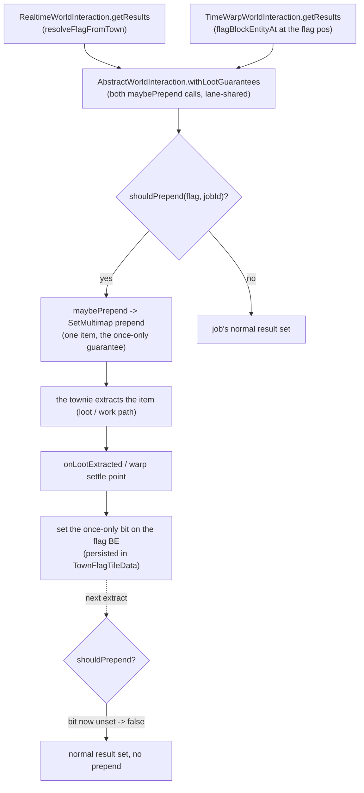

# Loot guarantees — first-delivery prepends

The mod gives certain one-time items to the player **through the first delivery** of a
job, not a recipe. The pattern is:

1. A **once-only bit** on the town flag BE (`TownFlagBlockEntity`), persisted in
   `TownFlagTileData` NBT, scoped to the town (not the run), survives chunk unload
   and reload.
2. A **pure static prepend** (a class with `maybePrepend(flag, jobId, base)`) that
   prepends one item to the job's result set while the guard holds.
3. A **shared guarantee chain** on the abstract base —
   `AbstractWorldInteraction.withLootGuarantees` — wired at **both** result paths
   (`RealtimeWorldInteraction.getResults`, which resolves the flag off the town,
   and `TimeWarpWorldInteraction.getResults`, which looks it up at the flag pos via
   `flagBlockEntityAt`) — so the drop arrives whether or not the player is present
   in a warp window.
4. A **flip** at the extraction settle point — `onLootExtracted` (realtime) /
   the warp's `processLootQuests` — when the item lands in a container.

The chicken-arc instance (the original) is documented in ADR 0014
(`docs/adr/0014-worldly-seeds-from-the-gatherer.md`). The hunter instance is
documented below.

## Guarantees table

| guarantee | bit (on `TownFlagBlockEntity`) | prepended item | guard (when to prepend) | flip (when the bit sets) |
|---|---|---|---|---|
| `ChickenArcLootGuarantee` | `chickenFirstGatherWorldlySeedsFired` | `ItemsInit.WORLDLY_SEEDS` | chicken spawned + arc not forfeited + bit unset | `ChickenArcConditions.maybeFlipFirstGatherBit` (seeds in container) |
| `FirstHunterLootGuarantee` | `firstHunterLootGuaranteeFired` | any item in the raw-food LOOT quest's wanted tag (typically `minecraft:mutton`) | bit unset + job rootId == `hunter` + raw-food LOOT quest ACTIVE | `RealtimeWorldInteraction.onLootExtracted` (mutton extracted = LOOT closed) |

## Guarantees flow (shared shape)

## The hunter guarantee (2026-07)

`FirstHunterLootGuarantee` closes the raw-food LOOT quest (`villager_simple_furnace_food_raw`)
on the first hunter delivery. This is the **unblock** for the
onboarding cook (`PHASE_JOB_CHANGE_FOOD`) — the cook quest is gated on that LOOT
closing, and in ~78% of fresh seeds (see `.scratch/cook-soft-lock/DIAGNOSIS.md` +
`run/samples/SUMMARY.md`) the `hunter/sword` job never starts (the `canFitInDay`
probe is timing-sensitive, no `ALWAYS_CONSIDER` global rule). The prepend
guarantees the first mutton reaches the LOOT quest regardless of whether the
townie actually runs the 2000-tick `sword` — the once-only bit caps the effect to
one mutton per town.

The guard reads:
- `!flag.isFirstHunterLootGuaranteeFired()` (the once-only bit).
- `jobId.rootId().equals("hunter")` (job-agnostic within hunter's own work), and
  `!MetaJobs.isMeta(jobId)`: not one of the root's upkeep jobs (the three diners, downtime,
  resting, seeking_work, bop_depositing). Since 2026-10-23 (agent playtest r10 #7, dev ruling): a
  starving hunter eating player-stocked raw beef had closed the raw-food quest on the meal. Check:
  `MetaJobsTest`; self_sufficiency 3/3 cook unlocked (baseline 3/4), each closed by a hunted item.
- `rawFoodLootQuestActive(flag)` — there is an ACTIVE `LOOT`-type quest whose
  wanted item matches the raw-food tag (the same tag a matching item would
  close).

The flip reads:
- `jobId.rootId().equals("hunter")` (only a hunter's extraction flips it).
- `rawFoodLootWasActiveBeforeClose` (the LOOT quest was open at settle time).
- `matchesFirstHunterItem(item)` (the item is in the raw-food tag).

**Caveat:** the guarantee is a *symptom-level* fix that removes the
`canFitInDay` flakiness from the raw-food chain. A deeper fix would address the
`hunter/sword` job's lack of `ALWAYS_CONSIDER` in the global rules so it can
start on a partial day (the `canAlwaysStart` predicate would then be true
and the hunt would not depend on the day-boundary alignment). See
`.scratch/cook-soft-lock/DIAGNOSIS.md` for the full diagnosis.

## Dev-only stall instrumentation: [completed-product-view] log (playtest 2026-10-15)

The COLLECTING_SUPPLIES stall's root cause is a desync between the gate
dump (which sees a terminal mat, `mat=3`) and the leaver's extraction view
(`computeRoomsWithCompletedProduct` -> empty -> "get work supplies"). To
pin the exact disagreement on the next fresh playtest,
`computeRoomsWithCompletedProduct` now logs **only on the disagreement
signature**: the view is empty while at least one contained job block IS
in the terminal state (`maxState`). The line
(`QT.JOB_LOGGER`, tag `[completed-product-view]`) dumps `maxState`,
`location`, and per room match each job block's `work.getJobBlockState`
(read through the SAME per-owner handle the circuit uses, so a null or
non-terminal read is itself the evidence). A view that is empty because no
block is terminal yet is legitimate and stays quiet; on-dump it is
throttled to one line per 5 s per ticker instance (`System.currentTimeMillis`,
no in-game time - this is wall-clock diagnostics). The method otherwise
returns exactly what `DeclarativeJobs.roomsWithState` returns.

## Next-state timer starts on the completing work write (2026-10-17)

`AbstractWorkWI.applyWork` computes the next state's time (`getTimeForStep(curState + 1)`) on
every work write and used to pass it to `setJobBlockStateWithTimer` whether or not the write
finished the step. A **partial** write (work left after the decrement, state unchanged) therefore
started the next state's countdown while the block was still in the work state, and the
completing write a few ticks later re-set it — the `Clobbered time on block at (1,64,0) from 1990
to 2000` ERROR in village/day1 (hunter:sword: state 1 `work: 1`, state 2 `time:
2000`). Captured stack: `VisitorMobEntity.villagerTick` → `JobLogic.doTryWorking` →
`AbstractWorkWI.tryWork` → `applyWork`, prev `State{1, workLeft=0.3}` → new `State{2}`.

Now only the write that advances the block (`actionCompleted`) starts the timer; partial writes
use `setJobBlockState`, which leaves timers alone. Shared by the realtime and warp
interactions. Pinned by `AbstractWorkWITest.tryWork_partialWork_doesNotStartTheNextStatesTimer` /
`tryWork_completedWork_startsTheNextStatesTimerOnce` (red-verified: both failed on the old form
with `[1@2000]` / `[1@2000, 2@2000]`).

## Eating takes a tenth of the old work (2026-10-19)

Dev ruling ("Should take more like 1/10th the time"): the NEED_EAT work requirement is 5 at a
table (`DinerWork`, was 50) and 3 without one (`DinerNoTableWork`, `DinerRawFoodWork`, were 25).
Pinned by `DiningWorkDurationTest`; eating autotests 4/4. The 100 s "eating" waits also seen in
that playtest were a separate GOING_TO_JOB stall (ticket dining-going-to-job-stall.md).

## [STALL:collecting] tripwire (2026-10-21)

`CollectingStallTrace` (called from `DeclarativeJob.tryGetSuppliesForDeps`): once a villager has
been COLLECTING_SUPPLIES for 1200 ticks without a take (`lastSupplyTick` unchanged — a nullable
Long, compare with `Objects.equals`), log one `[STALL:collecting] job=.. villager=..` line, then
every 6000 ticks while stuck: status, held items, the supply target's contents, the states the
town says need input, and every non-zero spot in the villager's own and the town work-status
store with its timer and whether this villager can claim it. Added to catch the after-sleep
hunter stall (`.scratch/playtest-2026-10-21/hunters-stuck-collecting-after-sleep.md`), which no
autotest reproduces. Silent across the full suite (81/82, 0 reports).

Extended 2026-10-24 (growth stall: a hunter stood ~5 blocks outside the storeroom while its
swords sat inside; ticket `.scratch/autotest-suite/growth-hunter-never-fetches-sword.md`): the
line also prints `pos` (the villager's block), `walkTarget` (what `navTargetForContainer`
gives for the supply chest), `dist`, `chestRoom` (the container's room: door and spaces),
and from the live entity `brainWalkTarget`, `navDone`, `pathEnd` and `pathReaches`. Checked
live by dropping the first-report threshold to 20 for one `hunter/sword` run (5/5): e.g.
`pos=3, 64, 2 walkTarget=6, 64, 0 dist=3.6 chestRoom=Room{doorPos=...} brainWalkTarget=6, 64, 0
navDone=false pathEnd=6, 64, 0 pathReaches=true`. A mismatch between `walkTarget`,
`brainWalkTarget` and `pathEnd`, or `pathReaches=false`, is what to read next time.

## A job sound that isn't registered is skipped, not played (2026-10-26)

`RealtimeWorldInteraction.playSound` resolves the job JSON's `sound.id` with `Loader.soundFromId`,
which answers null for an id with no registered `SoundEvent`. The null went on to
`ServerLevel.playSound` and crashed the server ("Ticking entity", NPE on `SoundEvent.getRange`)
the first time a villager worked the job: all three `paths/outfitter` runs died the moment the
crafter forged a wooden sword (`minecraft:item.sword.hit`, never a vanilla sound). Now a missing
sound is skipped with one warning per id. The data is fixed too: the five sword jobs use
`entity.player.attack.sweep`, `arborist/plant_tree` uses `block.grass.place` (was
`item.shovel.place`). `JobSoundIdsDataTest` checks every job JSON's sound against the sound
registry.

## Full-day trips prefer requested items; half-day trips bring up to 5 (Outfitter #25, dev 2026-10-26)

Ruling: a longer leaver trip must yield more, net of its one-food ration, within the 6-slot
inventory. Half-day tiers went to `attempts: 5` (hunter 2, axe/rod 3, gather/miner 4; the Java
shovel half-day's config moved to `GathererHalfDayLootAmountV2`, default 5, so existing configs take
it). Full-day tiers have `attempts: 6` (the hunter's was 4) and `"prefer_requested": true` in the
`biome_loot` result (the Java shovel full-day sets `withPrefersRequestedLoot(true)`), parsed onto
`Work.prefersRequestedLoot` (copied by every `Work` copy constructor).

`AbstractWorldInteraction.withRequestedLootPreference` runs inside `getResults` in both lanes
(`RealtimeWorldInteraction`, `TimeWarpWorldInteraction`), before `withLootGuarantees` prepends.
For a flagged job with anything on the board it calls the result generator a second time (the
same table and biome) and passes both rolls to `RequestedLootPreference.prefer`: the second roll's
requested items (matched by `WorkRequest.asIngredient()`) fill empty slots up to 6, then replace a
random non-requested item; its other items are dropped. A town with an empty board, or any other
job, keeps the first roll unchanged. "12 rolls" is 6 + 6: every leaver attempt brings back
exactly one item (next section). Pinned by `RequestedLootPreferenceTest` (pure);
the job-data and lane wiring are covered by held runs, not a unit JVM (the lanes need a loaded
flag and loot tables).

## A leaver attempt always brings back an item (dev, 2026-10-26)

Ruling: "Leaver work should ALWAYS bring back an item per attempt." `Loots.getFromLootTables`'s
leaver overloads passed `min = max / 2`, so `loadFromTables` picked a random count from half of
`attempts` to all of it (a 2-attempt hunter brought 1 or 2); since 2023 (`dcf7be84`, no recorded
reason). They now pass `min = max`. `loadFromTables` counts through `jobs/gatherer/LootRolls.roll`, which
skips empty rolls, so an empty table entry can't eat an attempt; it still gives up after
`Config.BASE_MAX_LOOP` rolls. Pinned by `LootRollsTest`. The
old `subList(0, min(size, max))` was sized before filtering empties and could overrun; it is a
`limit(max)` after the filter now. The fisher's `loot` result (`fisher_fish.json`, in town) still
calls `loadFromTables(level, loot, 1, maxResults)` and keeps its 1..2 range: it isn't a leaver.
