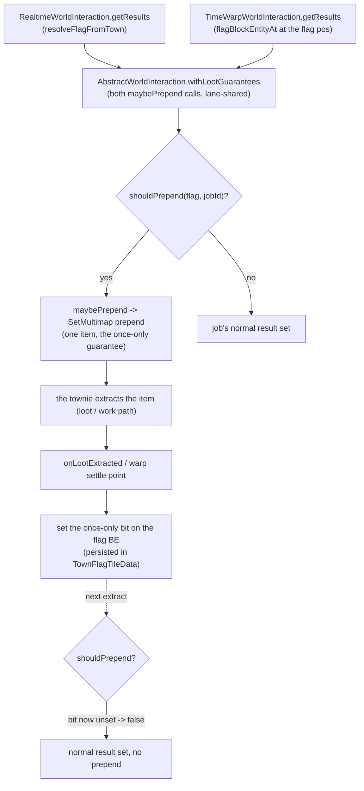

# Loot guarantees — first-delivery prepends

The mod gives certain one-time items to the player **through the first delivery** of a
job, not a recipe. The pattern is:

1. A **once-only bit** on the town flag BE (`TownFlagBlockEntity`), persisted in
   `TownFlagTileData` NBT, scoped to the town (not the run), survives chunk unload
   and reload.
2. A **pure static prepend** (a class with `maybePrepend(flag, jobId, base)`) that
   prepends one item to the job's result set while the guard holds.
3. A **shared guarantee chain** on the abstract base —
   `AbstractWorldInteraction.withLootGuarantees` — wired at **both** result paths
   (`RealtimeWorldInteraction.getResults`, which resolves the flag off the town,
   and `TimeWarpWorldInteraction.getResults`, which looks it up at the flag pos via
   `flagBlockEntityAt`) — so the drop arrives whether or not the player is present
   in a warp window.
4. A **flip** at the extraction settle point — `onLootExtracted` (realtime) /
   the warp's `processLootQuests` — when the item lands in a container.

The chicken-arc instance (the original) is documented in ADR 0014
(`docs/adr/0014-worldly-seeds-from-the-gatherer.md`). The hunter instance is
documented below.

## Guarantees table

| guarantee | bit (on `TownFlagBlockEntity`) | prepended item | guard (when to prepend) | flip (when the bit sets) |
|---|---|---|---|---|
| `ChickenArcLootGuarantee` | `chickenFirstGatherWorldlySeedsFired` | `ItemsInit.WORLDLY_SEEDS` | chicken spawned + arc not forfeited + bit unset | `ChickenArcConditions.maybeFlipFirstGatherBit` (seeds in container) |
| `FirstHunterLootGuarantee` | `firstHunterLootGuaranteeFired` | any item in the raw-food LOOT quest's wanted tag (typically `minecraft:mutton`) | bit unset + job rootId == `hunter` + raw-food LOOT quest ACTIVE | `RealtimeWorldInteraction.onLootExtracted` (mutton extracted = LOOT closed) |

## Guarantees flow (shared shape)

## The hunter guarantee (2026-07)

`FirstHunterLootGuarantee` closes the raw-food LOOT quest (`villager_simple_furnace_food_raw`)
on the first hunter delivery. This is the **unblock** for the
onboarding cook (`PHASE_JOB_CHANGE_FOOD`) — the cook quest is gated on that LOOT
closing, and in ~78% of fresh seeds (see `.scratch/cook-soft-lock/DIAGNOSIS.md` +
`run/samples/SUMMARY.md`) the `hunter/sword` job never starts (the `canFitInDay`
probe is timing-sensitive, no `ALWAYS_CONSIDER` global rule). The prepend
guarantees the first mutton reaches the LOOT quest regardless of whether the
townie actually runs the 2000-tick `sword` — the once-only bit caps the effect to
one mutton per town.

The guard reads:
- `!flag.isFirstHunterLootGuaranteeFired()` (the once-only bit).
- `jobId.rootId().equals("hunter")` (job-agnostic within hunter).
- `rawFoodLootQuestActive(flag)` — there is an ACTIVE `LOOT`-type quest whose
  wanted item matches the raw-food tag (the same tag a matching item would
  close).

The flip reads:
- `jobId.rootId().equals("hunter")` (only a hunter's extraction flips it).
- `rawFoodLootWasActiveBeforeClose` (the LOOT quest was open at settle time).
- `matchesFirstHunterItem(item)` (the item is in the raw-food tag).

**Caveat:** the guarantee is a *symptom-level* fix that removes the
`canFitInDay` flakiness from the raw-food chain. A deeper fix would address the
`hunter/sword` job's lack of `ALWAYS_CONSIDER` in the global rules so it can
start on a partial day (the `canAlwaysStart` predicate would then be true
and the hunt would not depend on the day-boundary alignment). See
`.scratch/cook-soft-lock/DIAGNOSIS.md` for the full diagnosis.
