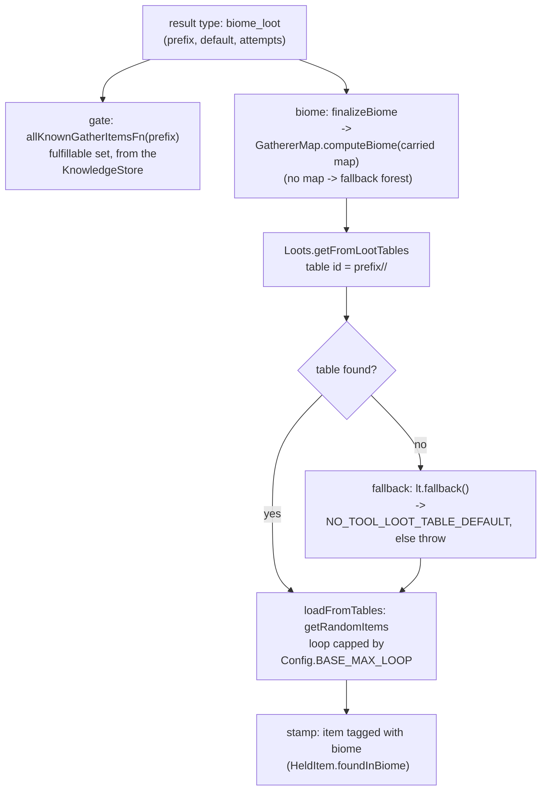

# How a leaver produces loot: a biome loot-table roll, not entity collection

A leaver (hunter, gatherer, miner, fisher, explorer) whose job result is
`type: "biome_loot"` does not walk up to a real animal or node. Its products are a
random roll from a per-biome loot table, gated by what the town already knows.
Vocabulary lives in `CONTEXT.md` ("Leaver job", "Known loot", "Gatherer map");
this file is the pointer that ties the scattered code together so the mechanism
is not re-derived.

- **Gate and roll are separate halves.** The gate, `allKnownGatherItemsFn` (wired in
  `WorksBehaviour`, backed by the KnowledgeStore, used by both
  `ResourceJobLoader.biomeDesc` and `NewLeaverWork`), decides which items are
  *fulfillable*, i.e. what the job board will offer. The roll (`biomeLootResult`
  -> `Loots`) is what actually generates items. A biome the town has not learned is
  nothing to offer, so the work sits in `NO_JOBSITE`/downtime. That is "why a leaver
  produces nothing", and the cause is a missing known biome or gatherer map, not
  missing mobs.
- **The biome comes from the carried gatherer map, not a coin flip.**
  `GathererMap.computeBiome` scans the items held for a `GATHERER_MAP` and reads its
  biome tag. With none, `Loots.fallbackBiome` (`forest`) is used.
- **Table address and fallbacks.** `Loots` builds `ResourceLocation(MODID,
  prefix/<namespace>/<path>)`. If that id is absent it tries `lt.fallback()`, then
  `NO_TOOL_LOOT_TABLE_DEFAULT`, then throws.
- **The roll is bounded.** `loadFromTables` calls `getRandomItems` in a loop capped by
  `Config.BASE_MAX_LOOP`, shuffles, and truncates to `maxItems`.
- **Nothing here touches a live entity.** The hunted animal is a table roll; a town
  with no animals in the world still hunts, as long as it holds a known biome.
