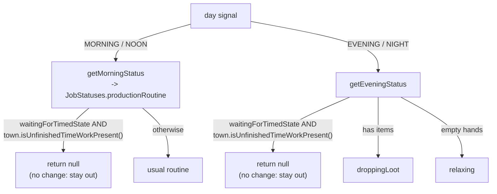

# production — the day-cycle status recall, and the evening hold

`ProductionStatuses.getNewStatusFromSignal` re-derives a production job's
status when the day signal flips (MORNING/NOON vs EVENING/NIGHT). The two
branches are *supposed* to be symmetric about one thing: a villager waiting on
a timed work state (`WAITING_FOR_TIMED_STATE`) whose timer is still running is
mid-trip and must not be pulled off it.

## The asymmetry that was the bug

The morning branch always had the hold (`productionRoutine` returns `null`
while `town.isUnfinishedTimeWorkPresent()`). The evening branch did not — it
recalled unconditionally, so a town-leaver (hunter, gatherer) out past dusk was
yanked home empty-handed with the trip unfinished. `getEveningStatus` now opens
with the same hold.

- **`null` means "leave the status alone."** Both callers
  (`ProductionJournal.tryUpdateStatus`, the warp-time sim in
  `DeclarativeJobs`) no-op on a `null` return, so the hold is a clean no-change.
- **The hold wins over carrying.** A mid-trip leaver who somehow has items stays
  out and drops them on the eventual post-timer recall, rather than being pulled
  home to drop now. The timer is the source of truth for "still working."
- **The timer check is town-wide, not per-villager.**
  `isUnfinishedTimeWorkPresent()` is any unfinished timed work in town. A
  leaver mid-trip has his own timer running, so it holds him; a leaver whose
  own timer just ended can be held one extra tick while another villager's
  timer finishes. The morning path accepts the same approximation, so the two
  branches stay consistent.

## Testability seam

`getEveningStatus` is generic over the status type (`<STATUS extends
IProductionStatus<STATUS>>`) and takes the timed-wait factory separately
(`waitingFactory`) from the recall factory, so a unit test can drive it with a
lightweight fake status instead of the concrete `ProductionStatus`. Regression
tests live in `StatusesProductionRoutineTest` (`InEvening_…`).

Bug writeup: `.scratch/warp-night-handling/town-leaver-returns-empty-at-night.md`.
