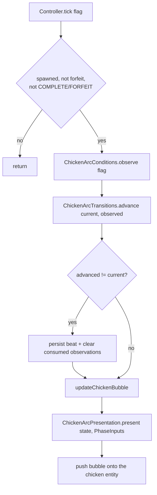
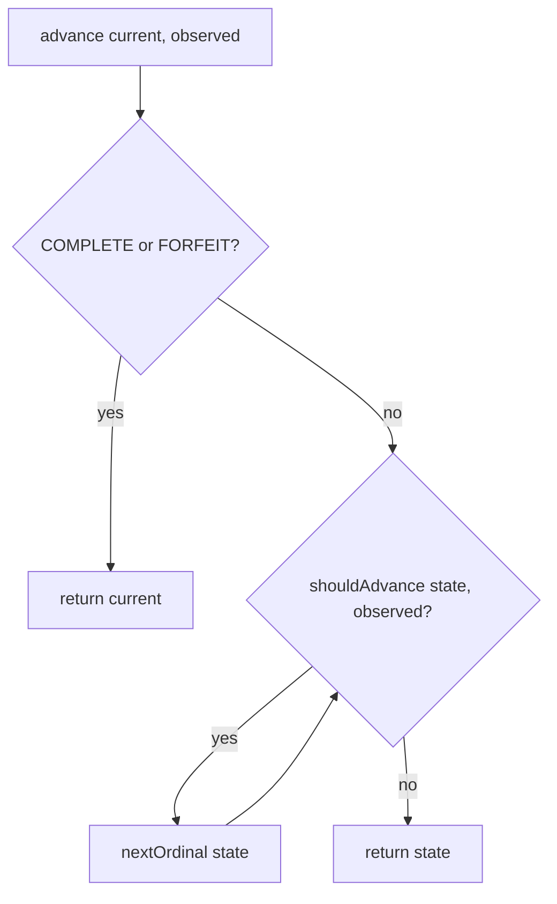
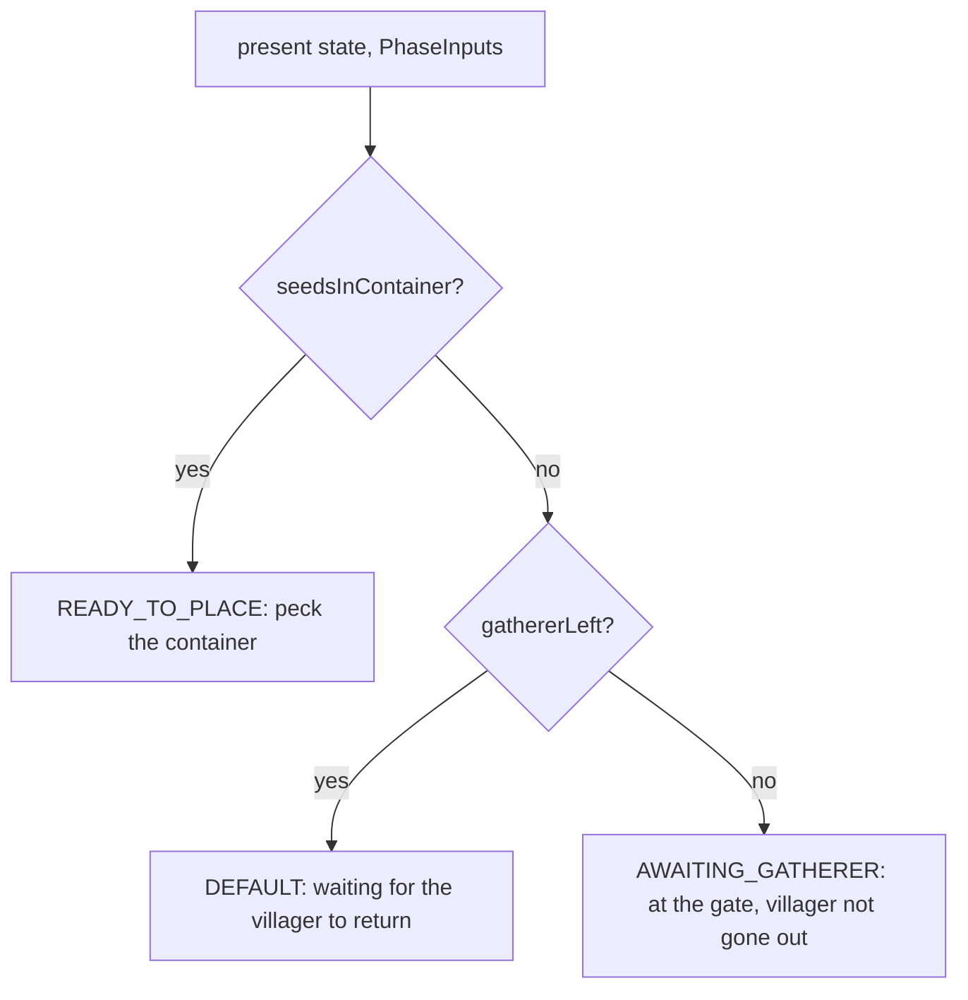
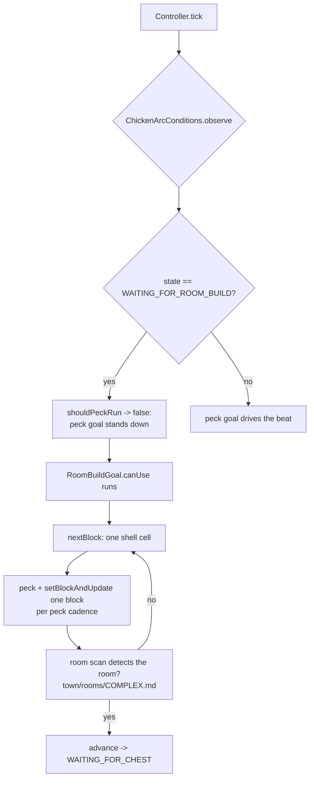

# COMPLEX.md — helperchicken (onboarding arc)

The helper-chicken tutorial walks the player through a linear set of beats to
onboard them to a town. Two pure layers drive it from one per-tick controller:

- **Beat** (`ChickenBeatState`) — the linear, ordinal state machine. The
  authoritative "how far along is the arc." Advanced by
  `ChickenArcTransitions`; persisted by `name()` in the flag NBT.
- **Phase** (`BeatPhase`) — the per-beat sub-state: what the chicken is doing
  *right now* within a beat (e.g. "at the gate" vs "ready to place the seeds").
  Derived by `ChickenArcPresentation`.

Both layers are pure (no I/O); the controller reads the world and writes the
result back.

## Tick flow (happy path)

`ChickenArcController.tick(flag)` runs once per flag per tick:

- `Observed` (15 booleans) feeds beat *advancement*; `PhaseInputs` (6 booleans)
  feeds phase *derivation* — two separate snapshots, read separately.
- `advance` skips past every satisfied beat in ordinal order, so a player who
  placed the chest before the sign auto-completes the chest beat the tick after
  the sign beat (out-of-order acceptance).
- On a beat change the controller clears the ephemeral observation that drove it
  (e.g. the sleep observation fires once and must not re-trigger next day).

## Beat state machine

`ChickenArcTransitions.advance(current, observed)` is a pure state machine that
skips past every beat whose condition is met:

- `shouldAdvance` is `isSatisfied(state)` for a required beat; for an optional
  beat it is also true when the NEXT beat's condition is met, so a player who
  skips the optional action is not stalled (see `CONTEXT.md` **Optional beat**).
- `isSatisfied` maps each beat to one boolean of `Observed` (e.g.
  `AWAITING_WORLDLY_SEEDS_DELIVERY -> playerGaveSeedsToChicken`).
- `WAITING_FOR_ROOM_BUILD` sits between `WAITING_FOR_WAND_ON_DOOR` and
  `WAITING_FOR_CHEST`: after the door is registered, the chicken lays a shell
  around it (below) so the wall walk detects a room, then the chest beat can
  drop its chest into a room that actually exists. The room-detection itself is
  documented in `town/rooms/COMPLEX.md`; this beat only lays the blocks that make
  it succeed.
- The chest beat (`WAITING_FOR_CHEST`) comes *before* the campfire sleep: the
  chicken works the player's store into place first (see the chest goal below),
  so the player has a room with something in it before they go to sleep. The
  job board (`WAITING_FOR_SIGN`) follows the sleep, in a second room, so the
  chest and the job board are no longer two conditions on one matched room.
- `HelperChickenSunsetChestGoal` drives the chest beat. On `WAITING_FOR_CHEST`
  it walks into the player's registered store shell, waits for the player to
  step inside that room, then drops the chest (map + wooden axe) in the room's
  interior. It reads the registered room through `RoomsHolder.getRegisteredRooms()`
  and picks a passable interior cell across the room's `yCoord`, `yCoord + 1`,
  and the chicken's ground Y (a door in open ground registers as a door but
  yields no enclosed room, so the goal stands down until a real room exists).
  `SUNSET_AND_MAP` follows the chest beat, driven by the same `chickenSunsetChestSpawned`
  flag the chest goal sets when it drops the chest.
- The campfire beat (`WAITING_FOR_WAND_ON_CAMPFIRE`) advances on a lit campfire
  *anywhere in the flag's campfire radius* — the same `TownCycle.findCampfire`
  scan the campfire quest uses, not the fixed structure `CAMPFIRE_OFFSET`. The
  offset is only the chicken's peck/animation target; the quest and the beat
  agree because both scan the radius (a hand-placed flag puts the campfire where
  the player put it, not at the offset).
- The wall-block beat (`WAITING_FOR_WALL_BLOCK`) advances on
  `wallBlockPlaced() || handPlaced`. The `empty_town` structure pre-digs the
  wall hole; a hand-placed flag has no such hole, so `wallBlockPlaced` can never
  be true and the beat would stall the arc. It is skipped when the flag is
  hand-placed; the room lesson is still carried by the door beats that follow.
- Beats are persisted by `name()` under `chicken-beat-state`. There is no live
  onboarding in the field, so the order and names may be reordered or renamed
  freely (not just inserted); only the persistence key is stable across a
  running save, and that is by `name()`.

## Phase derivation (per beat)

`ChickenArcPresentation.present(state, inputs)` picks a `BeatPhase` per beat and
maps it to a `Presentation` (a bubble icon + a monologue hint + a plain-text
fallback). Most beats are a single phase; a few branch on inputs. The
gate-wait beat (`AWAITING_WORLDLY_SEEDS_DELIVERY`) is the only one that reads a
jobs-domain value:

- `gathererLeft` is a **cross-domain read**: the gate-wait beat reads the
  gatherer villager's jobs-domain `ProductionStatus`
  (`IProductionStatus.isBusy`) through the chicken arc (see `CONTEXT.md`
  "phase across contexts").
- `ChickenArcConditions.isGathererLeft(flag)` finds the villager whose
  `jobId.rootId() == "gatherer"` among the flag's entities and returns its
  `isBusy()`; if no gatherer is loaded it returns false, so the neutral
  `AWAITING_GATHERER` hint is the safe fallback.

## Player clicks (hint cadence)

`onPlayerClickedChicken` is a separate entry point (left/right click on the
chicken). It re-derives the `Presentation` for the current beat and, every Nth
click on the same beat, switches the monologue hint to the plain-text fallback
(`PLAIN_TEXT_CYCLE = 3`); the per-player click counter resets when the beat
changes.

## The room-build beat and its goal tier

`WAITING_FOR_ROOM_BUILD` is the only onboarding beat the chicken drives itself:
the player does nothing, the chicken lays the shell. Two goals share goal tier 2
(`HelperChickenEntity`): the peck goal (follows/pecks the beat target) and the
room-build goal (`HelperChickenRoomBuildGoal`). They are mutually exclusive by
their own `canUse`/`canContinueToUse` gates, not by priority.

- `ChickenArcConditions.shouldPeckRun` returns `false` for `WAITING_FOR_ROOM_BUILD`
  (the beat has no held-item requirement, so without this the peck goal would run
  forever and starve the room-build goal at the same tier). This is the fix a
  plus-shaped layout was not the only failure — the goal was unreachable.
- `ChickenRoomShellPlan` is pure: it builds an `InclusiveSpace` around the door
  (the door centred on one edge) and lays the closed perimeter via
  `InclusiveSpaces.getWallPositions`, reusing RoomRecipes' enclosure that the room
  scan (`town/rooms/COMPLEX.md`) would walk. A hand-rolled corner/edge loop
  previously produced a plus (open sides) the wall walk could not close; the
  `isWhole` test guards against that. Each perimeter cell is laid at feet and head
  (`WallDetection.IsWall` needs a solid at both levels); there is no ceiling or
  floor (room detection is a 2D wall walk). The shell is a 4×4 rectangle
  (`ROOM_SIZE = 4`, a 3×3 interior) so the chest beat's witness gate and the
  chicken's own occupancy can coexist: the chest beat drops the chest only when
  the player is inside a room interior cell (`playerInStoreShell`), and the
  chicken stands on an interior cell to drop it — a 3×3 shell has a single
  interior cell that both need, which deadlocked the beat. The door is centred on
  the along edge via a floor/ceil split of the remaining cells, so the box stays
  square (an even `ROOM_SIZE` puts one more cell on one side than the other, but
  the door is walled on both sides and the wall walk still closes it).
- The goal re-plans from the live world each block, so a block the player placed
  (or broke) mid-build is skipped or re-laid, and the goal stands down when the
  plan is exhausted but the room still has not been detected.
