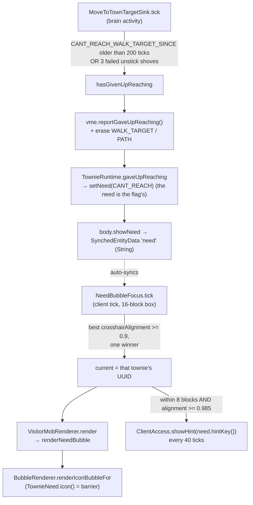
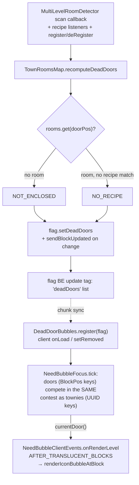
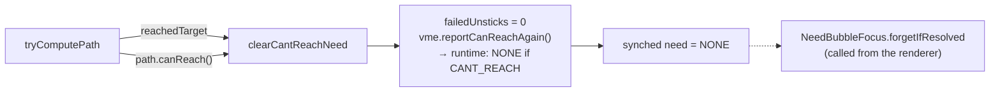
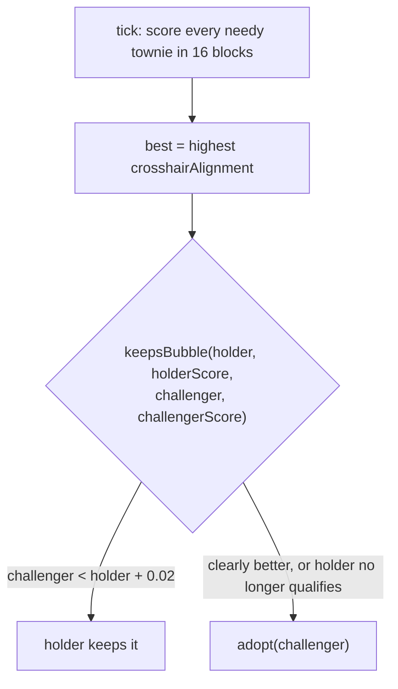

# Need bubbles — from "gave up walking" to an icon over one townie's head

One unmet need (ADR-0011) travels from a brain behaviour on the server to a
world-space bubble on the client. The server decides *that* a townie is stuck; the
client decides *which* stuck townie the player is currently asking about. Neither
half knows the other's rule.

See `CONTEXT.md` → **Need bubble** for the vocabulary, and
`docs/adr/0011-watching-first-and-need-bubbles.md` for why silence-means-working.

## Happy path

- **The give-up is keyed on failure, not elapsed travel.** `Config.WANDER_GIVEUP_TICKS`
  is this behaviour's *maximum duration*, so reusing it would cap healthy long walks
  and abandon townies mid-journey in a large town.
- **The bubble is drawn from `render`, not as a `RenderLayer`** — inside a layer the
  pose is still under body yaw and the icon would spin as the townie turns. This is
  the same reason `HelperChickenRenderer` calls the bubble layer statically.
- **Icon then words, in two gestures**: sweeping the crosshair earns the icon ("who
  needs me"); walking up and looking squarely earns the action-bar line ("what for").
- The bubble renderer was moved to `render/` (from `mobs/helperchicken`, where it was
  first built) once the third consumer (dead doors) landed, since it is now a neutral
  world-space bubble shared by the chicken, townie needs, and dead doors. It is
  `render/BubbleRenderer` — the chicken-specific `renderBubbleFor` path is the only
  method that still takes a `HelperChickenEntity`.

## The second consumer: dead doors

A registered door with no room bubbles too (ADR-0011, grilling 2026-08-09). Doors are
not entities, so the pipeline differs from townies at both ends and meets in the middle:

- **Zombie doors are not bubbles.** If the door *block* is gone, the registration is
  silently discarded on the next tick's block check (ADR-0013) — there is nothing to
  point a bubble at, and a never-completed room cost the player nothing, so there is no
  broadcast either.
- **Both troubles share one door icon** (`DoorTrouble.sharedIcon`); the distinction
  lives only in the close-up words, because the fix differs (walls/roof vs. contents).
- **The sync rides the flag BE update tag**, not a packet. Accepted cost: a player in
  bubble range of a door whose *flag* chunk is not loaded sees no bubble.
- **A door bubbles from the moment it is registered** — the wand-then-fetch-materials
  build flow is *expected* to show a bubble. It diagnoses; it never deregisters.
- The focus holder key is now `Object` (UUID for townies, BlockPos for doors) — the
  hysteresis rule (`keepsBubble`) is type-agnostic and its tests did not change.

## The third consumer: unmet item

When `TownPossibleWork.applyScores` finds **no viable job** for a root, the villagers of
that root are waiting on supplies the town does not have. That path already computed the
exact missing ingredient for the economics record; it now also raises the bubble, and the
bubble shows that item, not a generic stand-in.

- **Set** in `registerUnmetNed` (per-villager, same pass as `econ.registerUnmetNeed`):
  `setNeed(UNMET_ITEM)` and `setUnmetItem` with the missing ingredient's
  `Ingredients.toString` form (a tag like `#questown:villager_food` or a single item).
- **Cleared** in the `applyScores` else-branch (`clearUnmetItemNeeds`): any villager of
  the root whose need is `UNMET_ITEM` goes back to `NONE` the moment a viable job exists
  again, and `setNeed` clears `unmetItem` when the need is not `UNMET_ITEM` (so the item
  cannot linger onto another need). Only `UNMET_ITEM` is cleared here. A simultaneous
  `CANT_REACH` is left alone, and `MoveToTownTargetSink.clearCantReachNeed` returns the
  courtesy (each consumer clears only its own need).
- **Icon is the missing item itself**, shown like the Inventory screen's "needs" row:
  the item ID is synced per entity (`unmetItem`, alongside `need`), the client rebuilds
  the ingredient, and the bubble renders a rotating representative via
  `Ingredients.representativeItemStack`. It falls back to `TownieNeed.icon()` (the bundle)
  when the item cannot be resolved on the client.
- **The words name the item** ("They need %s to work", `%s` from
  `Ingredients.getName`, so a tag renders as its name, e.g. "Food"). The generic
  `unmet_item` key is the fallback when no item resolves. This is the ADR's deferred
  "townie under the actual missing item" follow-up: the item ID is now synced per entity,
  so the bubble no longer needs the developer-facing `WithReason` prose to be rephrased.
- **Autotest**: `farmer/harvest_wheat [no_supplies]` asserts every townie ends the run
  at `UNMET_ITEM`; the base `farmer/harvest_wheat` asserts the supplied counterpart ends
  at `NONE`. Both ride the existing `CustomAssertion` seam (realtime phase). The item the
  bubble shows is client-side, so it is verified in a dev client, not by the autotest.

## Exceptional: the need clears itself

- **There is no backoff and no silent re-targeting.** A townie that gave up retries,
  fails, and re-bubbles until the player clears the way — silent self-correction is
  the failure mode the mechanism exists to kill (CONTEXT.md, 2026-07-28).
- Only the server writes `need`: the townie's runtime on the flag owns it
  (`TownieRuntime.setNeed`, no-op on an unchanged value) and pushes it to the body
  (`TownieBody.showNeed`), so the synched field is quiet unless something actually changed.
  The entity's `setNeed`/`setUnmetItem` forward to the runtime (no-op on the client, where
  there is none) and its `getNeed`/`getUnmetItem` read the runtime on the server and the
  synched field on the client. A body that reattaches to its townie re-shows the need.
- `failedUnsticks` also resets in `start`, i.e. whenever a fresh path is taken up.
  Without that, a shove count earned against one target would carry to the next and
  make the townie give up on it instantly, before trying.

## Exceptional: two needy townies standing together

- `keepsBubble` is deliberately pure and package-visible so the flicker rule is unit
  tested (`NeedBubbleFocusTest`) without a client level; the cone threshold itself is
  only verifiable in-game.
- Focus state is **static** — there is exactly one local player, and exactly one
  bubble is shown town-wide by design.

# Third holder type: attention targets (G1+G2 "!" bubbles)

The one-bubble contest now has three candidate classes: townies (UUID holders),
dead doors (raw `BlockPos` holders) and **attention targets**
(`AttentionBubbles.Target` record holders — a flag with incomplete quests, or a
job board with zero work requests). The same cone/hysteresis/`keepsBubble`
rules apply; the holder type is carried through `current` as `Object`, so
`currentDoor()` still means "holder is a raw BlockPos" and
`currentAttention()` is the new accessor. When an attention target wins,
`NeedBubbleClientEvents` draws the "!" texture bubble
(`BubbleRenderer.renderTextureBubbleAtBlock`, authored
`textures/bubble/attention.png`) instead of the door's item bubble. The hint
(action-bar text on close examination) comes from `Kind.hintKey` —
`message.questown.attention.*` in en_us.json.

## Townie skin pool (`TownieSkins`, 2026-10-14)

Townie skins are a deterministic per-UUID pick from a pool: the 9 vanilla
1.20.6 character skins (slim variants, `minecraft:textures/entity/player/
slim/{alex,ari,efe,kai,makena,noor,steve,sunny,zuri}.png` — added alongside
Steve/Alex in 1.20.5) plus the mod's 6 custom `textures/entity/1-6.png`.
`VisitorMobRenderer` bakes `PLAYER_SLIM`, so the slim textures are the
match. `TownieSkins` is pure (pool + floor-mod pick) so it is
unit-testable without the client; the renderer delegates to it. Use
floor-mod, not `Math.abs`, for the hash (MIN_VALUE edge).

## Held-item NBT load: empty-slot guard (2026-10-15 playtest)

`readAdditionalSaveData` mapped every saved held-item tag through
`ItemStack.parse(...)`. `addAdditionalSaveData` saves an **empty compound**
for empty slots, and vanilla's parser logs `Tried to load invalid item: No
key id in MapLike[{}]` for it - 12 lines per entity load (every save/reload
of every townie). The guard: `tag.isEmpty() ? ItemStack.EMPTY : parse(...)`
before the `orElse` fallback. No behaviour change for non-empty slots.

## Doorway pathfinding preference — reverted (2026-10-15 → 2026-10-17)

The 2026-10-15 fix ("townies prefer jumping over walls to get inside the room") gave
`VisitorMobEntity.getPathfindingMalus` a 0.5 discount on `DOOR_WOOD_CLOSED` /
`DOOR_IRON_CLOSED` / `DOOR_OPEN`. **That made open doors impassable**: vanilla's
`WalkNodeEvaluator` treats any malus `< 0.0F` as unwalkable (its `>= 0.0F` gates), and
`DOOR_OPEN`'s default is `0.0F` → `-0.5`. A closed wooden door was unaffected because a
door-opening mob's evaluator re-types it to `WALKABLE_DOOR` (not discounted). Live
symptoms 2026-10-17: villagers could not enter rooms through open doors ("if I close the
door, they open it and walk through"), routed over walls / onto a bed, and stood on top
of a supply chest unable to path off. The override is removed (vanilla costs).

**Rule:** a malus is never negative — to make one route cheaper, raise the cost of the
alternative instead. The original wall-climb complaint is open again
(`.scratch/playtest-2026-10-17/villager-stuck-on-bed-pathing-over-wall.md`).
The `VillagerPathNavigation` seam (re-classifying campfire, water, fence cells) is the
place for a wall-top penalty if one is needed.

## NO_STORAGE need: full storage bubbles at once (2026-10-21 dev request)

Fourth need consumer. `TownieRuntime.syncStorageNeed` (each server tick, beside the status
sync in `showOn`; the rule itself is `TownieRuntime.storageNeedAfter`): a townie whose job status is NO_SPACE — holding work output with no free town storage slot
(`JobStatuses` "stop when holding output and the town has no space") — gets `NO_STORAGE` (drawn
from `TownieNeed.iconTexture()` — the questown "no space" status art, face-on via
`BubbleRenderer.renderTextureBubbleFor`; an item-model chest rendered at an angle, front away, hint "Every chest is full: they have nowhere to put what they made."). It replaces NONE
or UNMET_ITEM: full storage is the blocker right now, and `TownPossibleWork.refreshUnmetNeeds`
no longer overwrites NO_STORAGE with UNMET_ITEM (without both halves the bubble flapped between
them every recompute pass). It clears only its own need; UNMET_ITEM comes back on the next pass
if it still applies. The flag-level counterpart (after a tick build-up) is in
`town/rooms/COMPLEX.md`. Live pin: `cook/fuel [storage_full]`.
