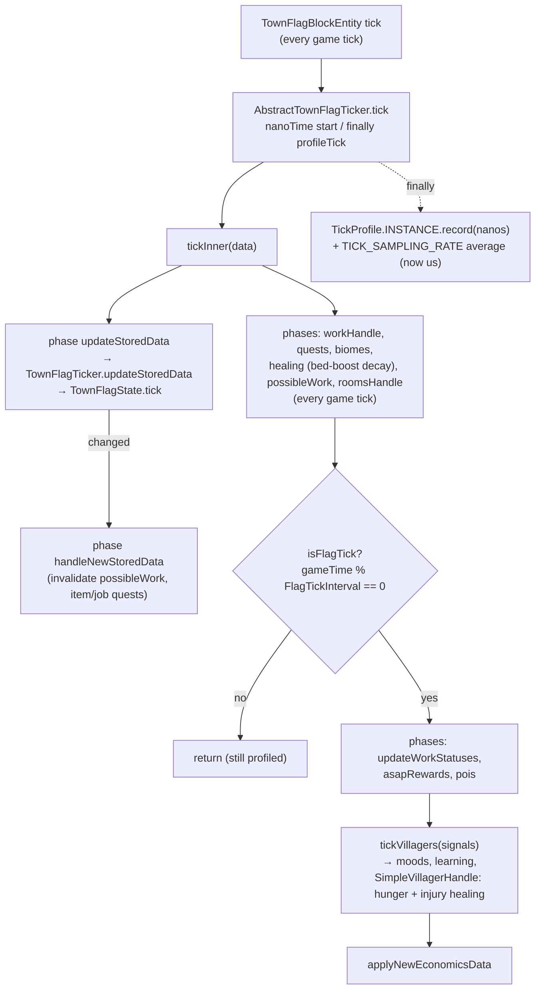
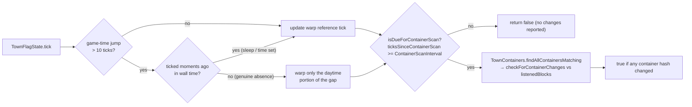
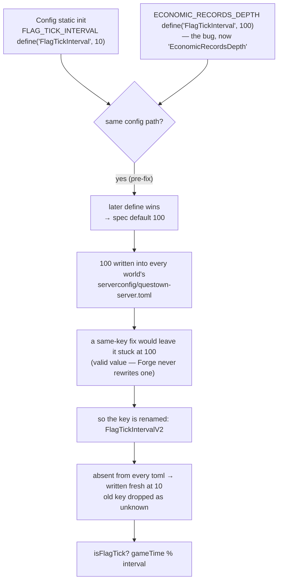
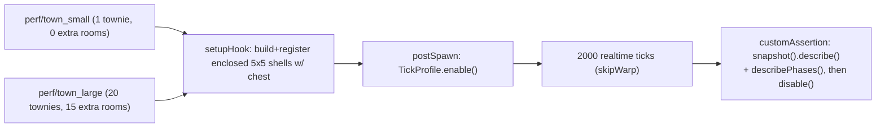
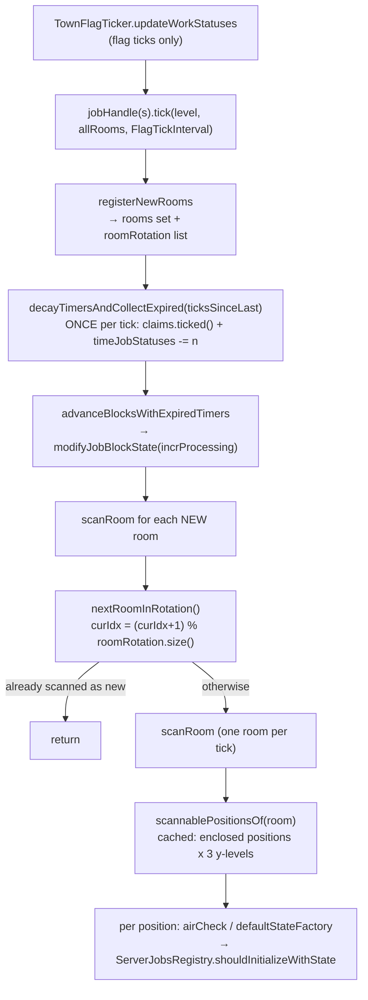
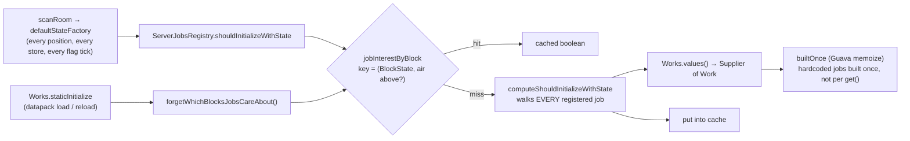
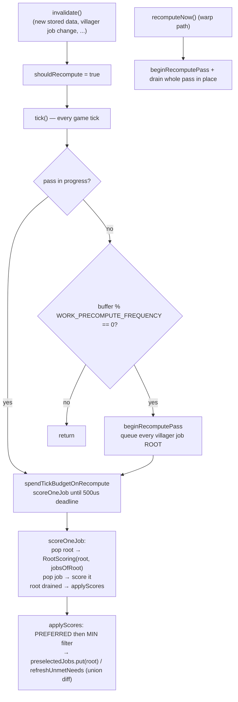
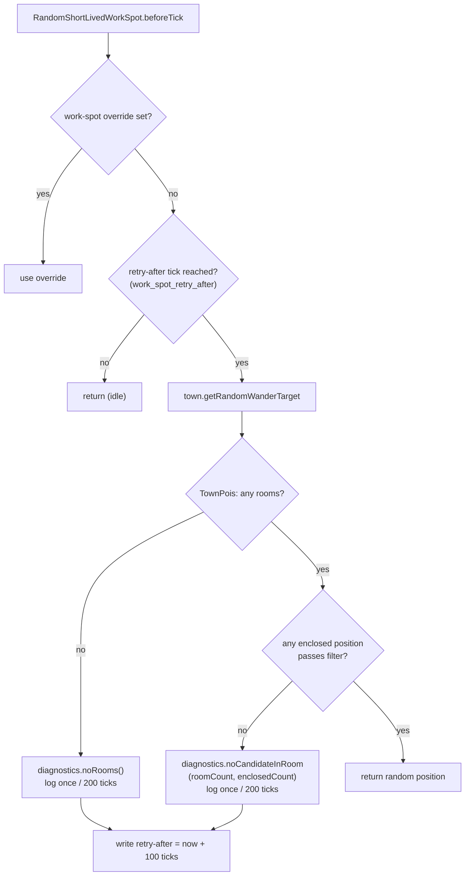

# Flag tick — throttles and profiling

Every town flag ticks on **every** game tick. Two independent throttles decide how
much of the tick actually runs, and `TickProfile` measures what it cost. The
motivating measurement: a flag tick averages ~430us but has a 4.5ms p99 and a
23ms max — a **stutter** problem, not a TPS problem, so the tail is what gets
recorded.

## Happy path

- **Profiling wraps every exit path, not just the full-tick one.** The heavy
  phases are gated behind `FlagTickInterval`, but `updateStoredData` runs on all
  ticks — measuring only full ticks would hide the per-tick cost entirely.
- `TickProfile` is a **disabled-by-default, process-wide singleton**; `enable()`
  is called only by the `perf/*` autotest scenarios, so the production path pays
  one boolean check per phase. Process-wide is deliberate: it is a dev
  measurement tool, and the arena runs one town at a time. If several flags tick
  while it is enabled, their samples fold into the same buckets — which is how
  the cross-run arena residue described in the perf notes shows up as a phase
  sample count that is a multiple of the tick count.
- **A whole-server-tick stall is invisible in the flag-tick buckets.** A flag tick is only one phase of the server tick, so a 2s "Can't keep up" can happen while the flag tick stays fast and the flag-tick buckets never show it. `TickProfile` carries a second sample set (`serverMicros`) fed by `ServerTickProfiler` on the `ServerTickEvent` START/END boundary; `describeStallAttribution` splits the worst server-tick against the flag-tick to localize the rest. Same dev-only enable guard; read by the `perf/*` autotest and the `qt tickprofile` command.
- Timings moved from `System.currentTimeMillis()` to `nanoTime`/microseconds — at
  ms resolution a 400us tick rounds to 0 and a rare spike averages away.
- **Two unrelated things are called "healing" on this map.** The per-game-tick
  `healing` phase decays temporary healing-*bed boost* factors
  (`tickHealingHandle` → `HealingStore.tick`). Villager *injury* healing is
  `SimpleVillagerHandle.tickDamage`, inside `tickVillagers`, below the gate — that
  is the one the interval table further down applies to.

## Sleep gate and the held-run keep-awake

`tickInner` runs the flag's full tick only while the flag is awake. The awake
decision is `allPlayersLeftArea` in `TownFlagTicker`: it returns true, the flag
sleeps, when no player is within `TOWN_TICK_RADIUS`, and false, the flag stays
awake, when one is. The POI scan (`tickPOIs`) is a full-tick phase, so a
sleeping flag does not scan for POIs.

Held autotest runs keep the flag awake. When `-Dquestown.autotest.hold=true`,
`allPlayersLeftArea` short-circuits to false before the player-distance check,
so the flag ticks from server start, before any player joins. That is what lets
the headless `village/self_sufficiency` watchtower's seeded lit campfire be
detected by `tickPOIs` and the campfire quest self-complete without a client
(see the watchtower seed in `commands/test/COMPLEX.md`). The branch is gated on
the test property, so real game behavior is untouched.

**The campfire scan runs while the Campfire quest is open (2026-10-22 r6).** `TownPois.tick`
used to look for a lit campfire only while the town had no villagers. With mat-gated arrival
the first villager does not need a campfire, so a player who skipped it on day one could never
complete the quest, and the flag's incomplete-quests bubble stayed up for good. The gate is now
`TownQuests.isCampfireQuestOpen()` (posted and incomplete), which keeps the one-shot intent
(no scan once it completes); the *lit* check still keeps an unlit worldgen campfire from
counting. Unit: `TownQuestsCampfireOpenTest`; the wiring was verified live.

## Container-scan throttle (inside `updateStoredData`)

- **A time jump while the town is awake produces nothing.** The flag ticks
  every game tick while a player is in radius, so a jump detected on a tick
  that follows the previous one by moments of wall time is a sleep or a
  `/time set`, not a player absence; the reference tick advances without a
  warp. Genuine absence (the flag was not ticking) warps only the
  time-of-day portion in `[0, 12000)` of the gap — villagers sleep at night.
  Regression guard: `gatherer/axe [sleep_jump]` asserts a non-positive
  product delta.

- The scan walks every recipe-matched room's blocks (chests **and** block
  entities) and hashes contents — ~187us in a 16-room town, ~44% of all tick
  time, and it **grows as the player builds**. It was previously paid above the
  flag-tick throttle, i.e. on every game tick.
- Skipping is safe because detection is a **diff against `listenedBlocks`**, not
  an edge trigger: a chest change during a skipped tick is caught by the next
  scan. Nothing in the town reacts to container contents within the same tick —
  item quests and economics are driven off `handleNewStoredData` — so the only
  visible effect is those reacting up to `ContainerScanInterval` ticks later.
- `ContainerScanInterval` is **independent of `FlagTickInterval`** and expressed
  in game ticks. Both default to 10; that is a coincidence of what each costs,
  not a coupling, and either can be tuned without the other.
- The counter is per-`TownFlagState` (per town), and warp bookkeeping stays above
  the early return so leaving/returning is unaffected by the throttle.

## Contained-blocks map is a snapshot (not refreshed on block-type change)

The `RoomRecipeMatch` contained-blocks map is read live once per detection and
cached in `ActiveRecipes`. It is re-read only when a room's **enclosed spaces**
change — `ActiveRooms.update` diffs `MCRoom`, which holds `doorPos`/`spaces`/
`yCoord` but no block data — not when a contained block's *type* changes. So a
block inside an already-enclosed room (a chest becoming a wall, placing or
adjusting furniture, building an inset corner) can leave the map stale until the
enclosed region changes. A mismatch between the map and the live block at a
recorded position is therefore not a detection error: the value was correct at
detection, the map just was not refreshed. The job path
(`Containers.asChest`) guards on the live blockstate, so a stale entry is
skipped, not logged — which is why the 2026-09-04 log-flood was a logging bug
(`TownContainers.fromChestBlockMaybe` logging `ERROR` per call), not a wrong
room.

## Exceptional case: where `FlagTickInterval` actually comes from

The gate above reads a **per-world server toml**, not the code default, and for
every world created before 2026-07-28 those two disagree.

- **The rename is the migration.** Forge only writes a key that is missing or
  fails validation, so fixing the collision alone would have left every existing
  world pinned at `100` forever — a value no one chose. Renaming to
  `FlagTickIntervalV2` makes the key absent everywhere, so each world writes it
  at the current default and the stale entry is dropped as unknown. This is the
  project's convention for "the value in the wild is wrong and should be
  re-defaulted": rename with a version suffix rather than write a migration.
- The player-facing comment says only what the setting does. The reason for the
  suffix lives here, not in everyone's toml.
- `EconomicRecordsDepth` is absent from those tomls entirely and will be written
  on next load at its intended default of 100 — the same number the collision
  happened to supply, so no economics behaviour changes.
- The interval does **not** rescale work-status timers, despite being passed as
  `ticksSinceLast`: the store is ticked only on flag ticks, so a timer loses
  `interval` every `interval` game ticks — one tick per game tick at any setting.
  What the interval changes is *granularity*: a timer can overshoot by up to one
  interval, so at 100 a finished job sits idle for up to 5 seconds before the
  town notices.
- The practical effect of the rename is that every existing world moves 100 → 10,
  i.e. work statuses update 10x more often than they have been. That is the
  setting doing what it was always meant to do, and the stutter work above is what
  makes it affordable.

### What the interval does and does not change (audited 2026-07-28)

Villager **labour throughput does not depend on this setting at all**: job progress
is driven every game tick by the flag's `townies` phase, which runs above the `isFlagTick`
guard (`TownVillagerHandle.tickTownies` → `TownieRuntime.tick` → `DeclarativeJob.tick` → the
ticker) and never reads the config. Everything below the `isFlagTick`
guard, though, runs once per flag tick, and whether that changes pace depends
entirely on whether the work per call is interval-scaled or fixed:

| per-flag-tick work | interval-scaled? | effect of a smaller interval |
|---|---|---|
| work-status timers (`ticksSinceLast`) | yes | none, beyond less overshoot at expiry |
| hunger (`tickHunger`) | yes | none |
| injury healing (`tickDamage`) | **yes, as of this change** | none (was 10x slower at large intervals) |
| injury healing on waking (sleep listener) | n/a — not on this path | none |
| ASAP rewards (`MCAsapRewards.tick`) | no — pops **one** per call | queued rewards drain faster |
| knowledge requests | no — serves **one** per call | job awareness resolves faster |
| mood recompute (`moodTick--`) | no — fixed decrement | stale mood corrects sooner |
| room scan rotation, POIs, beds, economics | n/a — idempotent | noticed sooner, same outcome |

- The rule to follow when adding work here: **subtract or advance by the interval,
  not by a constant.** `tickHunger` does; `tickDamage` did not, and was the
  constant `100` — which is `TICK_FACTOR x 10`, i.e. this expression with the
  interval frozen at its default. `DamageTicks` promises "the number of ticks it
  will take for one point of damage to heal", and that promise was only true at
  interval 10.
- The "one item per call" cases (rewards, knowledge) are deliberate drip-feeds, not
  bugs — but they are denominated in flag ticks, so their real-world rate moves
  with this setting. Worth knowing before tuning either of them.
- **Injury heals by two separate routes, in two different units.** `tickDamage`
  above subtracts `TICK_FACTOR x interval` per flag tick; the sleep listener in
  `SimpleVillagerHandle.add` subtracts `duration x healFactor` on waking, in raw
  game ticks with no `TICK_FACTOR` — so a night's sleep grants a tenth of what the
  same duration of continuous healing would. Whether that ratio is tuning or an
  omitted factor is unresolved; do not "fix" one route without pricing the other.
- `BlockClaimsTickLimit` is **real (2026-08-23)**: `decayClaims` subtracts
  `ticksSinceLast` — the same game-tick delta the timers use — from
  `Claim.ticksLeft`, and a claim whose TTL reaches 0 is dropped and logged. It is the
  catch-all that releases a claim orphaned by an owner that died, unloaded, changed jobs,
  or got stuck: nothing clears a claim on those paths (only the work-cycle reset and the
  morning plate reset do), and these servers rarely restart, so a TTL is the robust
  release. Active townies re-claim on every item insert, so only abandoned claims expire.
  (Was dead config in the 2026-07-28 audit: `Claim.ticked()` decremented `ticksLeft` but
  nothing read it.)

## Measuring it (`perf/*` autotest scenarios)

- These are **measurements, not gates**: the expectation is empty (no products, 0
  cycles), so they always pass and a regression surfaces as a number in the log.
  There is deliberately no p99 threshold — timings on a dev machine under a
  shared arena are too noisy to fail a build on, and a wrong gate would be worse
  than no gate. The signal is the *pair*: small vs large in one run gives the
  scaling shape.
- Each extra room is a self-enclosing shell **with a chest**: a bare shell matches
  no room recipe, and the container scan iterates recipe matches, so without the
  chest the room would not contribute to the cost being measured.
- The report prints the room/townie counts the town *actually* ended up with, so a
  shell that failed to resolve shows up in the measurement instead of silently
  inflating it.

## What the profile found: the `updateWorkStatuses` spike

That phase was the tail — **5314us average**, and the whole flag tick p99 was
14668us. It is now **138us / p99 2704us**. Three separate causes, one of which was
a correctness bug that the profiling exposed rather than a pure cost.

### `AbstractWorkStatusStore.tick` — timers decayed once, rooms scanned in rotation

- **This was a real bug, not just a cost.** The old `doTick` both decayed the
  store-global timers *and* scanned one room, and it was called once per
  newly-seen room — so N rooms appearing in one tick decayed **every** timer in
  the town by `N x ticksSinceLast`. Gatherer day-waits and the leaver `NEED_ROAM`
  tail expired early. `WorkStatusStoreTest.Test_TimerShouldDecayOncePerTick...`
  pins the split: five new rooms in one tick, timer still loses exactly one tick.
- `ticksSinceLast` is the **configured** `FlagTickInterval`, not a measured
  elapsed time. Timers are therefore denominated in "what the config says a flag
  tick is worth"; changing that config mid-world rescales every in-flight timer.
  That predates this change — the fix only makes it the *sole* clock instead of a
  clock multiplied by however many rooms appeared.
- The rotation is a `List` (was `rooms.toArray()[curIdx]`, i.e. a full array
  allocation over a `HashSet` per tick, in an order that was never guaranteed
  stable). The index still advances when the drawn room was already scanned as
  new, so no room is scanned twice and the rotation never stalls.
- A room's enclosed positions never change, so `scannablePositions` computes them
  once per room. The dedupe is a `LinkedHashSet` frozen to an `ImmutableList` —
  order is kept deterministic because scan order decides which cascading block
  wins when two positions map to the same block.
- **Rooms are never removed** from `rooms`, `roomRotation`, or
  `scannablePositions`. That leak predates this change (`rooms` already grew
  forever); the new structures inherit its lifetime rather than adding a new one.
  A demolished room keeps a slot in the rotation, so it costs one wasted scan per
  full rotation — bounded, but it is the thing to look at first if per-tick cost
  creeps back up in a town that has been remodelled a lot.

### Why the per-position job lookup is now cheap

- **The cache key is only valid because of what the predicates read.** Every
  registered `shouldInitializeWorkState` looks at the block state at the position
  and — for `REQUIRE_AIR_ABOVE` — the block above. A predicate that inspects any
  other neighbour silently breaks this and the key must be widened; the javadoc
  on `shouldInitializeWithState` states that contract.
- The answers depend on the *registered jobs*, so the only invalidation is
  `Works.staticInitialize` calling `forgetWhichBlocksJobsCareAbout()` — the one
  place the registry is (re)built, including `/reload`.
- The hardcoded jobs (explorer + 4 gatherer variants) were **method references**,
  so each `values().get()` rebuilt a whole `Work`. A `Work` is an immutable
  description of a job, so it is now built once, like datapack jobs always were.
- The walk it avoids is not small: there is **one cook job per cookable item**, so
  "check every registered job" scales with the item registry — per block
  position, per work-status store, per flag tick.

### `TownPossibleWork` — a recompute pass spread across ticks

- Scoring one job scans the town's containers per job state, and one root can own
  **dozens** of jobs (again: one cook job per cookable item) — a whole pass in one
  tick was the visible hitch. The budget is a hard `500_000` ns and deliberately
  **not** a config value, unlike every other throttle on this map: it is a
  fraction of the fixed 50ms server tick, not a taste knob.
- The budget is checked **between jobs**, so it cannot bound a job that costs more
  than the budget on its own — and one does (~4.6ms max remains). Making a single
  job cheaper means hoisting the town-container scan out of its per-state loop;
  that is the open follow-up, not something this map describes as solved.
- **Warp still drains the pass in one call.** `recomputeNow()` shares
  `beginRecomputePass`/`scoreOneJob` with the incremental path, so both produce
  identical results; warp simply has no ticks to spread across. This is the one
  place the two paths must not diverge — a villager waking up offline picks work
  from the same scores.
- `applyScores` runs **per root as that root finishes**, so mid-pass the
  `preselectedJobs` map is a mix of this pass and the last one. That is safe
  because every read (`getFor`, `nextForVillager`) is keyed by one villager's own
  job root: entries are written whole, per root, and no reader compares two roots
  against each other. An `invalidate()` arriving mid-pass does not restart the
  pass — it re-arms the gate, so the next pass starts after the current one ends.
- `nextForVillager` filters the preselected works by the **per-villager**
  `isUnlocked` (the townie's own unlocked set), not the town-wide "some townie
  knows it" gate. A townie only picks work it has personally unlocked, so a
  newly-minted hunter lands on base `hunter/sword` and does not climb the
  `sword_half_day` / `sword_full_day` tiers. The town-wide `isUnlocked` remains
  for the board/knowledge gate; the per-villager overload gates work selection.
- The old `FallbackSelector` (the 2024 "preferred work" stopgap — after 100
  cycler misses, shuffle the root's **whole** preferred list and hand the
  townie any variant that fits the day) is **retired** (2026-10-12). It predated
  the per-villager unlock system and escaped its filter: when nothing was
  preselected (fresh day-one town), the fallback could seat a townie on a locked
  tool variant (`gatherer:axe`), which then churning `NO_SUPPLIES` and seeded
  the econ tab with unfillable needs (the 2026-10-11 playtest "economics tab
  shows axes/fishing rods" bug; the 2024 in-code TODO predicted exactly this).
  Both call sites — the board path (`TownFlagBlockEntity.changeJobForVisitorFromBoard`)
  and the warp path (`TownFlagState.createWork.getRandomFinishableWork`) — now
  stop at the cycler/preselected set: if it finds nothing, the board's idle-
  downtime escape hook (or the warper's dynamic resolution, in warp) handles the
  townie. The cycler already carries the fairness role the fallback's shuffle
  was a stopgap for.

### Unmet-need registration: typed reason, idempotent enter/exit, union of live keys

When a root's candidate jobs cannot run, the town records *why* as a type
(`town/needs/GateReason`), not a label:

- `NO_ROOM(room)` — no state of the job has its job site built; the fix is
  self-contained (unlock this producer, place its room).
- `BLOCKED(state, missingIngredients, missingTools)` — first failing state;
  the supply key is the first missing ingredient, else the first missing tool.
- `NO_REQUEST` — inputs fine, product not on the board; **not** a supply need,
  so it is registered (diagnostic) but never actionable.
- `Ok` — nothing missing.

Whether a reason reaches the **econ item store** is a separate gate from
registration: `GateReason.supplyItem()` is true only for a `Blocked` with a
nameable missing ingredient/tool, and only those write the item store and the
villager's `UNMET_ITEM` bubble. `NO_ROOM` still carries an `itemKey()` — the
job's *product* (`initial_request`) — as the tracker's producer handle, but
it must not arrive at the store as a supply (the run-14 `oak_wood` mislabel:
the town's top need read "wood" because a gatherer's product leaked in by
this path). `NO_REQUEST`/`Ok` name no item at all.

The decision — which class a gate produces, which key it names — is pure
(`GateReason.classify`), and the bookkeeping behind it is a small state machine
(`UnmetNeedTracker`): enter/exit is idempotent per **(townie, item key)**,
`since` is first-enter, attempts grow per recompute pass, and `rank()` groups
the actionable rows by key, ordered **townies-desc then since-asc**. A townie
blocked on two keys counts in both groups.

**Union semantics (2026-10-15 ruling)**: a townie's live needs for a root are
the **union of the named keys across every unlocked candidate job**, not the
best-scoring job's single key. `enter` joins the key to the townie's live set
instead of replacing it; `applyPass` runs every recompute pass — it enters the
root's live keys and **exits the keys that dropped out of the pass** (per-key
liveness, not only the whole-root clear) — and returns the pass's first-enters
so the caller fires the econ record / bubble exactly once; `exitKey` clears
one root+key; `primaryKey` picks the bubble's single item as the townie's
**oldest live key** (min `since`, ties key-ascending — deterministic given the
world state, and why a coal and a raw-food block that enters the same pass
surfaces as the alphabetically-earlier key). All of it is unit-tested without
a Forge world (`GateReasonTest`, `UnmetNeedTrackerTest`, incl. four tests
red-verified against the pre-fix replace-on-new-key `enter`).

Why this shape (design lock: `.scratch/gannet-top-need/unmet-need-design.md`):
the old `registerUnmetNed` re-added a **random** work's first ingredient to the
econ queue on every recompute pass, so a single idle hunter produced
`swords=61` and non-sword failures got labelled as swords. Now the townie's
needs are the root's **live named keys** (deterministic given the world
state), each registered exactly once per (townie, key), and bounded by the
roster — the run-2 failure mode cannot recur by construction. The 2026-10-15
union ruling replaced the "bound to the root's **best-scoring** job" binding:
the cook root is blocked on coal AND raw food at once, and the hint flapped
between the two with the pass's argmax (playtest ticket
`.scratch/playtest-2026-10-14/cook-status-blocker-surfacing-10-14.md`). The
townie bubble and the econ queue both receive the record on first-enter only,
**and only when it is a supply-item need** (`supplyItem()`); `applyPass` exits
a key the moment it drops out of the pass's live set (stale keys leave
per-key — no more whole-root `clearUnmetItemNeeds`), so refuelling the
furnace drops just the coal key while the raw-food need keeps showing.

Every candidate key is also gated on the **town-wide** `isUnlocked(JobID)` —
at least one villager must personally be able to run that variant (2026-10-12).
Without it, a root whose only viable path is a locked tool variant registered
the variant's tool need for *every* townie of the root, even though nobody may
take that job — the day-one econ tab showing `#questown:axes` / `#questown:
fishing_rods` for a town whose gatherers only know tool-less `gather`.

The **townie's own hint** is narrower still (2026-10-23 dev ruling): the
bubble / "They need %s to work." line names a key only when *that* townie has
unlocked one of the jobs that need it (`isUnlocked(UUID, JobID)`, via
`canHoldAnyOf` and `UnmetNeedTracker.primaryKey(root, townie, canHold)`). The
town-wide gate keeps the key live for the econ ranking; the per-townie gate
keeps a gatherer whose rod job is locked from asking for a fishing rod because
another gatherer unlocked it (2026-10-11 playtest). With no holdable key left,
the townie drops UNMET_ITEM. Pin: `UnmetNeedTrackerTest.primaryKeySkipsKeysTheTownieCannotHold`;
the key→jobs wiring is registry-bound (held-run covered).

The pure classifier only receives labels and booleans: the town side supplies
them from the registry-bound job data and container scans (`evaluateJob` /
`gateFacts` in `TownPossibleWork`), and the NO_REQUEST / supply key come from
the work's product (`Work.initialRequest`). That registry-bound half is covered
by compile plus the held `village/self_sufficiency` run, per the
registry-bound-untestable doctrine.

## Wander-target search: deferred retry + reasoned failure log

`TownPois.getWanderTarget` picks a random room and a random interior position
in it that passes the caller's filter. It returns `null` for two distinct
reasons — the town has **no rooms**, or rooms exist but **every enclosed
position was filtered out**. Callers that treat `null` as "try again next tick"
turn an empty search into a per-tick full room-interior scan, which is what
produced the 2026-09-03 "waiting for server" stall (see
`docs/bugs/room-scan-server-stall.md`).

- The retry state lives on the villager (`questown:work_spot_retry_after`),
  not on the town, so one stuck villager's cooldown does not delay another's
  search. `RETRY_AFTER_FAILURE_TICKS` (100) is hardcoded: it is a backoff for a
  failed search, not a taste knob.
- The flag-side failure log is **rate-limited per stuck position** (one warn
  per 200 ticks) and carries the reason plus day/night and room/position
  counts — replacing the old per-tick `Could not find wander target avoiding
  {}` that gave no reason and no context.
- `beforeFindJobSite` no longer `logBug`s on a missing override: that is the
  normal "no spot assigned yet / no valid room" case, not a bug, and it fired
  every tick in a room-less town.

# Welcome-mat work spot — seeded state-0 invariant

A leaver's per-owner work-status ledger (this flag's `TownWorkStatusStore`) must be
able to say, for every leaver, "for me, the welcome mat is **state 0** (needs my
supplies)". Two sides, both pinned:

- **Seed side** — `TownWorkStatusStore.defaultStateFactory` seeds
  `State.welcomeMatSeedState()` (state 0) for the mat **unconditionally**. The old
  path asked `ServerJobsRegistry.shouldInitializeWithState` — which carries a static
  false-cache that outlives late job registration — and that left ~half the leavers'
  ledgers without the mat's state-0. That was the NO_JOBSITE / COLLECTING_SUPPLIES
  soft-lock (`.scratch/cook-soft-lock/STATE.md` Round 4, 2026-10-07;
  `.scratch/village-self-sufficiency/unseededMat-test-defect-map.md`).
- **Read side** — a block with *no* state in the ledger is **unstarted work, not
  "no state"**: `State.freshIfNull` / `State.freshAtState(0)` map it to fresh,
  matching the ticker's `getJobBlockState` upstream. Skipping nulls deadlocked the
  supply path (`shouldTakeItem REJECT needed-empty`, empty `cleanRooms()`).

Pinned by `WelcomeMatSeedStateTest`, `StateFreshIfNullTest`, and the
`unseededMat` case in `TickerAdvancerEquivalenceTest` (the test stand must present
the leaver's held items as a room container — `ContainersClean.get` skips the job
block itself; a stand with no container at all was the 855 red spec).

Companion guard: `WelcomeMatBlock` c3 — a mat in a slot no live flag has
registered in its POIs is a misplacement (placement via the flag item is the only
owner path); after a 6s post-load grace it reverts to air + drops, rather than
persisting a flagless work spot. And `UtilClean.specialRulesAllPass`: "no global
special rules" is *no restriction*, not "denied" — an empty rule set passes the
fresh-block gate (`ResourceJobLoader.trySpecialRuleIsJobBlock` delegates to it;
pinned by `JobBlockFreshGateTest`).

# Post-downtime warp work-block assignment (`PostDowntimeWarper.findAssignedWorkBlock`, 2026-10-10)

`PostDowntimeWarper` assigns each job a **real work block** in the room before handing the
job to its warp-lane warper; a job with no assignment runs at a virtual position
(`BlockPos(villagerNum, villagerNum, villagerNum)`) and its `insert_into_slot_*` /
`take_from_slot_*` rules drop there ("No container at [0, 0]"). The value only matters for
jobs whose special rules mention a slot (`TimeWarpWorldInteraction.shouldUseRealWorkBlock()`
gates on `assignedWorkBlock != null`).

## Assignment is by block IDENTITY, not by the full `isJobBlock` predicate

The seam is `ServerJobsRegistry.jobBlockAt(job, level, pos)` →
`Work.isJobBlockAt(blockInfo, pos)` → `Work.shouldInitializeWorkState` — the block-identity
check (`ResourceJobLoader.shouldInitWS`: block id via `getBlockCheck` + `int_state` property
+ air-above when the job declares `require_air_above`). Deliberately **not**
`Work.isJobBlock`, which for slot-gated jobs also tests `has_item_in_slot_initially`
against the live container. The slot gate tests the world **as it is**, while the warp is
**still to produce it**: `baker/extract`'s gate is `2/minecraft:bread` (bread must already
sit in the output slot), so on the oven the warp is about to fill, the full predicate never
matches, the extract job stays at its virtual position for the whole warp, and the bread the
warp baked in memory is never extracted — the `baker/bread` warp autotest reported
`[FAIL] minecraft:bread: expected >= 1, got 0` with 8 wheat + 7 coal consumed. The old
furnace class-sniff (`AbstractFurnaceBlockEntity instanceof`) was content-agnostic, which is
why the cook family never hit this; a class-sniff is also wrong for the baker (its oven is a
plain `ContainerBlockEntity`), which is why the assignment now goes through the job's own
block check. The miss is cached per job in `assignedWorkBlocks` (the value, including null),
so the live slot contents can never re-test mid-warp.

With several matching blocks the villager is round-robined onto
`matches.get(villagerIndex % matches.size())`, matching the old furnace assignment.

Evidence: `baker/bread` held autotest — failed 2026-10-10 05:55 on the full-predicate
version, PASS 06:19 on the identity version (After `{bread=4, wheat=26, coal=10}` — the
bread is in the warper's villager journal, counted by the town census; the oven BE itself is
not in the census: it does not implement `MCContainerInterface`, mirroring how the vanilla
furnace stays outside the cook family's town containers). Pinned at the seam by
`WorkIsJobBlockAtTest` (content-agnostic match, no block-class sniff).

# `TownVillagerMoods` — config-split test seam (2026-10-13)

`TownVillagerMoods` was the last of the known-red `todo_…` unit tests because both of its
seams read a NeoForge config value that is unloaded outside a mod run (`Config.NEUTRAL_MOOD`
in `compute`, `Config.MOOD_TICK_INTERVAL` in the ctor). It now follows the standard
config-split so the mood math is unit-testable in a plain JVM:

- **`compute(int neutral, Collection<Effect>)`** is the pure seam — the neutral value is a
  parameter, no config read. The public `compute(Collection<Effect>)` is a thin wrapper that
  reads `Config.NEUTRAL_MOOD.get()` and delegates. Behaviour is unchanged (incl. the
  `reduce(…).orElse(neutral)` fold — preserved verbatim, not "cleaned up").
- **`TownVillagerMoods(long interval)`** (package-private) sets `moodTick` without a config
  read; the no-arg `TownVillagerMoods()` (used by `TownVillagerHandle`) still reads
  `Config.MOOD_TICK_INTERVAL`.
- `MoodEffects`/`Effect` are registry-free (`ResourceLocation`), and
  `staticInitialize()` (the `buffs` map, wired in `TownEvents`) is pure, so all of it runs
  without `Bootstrap.bootStrap()`. Pinned by `TownVillagerMoodsTest` (compute math, clamps,
  effect tracking). The remaining registry-bound moods gap (the live SLEEPLESS magnitude end
  to end) is verified in the held self-sufficiency run, not a unit test.

# Status-icon "learn about jobs" list: town-known jobs only (2026-10-13)

Clicking a townie's status icon opens the same-root job list
(`TownVillagerUIs.showJobsWithSameRootUI`, via `OpenJobMessage`). It used to
advertise the whole same-root catalogue from `ServerJobsRegistry.getAllJobs()`;
now the list is additionally filtered through the town-wide
`VillagerHolder.isUnlocked(JobID)` gate ("can anyone in town do this" - the
same gate the request board uses, same semantics as the day-1 econ-tab
lock-filter). The clicked townie's current job is always unlocked by that
townie, so the list can't be empty.

# Smelter fuel surfacing: `Blocked` on `#minecraft:coals`, not `NoRoom` (2026-10-13)

A cook whose furnace is unlit used to surface as "has nowhere to work"
(`NoRoom` - the room check sees no workable block, and `NoRoom` never routes
the item store, so the UNMET_ITEM bubble + economics tab showed nothing;
the best-scoring job's gate also swallowed the fuel job's own "Lacking
coal" because `registerUnmetNeeds` names only the best job's gate).
Ruling b (surviving the 2026-10-13 Q3): the DECISION layer stays as-is
(`RoomsWithWorkableStatefulBlocks` - what counts as a workable block -
untouched); only the surfacing names the fuel.
`TownPossibleWork.smelterFuelBlocker` (called from the `!townHasJobSite`
branch of `gateFacts`): a smelter job (`furnace_smelt_warp` global rule)
whose room check failed while an `AbstractFurnaceBlock` that is **not
`LIT`** physically exists in the base room **with input waiting in slot 0** (2026-10-23: an
unlit, empty furnace is idle, not blocked; it also runs ahead of `JobFacts.slotNotReady`, see
`jobs/COMPLEX.md` "Slot jobs score from their slot") -> `JobFacts.blockedOnLabel =
SMELTER_FUEL_KEY` (`#` + `ItemTags.COALS.location()`, the tag the family's
own fuel jobs declare). `gateReason` maps a fuel-labelled facts to
`GateReason.Blocked(0, [coals], [])` - so `registerUnmetNeeds` routes it
through `supplyItem()` to the item store: the bubble names coal (client:
`Ingredients.fromString`) and the economics tab lists it. A lit smelter
failing the room check for another reason is NOT misnamed. The LIT half
(`smelterFuelBlocker`: room scan + live blockstate read) is registry-bound -
`@Disabled` with the reason in `SmelterFuelGateReasonTest`, held-run
covered. In-game verification owed: bubble + econ name coal; refueling drops just the
coal key (the union diff in `refreshUnmetNeeds`) while any other live need
keeps showing.

## Morning pass: `runMorning` (double-morning fix, 2026-10-15 playtest)

The campfire-sleep wake path (`TownFlags.onSleepFinished`) called
`ticker.onMorning(...)` directly, bypassing the ticker's `isMorning`
marker. The next tick, `handleIfNewMorning` saw an unmarked morning, ran
the whole morning pass **again** in the same window: duplicate BOP apply
+ duplicate "changed job" broadcast + the "Clobbered time ... from 2600 to
2600" spam (the second pass re-adding live timers). `runMorning(TICK_DATA,
long)` on `AbstractTownFlagTicker` sets `isMorning = true` then calls
`onMorning`; both the detection path and the campfire path use it.
Idempotent: the detection path already set the flag, so the wrapper is a
no-op there.

## Stuck-block self-heal (`reseedStuckBlocks`, 2026-10-15 playtest P0)

A job block sitting in a non-fresh state with **no timer** can be dead:
nothing advances it (no timer to expire, no villager writing). The 2026-10-15
playtest: the welcome mat sat at state 3 (the 3-state variant's terminal
state) with no timer - the leaver's extraction circuit
(`tryChoosingItemlessWork` -> `roomsWithCompletedProduct`, built from a
different room-source/handle view than the gate dump that kept showing
mat=3) never routed it to extraction, and `isUnfinishedTimeWorkPresent()`
was false (no timer), so every leaver parked in COLLECTING_SUPPLIES behind
it for the rest of the run.

`AbstractWorkStatusStore` now tracks, per position, ticks accumulated in a
non-fresh, timer-less state (`stuckTicks`). The counter resets on **any**
state write (`modifyJobBlockState`) and on `clearState`, so an actively
progressing block (p1 work writes, timer-driven advances) never accumulates.
`reseedStuckBlocks`, run once per `tick()` after the store-global timer
decay, reseeds to `State.fresh()` with a WARN when the window reaches
`STUCK_RESET_TICKS` (20000 - ~16.7 in-game minutes; above the longest
declared time state of 6000 and any legitimate leaver round-trip).
State-0 blocks never accumulate (fresh is the only valid state-0 value, so
a reseed is a no-op anyway). Cost: one snapshot pass over the (small)
job-status map per tick.

Also in this change: `setJobBlockStateWithTimer` demotes the same-value
timer re-add from ERROR to the debug logger (the work-progress path
re-invokes the state-with-timer write; 11 "Clobbered time ... from N to N"
ERRORs in the 2026-10-15 log). A *different*-value clobber still ERRORs.

Pinned by `WorkStatusStoreTest` (Test_StuckBlock*, Test_BlockWithActive*,
Test_FreshState*).

**Resting states are exempt (2026-10-18, dev decision).** A work seeker always sees the
job board as ready to extract: its 0 -> 1 step needs no work, time, items or tools, and
the real "is there a job" check runs at extraction (`changeJobForVisitorFromBoard`). A
seeker that gets a job before extracting (the morning `getComputeStatusOverrideForSpecialJobs`
path, or the 1000-tick downtime fallback) leaves the board at state 1 in its per-owner store,
which is the board's resting state, not a stall. `AbstractWorkStatusStore.isRestingState`
(default false) lets a subclass exempt such a block; `TownWorkStatusStore` returns true for a
loaded `JobBoardBlock` at `WorkSeekerJob.MAX_STATE`. A block check rather than a special
rule: the seeker has usually left the job by the time the board would be reseeded, and the
stuck counters are not saved, so a write-time job mark would be lost on reload. day1's
`no-stuck-reseeds` tripwire stays strict for every other spot. Pinned by
`WorkStatusStoreTest.Test_RestingStateBlockIsNotReseeded` /
`Test_NonRestingBlockIsStillReseededBesideARestingOne` (both red without the exemption).

## Chest walk target: a standable neighbour, door side first (2026-10-17 playtest)

`TownContainers.fromChestBlockMaybe` set a room chest's interact position to
`p.relative(doorDirectionFromCenter(room))` unchecked. In the playtest store room (walls
x 104..107, z -61..-59, door (106,-61) north, chest (105,-60)) that cell is the north
WALL, so `ProductionJob.navTargetForContainer` sent villagers into the wall; the
pathfinder parked them on top of the chest ("can't find my way there"), stalling
hunting supplies and dining. It now uses `jobs/InteractionSpots.find` — the same rule
job blocks already used (`DeclarativeJob.doFindInteractionSpot`, now delegating):
door-side neighbour if standable, else any standable horizontal neighbour, else the door
cell for a 1x1 room — with `jobs/WalkTargets.isStandable` (ground solid, foot + torso
clear; `ProductionJob.isValidWalkTarget` delegates to it). If nothing qualifies, the old
door-side step remains the fallback. Pinned by `InteractionSpotsTest` (the playtest room).

## Missed morning while no player was near (2026-10-17 playtest round 5)

The morning pass (`TownFlagBlockEntity.morningTick`: pending BOP job-root changes, morning
rewards, the arrival gate) is only triggered by `AbstractTownFlagTicker.detectMorning` seeing the
MORNING window (`Signals.fromDayTime` < 6000) after a non-morning tick. A flag outside every
player's tick radius does not tick, so an absence that spans dawn and resumes after 6000 skipped
the morning entirely ("my BOP job change never applied").

`TownFlagState`'s wake path for a genuine absence now calls `runMissedMorning` **after** the
catch-up warp (so the morning acts on the recovered villagers, and its `putStateOnTile` does not
race the warp's stored state). The decision is the pure `town/MissedMorning.missedDuringAbsence`:
a dawn crossed AND (resumed past the morning window OR stopped inside one — the ticker's
`isMorning` latch is still set, so it would not fire). One morning per absence. Test:
`MissedMorningTest`.

The same summary path's day count is now `town/AwayDuration.describe` ("half a day" below one
day; the summary only fires from 12000 ticks, so integer division printed "0 days").
Test: `AwayDurationTest`.

## Warp cycle budget (`WarpCycleBudget`, 2026-10-18 playtest)

A catch-up warp out-produced realtime by 2–4×: a fresh hunter banked 19 items in one missed day
(realtime: at most 6 for `hunter/sword`, 8 for `sword_full_day`). Two layers multiplied:

- `ImportantTicks.forVillager` gives each `totalDuration` window `getWarpTicksPerCycle()` (≥ 5)
  sub-steps, meant as one status transition each.
- `PostDowntimeWarper.runToCompletion` runs each sub-step up to 64 inner warps until a cycle
  completes, and every inner warp reduces the job's timer by the same step delta
  (`withTimerReducedBy(workPos, ticksPassed)`), so one 400-tick step burns a 2000-tick hunt.
  Every villager goes through `PostDowntimeWarper` (`MCAdvanceTime.createWarperFactory`).

Fix: each `PostDowntimeWarper` (one per villager) carries a `WarpCycleBudget`. Every warp step
credits its delta; a job cycle may start only once the budget covers that job's
`getTotalDuration` (the sum of its timed states, looked up with a null owner like
`ServerJobsRegistry.canFit`), and a completed cycle spends it. A job resolved while
unaffordable is held (`unaffordedJob`) so the tier rotation does not skip it. Untimed jobs
(duration 0) are never gated.

Known shortfall: the held job is not swapped for a cheaper tier, so a full-day hunter that
finishes one 6000-tick hunt with 5500 productive ticks left banks nothing more (one warp day:
~3–4 items vs realtime's ~6). Bounded under-production, chosen over the unbounded
over-production.

Pinned by `WarpCycleBudgetTest` (pure) and the autotest `hunter/sword [one_day_yield]`
(`*` delta 1..8 over a 24000-tick warp): red on the pre-fix code (got 21), green after (3).
Full suite 71/75, all known reds.

## Known loot lookup ignores its prefix, and leavers depend on that (2026-10-20)

`KnowledgeStore.getAllKnownGatherResults(biomes, prefix)` ignores `prefix` and returns every
leaver's finds in those biomes. That makes the "known jobs produce this" hint list a miner or
hunter as producing a gatherer's apples. Scoping it to the prefix (as CONTEXT.md "Known loot"
describes) was tried and reverted: village/growth stalled at 1 villager, the first hunter stuck
at CANT_REACH and the raw-food quest never closed, because the lookup also gates what a fresh
leaver can extract (its own table has no finds yet). Fix the hint on the hint side (known loot ∩
the job's own table), not here. Ticket:
`.scratch/playtest-2026-10-20/food-producers-list-includes-leavers.md`.

# No "no quests found" fallback batch (removed 2026-10-23)

`AbstractTownFlagTicker` used to call `ensureCompletableQuestsExist` every tick:
after ~500 ticks with every quest complete and no quest-adding morning reward
pending, it asked for a batch for the first villager (`TownFlagTicker.addQuests`
→ `addBatchOfQuestsForVisitor`). Past onboarding that batch re-ran the last
tutorial beat (the miner beat: Mineshaft, Miner job, pickaxes, swords, coal),
whose quests were already satisfied, so backfill closed them the same second and
chat repeated "Quest completed: Mineshaft" every couple of minutes (agent
playtest 2026-10-22, findings:100). Dev ruling: drop the fallback entirely;
quests now come only from the tutorial phases and the quest-completion reward
chain (`TownQuests.defaultQuestCompletionRewards`,
`TownQuestsHandle.addReplacementQuestBatch`). Consequence to know: a town whose
reward chain ends with nothing open gets no new quest from the ticker.
Removal only; there is no unit seam (the ticker is a 30-hook abstract class
with no test double).

## always_consider jobs score between the bands (`JobScoreBands`, 2026-10-23)

`applyScores` keeps the PREFERRED band (score > `PreferredJobAcceptance`, 0.65) when any job of
the root reaches it, else the MIN band (> `MinJobAcceptance`, 0.25). An `always_consider` job
skips the supply gate (`gateFacts` returns max state), so it used to score 1.0 and sit in the
PREFERRED band beside a job that could really be done: cook/stock_fuel and
cook/stock_ingredients tied a ready food job, and the selection shuffle picked (the coin flip,
`.scratch/cook-scoring-tie/`). Dev ruling: keep the bypass, rank it lower.

- `evaluateJob` now scores an `always_consider` job at `JobScoreBands.alwaysConsiderScore`, the
  midpoint of the two thresholds (0.45 at defaults). A ready job (> 0.65) pushes it out of the
  band; when nothing reaches 0.65 it is still a candidate, so stocking runs whenever the root
  has no better work. It never checks whether the chest already holds the item.
- Applies to every job carrying the rule: the four stock jobs (cook/baker) and organizer/fetch,
  which is the only organizer job, so its selection is unchanged. `downtime` / `seeking_work`
  are unregistered meta-jobs, not scored here. The stock jobs are `exclude_from_warp`, so the
  warp list loses nothing.
- Unit seam: `JobScoreBands` (band filter + the score, thresholds passed in; `Config` cannot be
  read in a unit JVM). `JobScoreBandsTest`: ready food beats stock; stock still runs with no
  ready work.
