# Relocation deed — availability, collection, loss-protection

The deed is **not** dropped as an item when a town shuts down. Shutdown completion
flips a **blockstate** flag on the dormant town flag; the client draws a spinning
deed above it, and the player takes it by interacting with the flag. Placement of
the collected deed (the actual town move) is out of scope here — see
`docs/adr/0009-town-relocation-via-dormant-flag-and-reference-deed.md` and
`TownRelocation`.

## Happy path

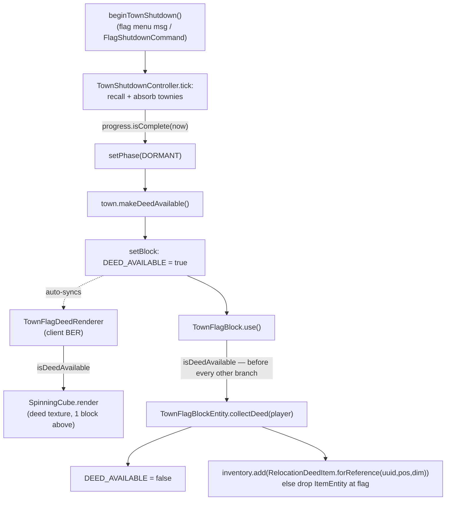

- **Why a blockstate property, not BE data**: the flag has no client-side ticker,
  so BE fields never hydrate there. Blockstate syncs for free, and every flag
  `blockstates/*.json` uses the `""` wildcard variant, so the extra property needs
  no model changes.
- **`use()` checks the deed first**, ahead of `convertItemInHand` and the flag
  menus — a dormant flag with a deed waiting is a pickup, not a UI.
- `SpinningCube` is the block-of-progress cube math lifted out of
  `SpinningCubeLayer` (visitor render layer); both callers pass their own
  translation, scale and UV window into the same six-face draw.

## Loss-protection (dormant flag only)

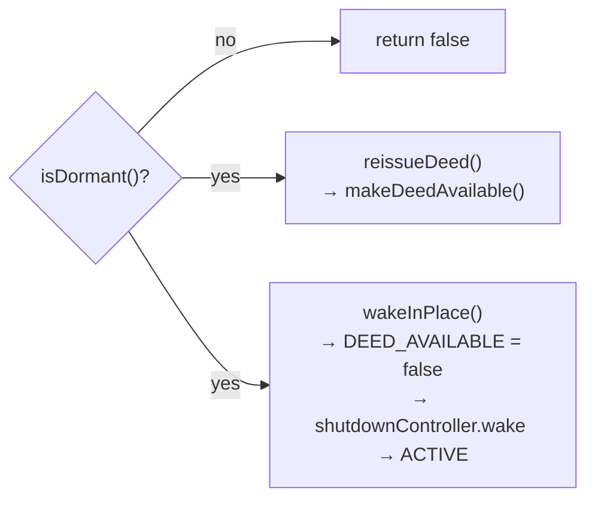

- Re-issue is idempotent: a lost deed just makes a new one available on the flag.
  The deed is a *reference* (town UUID + original flag pos + dimension), so
  re-issuing can never duplicate town data.
- **Waking retracts the waiting deed.** A live town must not hand out references to
  itself, and the deed branch in `use()` would otherwise shadow the flag menu on
  every interaction from then on.
- The deed's availability rides the blockstate, so it survives chunk unload and
  never expires — losing track of a dormant town is exactly what it protects
  against.

## Absorbed journals — a respawned townie keeps its job (#26)

A townie's journal (job, status, the 6 carried items) lives only on its entity; the
town keeps a copy in `NBT_TOWN_STATE`, republished from the *live* entities on each
change. The shutdown ritual discards each entity as it absorbs it, so that copy cannot
be the respawn's source. Before the fix every respawn (wake, cancel, relocation)
seeded a fresh gatherer journal (`SpawnVisitorReward.newVisitorJournal`), which
breaks ADR-0009's "jobs travel".

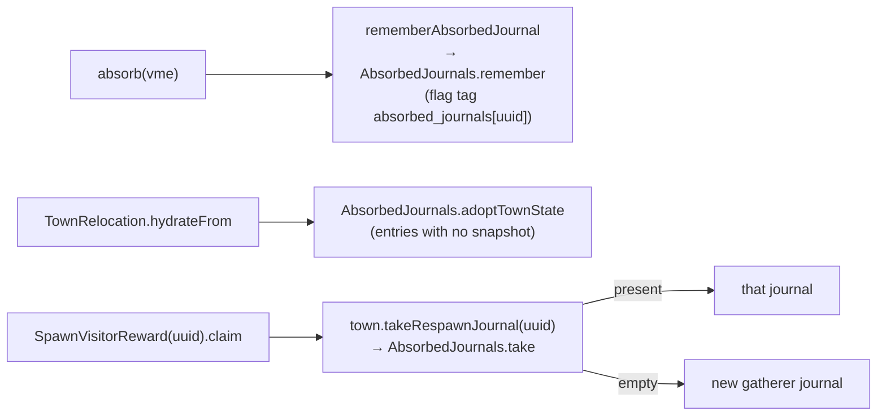

- **Snapshot at absorb time** (dev ruling 2026-10-22: full journal, not the job id):
  `TownFlagState.captureVillager` → `TownStateSerializer.storeVillager`, the same
  per-villager tag `NBT_TOWN_STATE` holds. It is on the flag's persistent tag, so it
  rides relocation's whole-blob copy and survives a restart.
- **Consumed on take**: one snapshot, one respawn.
- **`adoptTownState` runs synchronously inside `hydrateFrom`**, before any reward
  claims. The respawn rewards are claimed one per tick, and between claims the
  ticker republishes `NBT_TOWN_STATE` from the townies spawned so far, which drops
  the entries of the ones still queued. A lazy fallback read at claim time saw that
  rewritten state and respawned gatherers (`flag/relocate_nearby` check 10 failed that
  way). The adoption covers flags that went dormant without absorbing their townies
  (the autotest's direct DORMANT flip, or a town shut down before this fix).
- Proficiencies and learned jobs are keyed by UUID in the villager handle and were
  never lost; only the journal needed carrying.
- Pins: `AbsorbedJournalsTest` (tag store, adoption, mid-respawn republish);
  autotests `flag/shutdown_wake_keeps_jobs` (absorb → wake) and `flag/relocate_nearby`
  check 10 (root carried). Both were red with the lookup disabled (respawned
  `gatherer:gather`).
- **Who respawns** on wake and cancel is `AbsorbedJournals.absorbed` (the snapshot keys:
  absorbed and not yet respawned), read from the flag tag. It used to be an in-memory list on
  `TownShutdownController`, empty after a server restart, so waking a dormant town then
  respawned nobody. `AbsorbedJournalsTest.theAbsorbedListIsTheTowniesStillWaitingToRespawn`.
- **A restart mid-ritual resumes the recall.** `ShutdownProgress` lives in memory only, so a flag
  loaded in `SHUTTING_DOWN` has no progress and its ticker used to call only
  `shutdownController.tick` (a no-op) and never ran the initializers: the flag said "needs a
  moment to start up" forever. `TownFlagTicker.tick` now runs the initializers first, then
  `begin` (roster = the townies still standing; the absorbed ones are already in the tag), and the
  ritual completes. Same shape as the DORMANT branch above it. Live, r8 2026-10-22: shutdown,
  restart, "shutdown started … 1 townie(s)", dormant 10 s later, wake restored the townie.
- **A parked flag keeps its boards and mats.** `TownFlagSubBlocks` removes a registered sub-block
  (job board, welcome mat) once its flag has skipped `FlagSubBlockRetentionTicks` (20) heartbeats.
  The heartbeat (`notifySubBlocksOfTick` -> `parentTick`) lived only on the ACTIVE path, so every
  shutdown removed the town's boards and mats 20 ticks in; ADR-0009 says physical blocks stay.
  `TownFlagTicker.tick` now sends it for SHUTTING_DOWN and DORMANT too. Autotest
  `flag/shutdown_keeps_job_board` (red before: "Parent has stopped ticking. Entity removed"). The
  board is placed in the setup hook: `register` only queues it, and the watchdog listener attaches
  on a later `parentTick`, so a board placed in the same tick as the shutdown was never at risk.

---

# Block of Progress — the earn → deposit → collect state machine

The BOP is the town's progression currency: a townie **earns** it by leveling up,
**deposits** it into the flag, and the **player** collects and spends it on the
skill tree. The non-obvious part — and the reason this needs a map — is that the
XP **latch** clears at *deposit*, **not** at player collection. "Uncollected" is
therefore two distinct states, not one:

- **The latch** (`SimpleVillagerHandle.hasBlockOfProgress`, one `Boolean` per
  townie) — set on level-up, the value `addExperience` early-returns on; a townie
  can hold **at most one** uncollected BOP, so it accrues no XP until it deposits.
- **The flag's deposits** (`TownFlagBlockEntity.bopStacks`, capped at **64** by
  `TownFlagBOPItemHandler.getSlots()`) — real stacks, because each deposit may be
  **blessed** with the depositing townie's root job (a "gold" BOP; see ADR-0015).
  Appended on deposit, popped FIFO only when the **player** collects. This is the
  "uncollected by the player" state.

## Earn → latch → assign (happy path)

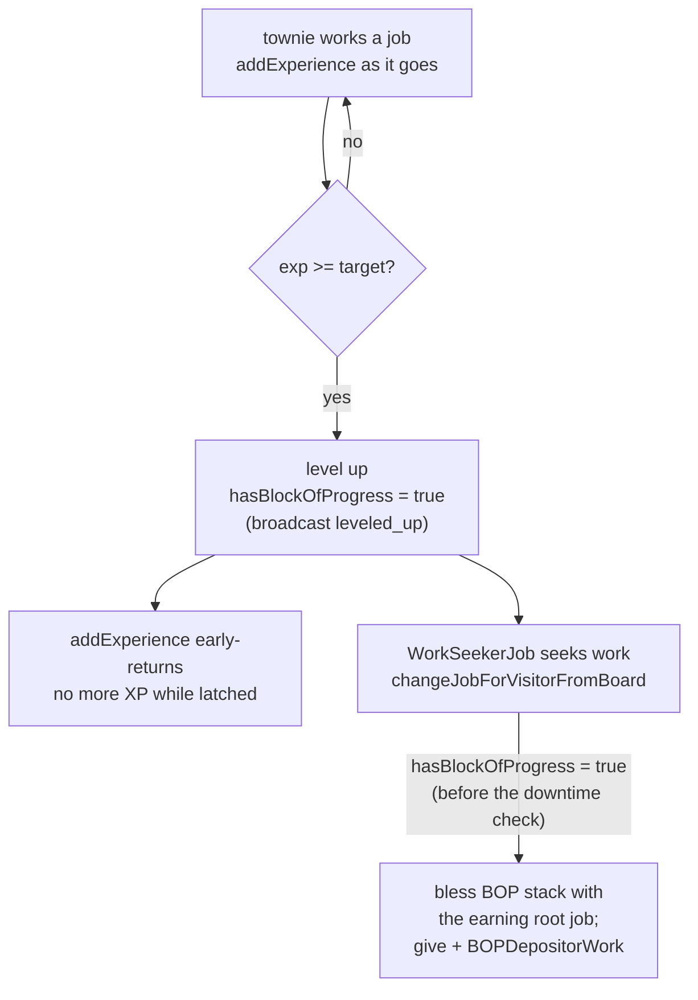

- The latch is a `Boolean`, not a counter — one townie holds at most one BOP, so
  it stalls for the brief level-up→deposit window, **not** until the player
  collects (collection never touches the latch).
- `changeJobForVisitorFromBoard` checks `hasBlockOfProgress` **before** the
  downtime/rest checks, so a latched townie always takes the deposit over idling.
- **The hand-out is idempotent (2026-10-14).** The latch outlives the first
  hand-out until the deposit clears it, so a stalled deposit loop re-enters
  this branch on every flag visit — and the 2026-10-14 playtest showed that
  re-entering unconditionally re-granted a BOP each pass (34 in ~4 min, user
  chat: "dupicating their BOP"). The branch now scans the townie's job
  inventory for an existing `BLOCK_OF_PROGRESS` and hands out only when none
  is carried; the deposit routing is unchanged.
- **The deposit stores a snapshot taken before the carried stack shrinks
  (2026-10-22 r3).** `TownFlagBOPItemHandler.insertItem` used to `shrink(1)`
  then `copy()`; a townie carries a 1-count BOP, so the copy was
  `ItemStack.EMPTY` and the flag stored an empty entry (counted, never saved,
  never collectable). `Compat.insertInNextOpenSlot` then aimed later deposits at
  that empty entry, `isItemValid` refused it, the helper still reported success,
  and those BOPs were lost too. The step is now `depositOne` (snapshot with
  `copyWithCount(1)` first; simulate returns a copy and leaves the caller's
  stack alone), pinned by `TownFlagBOPDepositTest`. Worlds that already hold
  empty entries drop them on the next load (`serializeBOP` skips empties).

## Deposit — the 64-slot cap

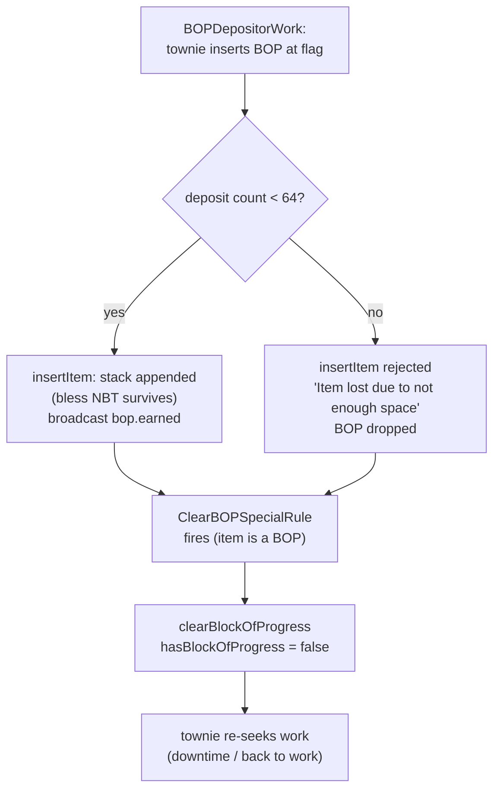

- `ClearBOPSpecialRule` fires **regardless of whether the insert succeeded** — it
  only checks the item *is* a BOP. That is why a full flag **does not re-stall**
  the townie: the latch clears even when the deposit is rejected, so the townie
  returns to work and can level again.
- The flag caps at **64**; past that, excess BOPs are silently dropped
  (server-logged `Item lost …`, not player-visible). A left-alone town therefore
  does not freeze — townies keep working, BOPs pile to 64, then further ones are
  lost. "Stops progressing" = the skill tree doesn't advance, not townies freezing.
- Verified by `flag/bop_boundary_63` (63→64 accepted, latch cleared) and
  `flag/bop_full_64` (64→full rejected, latch *still* cleared).

## Collect + spend (player side)

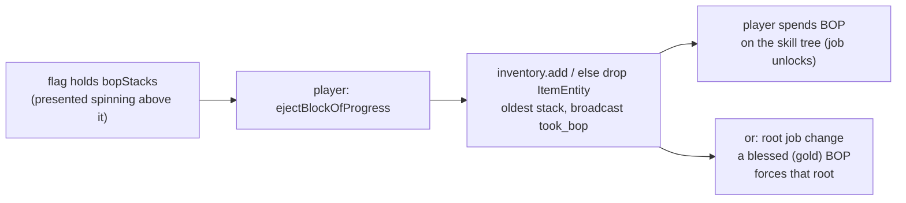

- Collection is the **only** thing that moves the deposits down; it never touches the
  latch. Spending is the player's decision, so progression advances only if the
  player checks in — the counterweight to warp (ADR-0011).
- **`took_bop` broadcast must pass the BOP as a `Component`, not a raw
  `ItemStack` (1.20.6).** `eject()` runs `bopStacks.remove(0)` → broadcast →
  `inventory.add`/drop, in that order. In 1.20.6 the broadcast's item argument
  must be a `Component`/`Number`/`Boolean`/`String` — a raw `ItemStack` throws
  `IllegalArgumentException` from `TranslatableContents`, which aborts the
  network task *after* the remove and *before* the give, so the BOP is removed
  from the flag and lost (the day-1 "all BOPs gone" bug). The fix wraps it:
  `flag.messages.broadcastMessage("messages.player.took_bop", recipient.getName(),
  Compat.getItemName(v), ...)` where `Compat.getItemName(ItemStack)` returns
  `stack.getDisplayName()` (1.20.6 renamed `ItemStack.getName()` →
  `getDisplayName()`).
- A blessed ("gold") BOP guarantees its carried root on a root job change:
  `JobRootChangeMessage` reads the spent stack (`BopTransactionSyncer.syncConsumedBOP`
  returns it), and `SimpleVillagerHandle` stores it in `guaranteedRoots`, applied at
  `handleMorning` **before** the overnight quest override (persisted as
  `guaranteed_roots` NBT). The menu shows the named root
  (`menu.unlock_root.insert_bop_blessed`).
- While the flag holds any BOP it **sparkles cyan** (`TownFlagTicker.spawnBopParticlesIfNeeded`,
  `DustParticleOptions`); a full flag renders the red BOP cube instead.

## Full-flag notice

A full flag (at the 64-deposit cap) silently loses further BOPs, and the latch
still clears (so the townie is *not* re-stalled), so "stopped progressing" was
invisible. A **blockstate** surfaces it, mirroring the deed's `DEED_AVAILABLE`
pattern, since the flag has no client-side ticker to hydrate BE data.

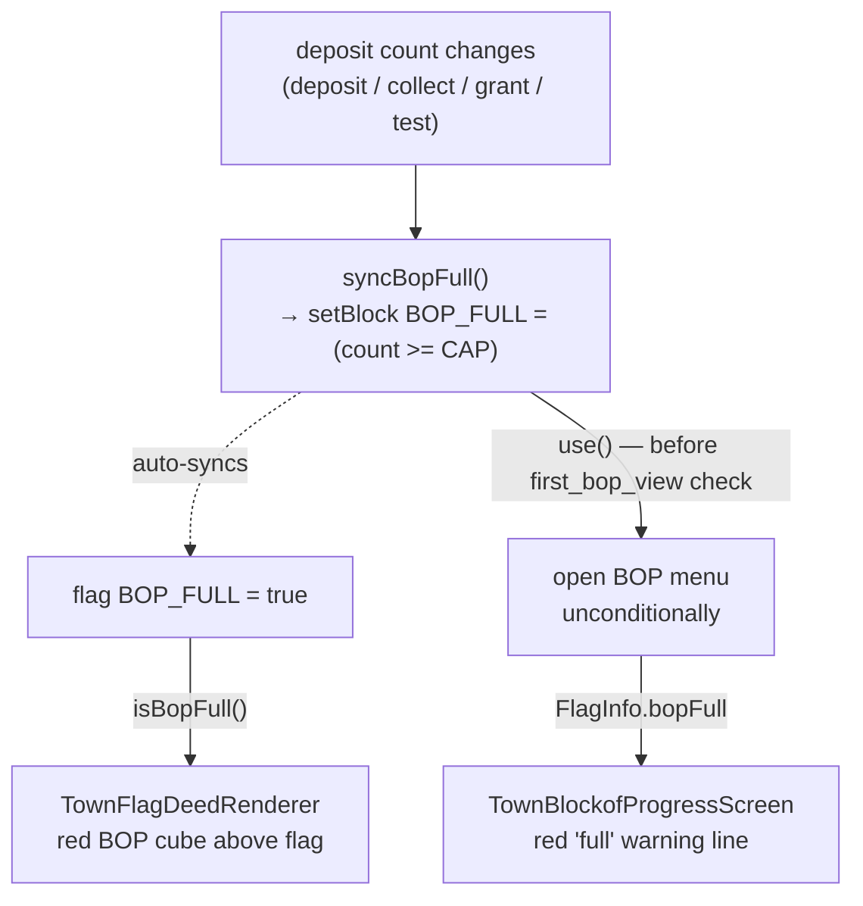

- `syncBopFull()` is called at every `bopCount` change site and **after
  `initializeBOP`**, where the persisted blockstate can be stale against the
  freshly-loaded count (reconcile on load).
- The notice is **unconditional on interaction** (not gated on the `first_bop_view`
  advancement), so the warning shows even once the player has seen the tab.
- `SpinningCube.render` gained a real `color` param — the old `0xF000F0` arg was a
  misnamed light value, not a tint — so the two existing callers pass white and the
  full-BOP passes red.

---

# Hungry townie — deposit work output, then dine

A hungry townie carrying its work output (a hunter with mutton) used to be snapped
straight to a dining work and eat that output before it was ever counted as
*produced*. Now the output is deposited first — which is what completes the
onboarding mutton quest — and only then does the townie eat. Whether a hungry
townie goes straight to dining or through the board depends on its **current job**.

## The two hungry paths

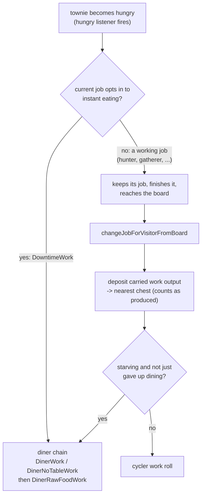

- The opt-in is the `CAN_INSTANTLY_SWITCH_TO_EATING` global rule; only
  `DowntimeWork` carries it, so a townie *at work* never gets the direct dining
  snap and always passes through the board first.
- The board's deposit sub-step runs **before** the starving check and the work
  roll, so a working townie's output is stored on its way to eating.
- The board's "ready for downtime" gate sits above both, and it skips a **starving
  diner** (`DiningStages.downtimeMayInterrupt`). Downtime is the instant-eat job, so
  sending a starving diner there restarted the chain at the first diner: 2026-10-23 r10
  a hunter looped dining_no_table -> downtime -> dining_no_table every ~200 ticks at
  fullness -272% beside raw beef, never reaching the raw-food stage.

## No storage — a deliberate blocker

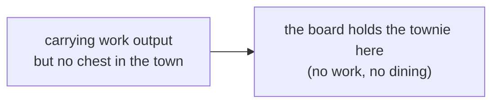

- With no chest the deposit sub-step returns "hold" and the board stops; a townie
  is never sent to dine before it can store what it carries.

---

# Stuck townie -> JOB_UNLOCK quest (the diagnostic quest) — RETIRED 2026-10-22

> **Retired.** The quest asked for a BOP spend, which rolls a random root, so it rarely
> delivered the producer. Dev ruling 2026-10-22: post-onboarding quests are room quests only.
> Nothing posts JOB_UNLOCK quests now; `TownQuests.retireJobUnlockQuests` (every quest tick)
> withdraws any a saved town still carries. `reconcileUnlockQuests`, `postUnlockQuest`,
> `processJobUnlocks` and the `UnmetUnlockQuestGraceTicks` config are gone. The section below is
> history. See "Top-need room quest" for what replaced the top-need half.

A root whose townies have a job but no material for it sits in `UNMET_ITEM`
and the town soft-locks. That state was invisible in play (only a cryptic
need-bubble icon), so `TownQuests` posts a **JOB_UNLOCK** quest that names the
missing item and the root that produces it. **One open quest per stuck root**:
when the root's missing item flips to a different producer's item the quest is
*retargeted in place*, and it is *withdrawn* (removed outright, no placeholder)
when the root stops mapping to any viable producer (e.g. the player stocked
the missing item directly). The quest completes the moment *any* townie
unlocks the targeted producer root (the normal BOP path). The stuck root is
encoded on the quest (`MCQuest.setUnlockStuckRoot` → `fromRecipeID`, persisted
via NBT `from_recipe_id`) so the dedupe survives a flag reload.

## Post / complete / reconcile

```mermaid
flowchart TD
    Tick["TownQuests.tick (flag tick)"] --> Scan["tickUnmetUnlockQuests:\nscan townies with need = UNMET_ITEM\nand a non-empty unmet item"]
    Scan --> Since["unmetRootSince: root -> first-stuck tick\nretainAll: pruned when the root unsticks"]
    Since --> Map["rootToProducer: per stuck root,\nchooseProducerRoot over the current missing item\n(absent = no unlockable producer)"]
    Map --> Recon["reconcileUnlockQuests (pure):\nrooted quests keep while their root maps to a\nviable producer; retarget in place when the\nproducer flips; withdraw when it does not.\nTown-wide quests keep while some root maps\nthem. Post only for due roots with no open quest."]
    Recon --> ApplyW["withdraw: QuestBatch.withdrawQuest\n(quest removed, listener notified; empty\nJOB_UNLOCK batches declined from the handle)"]
    Recon --> ApplyR["retarget: MCQuest.retargetUnlock\n(new producer wanted id + flavor, same\nbatch/owner/reward, setChanged)"]
    Recon --> Gate{"posting due? (onboarding not driving\n+ grace elapsed for that root)")}
    Gate -- no --> Hold["no post"]
    Gate -- yes --> Post["postUnlockQuest: add batch MCQuest.jobUnlock\n+ setUnlockStuckRoot, flavor names stuck root,\nmissing item, producer; 'New quests are\navailable!' broadcast"]

    Unl["TownFlagTicker.handleNewStoredData\n-> processJobUnlocks (unlocked jobs)"] --> Match{"wanted root now unlocked\nby some townie?"}
    Match -- yes --> Done["markRecipeAsComplete(wantedId)"]
```

- **The grace timer is per-root and restarts on unstick.** `unmetRootSince` is
  pruned to the roots stuck *right now* before being re-seeded, so a town that
  flaps in and out of the stuck state is not posted a quest until it has been
  stuck for the full grace continuously.
- **Nothing posts while onboarding drives jobs.** An open onboarding- or
  `JOB_CHANGE`-type quest means the town is mid-tutorial and the tutorial owns
  job assignment; a diagnostic quest on top is noise. The gate is on quest
  existence, not townie state. (Reconcile — retarget/withdraw — is not gated:
  it only touches quests that already exist.)
- **Completion is event-driven, reconcile is scan-driven.** Unlocks land through
  `processJobUnlocks` (stateless, run every flag tick, mirrors
  `processJobChanges`), and it runs *before* `tickQuests` in the same flag tick
  (`AbstractTownFlagTicker`: `handleNewStoredData` then `tickQuests`), so an
  unlock completes the quest before the reconcile can withdraw it.
- **Withdraw leaves no placeholder** (2026-10-11 ping-pong fix,
  `.scratch/mat-gated-arrival/job-unlock-quest-spam.md`): the old path ran
  `markRecipeAsLostByKey`, whose `lost()` replacement re-typed the quest as an
  ACTIVE *room* quest that no gate/UI/completion path ever cleared — every
  oscillation of the stuck root's missing item left another phantom in the
  handle (107× each of two quests in two minutes of a held run) and, being no
  longer JOB_UNLOCK-typed, defeated the dedupe so the post/lose cycle ran
  forever. Withdraw removes the quest outright, notifies the listener
  (`quest_lost` broadcast), and declines the batch when it empties.
- **The dedupe is per stuck root, not per producer**, so an oscillating
  `getUnmetItem()` (work-state flips changing the best gate reason) retargets
  the one quest instead of churning the handle; the stuck-root encoding in
  `fromRecipeID` is otherwise-unused for this type and round-trips through the
  quest NBT. Town-wide quests (the top-need phase: no stuck root, encoding
  empty) keep the legacy rule — withdrawn when no stuck root maps to their
  producer; their batches carry a second room quest, so only empty batches
  are declined.
- **Exclusions keep the quest honest.** `chooseProducerRoot` skips the stuck
  root itself (its capacity already exists) and any root some townie already
  has unlocked (an unlocked producer means the stuck state has a different
  cause and the quest would not help). Producer candidates come from the job
  definitions' declared products (`ServerJobsRegistry.staticProducerRootsForItem`
  — `initial_request` matching), not the discovery-gated registry results: an
  unlock quest exists to ask for a producer the town does not yet hold, so the
  producer knowledge must be omniscient (gannet decision 3); the discovery gate
  stays on the job engine's execution path. The same predicate drives the
  reconcile — a quest posted on declared capability must not be withdrawn by
  the discovery gate's view.
- **The unlocked-jobs seam is `VillagerHolder.getUnlockedJobs`** — the one
  handle surface that exposes per-townie unlocked `JobID` sets, read
  server-side via `TownVillagerHandles`.
- Verified by `TownQuestsJobUnlockTest` (producer selection, unlock
  detection, batch completion, the `reconcileUnlockQuests` decisions, the
  stuck-root NBT round-trip, in-place retarget, and withdraw plumbing). Post
  timing and live completion/withdrawal are covered by the held
  `village/self_sufficiency` run;
  plan: `docs/plans/2026-09-27-001-feat-unmet-unlock-quest-plan.md`.

**The tutorial's top-need batch is a second consumer of the same producer
predicate.** Phase 2.75 (`tryPhase2_75_topNeedUnlock`) walks the ranked
unmet-need item queue (`chooseTopNeed`, pure — `TownQuestsTopNeedWalkTest`)
to the first need with a not-yet-unlocked producer, and posts JOB_UNLOCK plus
that producer's base room. Needs with no producer at all, or with only
already-unlocked producers, are **skipped, not dead-ends** (run-14's
die-on-#1 `oak_wood` cell: zero candidates silenced a lower need that had
one). A need whose producer's unlock is already in flight ends the phase
(`SKIPPED`) — the walk does not reach past it to post for a lower-ranked
need. The producer core itself (`staticProducerRootsFor`) is unit green in
`StaticProducerRootsTest`; its `Works`-registry glue half is
registry-bound (compile + the held run settle it).

**`initial_request` is the declared product, so helper jobs must not name their
input.** A stock/fuel job moves an input into its chain's block and makes
nothing; it names the chain's product (the cook's stock jobs name villager food,
the baker's name bread). The baker stock jobs named coal and wheat (the f2f049cc
migration, against its own plan), so with a miner already unlocked a coal
shortage posted "unlock baker + build a breadmaker" (agent playtest 2026-10-22
r3), and the bakery burns coal. Pinned by
`BakerStockJobLoaderTest.bakerStockJobs_doNotDeclareTheirInputsAsProducts`.
`baker/bread` still names wheat (its input) as the plan specifies; that one is
an open question, not fixed here.

# LOOT quest close — extraction-satisfiable, decoupled from the job's post-extract rule

A **LOOT** quest (the raw-food family, e.g. the 2.5-gate
`villager_simple_furnace_food_raw` tag) satisfies the moment a townie *extracts*
the matching item — the meat the hunter just carried in, the ore the miner
just pulled. It is production-completable (like JOB_UNLOCK's
`processJobUnlocks`), not scan-completable, and it does **not** consume the
item: the deposit / eat path still decides its fate.

## Why the check used to be skipped for the hunter

`Quests.processLootQuests(item)` used to live inside
`RealtimeWorldInteraction`'s 5-arg `postExtractHook`. That hook is reached only
through the abstract 3-arg bridge, which short-circuits when the job declares
**no** `EXTRACTING_PRODUCT` special rule:

```java
Collection<String> rules = specialRules.get(ProductionStatus.EXTRACTING_PRODUCT);
if (rules == null || rules.isEmpty()) return currentState;   // hook never runs
```

The other post-extract behaviours (hunger fill, …) correctly
key off that rule. The sword-hunter job declares none — only `remove_from_world`
— so its raw-meat grant fell into the early-return and the quest never closed,
while a rule-bearing job (gatherer `hunger_fill*`) did.

**Pre-extract products (2026-10-19).** `take_from_slot_2` (cook/baker extract) is a
*pre*-extract rule: `beforeExtract` pulls the furnace output and hands it to the townie, and
the job's own result (`uses_special_rules`) is empty, so the bridge above only ever saw a null
item. Warp counted it (its pre-extract give routes through `tryGiveItems` → `postExtractHook`);
realtime gave it straight to the entity, so the cook batch's "eight pieces of food" quest never
moved. `RealtimeWorldInteraction.preExtractHook`'s give now calls `onLootExtracted` too. Pinned
by the `cook_extract_food` autotest (0/8 before, 5/8 after).

## The fix — the check is now unconditional on the extract path

`AbstractWorldInteraction`'s 3-arg bridge now calls a small virtual seam
**before** the rule gate:

```java
protected void onLootExtracted(EXTRA inputs, @Nullable HELD_ITEM item) {}   // default no-op
```

`RealtimeWorldInteraction.onLootExtracted` is the only override that fires it;
it calls `processLootQuests(item)` for any non-empty extraction, so a job
without an `EXTRACTING_PRODUCT` rule (the hunter) closes its quest too. The
warp engine inherits the no-op (it has no live flag to broadcast to), and the
rule-gated 5-arg path is otherwise unchanged.

- **The decoupling decision is `LootExtractGuard.questCheckFires(nonEmpty, rule)`**
  → `nonEmpty`. Extracted Forge-free so the contract ("fires for the hunter,
  independent of the rule") is unit-pinned even though the live wiring is not.
- **The untestable half is the live wiring** — `RealtimeWorldInteraction` and the
  declarative engine both pull Forge registries at `<clinit>`, so they cannot be
  loaded in a unit test (`ExceptionInInitializerError`, see the registry-bound
  doctrine). The end-to-end "hunter → raw meat → raw-food quest closes" is
  verified by the `loot_on_extract` autotest (`RealtimeWorldInteraction` path),
  which the six prior runs showed RED (`quest complete=false`) and which is
  GREEN after the fix.
- Verified by `LootExtractGuardTest` (non-empty+no-rule fires; non-empty+rule
  fires; empty never fires). The oracle: `loot_on_extract`.
- **Two independent axes — the gate and the engine.** The
  `EXTRACTING_PRODUCT` early-return (the 3-arg bridge) is *engine-agnostic* and
  runs before per-engine dispatch. "warp" vs "realtime" is a separate axis:
  `TimeWarpWorldInteraction` over the `MCTownState` loot snapshot vs
  `RealtimeWorldInteraction` over `MCExtra`'s live town; a *leaver* is a job
  category, not an engine. So when a per-engine side effect (like this quest
  close) doesn't fire, check for the engine-agnostic gate early-return **first**
  — a missing per-engine log line (e.g. `[LOOTTRACE]`) is not evidence the engine
  ran, it is evidence it was never reached. (2026-10-04: this was misdiagnosed
  as "the warp engine omits it"; the real gate was the rule early-return, and the
  warp/leaver conflation was dev-caught.)
- **Warp now closes it too (Option B, 2026-10-04).** Dev decision: warp must
  yield the same quest outcome as realtime, and the warper must stay *pure*
  (testable without a live quest handle) — so the close is *recorded in the
  snapshot, applied at settle*:
  - `TimeWarpWorldInteraction` overrides the 3-arg `postExtractHook` bridge (not
    `onLootExtracted`, which has no return value) and, under the same
    `LootExtractGuard.questCheckFires` contract, calls
    `currentState.recordLootExtract(item)` on the `MCTownState`.
  - `TownFlagState.warp` (the shared settle, covers dev `warpTime` *and*
    sleep-warp) applies each record via
    `e.getQuestHandle().processLootQuests(extracted.get())` — exactly
    realtime's call — then `clearRecordedLootExtractions()` (consumed once,
    never stored).
  - `MCTownState.recordedLootExtractions` is a per-state `ArrayList` shared *by
    reference* through the copy paths (`newTownState`, `withInsertedItem`, …),
    the `knowledge`-list pattern.
  - **Trap the unit tests do not catch:** `MCAdvanceTime.finalizeState` is the
    *terminal* rebuild (`AbstractAdvanceTime` hands the warp result through it —
    it drops instance fields, so it had to carry the list explicitly). The
    first oracle run proved it: 8 `warp-record` lines, then `warp-settle: 0`
    — records recorded, then silently dropped.
  - **Harness gap this work also closed:** `TestExecutor.checkResults` (the
    warp-only path) never ran the blueprint's `withCustomAssertion` (only the
    realtime check did) — so a warp-only scenario's assertion was vacuous and
    `loot_on_extract_warp` passed on a trivial item check with the quest never
    closed. The assertion now runs in the warp check too (keep assertions
    read-only: mixed scenarios run it in both phases).
  - Unit: `MCTownStateLootExtractTest` (record order, copy survival, consume
    once). The settle call itself (TFBE → QuestsHolder) is registry-bound —
    oracle-pinned. Oracles: `loot_on_extract` (realtime regression) and
    `loot_on_extract_warp` (warp), both GREEN — the warp run's log shows the
    records, the settle applying them, and `quest complete=true`.

---

# Quest backfill — state that predates the quest still completes it

The tutorial issues its gate quests (the Phase-1 kickoff — `job_board`,
`store_room`, `town_gate`, `wooden_sword` — and the Phase-2/2.5 cook chain)
after campfire, but quest *satisfaction* normally completes a quest via a
one-shot event **at satisfaction time**: a room recipe fires `roomRecipeCreated`
once when it registers, and an item count is tallied only on a stored-data
change. When the satisfying world state already exists by the time the quest is
added — exactly what the `village/self_sufficiency` drive does, building the
rooms and swords *before* the tutorial issues the gates — that event has
already fired and never re-fires, so the gate quests stall `ACTIVE` forever and
`allVillagerKickoffQuestsDone()` never holds (NO_FORWARD_PROGRESS, the whole
town frozen at the job board).

## Per-tick re-evaluation (happy path)

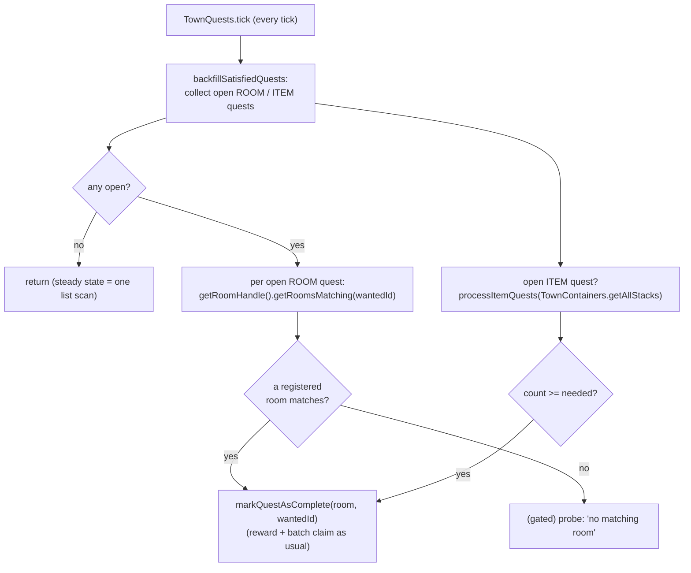

- **It reuses the existing completion plumbing**, not a parallel mechanism: rooms
  go through `markQuestAsComplete` (→ `markRecipeAsComplete` → the usual reward /
  batch-claim); item quests go through `processItemQuests`, the same tally
  `handleNewStoredData` uses. A backfilled quest completes exactly as an
  event-driven one does.
- **`getRoomsMatching(wantedId)` covers both room kinds**: a door room
  (`store_room`) and a registered block-room (`town_gate` via the welcome-mat
  meta rooms, `job_board` via the board's synthetic block-room key - the
  JOB_BOARD branch maps the quest id `questown:job_board` to
  `RoomBlock.getRoomId(JOB_BOARD_BLOCK)`, see "Job-board placement completes
  the JOB_BOARD quest"), since `registerBlockAsRoom` feeds the same match
  store the look-up reads.
- **The gate is on open-quest existence, not townie state.** The per-tick scan
  walks the journal **lazily** (it never copies it) and only materialises the few
  OPEN room matches; in steady state (nothing open) the cost is a plain iteration
  with zero allocation. An eager `questBatches.getAll()` copy per tick would grow
  with the town's history, because completed batches are never pruned (the journal
  is unbounded) — that was the pre-tighten cost. The room look-up and the container
  scan run only while a matching quest is still open. Measured on the
  `perf/town_large` town: the `quests` phase sits at ~47–49µs/tick, ~6% of a
  flag tick already ~16× under the 50ms budget.
- Verified: `village/self_sufficiency` run-18 completes all 12 onboarding quests
  (raw→kitchen→cooked chain), staffs both cook and hunter, and
  `NO_FORWARD_PROGRESS` no longer fires. (The deeper flaky `NO_JOBSITE`
  work-site resolution `getRoomsMatching` traces — see
  `.scratch/cook-soft-lock/DIAGNOSIS.md` — is a separate, still-open issue that
  this unblocks.)

# SLEEPLESS — the bedless-night debuff (capture at evening, apply at morning)

A townie that had no bed for the night that just ended wakes with the
`MoodEffects.SLEEPLESS` debuff (−15 mood, `Config.MOOD_EFFECT_DURATION_SLEEPLESS`,
default 23000 ticks): neutral 75 → 60, work speed 7 → 6. The pipeline is
deliberately asymmetric — captured on the **evening edge** of the flag tick,
applied at the **morning transition** — so the two ends sit a full night apart.

## Capture → carry → apply (happy path)

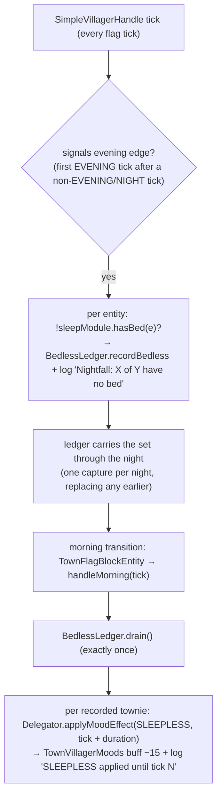

- **The capture edge, not the time of day, is the trigger.** `BedlessLedger.captureEdge`
  fires on the first tick whose `Signals` is `EVENING` after the signal was
  anything else (world ~11500, before the villager schedule's REST phase at
  12500). A restart mid-night therefore does **not** capture until the next real
  evening. `BedlessLedger` is pure and Forge-free — its edge/drain rule is what
  `BedlessLedgerTest` pins without a flag or a level.
- **The capture waits for the beds to be known** (`captureEdge(signals, bedsKnown)`,
  dev ruling 2026-10-22). After a load the bed supply is empty until the room scan
  re-matches the bedrooms, so a restart mid-evening used to capture every townie as
  bedless and apply SLEEPLESS to all of them next morning (logged "Nightfall: 20 of
  20"). The edge now marks the capture *due*; it runs on the first EVENING/NIGHT tick
  where `VillagerSleepModule.bedsKnown()` holds (`TownRoomsMap.hasScannedSinceLoad`:
  a full `MultiLevelRoomDetector` pass finished this session). A capture still due
  at dawn is dropped. Live: a mid-evening restart logged "16 of 20", the real-
  nightfall count, 1.25 s after the player joined.
- **`hasBed` is the *assignment*, not the block.**
  `TownVillagerSleepModule.hasBed` asks
  `VillagerBedsHandle.getBestBed` (the same source that becomes a townie's HOME
  memory). A bed that exists in the world but is not assigned to the townie
  counts as bedless. The bed supply behind the assignment is
  `TownVillagerBedsHandle.getAllBedHeads`: the recipe-matched room blocks that
  are beds, filtered to the positions whose **live block state is the HEAD part**
  (`isHead`).
- **Upstream bed-placement bug (2026-10-09, fixed & live-verified):**
  `TownFlagBlockEntity.buildRoomForRecipe` used to place every recipe block
  with `defaultBlockState()` — for a bed that is the FOOT part only, never the
  HEAD — so rooms held a lone foot, `isHead` filtered 100% of beds out,
  nobody was assigned, and **every** townie was bedless (SLEEPLESS applied to
  all, nobody ever slept). The fix is on the placement side: any recipe block
  whose state carries the `BED_PART` property (vanilla `BedBlock` and
  `HospitalBedBlock` both extend `HorizontalDirectionalBlock`) now reserves
  two adjacent interior cells — the foot placed with an explicit orientation
  and the HEAD at `foot.relative(FACING)` in `PART=HEAD` state (vanilla
  `BedBlock.setPlacedBy` semantics). When no free adjacent pair fits (an
  inn's 12 beds vs 18 interior cells) the bed is skipped with a warning
  rather than placed as a lone foot. Live-verified in a 5-day
  `village/self_sufficiency` held run: the probe read `bed blocks=4 beds after
  head filter=2` (was `2 … 0`), `Nightfall: 1 of 3 townies have no bed` (was
  3 of 3), SLEEPLESS applied **only** to the bedless townie, the bedded
  townies actually slept (SLEEPING overnight, awake and working by the next
  morning), and the bedroom quest still closed — the recipe matcher tolerates
  the 4 live bed blocks vs the recipe's 2 bed entries. Run log:
  `.scratch/sleepless-debuff/runs/run2-beds-fixed.log`. Plan + finding:
  `docs/plans/2026-10-09-003-feat-sleepless-no-bed-debuff-plan.md`.
- **One whole bed per two bed entries (2026-10-22).** That "tolerates" was
  the builder over-placing: a recipe lists two `#minecraft:beds` per bed (a
  bed is two blocks, CONTEXT.md "Bed room recipe"), and the builder placed a
  whole bed for each, so a Bedroom got two beds. `buildRoomForRecipe` now
  passes the list through `logic/BedHalves.oneEntryPerBed` first (pinned by
  `BedHalvesTest`): Bedroom = light + 1 bed, and the inn (light + 6 beds +
  sign = 14 cells) now fits the 18 interior cells. `VillageGrowthExecutor`'s
  `furnishNextRoomQuest` (bed item use = a whole bed) does the same. Live: a
  `village/self_sufficiency` run logged `placed 2 of 2` for the bedroom and the
  quest closed; in `village/growth` the Bedroom quest now registers a
  `bedroom` (it was a `big_bedroom`, which also closed the cook batch's Big
  Bedroom upgrade for free) and the upgrade is furnished in its own building
  (42/42 checks, was 38/38).
- **The debuff does not clear on rest (v1).** It is a fixed-duration buff
  re-applied at every morning while the townie is still bedless; clearing on
  rest would race the dawn DowntimeWork bypass edge case.
- **The autotest report line is out of phase on purpose.**
  `VillageSelfSufficiencyExecutor`'s daily report fires at midnight
  (`sleep bedless=N sleepless=M`) but the application happens at the flag
  morning (~800 ticks later), so day-N's report reflects the state up to the
  previous night — a day-N report showing `sleepless=0` after night N-1's dawn
  line is correct, not missing.
- **Secondary effects while everyone is bedless** (noted, not fixed): a bedless
  townie never gets a HOME memory (HOME = the assigned bed) and
  `registerUnmetRoom(BEDROOM)` fires for every bedless townie every handle tick
  (demand-spam candidate).

# Room-upgrade recipe — the holder owns the id (1.20.2+)

`TownQuests.getUpgradeRecipe` needs the **canonical recipe id** of every
`ROOM` recipe to feed `RoomRecipes.upgradeCandidates` (the pure selection
core). Since the 1.20.2 recipe-holder split, the codec-constructed
`RoomRecipe.getId()` is null for every data-driven recipe — the id lives on
the holder, so the leaf must not read it off the value (the pre-fix raw-list
loop NPE'd in `ImmutableList.Builder.add` on the first match; run-15
self_suff zero-coal cell, `af202d27`'s finding).

The leaf therefore gets (id, value) pairs from the strangler seam
`mc/RecipeRef` — `pairsOf` (added with this flow; `recipeById`/`findById`/
`recipesOf`/`idsOf` are its siblings) — and never names the vanilla holder
type: the strangler gate (`tools/strangler-check`) fails the build on a
holder reference outside the seam family, and `1e8ef2cd`'s
`RecipeRef` holder-seam de-grandfathered this leaf. (The NPE fix
`af202d27` re-leaked the type directly here and went red; this commit
re-routes through `pairsOf`.) The pure core and its id-as-data contract are
pinned by `RoomRecipesUpgradeCandidatesTest`.

Selection semantics (unchanged by either commit): a candidate covers every
from-recipe ingredient group; a perfect overlap is the recipe itself and is
excluded; the caller picks randomly among the survivors.

## Flag menu tab gating (`TownFlagBlockEntity.getInfo`)

Day-1 playtest: the villagers tab and the economics tab both show before they
have anything to offer (the villager tab's own copy reads "one more in the
morning" with zero townies). `getInfo()` now gates them:
`showVillagers = !getVillagers().isEmpty()`, `showEcon =
completedProceduralBatches >= 1` (the "your village is thriving" milestone —
the first completed procedural batch). The quests/BOP/crafting tabs are
ungated. The client's `FlagTabs` already honors the `FlagInfo` booleans (the
wire format predates this); only the server-side values changed.

## BOP "earned by" (`TownFlagBlockEntity.depositedBopRootJobs`)

Day-1 playtest: the Block of Progress screen showed the block but not why it
was there. `depositedBopRootJobs()` reads the deposited BOP's job roots off the
flag's town-data (the same source the economics card counts) and returns them
as a list (e.g. `[baker, baker]`). The flag-menu payload carries this list
(instead of the old `int bopCount`), and `TownBlockofProgressScreen` renders an
"Earned by: Baker x2" line from it — the count is the list size, so no separate
count is wired. The roots render via the `jobs.<root>` lang keys.

# Day-2 playtest (2026-10-11 evening): onboarding gates + sword quest

Two onboarding/content decisions from the evening playtest, both in `TownFlagBlockEntity` / `TownQuests`:

- **Economics tab gate = villager presence.** `getInfo()` sets `showEcon =
  showVillagers` (`!getVillagers().isEmpty()`), so the economics tab and the
  villagers tab reveal together. The old gate (`completedProceduralBatches >= 1`)
  was met by day 2 (onboarding batches tick over) even before a villager arrives;
  the player's bar was "not until we've met a villager". `completedProceduralBatches`
  is still the counter for quest seeding + the batch milestones — it just no
  longer drives the tab gate.
- **One sword quest only (4 stone swords).** `addHunterGatherer` (the day-2
  batch #1.5) previously had two sword item quests — 4× wooden + 1× stone. They
  are consolidated to a single `MCQuest.item(STONE_SWORD, 4)`; the wooden-sword
  quest is removed. The hunter/sword job-change and bedroom quests in that batch
  are unchanged. Pinned by `TutorialPhaseGateTest`.

# Flag tick-stop logging — the "no players" line is transition-gated

`TownFlagTicker.allPlayersLeftArea` has two "stop" reasons. The "player went far"
branch was already gated on `playersNearbyOnPrevTick` (= `!alreadyStopped`, i.e. the
flag was ticking last tick, per `AbstractTownFlagTicker`), so it logs only on the
ticking→stopped transition. The "no players on the server at all" branch was **not**
gated — it logged `logStop(…"No players are found on server")` on **every tick**
while `nearestPlayer == null`, which in a headless run (no client) produced ~67k
identical lines in ~6 min and buried every other log line. The "no players" log is
now gated on the same `playersNearbyOnPrevTick` flag: it fires once on the transition
(or at boot if the flag starts stopped), never per-tick. No behaviour change — only
log frequency. (Found 2026-10-12 during the econ-tab crash-probe repro; ticket
`.scratch/day1-playtest-2026-10-11/flag-stopped-ticking-per-tick-log-spam.md`.)

# Top-need room quest — lock-until-complete (no per-tick churn)

Phase 2.75 (`tryPhase2_75_topNeedUnlock`) names the town's top unmet need and posts the base
room of the job that produces it. Until 2026-10-22 the batch also carried a town-wide
"Unlock job: X" JOB_UNLOCK quest; it asked for a BOP spend that rolls a random root, so the dev
removed it (room quest only).

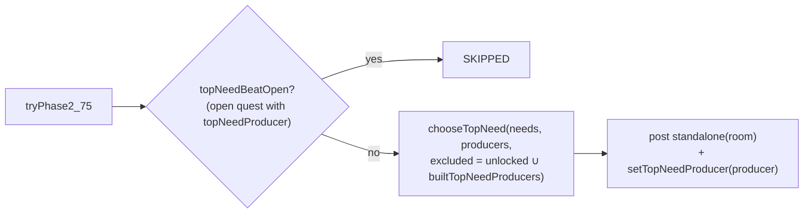

- **The lock** is `topNeedBeatOpen`: any incomplete quest tagged with `topNeedProducer` (a
  `Quest` field, NBT `top_need_producer`, carried by `completed()`/`lost()`/load replay). It keeps
  the in-flight room pinned so the shifting need ranking can't re-target it every tick (the
  day-1 playtest's churn: `.scratch/day1-playtest-2026-10-11/demand-quest-constantly-replaced.md`).
- **Retiring a producer**: building the room does not staff it, so the same need can stay on
  top. `builtTopNeedProducers` (completed tagged quests) joins the unlocked roots in the
  exclusion set, or the beat would re-post the same room forever.
- **Saved towns**: `retireJobUnlockQuests` tags a legacy top-need batch's room quest with the
  withdrawn unlock quest's producer, so the lock and the exclusion see it.
- Pins: `TownQuestsJobUnlockTest` (retire, lock, exclusion, tag NBT/lost round-trip),
  `TownQuestsTopNeedWalkTest` (the walk). The phase wiring needs a town/econ harness.

# FillHunger log — no-op guard (2026-10-12)

`SimpleVillagerHandle.fillHunger` logged "Fullness changed from X to Y" on
**every** call, including no-ops ("from 2500 to 2500") — dozens of lines per
second across the roster, burying inspect output in held-run logs. The log now
fires only when the stored value actually changes (or is first set). Pure
logging; no state change.

Companion to the same session's fallback retirement: the
`TownVillagerData.FallbackSelector` removal from `changeJobForVisitorFromBoard`
and the warp `getRandomFinishableWork` is documented in `town/COMPLEX.md`
(work-selection bullets + unmet-need registration section).

## Starting timber seed (`TownFlagBlockEntity.seedStartingTimber`)

A brand-new flag seeds its surroundings with onboarding timber — an
onboarding gift, not a quest reward
(`.scratch/day1-playtest-2026-10-11/onboarding-starting-trees-or-logs.md`):
a line of 8 horizontal oak logs 6 blocks clear of the flag (pickable wood,
no axe) plus two oaks grown via `MinecraftWorldAccess.growTreeAt`
(`TreeFeatureResolver` seeds the shape by `pos.asLong()`, so it is
reproducible). The call lives in the first-tick initializer under the same
`!isInitializedQuests` gate as `setUpQuestsForNewlyPlacedFlag`, so NBT-loaded
flags never reseed; placement is biome-blind (tree features are
ground-checked only) and overwrites nothing (air + solid-below checks).

## Bonus food: container deposit + flag-UI claim (replaces the dirt trick)

The one-time free-food beat no longer lives on "right-click the flag with a
block of dirt" (that branch in `TownFlagBlock` is gone;
`.scratch/day1-playtest-2026-10-11/free-food-economics-card.md`). The owner is
`TownFlagBlockEntity`:

- `depositBonusCarrots()` — deposits `BONUS_FOOD_COUNT` (20) carrots into the
  first slot of the first registered container (the `TownContainers`
  path, same as a player leaving food in the storeroom); returns the count.
- `claimBonusFood(@Nullable ServerPlayer)` — the once-only claim: container
  first, player-inventory fallback when no container is registered yet; the
  `givenBonusFood` bit flips only after the food actually lands, and the chat
  line names where the carrots went. The client reaches it through
  `ClaimFreeFoodMessage` (the food card click); `FreeFoodCommand` is now a thin
  wrapper calling the same `depositBonusCarrots()` + `markBonusFoodGiven()`.

`getInfo()` carries `bonusFoodAvailable = !givenBonusFood` in `FlagInfo` so the
client can show the claim affordance (see `gui/COMPLEX.md`).

## Job-board placement completes the JOB_BOARD quest

The quest's wanted id is the room recipe `questown:job_board` (single tag
ingredient `#questown:job_board_inputs`, `data/questown/recipes/job_board.json`;
data wiring pinned by `JobBoardRecipeDataTest`). A placed board registers two
ways: the WORK handle (`registerJobsBoard` → `workHandle.registerJobBoard`,
work-location/menu side - does NOT touch the quest) and the ROOMS handle
(`RoomBlock.getStateForPlacement` → `registerBlockAsRoom` under the synthetic
`block_room/block.questown.job_board_block` key).

Completion therefore rides the **per-tick backfill**, not the placement
moment: `getRoomsMatching(JOB_BOARD)` has a dedicated branch mapping the quest
id to that block-room key (`getBlockMetaRooms`), because the generic fast path
only matches `block_room/*` wanted ids and the fallback scans only
door-registered rooms - a board placed outside any room is otherwise
invisible and the quest stalls ACTIVE forever (2026-10-14 live playtest: board
placed "near the flag", exactly as the quest text says).

The event path (`roomRecipeCreated` → top match) can ALSO miss it: the board's
meta room ties at equal cost between the real recipe and the synthetic
`block_room/...` recipe (both fall back to `DEFAULT_ITEM_WEIGHT`), and
`Stream.max` keeps the first on a tie - stream order, not merit. Boards placed
INSIDE a door-registered room complete via that room's match instead (the
`village/growth` executor deliberately places it inside the chest room for
this reason - see `VillageGrowthExecutor.placeJobBoard`).

NOTE: an earlier revision of this section claimed `registerJobsBoard` marked
the quest complete "on the spot" against a sign+log pedestal recipe - neither
survives in current code (the recipe is a single tag ingredient; no
completion call exists on the register path). A board placed with the quest
already open completes on the next flag tick.

## Broadcast pacing (E2)

All `TownMessages.broadcastMessage` traffic goes through a flag-wide queue
(`BroadcastPacer`): the first line of a burst sends immediately, later lines
hold in the pacer and `TownFlagTicker.tick` releases one per
`BROADCAST_SPACING_TICKS` (100 = ~5s) via `flushBroadcasts()`. Consecutive
duplicate lines are dropped (value-equal `Component`), counting the line just
sent as well as the queue: comparing only the queue let the second copy of a
same-tick triple through ("Bedroom destroyed at location [-44, -35]" twice,
2026-10-22 r6). Pinned by `BroadcastPacerTest`. The log keeps the
`Queued broadcast (` prefix that `LogTripwire` matches. This paces the day-1
quest/room chat blast; it deliberately does NOT root-cause the underlying
double-firing (`.scratch/day1-playtest-2026-10-11/messages-print-twice.md`).

# Attention ("!") bubble state — flag quest state and work-request state on the update tag

G1+G2 (day-1 playtest): a "!" bubble above the flag while any quest is incomplete,
and above the job board while the town has zero outstanding work requests. The
state rides the flag's **block-entity update tag**, exactly like `deadDoors`:

- The update tag carries **only** the client's bubble state (dead doors + attention).
  It used to carry the whole town (`writeTownData`), which the client never reads;
  at ~150 quest batches the flag's chunk packet passed the client's 2 MiB NBT cap
  and login failed decoding `level_chunk_with_light` (2026-10-22 playtest).
- `getUpdateTag` writes it **live** (`writeAttention`): `hasIncompleteQuests()`
  (via `TownQuests.hasIncompleteQuests()` — per-quest `!isComplete()` over
  `questBatches.getAll()`, because completed quests stay in their batch until the
  batch is declined) + `workHandle.getRequestedResults().isEmpty()` + the
  `workHandle.jobBoards` positions. So a client chunk-loading the flag always
  sees current state.
- `syncAttentionState()` pushes a `sendBlockUpdated` when the state changes. It is
  **polled every 20 ticks** from the flag's static block ticker (not wired to the
  many quest/request mutation sites): a one-second lag is imperceptible for a
  diegetic indicator. The cached fields (`attention*`) exist only for change
  detection; they are never persisted.
- Client: `handleUpdateTag` → `readAttention`; the flag registers itself in
  `AttentionBubbles` (town/rooms) in `onLoad`/`setRemoved` just like
  `DeadDoorBubbles`. The candidates then join the one-bubble crosshair contest in
  `NeedBubbleFocus` (mobs/visitor) and draw via
  `BubbleRenderer.renderTextureBubbleAtBlock` (the authored
  `textures/bubble/attention.png` "!" — same folder/pipeline as the chicken's
  sunset bubble).

# Job-root change: the outcome settles at the BOP spend, not at morning (E1, 2026-10-13)

The day-1 playtest ruling: the "change to <job>" quest completes **when the player
consumes the BOP**, and the root roll happens at the same moment — "it's more
satisfying for the player"; the morning only *applies* the settled outcome.

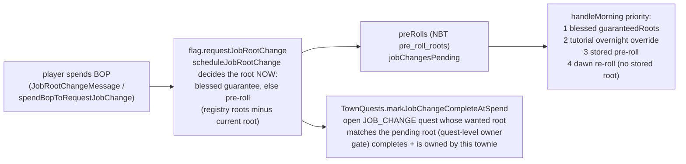

- `SimpleVillagerHandle.scheduleJobRootChange` now **returns the decided pending root**
  (`Optional<JobID>` — the `VillagerHolder` interface changed to match; the only
  implementation is `TownVillagerHandles.asVillagerHolder`'s anonymous holder).
  Instant (creative) spends return empty and apply immediately as before.
- The pre-roll is persisted like `guaranteedRoots` (`pre_roll_roots` NBT, same
  serializer pattern) so a spend overnight survives save/quit; a missing pre-roll
  falls back to the existing dawn re-roll.
- **The tutorial override still wins at dawn** (`overnightJobOverride`) — it only
  needs to *win* at dawn, not be *known* at spend, so the spend-time decision is
  blessed-or-preroll and the morning priority is unchanged:
  blessed > override > pre-roll > re-roll.
- Quest completion is the flag's call, not the message's: `JobRootChangeMessage`
  and `spendBopToRequestJobChange` both route through
  `TownFlagBlockEntity.requestJobRootChange`, which schedules and then calls
  `TownQuests.markJobChangeCompleteAtSpend`. That method mirrors
  `processJobChanges`'s matching (exact wanted, then `sameRoot` family fallback)
  but adds the spend-time rules: one spend completes **one** quest, and a quest
  whose **quest-level** owner (`Quest.getOwner()`, not the batch owner — a batch
  can hold several JOB_CHANGE quests with different owners) is a different townie
  never completes. `Quest.setOwner`/`getOwner` were added for this.
- Headless unit tests: `ServerJobsRegistry.getAllRootJobs()` now returns empty
  (instead of NPE-ing via `Works.ids()`) when `Works.isInitialized()` is false,
  so the spend-time roll degrades to "no candidates" rather than crashing the
  forked test JVM.

# Day-2 "first work request" quest + the board's auto-request toggle (F2, 2026-10-13)

The 2026-10-12 playtest: the board sat empty because a newly-created cook's
`initial_request` was never posted, and the player wanted a say in whether the
town auto-posts requests at all. F2 ships both: a day-2 onboarding quest that
completes on the *first* posted request, and a per-flag toggle that gates the
auto-posting.

## Day-2 quest — post → complete

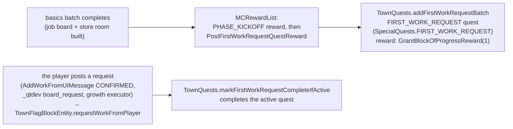

- The quest posts from the **basics batch's completion reward** (wrapped in an
  `MCRewardList` with the tutorial kickoff reward), not on a tick: by the time
  the batch completes the board exists. A villager may not be — the reward then
  defers to the morning (see "First-work-request quest waits for a villager"). `QuestsHolder.addFirstWorkRequestBatch` / `TownQuestsHandle` delegate.
- Completion is the player's own request only (dev, 2026-10-22): the owner method
  `TownFlagBlockEntity.requestWorkFromPlayer` posts the request and calls
  `markFirstWorkRequestCompleteIfActive`, which walks batches for an incomplete
  `FIRST_WORK_REQUEST` quest and marks it. It used to ride the work-handle change
  listener on any add, so a BOP job change's auto-posted starter request
  (`postStarterRequests`, board toggle ON) completed the quest before the player
  ever touched the board (2026-10-21 agent playtest #19). Pinned by village/day1's
  `first-work-request-completed-by-the-player` (the executor posts only after the
  first root change lands, the order that exposed it).
- `Quest.QuestType.FIRST_WORK_REQUEST` is new; the exhaustive switches got cases:
  `UIQuest.getIngredients` (empty — a do-this quest takes no item),
  `UIQuest.getName` (`menu.quests.first_work_request`), the `QuestsScreen`
  tooltip switch (empty tooltip; the flavor text carries the guidance), and
  `QuestBatches`'s duplicate-check reconstruction (treated like CONCURRENT_JOBS).
  `QuestTypes` NBT round-trips by `name()`, so no per-value mapping.
- Rewards: `PostFirstWorkRequestQuestReward` (no NBT, `addsQuestsWhenApplied`)
  and `GrantBlockOfProgressReward` (count in NBT, `emptyForDeserializing` entry
  like `AddItemQuestReward`) are both registered in `RewardsInit`
  (`FIRST_WORK_REQUEST`, `GRANT_BOP`). The BOP grant is a public flag method
  (`TownFlagBlockEntity.grantBlockOfProgress`) mirroring
  `TownFlagTutorialAdapter.grantBop` — the reward lives in `town.rewards` and
  must not reach the package-private `bopStacks`.

## Auto-request toggle — state, gate, UI

- **State**: `TownFlagBlockEntity.boardAutoRequest` (default ON, "the board
  reads alive on a fresh town"), persisted through the standard flag tile-data
  path: `TownFlagTileData.NBT_BOARD_AUTO_REQUEST` InitPair (load + onFlagPlace)
  + `TownFlagInitialization(Impl).serializeBoardAutoRequest` + the write line in
  `TownFlagTileData.write`.
- **Gate**: the ONLY auto-post site is `TownFlagBlockEntity.postStarterRequests(root)`
  (acquiring a root job posts its default works' `initial_request(s)`), called by both
  job-change paths: `ChangeJobReward`'s applier and the BOP root change
  (`SimpleVillagerHandle.unlockAndChange` → `Delegator.postStarterRequests`). It checks
  `isBoardAutoRequest()`. Manual posting (`AddWorkFromUIMessage` → `requestWork`) is never
  gated. (Until 2026-10-19 only the quest reward posted; see "BOP root change ..." below.)
- **Idempotency**: `TownWorkHandle.requestWork(WorkRequest)` now no-ops when the
  request is already pending. The board is a set of *unfulfilled* requests — a
  fulfilled one drops off (`removeWorkRequest`) and may be re-requested then.
  Trap: `requestedResults` is a `List` — `List.add` never dedupes (only Sets
  do), so the guard is a `contains` check, not a `!add` result. Unit tests:
  `TownWorkHandleRequestWorkTest` (dedupe + re-request-after-removal + the
  FIRST_WORK_REQUEST quest shape; vanilla-bootstrapped like
  `PostDowntimeWarperNoOpGuardTest`).
- **UI**: `WorkScreen` renders a `[x] Auto-post new requests` row pinned to the
  screen's bottom band (clickable via the existing `removes` position→Runnable
  map + `highlightAndTooltip`). Click flips the local `TownWorkContainer` copy
  optimistically and sends `ToggleBoardAutoRequestMessage` (TO_SERVER, flag pos
  + new state); the handler applies it and re-opens the board menu (`openJobsMenu`),
  which resyncs the checkbox from the server — same resync pattern
  `RemoveWorkFromUIMessage` uses. The open state travels in the menu's container
  data (`TownWorkContainer` new `boardAutoRequest` ctor arg, `readBoolean` in
  `ForClientSide`, `writeBoolean` in `openMenuRequested`'s data lambda).

# "Empty room" onboarding beat between the gate and the basics (D#2, 2026-10-13)

The 2026-10-11 playtest: without the chicken, the opening quests (campfire,
mat) assume the player knows what a (room around a) flag means. The 2026-10-11
design-walkthrough ruling: insert a standalone "empty room" batch after
campfire + mat that **gates the basics batch**, so room registration is taught
before specific rooms are demanded.

The onboarding chain is now:

1. Campfire batch (flag placement) → campfire-ready toast.
2. Gate batch (welcome mat) → first villager next morning +
   **`AddEmptyRoomBatchReward`** (was `AddBasicsBatchReward`).
3. **Empty-room batch (new)** — a single ROOM quest, `SpecialQuests.EMPTY_ROOM`
   = the `questown:empty_room` room recipe (`data/questown/recipes/empty_room.json`,
   **zero ingredients**). A zero-ingredient recipe matches every room (vacuous
   superset in `RoomRecipe.matches`), so the quest completes on *any* room with
   a registered door: `TownQuests`'s per-tick ROOM-quest check calls
   `getRoomsMatching(EMPTY_ROOM)`, which only walks the flag's
   `registeredDoors` — walls + registered door, no contents. Reward:
   `AddBasicsBatchReward`.
4. Basics batch (job board + store room) → PHASE_KICKOFF + the F2
   first-work-request quest.

- **Chicken path**: the chicken's beat order (wand → wall → door → wand-on-door
  → room-build → chest → mat, `ChickenArcTransitions`) means the gate room with
  its registered door exists *before* the mat registers, so the empty-room quest
  completes on the first tick after the gate reward posts it — the basics batch
  lands without player input, as before.

- **Flavor copy (2026-10-13/14, user calls):** the empty-room quest's flavor
  text is "Build a room: four walls and a door. Use your town wand to register
  the door." Set at post time in `addEmptyRoomBatch`, so already-posted quests
  in existing worlds keep the older copy - and the live empty-room card showed

  the *generic* room_quest line, not even the old flavor (user report
  2026-10-14): whatever the flavor's save/load path does, the CARD tooltip for
  this quest must not depend on what the specific posted quest carries. It
  reads a lang key instead (see gui/COMPLEX.md, room-block tooltips).
- **Store-room flavor (2026-10-15, user call, day-2 playtest):** the
  basics-batch store-room card (`addBasicsBatch` → `setFlavorText`) now reads
  "Place a chest in a room with a wand-registered door." — the
  "Villagers store their work here." payoff line was dropped on purpose:
  onboarding should not reveal what villagers do with the room yet. Same
  post-time-baked semantics as the empty-room copy above (already-posted
  cards in existing worlds keep their old copy).
- **No-chicken path**: the player builds a small room, places a door, and wands
  it (`TownWand` → `registerDoor`). The quest's flavor text says exactly this.
  The zero-ingredient recipe is global (it matches every room in every town),
  but `getRoomsMatching` is per-flag, and every recipeID consumer filters on a
  specific id, so the extra id in each `RoomRecipeMatch` is inert.
- Plumbing: `QuestsHolder.addEmptyRoomBatch` / `TownQuestsHandle` delegate;
  `AddEmptyRoomBatchReward` registered in `RewardsInit` (`EMPTY_ROOM_BATCH`).
  The zero-ingredient-matches-any semantics are pinned by
  `EmptyRoomRecipeTest` (pure `RoomRecipe.matches` on synthetic containers).
  In-game confirmation of the new beat order is pending (held run / playtest).

# Block-room placement: one "Created X" broadcast, not two (messages-print-twice, 2026-10-13)

`TownRoomsHandle.registerBlockAsRoom` has always called
`TownFlagBlockEntity.roomRecipeCreated` **twice** (legacy in the 1.19.2 golden
too): once with the META_ROOM_DIAMETER meta-room (the real surroundings, for
the block swap / advancements / quest completion) and once via
`broadcastBlockRoomCreated` with a diameter-1 room carrying just the placed
block (so the broadcast's top match is the block itself, not whatever the
meta-room happened to contain). Both calls broadcast, so every board/mat
placement printed "A new room has been created…" twice.

Fix: `roomRecipeCreated` takes a `broadcast` flag; the meta-room call in
`registerBlockAsRoom` passes `false`, and `broadcastBlockRoomCreated` remains
the single player-facing line. The scan-driven path (player-built rooms,
`TownRoomsMap` → `flag.roomRecipeCreated`) still broadcasts. The double call's
other side effects (swapBlocks, markQuestAsComplete, advancement triggers)
were always running twice and are idempotent - unchanged.

Client half of the ticket: `FlagCraftingScreen.craftButton` now sets
`btn.active = false` before sending `FlagCraftMessage` (1.20.6 `AbstractButton`
exposes the `active` field; `setActive` is gone), so a fast double-click cannot
send two craft messages - the server consumes input and grants an item **per
message**, so the guard has to be on the client.

# Onboarding job-change guarantee: the quest's root fills the guarantee slot (ruling D, 2026-10-13)

A BOP spend on the change-job tab decides the townie's new root in the
**guarantee slot** (`SimpleVillagerHandle.scheduleJobRootChange` →
`guaranteedRoots`, applied at morning): a blessed ("gold") BOP's NBT carries
the root that earned it and forces it; a plain BOP pre-rolls one instead.
The first hunter was guaranteed this way — the town's first BOP was
hunter-blessed, so the onboarding `hunter/sword` JOB_CHANGE quest's root was
what the spend decided. The cook quest had no such source (no cook exists to
earn a cook-blessed BOP), so a plain/differently-blessed spend pre-rolled
arbitrarily (the 2026-10-12 "expected a cook, got an arborist" incident).

The user's ruling: guarantee the cook the same way while the player is in
onboarding. `TownQuests.onboardingJobChangeGuarantee(target)` returns the
oldest posted open onboarding JOB_CHANGE quest's root (owner null or this
townie); `TownFlagBlockEntity.requestJobRootChange` resolves
**onboarding quest root > BOP blessing > pre-roll** and passes the effective
guarantee through `scheduleJobRootChange`, so the promised root stores and
morning-applies exactly like a blessed BOP's, and
`markJobChangeCompleteAtSpend` (E1) completes the matching quest at the spend
moment. Once no onboarding job-change quest is open the guarantee is empty
and the post-tutorial rules (blessing > pre-roll) are unchanged.

Tests: `TownQuestsJobChangeSpendTest` (the six `onboarding_*` cases:
unowned, owned, completed, non-onboarding, oldest-wins, spend-completes).

# Entity load out-runs flag init - deferred bed claims

A townie deserialized before the flag's initializer runs hits
`SimpleVillagerHandle.add` -> `TownVillagerSleepModule.claimBed` ->
`UnsafeTown.getUnsafe()` and throws "Town has not been initialized". Vanilla
drops the loading entity on that exception (one townie/visitor lost per
restart, observed 2026-10-14). The module now gates `claimBed` on
`isInitialized()`: early claims queue in `pendingClaims` and `associate(t)`
drains them right after `town.initialize(t)`. Load order, not registration
logic, is the cause - the claim is valid, just early.

Tests: `TownVillagerSleepModuleTest` (deferred claim does not throw). The
drain path needs a live `TownFlagBlockEntity` (registry-bound) - held-run
covered.

Audited 2026-10-14: the load path had TWO unguarded `getUnsafe()` calls -
`claimBed` (fixed first) and `SimpleVillagerHandle.register`'s tail
`delegator.setChanged()` (the `$1` delegator's `town.getUnsafe().setChanged()`,
fixed second). The first throw masked the second: fixing `claimBed` let
`register` run one line further, into the next landmine. The rest of the
`assumeStateFromTown -> register -> add -> initialize` path is listener
registration, NBT load, and job lookup. Both fixes gate on
`UnsafeTown.isInitialized()`; the `setChanged` guard is a deliberate no-op
(the town state was just read from the block entity - nothing new to
persist). Neither is unit-testable (config/registry-bound construction);
live-verify = zero "Exception loading entity" lines on a world with a
townie, and re-audit the whole path after ANY change to it.

## Townie display numbers ("Villager N", 2026-10-14 playtest)

The user-facing name of a townie is "Villager N" where N is its monotonic
arrival number. Ruling (`.scratch/playtest-2026-10-14/villager-display-names.md`):
surfaces = name tags, menu headers, system chat; **no reuse** - a retired
number is never handed to a new townie.

- The pure core is `VillagerDisplayNumbers` (map + monotonic high-water mark;
  `assign` is idempotent, `retire` removes without re-issuing, `restore`
  catches the counter up past any stored value). Pinned in
  `VillagerDisplayNumbersTest`. `TownVillagerHandle` owns one instance and
  delegates; the handle itself is not unit-testable (config in `<clinit>`-path
  construction), hence the split (same pattern as the config value-taking
  seams).
- Assignment happens in `TownVillagerHandle.register(entity)` - the single
  funnel for new spawns AND reloads (`TownVillagerMobs`, `SpawnVisitorReward`,
  `TownFlagState.recoverMobs`, `TownVillagerHandles`). Idempotency makes the
  reload path safe. The same `register` sets the entity's custom name +
  name-tag visibility (the "Villager N" name tag surface).
- The name tag is stored **translatable** (`VillagerDisplayNumbers.nameplate(n)`,
  `{"translate":"menu.villager.name","with":[n]}`), never a server-resolved
  string. On a dedicated server, `register` runs again while the world loads
  (entity-deserializer thread), and `getString()` there returned the raw key,
  which was saved as the literal name: both townies read "menu.villager.name"
  after a restart (2026-10-22 playtest), while a townie spawned at runtime read
  "Villager 3". The client now resolves the key; existing broken names heal on
  the next load because `register` re-sets them. Pinned in
  `VillagerDisplayNumbersTest.theNameplateIsLeftForTheClientToTranslate`.
  `displayNameFor` (the String for chat/menus) still resolves on the server.
- Persistence: `TownVillagerHandlerSerializer` writes `display_numbers`
  (UUID->N pairs) and `display_numbers_highest` (the counter) into the
  handle's NBT, restoring both in `deserialize` -> `TownVillagerHandle.
  initialize`.
- Surfaces: the name tag (above); the system chat broadcast
  (`TownMessages.jobChanged(JobID, String label)` - the handle's setJob path
  passes the display name, falling back to the truncated UUID when
  unassigned); the BOP screen text (`menu.block_of_progress.v_has_earned` /
  `will_deposit`) via `VillagerMenusPayload.villagerDisplayName` (wire
  string, "" = fall back to the truncated UUID; round-trip pinned in
  `VillagerMenusPayloadTest`), carried `TownVillagerUIs.showUI` ->
  `ShowerData` -> `VillagerMenus.write`. The flag quest-card tooltip
  (`quests.job_owner`) carries the UUID->name map on the flag-menu sync:
  `TownVillagerHandle.displayNamesForAll()` (also on the `VillagerHolder`
  seam) is written by `TownQuestsContainer.write` / `TownRemoveQuestsContainer.
  write` (after the summary booleans / batch UUID respectively) and read back
  in `FlagMenus.fromNetwork` / `TownRemoveQuestsContainer.read` via
  `AbstractQuestsContainer.readVillagerNames`; both screens resolve through
  `AbstractQuestsContainer.villagerLabelFor` (map hit -> "Villager N", miss /
  malformed -> the truncated UUID). Codec order + resolution pinned in
  `FlagMenusVillagerNamesTest` (2026-10-15; the earlier deferral - "would need
  a UUID->name map" - is now closed).

# Fresh-flag first tick: seed the warp reference tick, never warp (2026-10-15)

`TownFlagState.tick()` used to read `NBT_TIME_WARP_REFERENCE_TICK` with a bare
`getLong` — a just-placed flag has never persisted the key, so it read 0, the
whole world age computed as `timeSinceWake`, and the "genuine absence" branch
fired a catch-up natural warp against the (expected) missing
`NBT_TOWN_STATE`, logging the ERROR "NBT had no town state. That's probably a
bug. Town state will reset" on every fresh flag placement (2026-10-15
playtest, server log 02:40:15, same second as `[findflag] … registered`).
The warp itself was harmless (empty state, no villagers/containers) but the
bug line was a false positive.

Fix: `tick()` now checks `flagTag.contains(NBT_TIME_WARP_REFERENCE_TICK)`
first; if absent (a fresh or corrupted flag) it seeds the key with the current
game time, marks the state initialized, stamps `lastTickWallMs`, and returns
before the waking/warp logic. Only a flag that HAS persisted a reference tick
can reach the catch-up warp; the `logBug` in `advanceTime` remains the real
signal for "reference tick present but town state missing". Ticket:
`.scratch/playtest-2026-10-15/fresh-flag-nbt-town-state-false-positive.md`.

## "changed job" broadcast: display name, not UUID (2026-10-15 playtest)

`SimpleVillagerHandle` broadcast `UtilClean.truncateMiddle(villagerUUID)`
(the raw UUID) because it only saw the `Delegator` interface, which had no
name method. `Delegator.displayNameFor(UUID)` (default `""` - non-town
delegators fall back to the truncated UUID at the call site) + a `Town`
override delegating to `TownVillagerHandle.displayNameFor` (the "Villager
N" assignment, see "Townie display numbers" above). The call site uses the
label when non-empty.

## Room double-announcement dedup (`roomAdded`, 2026-10-15 playtest)

A matched-recipe room placement printed two lines in the same ms: the
recipe-listener path (`roomRecipeCreated` -> "Built a X") and the generic
`roomCreated` ("Room created at [pos]"). `TownRooms.roomAdded` now only
fires `entity.messages.roomCreated(null, doorPos)` when `name.isEmpty()`
(the unmatched case) - matched rooms keep the richer recipe line, unmatched
rooms keep the position line.

## Sword quest flavor (2026-10-15 playtest)

`TownQuests` stone-sword flavor shortened to "Craft 4 stone swords and
place them in your store room chest. Each hunter carries one." (dropped
"Your villagers will need them -"). Quest flavor is baked into town NBT at
batch creation, so only new towns see it.

## Work-request producer hint counts only town-known jobs (playtest 2026-10-15)

"X jobs can produce this" was counting the whole dataset
(`ServerJobsRegistry.getAllJobsThatProduce`), so a fresh town was told "20
jobs can produce stone bricks" before it knew any of them. Progressive
discovery means the hint should count jobs the town KNOWS:
`TownVillagerLearningHandle.getTownKnownJobs()` unions, across every
villager, the knowledge-tree parents and children of each villager's root
(`TownVillagerLearningHandle.knowledgeTree`/`knowledgeTreeParent` — the same
relation `VillagerAdvancements` shows) plus the unlocked set
(`TownVillagerLearning.getUnlockedJobs`). `TownVillagerHandle` re-exposes it
and `TownFlagBlockEntity.getTownVillagerHandle()` is the accessor;
`AddWorkFromUIMessage` (INQUIRED case) filters the producer map through it
before sending `WorkRequestConfirmMessage`, so the client's hint, its
progressive-discovery card, and its job-icon column all see only town-known
jobs. Registry-bound end-to-end (the handle ctor reads
`Config.JOB_TREE_GROWTH`) — held-run-covered.

## Second-villager hold: raw-food (LOOT) gate (2026-10-15, reworked 2026-10-17)

Pacing ruling (user chat 10-15 05:34:56, restated 10-17 04:31:52): "the second
villager should ONLY arrive after the raw food quest has been COMPLETED."

**Why the 10-15 gate never held.** Its predicate read "no LOOT quest posted" as
satisfied, and the raw-food quest is posted by the hunter-gatherer phase, which
waited for **two** villagers (`tryPhase2_hunterGatherer`). The gate reward's
first-villager spawn and the basics batch's PHASE_KICKOFF spawn were both queued
for the same morning; no LOOT quest existed yet, so both spawned (10-17 log:
two `Registered entity with town` at 04:31:26). The rule and the phase threshold
were a deadlock by construction.

**Now:**
- `tryPhase2_hunterGatherer` opens at **one** villager, so the raw-food quest is
  posted for the first villager (later phases keep their headcounts: cook ≥ 3,
  miner ≥ 3).
- `TownQuests.isArrivalGateOpen(villagerCount)`: open when the town has no
  villagers (the first is never held) or never ran onboarding (no
  `isOnboarding()` quest — test harnesses, hand-grown towns); otherwise open
  only once the raw-food LOOT quest is complete (`hunterRawFoodLootComplete`).
- `TownQuests.releaseArrivals(queued, isArrival, villagerCount)` splits one
  morning's rewards into others / released arrivals / held, **counting each
  released arrival** toward the next check — two queued spawns on an empty town
  release one and hold one.
- `TownFlagBlockEntity.morningTick` applies the split: held spawns roll back
  into `morningRewards` (INFO "Holding N queued villager arrival(s)"), and
  because `asapRewards` is a LIFO `Stack`, others are pushed first and arrivals
  last so **arrivals are claimed first** (the first-work-request reward below
  needs to see the villager). `hasVillagerArrivingInMorning()` (the
  "...and one more in the morning" card) uses the same gate.
- Dev/test `addImmediateReward` spawn paths are not gated.
- Pinned by `TownQuestsRawFoodGateTest` (7 tests: the predicate and the split)
  and `TutorialPhaseGateTest.whenDayOneDoneAndOneVillager_hunterGathererAdded`;
  the morningTick wiring is registry-bound.

## First-work-request quest waits for a villager (2026-10-17)

User (10-15 02:59:19, again 10-17 04:29:48): "'Post a request' quest should not get
added until the villager has arrived." The basics batch completion reward still
carries `PostFirstWorkRequestQuestReward`, but its applier now checks
`TownFlagBlockEntity.hasVillagers()`: with none it queues a **fresh** instance as a
morning reward (persisted, unlike the asap stack; a fresh one because
`Reward.claim()` ignores an instance already marked applied) and logs
"First-work-request quest deferred to the next morning: no villager yet". The
morning release order above puts the arrival ahead of it, so the quest posts the
morning the first villager arrives.

## Villager counting: saved roster for the gate, one entry per UUID (2026-10-17)

The arrival gate (`isArrivalGateOpen`) and the "one more in the morning" card read a
villager count. They used `villagerHandle.size()` — the LIVE registered entities — which
is wrong in both directions around a load:

- **Too high:** `SimpleVillagerHandle.entities` is a List and `register` never deduped, so a
  reloaded villager (a new entity object, same UUID) was listed next to its stale unloaded
  copy. village/day1's reload step showed roster 1 → 2 with no spawn, and the gate opened.
  `register` now replaces any listed entity with the same UUID ("Replaced a stale entity
  for townie …"). `VisitorMobEntity.onRemovedFromWorld` also unregisters on
  UNLOADED_TO_CHUNK / UNLOADED_WITH_PLAYER (a chunk unload stops tracking without calling
  `remove`, which only unregistered KILLED).
- **Too low:** while villagers are unloaded, or before they re-register after a restart,
  the live count can read 0 — and 0 means "first villager, never held".
  `TownFlagBlockEntity.townVillagerCount()` = max(live, `TownVillagerHandle.knownVillagerCount()`
  — the saved display-number roster, one entry per townie). `morningTick`,
  `hasVillagerArrivingInMorning`, and `hasVillagers` use it. A death now retires the
  townie's roster entry (`retireVillager`, from the KILLED branch) — `retire` was never
  called before, which would have held arrivals forever in a town whose only villager died.

Verified by village/day1 with the reload step (31/31). The step reloads the villagers'
chunk but the flag BE survives, so it exercises the duplicate path; the full-restart path
(count reads 0 before re-registration) is covered by the roster count, not separately run.

## "Will change job in the morning" broadcast takes the display name (2026-10-17 round 5)

`SimpleVillagerHandle`'s BOP-spend broadcast passes `displayNameFor(villagerUUID)` ("Villager 1",
or a truncated UUID when unassigned) into `message.questown.villager.change_job_in_morning`, so the
lang string must not carry its own "Villager " prefix (it read "Villager Villager 1"). The string is
now "%s will change to a new job in the morning." Ticket:
`.scratch/playtest-2026-10-17/change-job-in-morning-message-stutters.md`.

## First-work-request quest: no announcement of its own (2026-10-17 round 6)

`TownQuests.addFirstWorkRequestBatch` used to broadcast "New quest is available: post your first
work request on the job board." one tick after the arrival batch's generic "New quests are
available! Right-click the town flag to see them." The user ruled the generic line sufficient, so
the specific one is gone. It relies on the request quest being posted with the arrival's batch
(`PostFirstWorkRequestQuestReward` re-queues itself until a villager exists).

## Job root change clears the villager's job-block states (2026-10-17 round 6)

Job-block states (which state each work spot is in) are per villager: `TownFlagBlockEntity.jobHandles`
maps villager UUID → `TownWorkStatusStore`, created lazily by `getRealWorkStatusHandle`. They used to
survive a job root change, so the new job read the old job's leftovers. Playtest: the gatherer's
gather left the welcome mat at its terminal state 3; the new hunter:sword (also terminal 3) read it as
its own finished hunt and parked in COLLECTING_SUPPLIES until `reseedStuckBlocks` (20000 ticks).

`SimpleVillagerHandle.changeJobForVillager` now calls `Delegator.resetWorkStatus(uuid)` when the root
changes (the same branch that clears `jobChangesPending`); the real delegator
(`TownVillagerHandle`) forwards to `TownFlagBlockEntity.resetWorkStatusFor`, which removes the
villager's store. Same-root changes keep it (dining/downtime/seeking_work return to the same spots).
The store map is not persisted, so there is nothing to clean in NBT. Tests:
`SimpleVillagerHandleTest.changeJob_*WorkStatus` (they load `DinerRawFoodWork`, registry-bound, so
like the class's other `changeJobForVillager` tests they pass only in the full suite).

## Onboarding arrivals: one per batch that should bring one (2026-10-18 playtest)

Two villagers arrived the morning after the hunter-gatherer batch completed. Two onboarding
batches each queued a morning `SpawnVisitorReward`: the basics batch (`PHASE_KICKOFF`: job board +
store room) and the hunter-gatherer batch (`PHASE_HUNTER_GATHERER`: raw food, 4 stone swords,
hunter job change, bedroom). Once the second-villager hold (`isArrivalGateOpen`) made the basics
arrival wait for raw food — a quest inside the hunter-gatherer batch — both landed together.
Dev ruling: the basics batch brings no villager; villager 2 is the hunter-gatherer reward.
`TownFlagTutorialAdapter.makeReward(PHASE_KICKOFF)` is now only the batch-advance reward. The
hunter-gatherer reward also used two different random ids for the arrival and its quest batch
(the batch belonged to a villager who never arrived); it now uses one.

Dev observation, not yet a rule: "batch contains a bedroom" ≈ "batch rewards a villager" (the
gate batch and `defaultQuestCompletionRewards` are the current exceptions).

Follow-on, same session: with villager 2 now arriving only after the hunter-gatherer batch, the
cook batch's `villagerCount() < 3` gate never opened (day1 timed out at roster 2). It opens at
two (the hunter + the future cook), and its reward is a fixed arrival + quest batch
(`arrivalWithQuestBatch`, shared with the hunter-gatherer reward) instead of
`defaultQuestCompletionRewards`, which is a coin flip between a villager and an upgrade quest
once a villager has quests — tails would have left the miner beat (3 villagers) waiting.
Onboarding arrivals are now: gate -> villager 1, hunter-gatherer -> 2, cook -> 3.

Pinned end to end by day1's `one-arrival-per-day[day N]` (red on the pre-fix code: villagers 2
and 3 both on day 3) and `TutorialPhaseGateTest.whenHunterDoneAndTwoVillagers_jobChangeAndFoodAdded`.

The hunter-gatherer bedroom quest also lost its flavor text, so its card shows the standard
room-recipe tooltip (dev preference; `TownQuestsHunterGathererOnboardingTest`).

## BOP root change unlocks the new root's default work (2026-10-18 playtest)

A cook made by a blessed BOP had no fuel or `cook_mutton` jobs.
`SimpleVillagerHandle.unlockAndChange` unlocked only the job it switched to (`cook/extract`);
`ChangeJobReward` and `TownVillagerHandle.register` also unlock
`ServerJobsRegistry.getDefaultWork(root)` (extract + fuel + the template's `starter_recipes`).
The BOP path now does the same. Hunters never showed it: `hunter/sword` is that root's whole
default set. Pinned by day1's `cook-starter-job-unlocked[<job>]`.

**It also posts the starter requests (2026-10-19, village/growth).** The BOP path unlocked the
works but did not post their `initial_request`s, which only `ChangeJobReward` did. A work whose
product nothing on the board asks for is "Product not requested", and `JobCycler.isValid` rejects
every candidate when the board holds requests none of them satisfy (the hunter's sword request
was there). So the BOP-made cook never left the seeking_work → downtime → dining loop. Both paths
now call `TownFlagBlockEntity.postStarterRequests`. Pinned by
`SimpleVillagerHandleTest.morningRootChange_postsTheNewRootsStarterRequests` (red before).

## Cook batch carries the storage upgrade; phase 6 removed (2026-10-18)

`addQuestsForJobChangeAndFood` adds `MCQuest.upgrade(store_room -> store_room_medium)` ("Small
Storeroom", 1 chest -> "Storeroom", 2 chests): storage fills around the kitchen beat (playtests
2026-10-12, 2026-10-18). Dev ruling: this replaces the old storage-upgrade phase 6, which is gone
(`tryPhase6_storageUpgrade`, `PHASE_6`). Its two journal triggers moved:
`FirstRoomUpgrade` (entries/lesson_upgrades) fires when the cook batch posts, and `SecondJobType`
(entries/014-supply-chains) fires when phase 7 starts, i.e. right after the supply chain, as
before. Pinned by `TutorialPhaseGateTest`.

## Re-registration keeps a live copy; the late duplicate is discarded (2026-10-19)

After a catch-up warp, `TownFlagState.recoverMobs` discards the registered townies and respawns
them from the warped state. A townie whose chunk had not loaded yet was not among them; its
pre-absence copy loaded afterwards with the same UUID. `SimpleVillagerHandle.register` replaced
"the stale entity" with that late copy — the warped one was dropped and then discarded by
`validateEntity` as unknown ("Visitor mob's parent has no record of entity", ERROR; day1 4 of 22
runs, 2 of 3 under parallel load). The warp's results (the townie's inventory) were lost.

`register` now only replaces a same-UUID copy that has left the world (`Delegator.isRemoved`: the
2026-10-17 unloaded-with-its-chunk case); if the listed copy is still live, the newcomer is the
duplicate and is discarded (INFO). Pinned by `SimpleVillagerHandleTest.register_keepsALiveCopy
AndDiscardsTheLateDuplicate` (red without the branch) and `register_replacesACopyThatLeftTheWorld`;
day1 ×3 in parallel: zero ERRORs, the duplicate path taken in 2 of 3.

## Cook batch carries the bed for villager 3 (2026-10-19)

The cook batch brings villager 3, so it adds `MCQuest.upgrade(bedroom -> big_bedroom)` (2 -> 4
beds; no flavor text, the standard upgrade tooltip). Dev rule, now in CONTEXT.md "Onboarding
arrival": a batch that brings a villager carries the bed that villager sleeps in (the gate batch
is the exception). A second plain BEDROOM quest would not work: `backfillSatisfiedQuests` closes an
open ROOM quest that any existing room already satisfies. Pinned by `TutorialPhaseGateTest`
(red without the quest) and `TownQuestsHunterGathererOnboardingTest.hunterGathererBatch_
carriesTheBedForTheVillagerItBrings`.

## Two-empty-rooms batch before the cook; empty-room quests need a new room (2026-10-19)

Dev ruling: a batch of two "empty room" quests comes after the hunter-gatherer batch (raw food)
and before the cook batch. `tryPhase2_4_emptyRooms` posts it once the hunter-gatherer batch is
fully complete; the cook batch (phase 2.5) waits for it; a town whose cook batch is already out
skips it. Reward: `PHASE_EMPTY_ROOMS` (no villager — bed rule, CONTEXT.md "Onboarding arrival").
An EMPTY_ROOM quest matches any registered room, so `backfillSatisfiedQuests` would have closed
both at once on rooms the town already had. `TownQuests.isClaimedByACompletedQuest`: an
empty-room quest only completes on a room no completed quest has claimed (`Quest.completedOn`),
in both the room-created path (`markQuestAsComplete`) and the backfill (picks the first unclaimed
match). Only EMPTY_ROOM is restricted — the store room still completes in the first empty room.
Pinned by `TutorialPhaseGateTest` (red on the previous TownQuests); day1 43/43.

**One room since 2026-10-23** (dev: "no compelling reason to get two rooms ready"; two same-named
"Room" cards read like a duplicate, r9 #7). `addEmptyRoomsBatch` posts a single EMPTY_ROOM quest.
That made it look exactly like the day-1 empty-room batch (`addEmptyRoomBatch`, also one
EMPTY_ROOM quest, posted by the gate reward), so `emptyRoomsBatch()` no longer matches on shape
("2 quests"): it is the first EMPTY_ROOM-only batch **after** the hunter-gatherer batch (the one
holding the raw-food LOOT quest) in `getAllBatches()` order. That still finds a pre-2026-10-23
world's two-quest batch. Pins: `TutorialPhaseGateTest.whenHunterGathererDone_oneEmptyRoomBatchAdded_notTheCookBatch`
and `dayOneEmptyRoomBatch_isNotMistakenForThePostHunterOne` (with the day-1 batch in the fixture,
shape matching made the phase skip straight to the cook batch).

## Phase 7 (exotic wood / flagpole) cut (2026-10-19)

Dev: "I've never made it that far, and we already have a bunch of reasons for a person to leave
their village". Removed `tryPhase7_exoticWood`, its quest, `PHASE_7`, the exotic-wood choice
(`TutorialTownView.getExoticWood`, `TownFlagTutorialAdapter.chooseExoticWood`,
`ExoticWoodSelectionTest`) and the flag's `flagpoleBuilt` state (the `flagpole_built` NBT is
ignored on load). The supply-chains journal trigger (`SecondJobType`) now fires once when the
supply chain (phase 5) completes, where phase 7 used to fire it.

## A meal adds fullness; it never lowers it (2026-10-21)

`SimpleVillagerHandle.fillHunger(uuid, percent)` **sets** fullness to `percent × baseFullness` (the
test harness drains hunger with it at 0). Meals used it too, so `hunger_fill_half` (raw food) set
fullness to 50% whatever it was: the agent playtest saw 4370 → 2500 three times overnight. Meals
now go through `eat(uuid, percent)` (`VillagerHolder`, realtime `RealtimeWorldInteraction`
hunger updater): fullness rises by `percent` of max, capped at max. The warp path's hunger updater
is a no-op and is unchanged. Pins: `SimpleVillagerHandleTest.eat_halfMeal_*` (red against the
old set-semantics: 0.5 instead of 1.0 / 0.7).

## Quest names in chat match the quest card (2026-10-21)

`TownMessages.questName(type, wantedId, countNeeded)` (static, unit-testable) names a quest for the
completed/lost chat lines, worded like `UIQuest.getName`. Job-change quests previously fell through
to the room lookup and read as raw keys ("Quest completed: room.hunter_qt_sword"); job-unlock quests
printed the bare root id. Both now use `jobs.<root>`. Pins: `TownMessagesQuestNameTest` (red against
the old fall-through: `room.hunter_qt_sword`). Also added missing names: `block.questown.mineshaft`
(quest card, chat, crafting), `block.questown.sapling_tester`, `item.questown.town_door_tester`.

## Block rooms announce their own block (2026-10-22)

A block room's meta-room puts its "door" one block east of the block
(`Spaces.metaRoomAround`: `p.offset(1, 0, 0)`), and the door is the room's identity (quest
completion, the rooms map keys), so it stays. The chat line printed that door, so every
single-block room was announced at x+1 ("Job Board created at [17, -7]" for a board at x=16).
`TownRoomsHandle.broadcastBlockRoomCreated` now calls `TownFlagBlockEntity.blockRoomCreated`:
the usual side effects (`roomRecipeCreated(room, match, false)`) plus the line from
`TownMessages.roomRecipeCreated(Position, match)` at the block itself. Verified live (r8): a
board at (12, -9) is announced at [12, -9], once.

---

# Villager stats listeners are per townie

`SimpleVillagerHandle` notifies stats listeners from `tickThing` (hunger and damage ticks) for the
townie whose value changed. Until 2026-10-22 every listener sat in one list and heard every
townie, so an open stats page (`VillagerStatsMenu.accept`, which can't tell whose stats arrived)
showed whichever townie ticked last: the hunter's page read "Lvl 1" while the flag NBT held
`level: 4` (agent playtest r9), and the hunger and mood bars were mixed the same way. Listeners
are now keyed by townie UUID (`addStatsListener(uuid, l)`, wired by `VisitorMobEntity` with its own
UUID); the flag's save-on-change hook, which does want every townie, uses `addAnyStatsListener`.
Pins: `SimpleVillagerHandleTest.statsListener_hearsOnlyItsOwnVillager` (red before: heard
`[4, 1]`), `anyStatsListener_hearsEveryVillager`.
