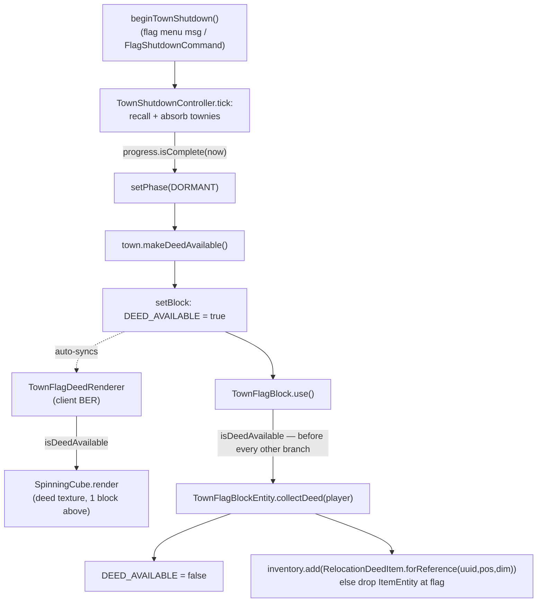
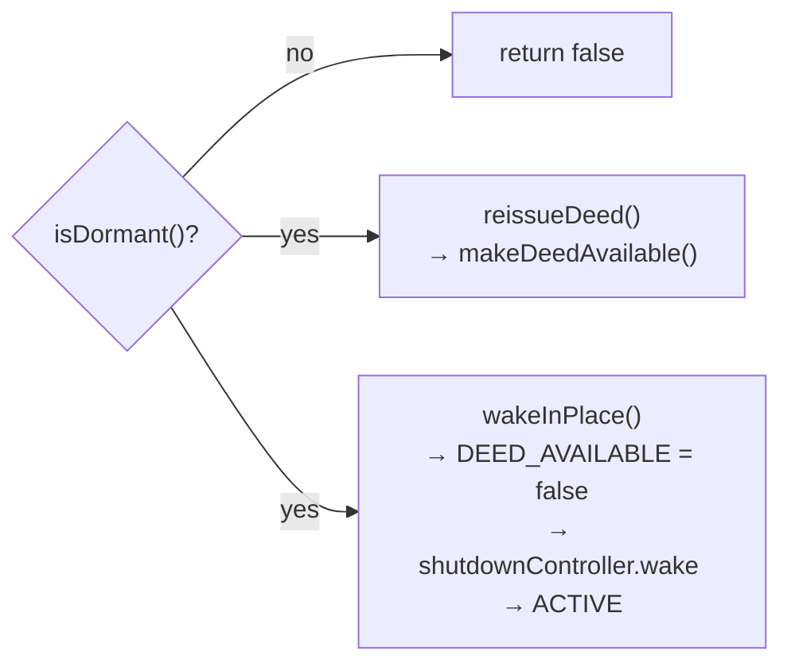
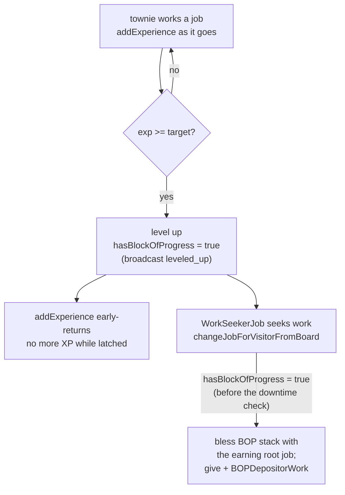
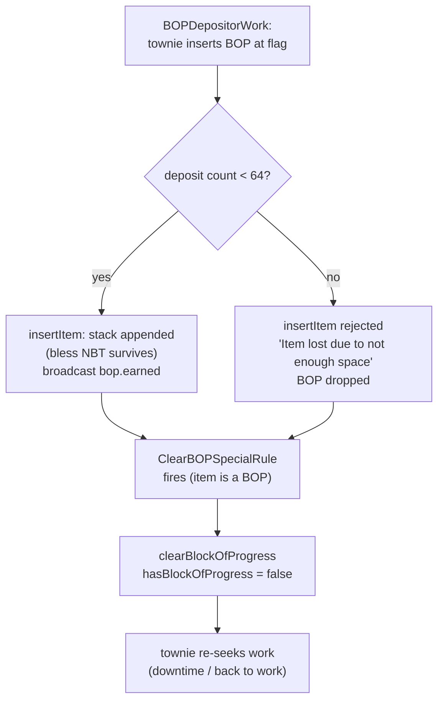
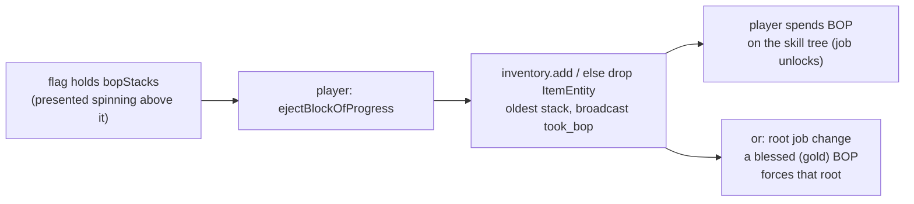
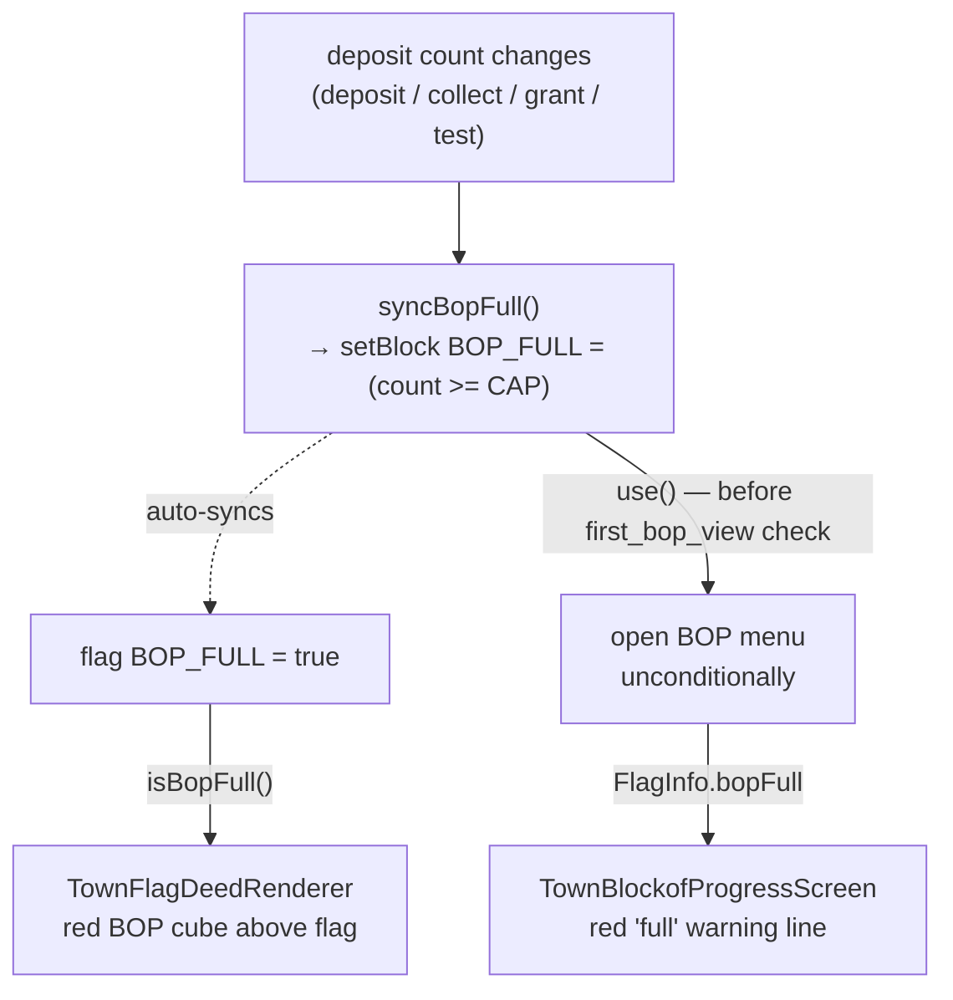
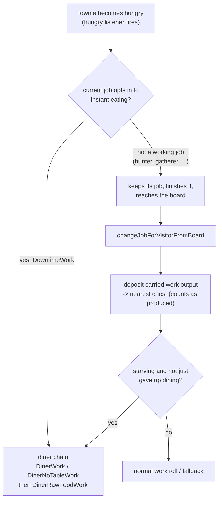
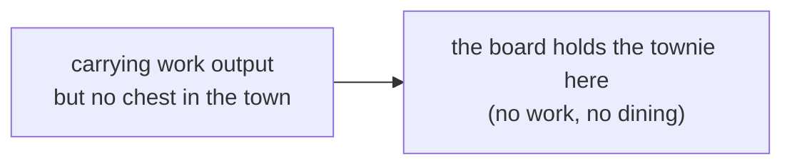
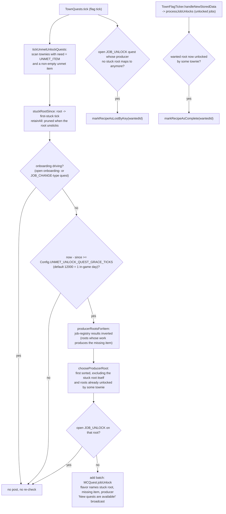
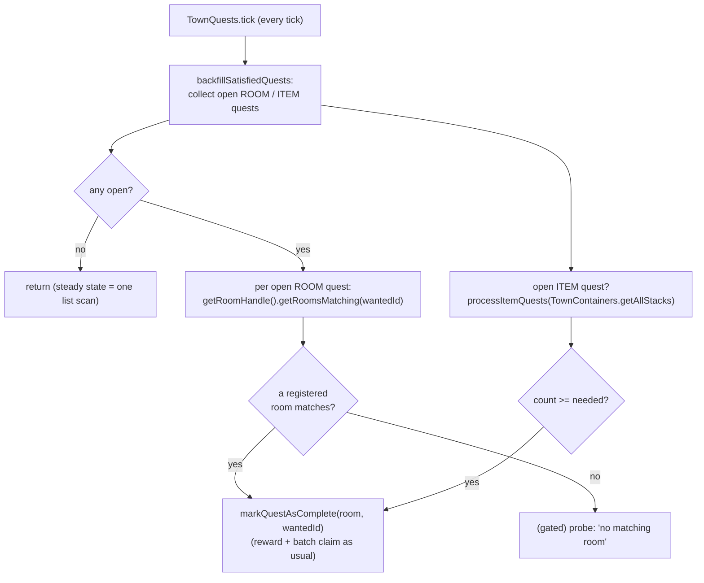

# Relocation deed — availability, collection, loss-protection

The deed is **not** dropped as an item when a town shuts down. Shutdown completion
flips a **blockstate** flag on the dormant town flag; the client draws a spinning
deed above it, and the player takes it by interacting with the flag. Placement of
the collected deed (the actual town move) is out of scope here — see
`docs/adr/0009-town-relocation-via-dormant-flag-and-reference-deed.md` and
`TownRelocation`.

## Happy path



- **Why a blockstate property, not BE data**: the flag has no client-side ticker,
  so BE fields never hydrate there. Blockstate syncs for free, and every flag
  `blockstates/*.json` uses the `""` wildcard variant, so the extra property needs
  no model changes.
- **`use()` checks the deed first**, ahead of `convertItemInHand` and the flag
  menus — a dormant flag with a deed waiting is a pickup, not a UI.
- `SpinningCube` is the block-of-progress cube math lifted out of
  `SpinningCubeLayer` (visitor render layer); both callers pass their own
  translation, scale and UV window into the same six-face draw.

## Loss-protection (dormant flag only)



- Re-issue is idempotent: a lost deed just makes a new one available on the flag.
  The deed is a *reference* (town UUID + original flag pos + dimension), so
  re-issuing can never duplicate town data.
- **Waking retracts the waiting deed.** A live town must not hand out references to
  itself, and the deed branch in `use()` would otherwise shadow the flag menu on
  every interaction from then on.
- The deed's availability rides the blockstate, so it survives chunk unload and
  never expires — losing track of a dormant town is exactly what it protects
  against.

---

# Block of Progress — the earn → deposit → collect state machine

The BOP is the town's progression currency: a townie **earns** it by leveling up,
**deposits** it into the flag, and the **player** collects and spends it on the
skill tree. The non-obvious part — and the reason this needs a map — is that the
XP **latch** clears at *deposit*, **not** at player collection. "Uncollected" is
therefore two distinct states, not one:

- **The latch** (`SimpleVillagerHandle.hasBlockOfProgress`, one `Boolean` per
  townie) — set on level-up, the value `addExperience` early-returns on; a townie
  can hold **at most one** uncollected BOP, so it accrues no XP until it deposits.
- **The flag's deposits** (`TownFlagBlockEntity.bopStacks`, capped at **64** by
  `TownFlagBOPItemHandler.getSlots()`) — real stacks, because each deposit may be
  **blessed** with the depositing townie's root job (a "gold" BOP; see ADR-0015).
  Appended on deposit, popped FIFO only when the **player** collects. This is the
  "uncollected by the player" state.

## Earn → latch → assign (happy path)



- The latch is a `Boolean`, not a counter — one townie holds at most one BOP, so
  it stalls for the brief level-up→deposit window, **not** until the player
  collects (collection never touches the latch).
- `changeJobForVisitorFromBoard` checks `hasBlockOfProgress` **before** the
  downtime/rest checks, so a latched townie always takes the deposit over idling.

## Deposit — the 64-slot cap



- `ClearBOPSpecialRule` fires **regardless of whether the insert succeeded** — it
  only checks the item *is* a BOP. That is why a full flag **does not re-stall**
  the townie: the latch clears even when the deposit is rejected, so the townie
  returns to work and can level again.
- The flag caps at **64**; past that, excess BOPs are silently dropped
  (server-logged `Item lost …`, not player-visible). A left-alone town therefore
  does not freeze — townies keep working, BOPs pile to 64, then further ones are
  lost. "Stops progressing" = the skill tree doesn't advance, not townies freezing.
- Verified by `flag/bop_boundary_63` (63→64 accepted, latch cleared) and
  `flag/bop_full_64` (64→full rejected, latch *still* cleared).

## Collect + spend (player side)



- Collection is the **only** thing that moves the deposits down; it never touches the
  latch. Spending is the player's decision, so progression advances only if the
  player checks in — the counterweight to warp (ADR-0011).
- A blessed ("gold") BOP guarantees its carried root on a root job change:
  `JobRootChangeMessage` reads the spent stack (`BopTransactionSyncer.syncConsumedBOP`
  returns it), and `SimpleVillagerHandle` stores it in `guaranteedRoots`, applied at
  `handleMorning` **before** the overnight quest override (persisted as
  `guaranteed_roots` NBT). The menu shows the named root
  (`menu.unlock_root.insert_bop_blessed`).
- While the flag holds any BOP it **sparkles cyan** (`TownFlagTicker.spawnBopParticlesIfNeeded`,
  `DustParticleOptions`); a full flag renders the red BOP cube instead.

## Full-flag notice

A full flag (at the 64-deposit cap) silently loses further BOPs, and the latch
still clears (so the townie is *not* re-stalled), so "stopped progressing" was
invisible. A **blockstate** surfaces it, mirroring the deed's `DEED_AVAILABLE`
pattern, since the flag has no client-side ticker to hydrate BE data.



- `syncBopFull()` is called at every `bopCount` change site and **after
  `initializeBOP`**, where the persisted blockstate can be stale against the
  freshly-loaded count (reconcile on load).
- The notice is **unconditional on interaction** (not gated on the `first_bop_view`
  advancement), so the warning shows even once the player has seen the tab.
- `SpinningCube.render` gained a real `color` param — the old `0xF000F0` arg was a
  misnamed light value, not a tint — so the two existing callers pass white and the
  full-BOP passes red.

---

# Hungry townie — deposit work output, then dine

A hungry townie carrying its work output (a hunter with mutton) used to be snapped
straight to a dining work and eat that output before it was ever counted as
*produced*. Now the output is deposited first — which is what completes the
onboarding mutton quest — and only then does the townie eat. Whether a hungry
townie goes straight to dining or through the board depends on its **current job**.

## The two hungry paths



- The opt-in is the `CAN_INSTANTLY_SWITCH_TO_EATING` global rule; only
  `DowntimeWork` carries it, so a townie *at work* never gets the direct dining
  snap and always passes through the board first.
- The board's deposit sub-step runs **before** the starving check and the work
  roll, so a working townie's output is stored on its way to eating.

## No storage — a deliberate blocker



- With no chest the deposit sub-step returns "hold" and the board stops; a townie
  is never sent to dine before it can store what it carries.

---

# Stuck townie -> JOB_UNLOCK quest (the diagnostic quest)

A root whose townies have a job but no material for it sits in `UNMET_ITEM`
and the town soft-locks. That state was invisible in play (only a cryptic
need-bubble icon), so `TownQuests` posts a **JOB_UNLOCK** quest that names the
missing item and the root that produces it. The quest completes the moment
*any* townie unlocks that producer root (the normal BOP path) and is **lost**
when the stuck state no longer maps to that producer (e.g. the player stocked
the missing item directly).

## Post / complete / lose



- **The grace timer is per-root and restarts on unstick.** `stuckRootSince` is
  pruned to the roots stuck *right now* before being re-seeded, so a town that
  flaps in and out of the stuck state is not posted a quest until it has been
  stuck for the full grace continuously.
- **Nothing posts while onboarding drives jobs.** An open onboarding- or
  `JOB_CHANGE`-type quest means the town is mid-tutorial and the tutorial owns
  job assignment; a diagnostic quest on top is noise. The gate is on quest
  existence, not townie state.
- **Completion is event-driven, loss is scan-driven.** Unlocks land through
  `processJobUnlocks` (stateless, run every flag tick, mirrors
  `processJobChanges`). Loss is decided by the per-tick scan: when no stuck
  root maps to the quest's producer anymore the quest is withdrawn.
- **The lost placeholder follows pre-existing `lost()` semantics** (all quest
types): the journal keeps a `ROOM`-typed ACTIVE placeholder, not a
  LOST-status quest (see the TODO on `MCQuest.lost`). What loss guarantees for
  this feature is that no open JOB_UNLOCK remains, so a re-stuck root can get
  a fresh quest.
- **Exclusions keep the quest honest.** `chooseProducerRoot` skips the stuck
  root itself (its capacity already exists) and any root some townie already
  has unlocked (an unlocked producer means the stuck state has a different
  cause and the quest would not help). Producer candidates come from the live
  job registry (`ServerJobsRegistry.getResults`), not a static table.
- **The unlocked-jobs seam is `VillagerHolder.getUnlockedJobs`** — the one
  handle surface that exposes per-townie unlocked `JobID` sets, read
  server-side via `TownVillagerHandles`.
- Verified by `TownQuestsJobUnlockTest` (producer selection, unlock
  detection, batch completion/lost plumbing). Post timing and live
  completion/loss are covered by the held `village/self_sufficiency` run;
  plan: `docs/plans/2026-09-27-001-feat-unmet-unlock-quest-plan.md`.

# LOOT quest close — extraction-satisfiable, decoupled from the job's post-extract rule

A **LOOT** quest (the raw-food family, e.g. the 2.5-gate
`villager_simple_furnace_food_raw` tag) satisfies the moment a townie *extracts*
the matching item — the meat the hunter just carried in, the ore the miner
just pulled. It is production-completable (like JOB_UNLOCK's
`processJobUnlocks`), not scan-completable, and it does **not** consume the
item: the deposit / eat path still decides its fate.

## Why the check used to be skipped for the hunter

`Quests.processLootQuests(item)` used to live inside
`RealtimeWorldInteraction`'s 5-arg `postExtractHook`. That hook is reached only
through the abstract 3-arg bridge, which short-circuits when the job declares
**no** `EXTRACTING_PRODUCT` special rule:

```java
Collection<String> rules = specialRules.get(ProductionStatus.EXTRACTING_PRODUCT);
if (rules == null || rules.isEmpty()) return currentState;   // hook never runs
```

The other post-extract behaviours (hunger fill, `take_from_slot_2`, …) correctly
key off that rule. The sword-hunter job declares none — only `remove_from_world`
— so its raw-meat grant fell into the early-return and the quest never closed,
while a rule-bearing job (gatherer `hunger_fill*`, cook `take_from_slot_2`) did.

## The fix — the check is now unconditional on the extract path

`AbstractWorldInteraction`'s 3-arg bridge now calls a small virtual seam
**before** the rule gate:

```java
protected void onLootExtracted(EXTRA inputs, @Nullable HELD_ITEM item) {}   // default no-op
```

`RealtimeWorldInteraction.onLootExtracted` is the only override that fires it;
it calls `processLootQuests(item)` for any non-empty extraction, so a job
without an `EXTRACTING_PRODUCT` rule (the hunter) closes its quest too. The
warp engine inherits the no-op (it has no live flag to broadcast to), and the
rule-gated 5-arg path is otherwise unchanged.

- **The decoupling decision is `LootExtractGuard.questCheckFires(nonEmpty, rule)`**
  → `nonEmpty`. Extracted Forge-free so the contract ("fires for the hunter,
  independent of the rule") is unit-pinned even though the live wiring is not.
- **The untestable half is the live wiring** — `RealtimeWorldInteraction` and the
  declarative engine both pull Forge registries at `<clinit>`, so they cannot be
  loaded in a unit test (`ExceptionInInitializerError`, see the registry-bound
  doctrine). The end-to-end "hunter → raw meat → raw-food quest closes" is
  verified by the `loot_on_extract` autotest (`RealtimeWorldInteraction` path),
  which the six prior runs showed RED (`quest complete=false`) and which is
  GREEN after the fix.
- Verified by `LootExtractGuardTest` (non-empty+no-rule fires; non-empty+rule
  fires; empty never fires). The oracle: `loot_on_extract`.
- **Two independent axes — the gate and the engine.** The
  `EXTRACTING_PRODUCT` early-return (the 3-arg bridge) is *engine-agnostic* and
  runs before per-engine dispatch. "warp" vs "realtime" is a separate axis:
  `TimeWarpWorldInteraction` over the `MCTownState` loot snapshot vs
  `RealtimeWorldInteraction` over `MCExtra`'s live town; a *leaver* is a job
  category, not an engine. So when a per-engine side effect (like this quest
  close) doesn't fire, check for the engine-agnostic gate early-return **first**
  — a missing per-engine log line (e.g. `[LOOTTRACE]`) is not evidence the engine
  ran, it is evidence it was never reached. (2026-10-04: this was misdiagnosed
  as "the warp engine omits it"; the real gate was the rule early-return, and the
  warp/leaver conflation was dev-caught.)
- **Warp now closes it too (Option B, 2026-10-04).** Dev decision: warp must
  yield the same quest outcome as realtime, and the warper must stay *pure*
  (testable without a live quest handle) — so the close is *recorded in the
  snapshot, applied at settle*:
  - `TimeWarpWorldInteraction` overrides the 3-arg `postExtractHook` bridge (not
    `onLootExtracted`, which has no return value) and, under the same
    `LootExtractGuard.questCheckFires` contract, calls
    `currentState.recordLootExtract(item)` on the `MCTownState`.
  - `TownFlagState.warp` (the shared settle, covers dev `warpTime` *and*
    sleep-warp) applies each record via
    `e.getQuestHandle().processLootQuests(extracted.get())` — exactly
    realtime's call — then `clearRecordedLootExtractions()` (consumed once,
    never stored).
  - `MCTownState.recordedLootExtractions` is a per-state `ArrayList` shared *by
    reference* through the copy paths (`newTownState`, `withInsertedItem`, …),
    the `knowledge`-list pattern.
  - **Trap the unit tests do not catch:** `MCAdvanceTime.finalizeState` is the
    *terminal* rebuild (`AbstractAdvanceTime` hands the warp result through it —
    it drops instance fields, so it had to carry the list explicitly). The
    first oracle run proved it: 8 `warp-record` lines, then `warp-settle: 0`
    — records recorded, then silently dropped.
  - **Harness gap this work also closed:** `TestExecutor.checkResults` (the
    warp-only path) never ran the blueprint's `withCustomAssertion` (only the
    realtime check did) — so a warp-only scenario's assertion was vacuous and
    `loot_on_extract_warp` passed on a trivial item check with the quest never
    closed. The assertion now runs in the warp check too (keep assertions
    read-only: mixed scenarios run it in both phases).
  - Unit: `MCTownStateLootExtractTest` (record order, copy survival, consume
    once). The settle call itself (TFBE → QuestsHolder) is registry-bound —
    oracle-pinned. Oracles: `loot_on_extract` (realtime regression) and
    `loot_on_extract_warp` (warp), both GREEN — the warp run's log shows the
    records, the settle applying them, and `quest complete=true`.

---

# Quest backfill — state that predates the quest still completes it

The tutorial issues its gate quests (the Phase-1 kickoff — `job_board`,
`store_room`, `town_gate`, `wooden_sword` — and the Phase-2/2.5 cook chain)
after campfire, but quest *satisfaction* normally completes a quest via a
one-shot event **at satisfaction time**: a room recipe fires `roomRecipeCreated`
once when it registers, and an item count is tallied only on a stored-data
change. When the satisfying world state already exists by the time the quest is
added — exactly what the `village/self_sufficiency` drive does, building the
rooms and swords *before* the tutorial issues the gates — that event has
already fired and never re-fires, so the gate quests stall `ACTIVE` forever and
`allVillagerKickoffQuestsDone()` never holds (NO_FORWARD_PROGRESS, the whole
town frozen at the job board).

## Per-tick re-evaluation (happy path)



- **It reuses the existing completion plumbing**, not a parallel mechanism: rooms
  go through `markQuestAsComplete` (→ `markRecipeAsComplete` → the usual reward /
  batch-claim); item quests go through `processItemQuests`, the same tally
  `handleNewStoredData` uses. A backfilled quest completes exactly as an
  event-driven one does.
- **`getRoomsMatching(wantedId)` covers both room kinds**: a door room
  (`store_room`, `job_board`) and a registered block-room (`town_gate`), since
  `registerBlockAsRoom` feeds the same match store the look-up reads.
- **The gate is on open-quest existence, not townie state**, so the early-out
  keeps the steady state to a single `questBatches.getAll()` scan; the room look-up
  and the container scan run only while a matching quest is still open.
- Verified: `village/self_sufficiency` run-18 completes all 12 onboarding quests
  (raw→kitchen→cooked chain), staffs both cook and hunter, and
  `NO_FORWARD_PROGRESS` no longer fires. (The deeper flaky `NO_JOBSITE`
  work-site resolution `getRoomsMatching` traces — see
  `.scratch/cook-soft-lock/DIAGNOSIS.md` — is a separate, still-open issue that
  this unblocks.)
