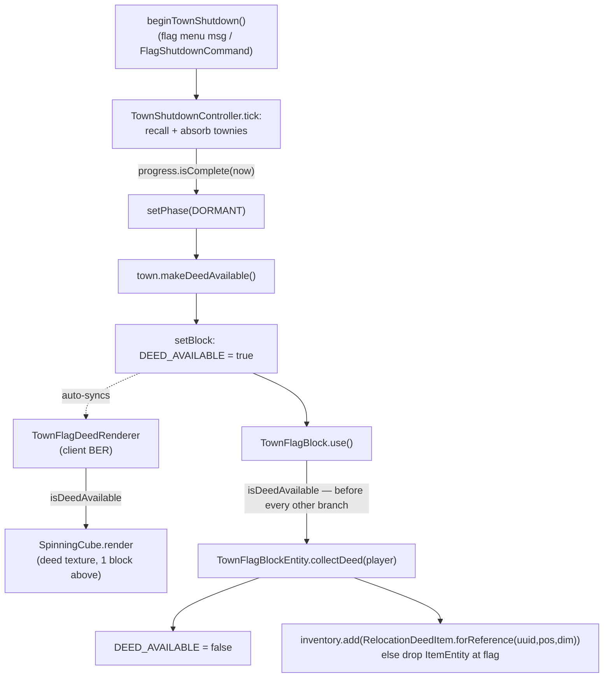
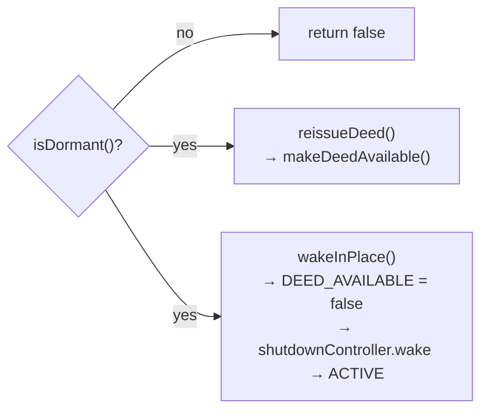
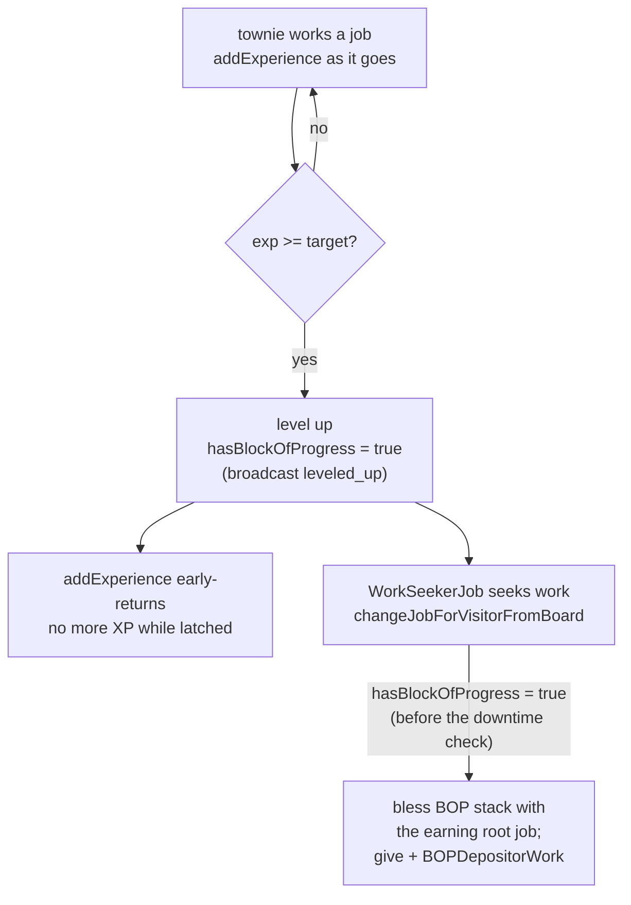
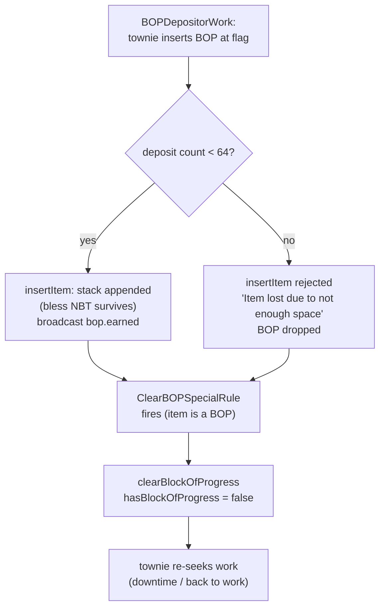
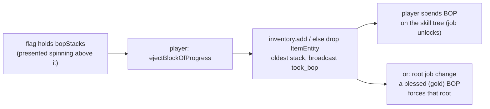
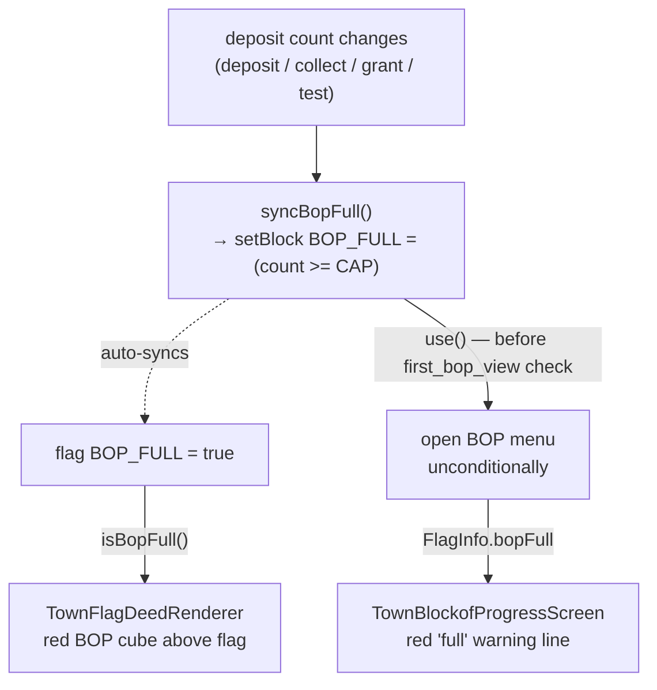
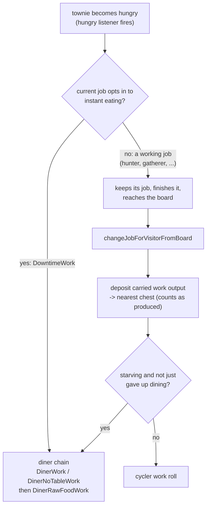
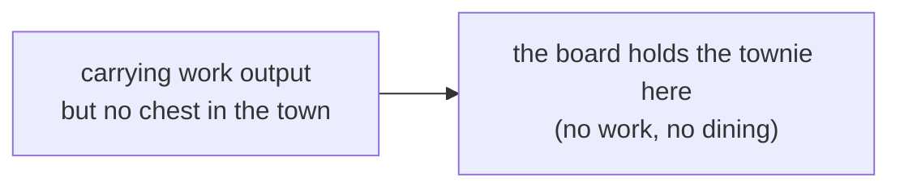
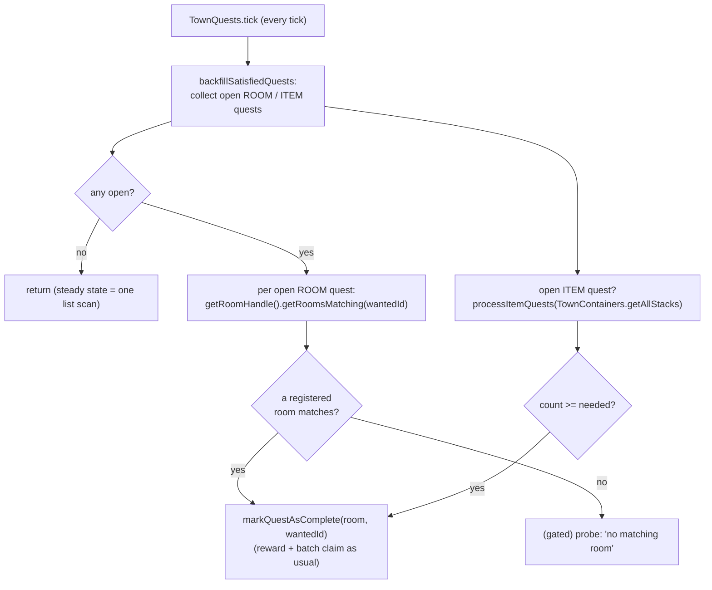
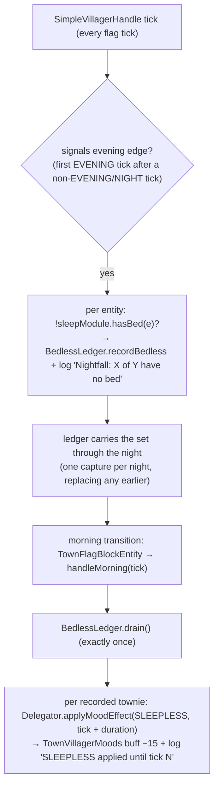

# Relocation deed — availability, collection, loss-protection

The deed is **not** dropped as an item when a town shuts down. Shutdown completion
flips a **blockstate** flag on the dormant town flag; the client draws a spinning
deed above it, and the player takes it by interacting with the flag. Placement of
the collected deed (the actual town move) is out of scope here — see
`docs/adr/0009-town-relocation-via-dormant-flag-and-reference-deed.md` and
`TownRelocation`.

## Happy path



- **Why a blockstate property, not BE data**: the flag has no client-side ticker,
  so BE fields never hydrate there. Blockstate syncs for free, and every flag
  `blockstates/*.json` uses the `""` wildcard variant, so the extra property needs
  no model changes.
- **`use()` checks the deed first**, ahead of `convertItemInHand` and the flag
  menus — a dormant flag with a deed waiting is a pickup, not a UI.
- `SpinningCube` is the block-of-progress cube math lifted out of
  `SpinningCubeLayer` (visitor render layer); both callers pass their own
  translation, scale and UV window into the same six-face draw.

## Loss-protection (dormant flag only)



- Re-issue is idempotent: a lost deed just makes a new one available on the flag.
  The deed is a *reference* (town UUID + original flag pos + dimension), so
  re-issuing can never duplicate town data.
- **Waking retracts the waiting deed.** A live town must not hand out references to
  itself, and the deed branch in `use()` would otherwise shadow the flag menu on
  every interaction from then on.
- The deed's availability rides the blockstate, so it survives chunk unload and
  never expires — losing track of a dormant town is exactly what it protects
  against.

---

# Block of Progress — the earn → deposit → collect state machine

The BOP is the town's progression currency: a townie **earns** it by leveling up,
**deposits** it into the flag, and the **player** collects and spends it on the
skill tree. The non-obvious part — and the reason this needs a map — is that the
XP **latch** clears at *deposit*, **not** at player collection. "Uncollected" is
therefore two distinct states, not one:

- **The latch** (`SimpleVillagerHandle.hasBlockOfProgress`, one `Boolean` per
  townie) — set on level-up, the value `addExperience` early-returns on; a townie
  can hold **at most one** uncollected BOP, so it accrues no XP until it deposits.
- **The flag's deposits** (`TownFlagBlockEntity.bopStacks`, capped at **64** by
  `TownFlagBOPItemHandler.getSlots()`) — real stacks, because each deposit may be
  **blessed** with the depositing townie's root job (a "gold" BOP; see ADR-0015).
  Appended on deposit, popped FIFO only when the **player** collects. This is the
  "uncollected by the player" state.

## Earn → latch → assign (happy path)



- The latch is a `Boolean`, not a counter — one townie holds at most one BOP, so
  it stalls for the brief level-up→deposit window, **not** until the player
  collects (collection never touches the latch).
- `changeJobForVisitorFromBoard` checks `hasBlockOfProgress` **before** the
  downtime/rest checks, so a latched townie always takes the deposit over idling.

## Deposit — the 64-slot cap



- `ClearBOPSpecialRule` fires **regardless of whether the insert succeeded** — it
  only checks the item *is* a BOP. That is why a full flag **does not re-stall**
  the townie: the latch clears even when the deposit is rejected, so the townie
  returns to work and can level again.
- The flag caps at **64**; past that, excess BOPs are silently dropped
  (server-logged `Item lost …`, not player-visible). A left-alone town therefore
  does not freeze — townies keep working, BOPs pile to 64, then further ones are
  lost. "Stops progressing" = the skill tree doesn't advance, not townies freezing.
- Verified by `flag/bop_boundary_63` (63→64 accepted, latch cleared) and
  `flag/bop_full_64` (64→full rejected, latch *still* cleared).

## Collect + spend (player side)



- Collection is the **only** thing that moves the deposits down; it never touches the
  latch. Spending is the player's decision, so progression advances only if the
  player checks in — the counterweight to warp (ADR-0011).
- **`took_bop` broadcast must pass the BOP as a `Component`, not a raw
  `ItemStack` (1.20.6).** `eject()` runs `bopStacks.remove(0)` → broadcast →
  `inventory.add`/drop, in that order. In 1.20.6 the broadcast's item argument
  must be a `Component`/`Number`/`Boolean`/`String` — a raw `ItemStack` throws
  `IllegalArgumentException` from `TranslatableContents`, which aborts the
  network task *after* the remove and *before* the give, so the BOP is removed
  from the flag and lost (the day-1 "all BOPs gone" bug). The fix wraps it:
  `flag.messages.broadcastMessage("messages.player.took_bop", recipient.getName(),
  Compat.getItemName(v), ...)` where `Compat.getItemName(ItemStack)` returns
  `stack.getDisplayName()` (1.20.6 renamed `ItemStack.getName()` →
  `getDisplayName()`).
- A blessed ("gold") BOP guarantees its carried root on a root job change:
  `JobRootChangeMessage` reads the spent stack (`BopTransactionSyncer.syncConsumedBOP`
  returns it), and `SimpleVillagerHandle` stores it in `guaranteedRoots`, applied at
  `handleMorning` **before** the overnight quest override (persisted as
  `guaranteed_roots` NBT). The menu shows the named root
  (`menu.unlock_root.insert_bop_blessed`).
- While the flag holds any BOP it **sparkles cyan** (`TownFlagTicker.spawnBopParticlesIfNeeded`,
  `DustParticleOptions`); a full flag renders the red BOP cube instead.

## Full-flag notice

A full flag (at the 64-deposit cap) silently loses further BOPs, and the latch
still clears (so the townie is *not* re-stalled), so "stopped progressing" was
invisible. A **blockstate** surfaces it, mirroring the deed's `DEED_AVAILABLE`
pattern, since the flag has no client-side ticker to hydrate BE data.



- `syncBopFull()` is called at every `bopCount` change site and **after
  `initializeBOP`**, where the persisted blockstate can be stale against the
  freshly-loaded count (reconcile on load).
- The notice is **unconditional on interaction** (not gated on the `first_bop_view`
  advancement), so the warning shows even once the player has seen the tab.
- `SpinningCube.render` gained a real `color` param — the old `0xF000F0` arg was a
  misnamed light value, not a tint — so the two existing callers pass white and the
  full-BOP passes red.

---

# Hungry townie — deposit work output, then dine

A hungry townie carrying its work output (a hunter with mutton) used to be snapped
straight to a dining work and eat that output before it was ever counted as
*produced*. Now the output is deposited first — which is what completes the
onboarding mutton quest — and only then does the townie eat. Whether a hungry
townie goes straight to dining or through the board depends on its **current job**.

## The two hungry paths



- The opt-in is the `CAN_INSTANTLY_SWITCH_TO_EATING` global rule; only
  `DowntimeWork` carries it, so a townie *at work* never gets the direct dining
  snap and always passes through the board first.
- The board's deposit sub-step runs **before** the starving check and the work
  roll, so a working townie's output is stored on its way to eating.

## No storage — a deliberate blocker



- With no chest the deposit sub-step returns "hold" and the board stops; a townie
  is never sent to dine before it can store what it carries.

---

# Stuck townie -> JOB_UNLOCK quest (the diagnostic quest)

A root whose townies have a job but no material for it sits in `UNMET_ITEM`
and the town soft-locks. That state was invisible in play (only a cryptic
need-bubble icon), so `TownQuests` posts a **JOB_UNLOCK** quest that names the
missing item and the root that produces it. **One open quest per stuck root**:
when the root's missing item flips to a different producer's item the quest is
*retargeted in place*, and it is *withdrawn* (removed outright, no placeholder)
when the root stops mapping to any viable producer (e.g. the player stocked
the missing item directly). The quest completes the moment *any* townie
unlocks the targeted producer root (the normal BOP path). The stuck root is
encoded on the quest (`MCQuest.setUnlockStuckRoot` → `fromRecipeID`, persisted
via NBT `from_recipe_id`) so the dedupe survives a flag reload.

## Post / complete / reconcile

```mermaid
flowchart TD
    Tick["TownQuests.tick (flag tick)"] --> Scan["tickUnmetUnlockQuests:\nscan townies with need = UNMET_ITEM\nand a non-empty unmet item"]
    Scan --> Since["unmetRootSince: root -> first-stuck tick\nretainAll: pruned when the root unsticks"]
    Since --> Map["rootToProducer: per stuck root,\nchooseProducerRoot over the current missing item\n(absent = no unlockable producer)"]
    Map --> Recon["reconcileUnlockQuests (pure):\nrooted quests keep while their root maps to a\nviable producer; retarget in place when the\nproducer flips; withdraw when it does not.\nTown-wide quests keep while some root maps\nthem. Post only for due roots with no open quest."]
    Recon --> ApplyW["withdraw: QuestBatch.withdrawQuest\n(quest removed, listener notified; empty\nJOB_UNLOCK batches declined from the handle)"]
    Recon --> ApplyR["retarget: MCQuest.retargetUnlock\n(new producer wanted id + flavor, same\nbatch/owner/reward, setChanged)"]
    Recon --> Gate{"posting due? (onboarding not driving\n+ grace elapsed for that root)")}
    Gate -- no --> Hold["no post"]
    Gate -- yes --> Post["postUnlockQuest: add batch MCQuest.jobUnlock\n+ setUnlockStuckRoot, flavor names stuck root,\nmissing item, producer; 'New quests are\navailable!' broadcast"]

    Unl["TownFlagTicker.handleNewStoredData\n-> processJobUnlocks (unlocked jobs)"] --> Match{"wanted root now unlocked\nby some townie?"}
    Match -- yes --> Done["markRecipeAsComplete(wantedId)"]
```

- **The grace timer is per-root and restarts on unstick.** `unmetRootSince` is
  pruned to the roots stuck *right now* before being re-seeded, so a town that
  flaps in and out of the stuck state is not posted a quest until it has been
  stuck for the full grace continuously.
- **Nothing posts while onboarding drives jobs.** An open onboarding- or
  `JOB_CHANGE`-type quest means the town is mid-tutorial and the tutorial owns
  job assignment; a diagnostic quest on top is noise. The gate is on quest
  existence, not townie state. (Reconcile — retarget/withdraw — is not gated:
  it only touches quests that already exist.)
- **Completion is event-driven, reconcile is scan-driven.** Unlocks land through
  `processJobUnlocks` (stateless, run every flag tick, mirrors
  `processJobChanges`), and it runs *before* `tickQuests` in the same flag tick
  (`AbstractTownFlagTicker`: `handleNewStoredData` then `tickQuests`), so an
  unlock completes the quest before the reconcile can withdraw it.
- **Withdraw leaves no placeholder** (2026-10-11 ping-pong fix,
  `.scratch/mat-gated-arrival/job-unlock-quest-spam.md`): the old path ran
  `markRecipeAsLostByKey`, whose `lost()` replacement re-typed the quest as an
  ACTIVE *room* quest that no gate/UI/completion path ever cleared — every
  oscillation of the stuck root's missing item left another phantom in the
  handle (107× each of two quests in two minutes of a held run) and, being no
  longer JOB_UNLOCK-typed, defeated the dedupe so the post/lose cycle ran
  forever. Withdraw removes the quest outright, notifies the listener
  (`quest_lost` broadcast), and declines the batch when it empties.
- **The dedupe is per stuck root, not per producer**, so an oscillating
  `getUnmetItem()` (work-state flips changing the best gate reason) retargets
  the one quest instead of churning the handle; the stuck-root encoding in
  `fromRecipeID` is otherwise-unused for this type and round-trips through the
  quest NBT. Town-wide quests (the top-need phase: no stuck root, encoding
  empty) keep the legacy rule — withdrawn when no stuck root maps to their
  producer; their batches carry a second room quest, so only empty batches
  are declined.
- **Exclusions keep the quest honest.** `chooseProducerRoot` skips the stuck
  root itself (its capacity already exists) and any root some townie already
  has unlocked (an unlocked producer means the stuck state has a different
  cause and the quest would not help). Producer candidates come from the job
  definitions' declared products (`ServerJobsRegistry.staticProducerRootsForItem`
  — `initial_request` matching), not the discovery-gated registry results: an
  unlock quest exists to ask for a producer the town does not yet hold, so the
  producer knowledge must be omniscient (gannet decision 3); the discovery gate
  stays on the job engine's execution path. The same predicate drives the
  reconcile — a quest posted on declared capability must not be withdrawn by
  the discovery gate's view.
- **The unlocked-jobs seam is `VillagerHolder.getUnlockedJobs`** — the one
  handle surface that exposes per-townie unlocked `JobID` sets, read
  server-side via `TownVillagerHandles`.
- Verified by `TownQuestsJobUnlockTest` (producer selection, unlock
  detection, batch completion, the `reconcileUnlockQuests` decisions, the
  stuck-root NBT round-trip, in-place retarget, and withdraw plumbing). Post
  timing and live completion/withdrawal are covered by the held
  `village/self_sufficiency` run;
  plan: `docs/plans/2026-09-27-001-feat-unmet-unlock-quest-plan.md`.

**The tutorial's top-need batch is a second consumer of the same producer
predicate.** Phase 2.75 (`tryPhase2_75_topNeedUnlock`) walks the ranked
unmet-need item queue (`chooseTopNeed`, pure — `TownQuestsTopNeedWalkTest`)
to the first need with a not-yet-unlocked producer, and posts JOB_UNLOCK plus
that producer's base room. Needs with no producer at all, or with only
already-unlocked producers, are **skipped, not dead-ends** (run-14's
die-on-#1 `oak_wood` cell: zero candidates silenced a lower need that had
one). A need whose producer's unlock is already in flight ends the phase
(`SKIPPED`) — the walk does not reach past it to post for a lower-ranked
need. The producer core itself (`staticProducerRootsFor`) is unit green in
`StaticProducerRootsTest`; its `Works`-registry glue half is
registry-bound (compile + the held run settle it).

# LOOT quest close — extraction-satisfiable, decoupled from the job's post-extract rule

A **LOOT** quest (the raw-food family, e.g. the 2.5-gate
`villager_simple_furnace_food_raw` tag) satisfies the moment a townie *extracts*
the matching item — the meat the hunter just carried in, the ore the miner
just pulled. It is production-completable (like JOB_UNLOCK's
`processJobUnlocks`), not scan-completable, and it does **not** consume the
item: the deposit / eat path still decides its fate.

## Why the check used to be skipped for the hunter

`Quests.processLootQuests(item)` used to live inside
`RealtimeWorldInteraction`'s 5-arg `postExtractHook`. That hook is reached only
through the abstract 3-arg bridge, which short-circuits when the job declares
**no** `EXTRACTING_PRODUCT` special rule:

```java
Collection<String> rules = specialRules.get(ProductionStatus.EXTRACTING_PRODUCT);
if (rules == null || rules.isEmpty()) return currentState;   // hook never runs
```

The other post-extract behaviours (hunger fill, `take_from_slot_2`, …) correctly
key off that rule. The sword-hunter job declares none — only `remove_from_world`
— so its raw-meat grant fell into the early-return and the quest never closed,
while a rule-bearing job (gatherer `hunger_fill*`, cook `take_from_slot_2`) did.

## The fix — the check is now unconditional on the extract path

`AbstractWorldInteraction`'s 3-arg bridge now calls a small virtual seam
**before** the rule gate:

```java
protected void onLootExtracted(EXTRA inputs, @Nullable HELD_ITEM item) {}   // default no-op
```

`RealtimeWorldInteraction.onLootExtracted` is the only override that fires it;
it calls `processLootQuests(item)` for any non-empty extraction, so a job
without an `EXTRACTING_PRODUCT` rule (the hunter) closes its quest too. The
warp engine inherits the no-op (it has no live flag to broadcast to), and the
rule-gated 5-arg path is otherwise unchanged.

- **The decoupling decision is `LootExtractGuard.questCheckFires(nonEmpty, rule)`**
  → `nonEmpty`. Extracted Forge-free so the contract ("fires for the hunter,
  independent of the rule") is unit-pinned even though the live wiring is not.
- **The untestable half is the live wiring** — `RealtimeWorldInteraction` and the
  declarative engine both pull Forge registries at `<clinit>`, so they cannot be
  loaded in a unit test (`ExceptionInInitializerError`, see the registry-bound
  doctrine). The end-to-end "hunter → raw meat → raw-food quest closes" is
  verified by the `loot_on_extract` autotest (`RealtimeWorldInteraction` path),
  which the six prior runs showed RED (`quest complete=false`) and which is
  GREEN after the fix.
- Verified by `LootExtractGuardTest` (non-empty+no-rule fires; non-empty+rule
  fires; empty never fires). The oracle: `loot_on_extract`.
- **Two independent axes — the gate and the engine.** The
  `EXTRACTING_PRODUCT` early-return (the 3-arg bridge) is *engine-agnostic* and
  runs before per-engine dispatch. "warp" vs "realtime" is a separate axis:
  `TimeWarpWorldInteraction` over the `MCTownState` loot snapshot vs
  `RealtimeWorldInteraction` over `MCExtra`'s live town; a *leaver* is a job
  category, not an engine. So when a per-engine side effect (like this quest
  close) doesn't fire, check for the engine-agnostic gate early-return **first**
  — a missing per-engine log line (e.g. `[LOOTTRACE]`) is not evidence the engine
  ran, it is evidence it was never reached. (2026-10-04: this was misdiagnosed
  as "the warp engine omits it"; the real gate was the rule early-return, and the
  warp/leaver conflation was dev-caught.)
- **Warp now closes it too (Option B, 2026-10-04).** Dev decision: warp must
  yield the same quest outcome as realtime, and the warper must stay *pure*
  (testable without a live quest handle) — so the close is *recorded in the
  snapshot, applied at settle*:
  - `TimeWarpWorldInteraction` overrides the 3-arg `postExtractHook` bridge (not
    `onLootExtracted`, which has no return value) and, under the same
    `LootExtractGuard.questCheckFires` contract, calls
    `currentState.recordLootExtract(item)` on the `MCTownState`.
  - `TownFlagState.warp` (the shared settle, covers dev `warpTime` *and*
    sleep-warp) applies each record via
    `e.getQuestHandle().processLootQuests(extracted.get())` — exactly
    realtime's call — then `clearRecordedLootExtractions()` (consumed once,
    never stored).
  - `MCTownState.recordedLootExtractions` is a per-state `ArrayList` shared *by
    reference* through the copy paths (`newTownState`, `withInsertedItem`, …),
    the `knowledge`-list pattern.
  - **Trap the unit tests do not catch:** `MCAdvanceTime.finalizeState` is the
    *terminal* rebuild (`AbstractAdvanceTime` hands the warp result through it —
    it drops instance fields, so it had to carry the list explicitly). The
    first oracle run proved it: 8 `warp-record` lines, then `warp-settle: 0`
    — records recorded, then silently dropped.
  - **Harness gap this work also closed:** `TestExecutor.checkResults` (the
    warp-only path) never ran the blueprint's `withCustomAssertion` (only the
    realtime check did) — so a warp-only scenario's assertion was vacuous and
    `loot_on_extract_warp` passed on a trivial item check with the quest never
    closed. The assertion now runs in the warp check too (keep assertions
    read-only: mixed scenarios run it in both phases).
  - Unit: `MCTownStateLootExtractTest` (record order, copy survival, consume
    once). The settle call itself (TFBE → QuestsHolder) is registry-bound —
    oracle-pinned. Oracles: `loot_on_extract` (realtime regression) and
    `loot_on_extract_warp` (warp), both GREEN — the warp run's log shows the
    records, the settle applying them, and `quest complete=true`.

---

# Quest backfill — state that predates the quest still completes it

The tutorial issues its gate quests (the Phase-1 kickoff — `job_board`,
`store_room`, `town_gate`, `wooden_sword` — and the Phase-2/2.5 cook chain)
after campfire, but quest *satisfaction* normally completes a quest via a
one-shot event **at satisfaction time**: a room recipe fires `roomRecipeCreated`
once when it registers, and an item count is tallied only on a stored-data
change. When the satisfying world state already exists by the time the quest is
added — exactly what the `village/self_sufficiency` drive does, building the
rooms and swords *before* the tutorial issues the gates — that event has
already fired and never re-fires, so the gate quests stall `ACTIVE` forever and
`allVillagerKickoffQuestsDone()` never holds (NO_FORWARD_PROGRESS, the whole
town frozen at the job board).

## Per-tick re-evaluation (happy path)



- **It reuses the existing completion plumbing**, not a parallel mechanism: rooms
  go through `markQuestAsComplete` (→ `markRecipeAsComplete` → the usual reward /
  batch-claim); item quests go through `processItemQuests`, the same tally
  `handleNewStoredData` uses. A backfilled quest completes exactly as an
  event-driven one does.
- **`getRoomsMatching(wantedId)` covers both room kinds**: a door room
  (`store_room`, `job_board`) and a registered block-room (`town_gate`), since
  `registerBlockAsRoom` feeds the same match store the look-up reads.
- **The gate is on open-quest existence, not townie state.** The per-tick scan
  walks the journal **lazily** (it never copies it) and only materialises the few
  OPEN room matches; in steady state (nothing open) the cost is a plain iteration
  with zero allocation. An eager `questBatches.getAll()` copy per tick would grow
  with the town's history, because completed batches are never pruned (the journal
  is unbounded) — that was the pre-tighten cost. The room look-up and the container
  scan run only while a matching quest is still open. Measured on the
  `perf/town_large` town: the `quests` phase sits at ~47–49µs/tick, ~6% of a
  flag tick already ~16× under the 50ms budget.
- Verified: `village/self_sufficiency` run-18 completes all 12 onboarding quests
  (raw→kitchen→cooked chain), staffs both cook and hunter, and
  `NO_FORWARD_PROGRESS` no longer fires. (The deeper flaky `NO_JOBSITE`
  work-site resolution `getRoomsMatching` traces — see
  `.scratch/cook-soft-lock/DIAGNOSIS.md` — is a separate, still-open issue that
  this unblocks.)

# SLEEPLESS — the bedless-night debuff (capture at evening, apply at morning)

A townie that had no bed for the night that just ended wakes with the
`MoodEffects.SLEEPLESS` debuff (−15 mood, `Config.MOOD_EFFECT_DURATION_SLEEPLESS`,
default 23000 ticks): neutral 75 → 60, work speed 7 → 6. The pipeline is
deliberately asymmetric — captured on the **evening edge** of the flag tick,
applied at the **morning transition** — so the two ends sit a full night apart.

## Capture → carry → apply (happy path)



- **The capture edge, not the time of day, is the trigger.** `BedlessLedger.captureEdge`
  fires on the first tick whose `Signals` is `EVENING` after the signal was
  anything else (world ~11500, before the villager schedule's REST phase at
  12500). A restart mid-night therefore does **not** capture until the next real
  evening; a restart mid-evening captures on the first observed tick (best
  effort). `BedlessLedger` is pure and Forge-free — its edge/drain rule is what
  `BedlessLedgerTest` pins without a flag or a level.
- **`hasBed` is the *assignment*, not the block.**
  `TownVillagerSleepModule.hasBed` asks
  `VillagerBedsHandle.getBestBed` (the same source that becomes a townie's HOME
  memory). A bed that exists in the world but is not assigned to the townie
  counts as bedless. The bed supply behind the assignment is
  `TownVillagerBedsHandle.getAllBedHeads`: the recipe-matched room blocks that
  are beds, filtered to the positions whose **live block state is the HEAD part**
  (`isHead`).
- **Upstream bed-placement bug (2026-10-09, fixed & live-verified):**
  `TownFlagBlockEntity.buildRoomForRecipe` used to place every recipe block
  with `defaultBlockState()` — for a bed that is the FOOT part only, never the
  HEAD — so rooms held a lone foot, `isHead` filtered 100% of beds out,
  nobody was assigned, and **every** townie was bedless (SLEEPLESS applied to
  all, nobody ever slept). The fix is on the placement side: any recipe block
  whose state carries the `BED_PART` property (vanilla `BedBlock` and
  `HospitalBedBlock` both extend `HorizontalDirectionalBlock`) now reserves
  two adjacent interior cells — the foot placed with an explicit orientation
  and the HEAD at `foot.relative(FACING)` in `PART=HEAD` state (vanilla
  `BedBlock.setPlacedBy` semantics). When no free adjacent pair fits (an
  inn's 12 beds vs 18 interior cells) the bed is skipped with a warning
  rather than placed as a lone foot. Live-verified in a 5-day
  `village/self_sufficiency` held run: the probe read `bed blocks=4 beds after
  head filter=2` (was `2 … 0`), `Nightfall: 1 of 3 townies have no bed` (was
  3 of 3), SLEEPLESS applied **only** to the bedless townie, the bedded
  townies actually slept (SLEEPING overnight, awake and working by the next
  morning), and the bedroom quest still closed — the recipe matcher tolerates
  the 4 live bed blocks vs the recipe's 2 bed entries. Run log:
  `.scratch/sleepless-debuff/runs/run2-beds-fixed.log`. Plan + finding:
  `docs/plans/2026-10-09-003-feat-sleepless-no-bed-debuff-plan.md`.
- **The debuff does not clear on rest (v1).** It is a fixed-duration buff
  re-applied at every morning while the townie is still bedless; clearing on
  rest would race the dawn DowntimeWork bypass edge case.
- **The autotest report line is out of phase on purpose.**
  `VillageSelfSufficiencyExecutor`'s daily report fires at midnight
  (`sleep bedless=N sleepless=M`) but the application happens at the flag
  morning (~800 ticks later), so day-N's report reflects the state up to the
  previous night — a day-N report showing `sleepless=0` after night N-1's dawn
  line is correct, not missing.
- **Secondary effects while everyone is bedless** (noted, not fixed): a bedless
  townie never gets a HOME memory (HOME = the assigned bed) and
  `registerUnmetRoom(BEDROOM)` fires for every bedless townie every handle tick
  (demand-spam candidate).

# Room-upgrade recipe — the holder owns the id (1.20.2+)

`TownQuests.getUpgradeRecipe` needs the **canonical recipe id** of every
`ROOM` recipe to feed `RoomRecipes.upgradeCandidates` (the pure selection
core). Since the 1.20.2 recipe-holder split, the codec-constructed
`RoomRecipe.getId()` is null for every data-driven recipe — the id lives on
the holder, so the leaf must not read it off the value (the pre-fix raw-list
loop NPE'd in `ImmutableList.Builder.add` on the first match; run-15
self_suff zero-coal cell, `af202d27`'s finding).

The leaf therefore gets (id, value) pairs from the strangler seam
`mc/RecipeRef` — `pairsOf` (added with this flow; `recipeById`/`findById`/
`recipesOf`/`idsOf` are its siblings) — and never names the vanilla holder
type: the strangler gate (`tools/strangler-check`) fails the build on a
holder reference outside the seam family, and `1e8ef2cd`'s
`RecipeRef` holder-seam de-grandfathered this leaf. (The NPE fix
`af202d27` re-leaked the type directly here and went red; this commit
re-routes through `pairsOf`.) The pure core and its id-as-data contract are
pinned by `RoomRecipesUpgradeCandidatesTest`.

Selection semantics (unchanged by either commit): a candidate covers every
from-recipe ingredient group; a perfect overlap is the recipe itself and is
excluded; the caller picks randomly among the survivors.

## Flag menu tab gating (`TownFlagBlockEntity.getInfo`)

Day-1 playtest: the villagers tab and the economics tab both show before they
have anything to offer (the villager tab's own copy reads "one more in the
morning" with zero townies). `getInfo()` now gates them:
`showVillagers = !getVillagers().isEmpty()`, `showEcon =
completedProceduralBatches >= 1` (the "your village is thriving" milestone —
the first completed procedural batch). The quests/BOP/crafting tabs are
ungated. The client's `FlagTabs` already honors the `FlagInfo` booleans (the
wire format predates this); only the server-side values changed.

## BOP "earned by" (`TownFlagBlockEntity.depositedBopRootJobs`)

Day-1 playtest: the Block of Progress screen showed the block but not why it
was there. `depositedBopRootJobs()` reads the deposited BOP's job roots off the
flag's town-data (the same source the economics card counts) and returns them
as a list (e.g. `[baker, baker]`). The flag-menu payload carries this list
(instead of the old `int bopCount`), and `TownBlockofProgressScreen` renders an
"Earned by: Baker x2" line from it — the count is the list size, so no separate
count is wired. The roots render via the `jobs.<root>` lang keys.

# Day-2 playtest (2026-10-11 evening): onboarding gates + sword quest

Two onboarding/content decisions from the evening playtest, both in `TownFlagBlockEntity` / `TownQuests`:

- **Economics tab gate = villager presence.** `getInfo()` sets `showEcon =
  showVillagers` (`!getVillagers().isEmpty()`), so the economics tab and the
  villagers tab reveal together. The old gate (`completedProceduralBatches >= 1`)
  was met by day 2 (onboarding batches tick over) even before a villager arrives;
  the player's bar was "not until we've met a villager". `completedProceduralBatches`
  is still the counter for quest seeding + the batch milestones — it just no
  longer drives the tab gate.
- **One sword quest only (4 stone swords).** `addHunterGatherer` (the day-2
  batch #1.5) previously had two sword item quests — 4× wooden + 1× stone. They
  are consolidated to a single `MCQuest.item(STONE_SWORD, 4)`; the wooden-sword
  quest is removed. The hunter/sword job-change and bedroom quests in that batch
  are unchanged. Pinned by `TutorialPhaseGateTest`.

# Flag tick-stop logging — the "no players" line is transition-gated

`TownFlagTicker.allPlayersLeftArea` has two "stop" reasons. The "player went far"
branch was already gated on `playersNearbyOnPrevTick` (= `!alreadyStopped`, i.e. the
flag was ticking last tick, per `AbstractTownFlagTicker`), so it logs only on the
ticking→stopped transition. The "no players on the server at all" branch was **not**
gated — it logged `logStop(…"No players are found on server")` on **every tick**
while `nearestPlayer == null`, which in a headless run (no client) produced ~67k
identical lines in ~6 min and buried every other log line. The "no players" log is
now gated on the same `playersNearbyOnPrevTick` flag: it fires once on the transition
(or at boot if the flag starts stopped), never per-tick. No behaviour change — only
log frequency. (Found 2026-10-12 during the econ-tab crash-probe repro; ticket
`.scratch/day1-playtest-2026-10-11/flag-stopped-ticking-per-tick-log-spam.md`.)

# Top-need JOB_UNLOCK quest — lock-until-complete (no per-tick churn)

Two sources post `JOB_UNLOCK` quests. **Rooted** ones (from
`reconcileUnlockQuests`/`postUnlockQuest`) carry a stuck root (`MCQuest.unlockStuckRoot()`
non-empty) and are retargeted/withdrawn every tick as the stuck root's viable producer
flips. **Town-wide** ones (the top-need phase `tryPhase2_75_topNeedUnlock`: no stuck root)
are the player-visible "highest demand item" quest. The day-1 playtest flagged that this
quest visibly changed target every time the menu was opened — the ranked unmet-need queue
shifts tick-to-tick, so the chosen top need moved and the in-flight quest was withdrawn
and re-posted.

Fix = lock-until-complete: the town-wide quest stays pinned to its target until
`processJobUnlocks` completes it (the root gets unlocked), then the next top need is
posted. Concretely:
- `reconcileUnlockQuests` no longer withdraws town-wide quests on a producer flip (the
  `townWideOpenQuests` arg is accepted but intentionally unused — only rooted quests are
  reconciled). The `reconcileTownWideQuestPinnedEvenWhenNoRootMapsToProducer` test pins
  this.
- `tryPhase2_75_topNeedUnlock` returns `SKIPPED` early when
  `openTownWideJobUnlockQuestExists()` (an open, incomplete JOB_UNLOCK with an empty stuck
  root) — so it never re-rolls the top need or posts a second town-wide quest while one is
  in flight. The predicate is unit-tested (`openTownWideJobUnlockQuest*`); the phase wiring
  around it needs a town/econ harness and is verified in a held run.

Ticket: `.scratch/day1-playtest-2026-10-11/demand-quest-constantly-replaced.md`.

# FillHunger log — no-op guard (2026-10-12)

`SimpleVillagerHandle.fillHunger` logged "Fullness changed from X to Y" on
**every** call, including no-ops ("from 2500 to 2500") — dozens of lines per
second across the roster, burying inspect output in held-run logs. The log now
fires only when the stored value actually changes (or is first set). Pure
logging; no state change.

Companion to the same session's fallback retirement: the
`TownVillagerData.FallbackSelector` removal from `changeJobForVisitorFromBoard`
and the warp `getRandomFinishableWork` is documented in `town/COMPLEX.md`
(work-selection bullets + unmet-need registration section).

## Starting timber seed (`TownFlagBlockEntity.seedStartingTimber`)

A brand-new flag seeds its surroundings with onboarding timber — an
onboarding gift, not a quest reward
(`.scratch/day1-playtest-2026-10-11/onboarding-starting-trees-or-logs.md`):
a line of 8 horizontal oak logs 6 blocks clear of the flag (pickable wood,
no axe) plus two oaks grown via `MinecraftWorldAccess.growTreeAt`
(`TreeFeatureResolver` seeds the shape by `pos.asLong()`, so it is
reproducible). The call lives in the first-tick initializer under the same
`!isInitializedQuests` gate as `setUpQuestsForNewlyPlacedFlag`, so NBT-loaded
flags never reseed; placement is biome-blind (tree features are
ground-checked only) and overwrites nothing (air + solid-below checks).

## Bonus food: container deposit + flag-UI claim (replaces the dirt trick)

The one-time free-food beat no longer lives on "right-click the flag with a
block of dirt" (that branch in `TownFlagBlock` is gone;
`.scratch/day1-playtest-2026-10-11/free-food-economics-card.md`). The owner is
`TownFlagBlockEntity`:

- `depositBonusCarrots()` — deposits `BONUS_FOOD_COUNT` (20) carrots into the
  first slot of the first registered container (the `TownContainers`
  path, same as a player leaving food in the storeroom); returns the count.
- `claimBonusFood(@Nullable ServerPlayer)` — the once-only claim: container
  first, player-inventory fallback when no container is registered yet; the
  `givenBonusFood` bit flips only after the food actually lands, and the chat
  line names where the carrots went. The client reaches it through
  `ClaimFreeFoodMessage` (the food card click); `FreeFoodCommand` is now a thin
  wrapper calling the same `depositBonusCarrots()` + `markBonusFoodGiven()`.

`getInfo()` carries `bonusFoodAvailable = !givenBonusFood` in `FlagInfo` so the
client can show the claim affordance (see `gui/COMPLEX.md`).

## Job-board placement completes the JOB_BOARD quest

`registerJobsBoard(pos)` (called by `JobBoardBlock.getStateForPlacement` and by
the console `placeJobBoard`) now marks `SpecialQuests.JOB_BOARD` complete on
the spot - a single-board room can never match the blueprint "Job Board"
recipe (signs + log), so the generic room-recipe path will not. Same pattern as
`registerWelcomeMat` completing TOWN_GATE. Live-reported 2026-10-12: board
placed twice, quest stayed open.

## Broadcast pacing (E2)

All `TownMessages.broadcastMessage` traffic goes through a flag-wide queue:
the first line of a burst sends immediately, later lines hold in
`pendingBroadcasts` and `TownFlagTicker.tick` releases one per
`BROADCAST_SPACING_TICKS` (100 = ~5s) via `flushBroadcasts()`. Consecutive
duplicate lines are dropped (value-equal `Component`). This paces the day-1
quest/room chat blast; it deliberately does NOT root-cause the underlying
double-firing (`.scratch/day1-playtest-2026-10-11/messages-print-twice.md`).

# Attention ("!") bubble state — flag quest state and work-request state on the update tag

G1+G2 (day-1 playtest): a "!" bubble above the flag while any quest is incomplete,
and above the job board while the town has zero outstanding work requests. The
state rides the flag's **block-entity update tag**, exactly like `deadDoors`:

- `getUpdateTag` writes it **live** (`writeAttention`): `hasIncompleteQuests()`
  (via `TownQuests.hasIncompleteQuests()` — per-quest `!isComplete()` over
  `questBatches.getAll()`, because completed quests stay in their batch until the
  batch is declined) + `workHandle.getRequestedResults().isEmpty()` + the
  `workHandle.jobBoards` positions. So a client chunk-loading the flag always
  sees current state.
- `syncAttentionState()` pushes a `sendBlockUpdated` when the state changes. It is
  **polled every 20 ticks** from the flag's static block ticker (not wired to the
  many quest/request mutation sites): a one-second lag is imperceptible for a
  diegetic indicator. The cached fields (`attention*`) exist only for change
  detection; they are never persisted.
- Client: `handleUpdateTag` → `readAttention`; the flag registers itself in
  `AttentionBubbles` (town/rooms) in `onLoad`/`setRemoved` just like
  `DeadDoorBubbles`. The candidates then join the one-bubble crosshair contest in
  `NeedBubbleFocus` (mobs/visitor) and draw via
  `BubbleRenderer.renderTextureBubbleAtBlock` (the authored
  `textures/bubble/attention.png` "!" — same folder/pipeline as the chicken's
  sunset bubble).
