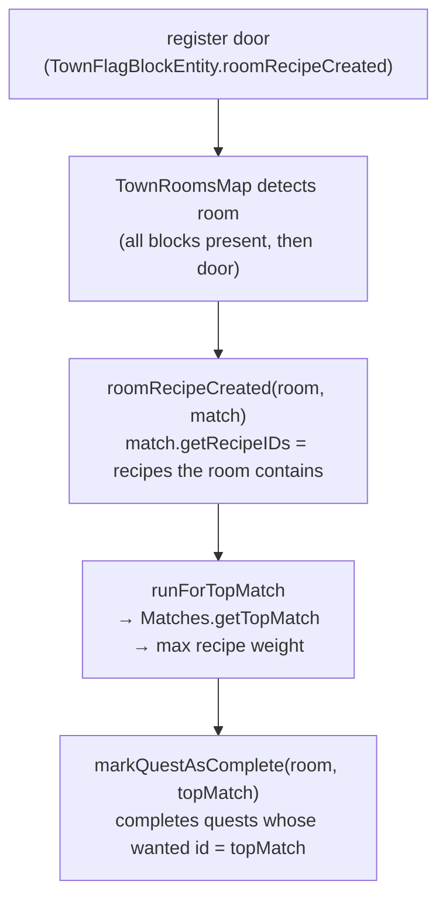
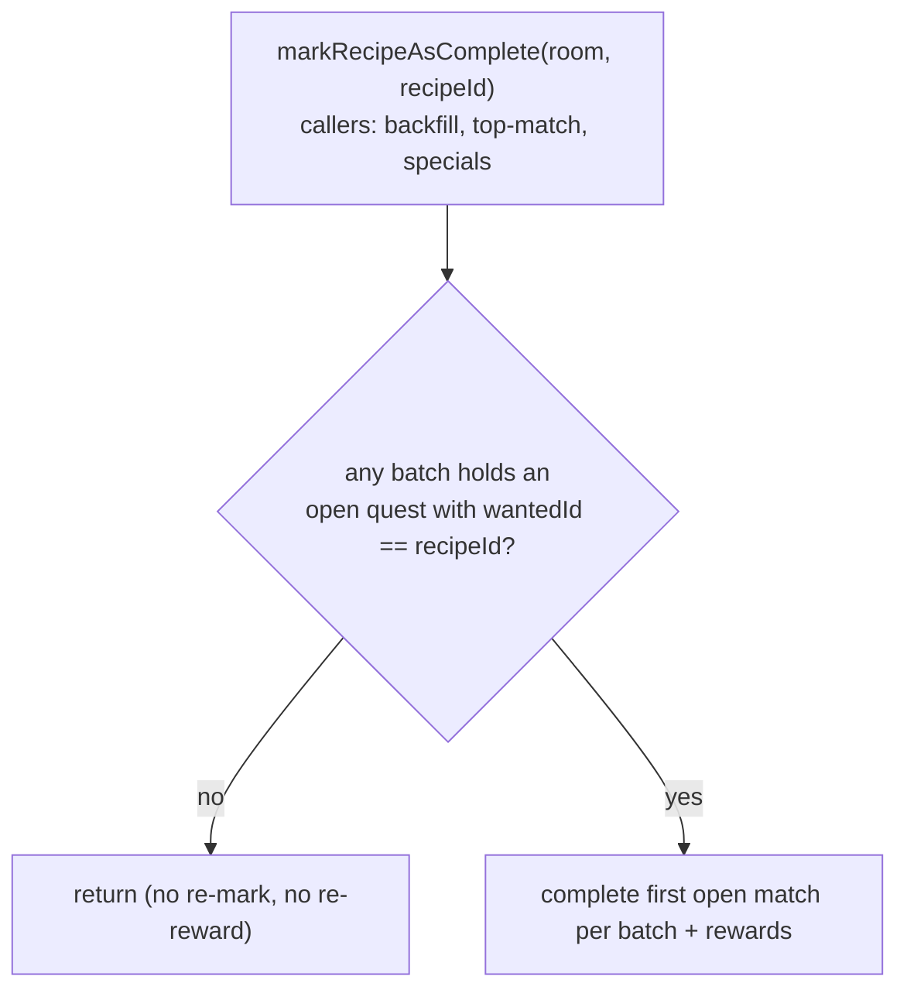
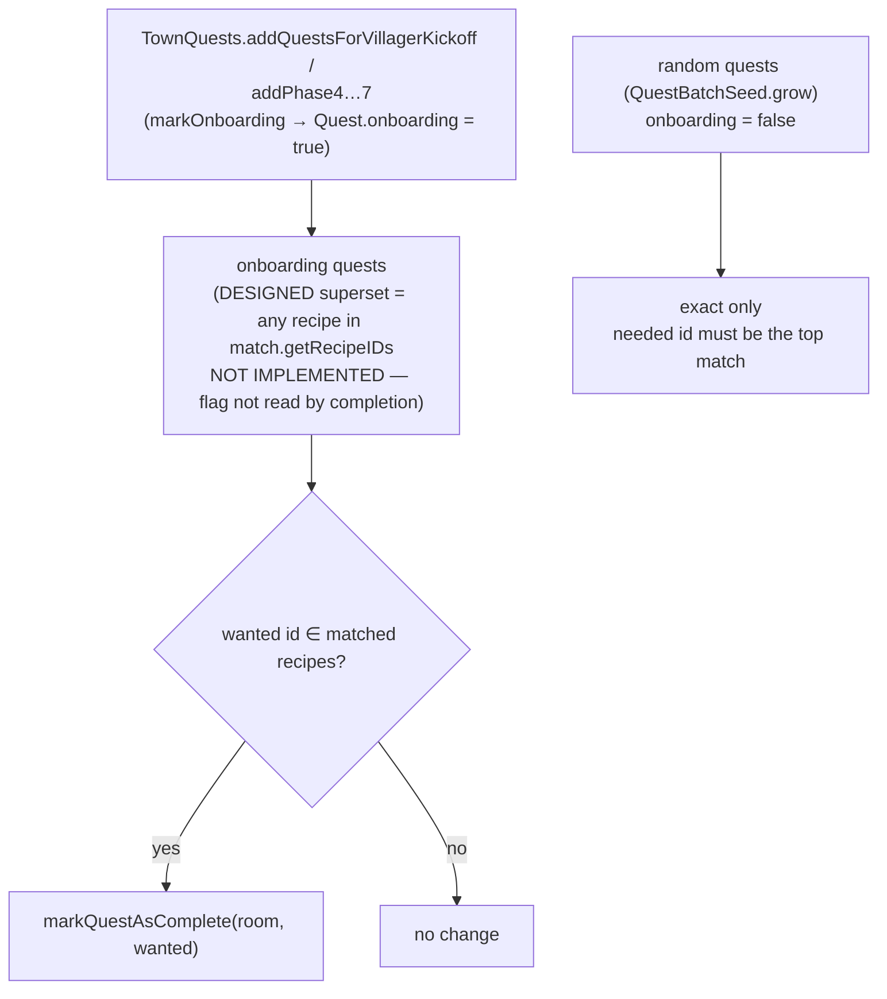
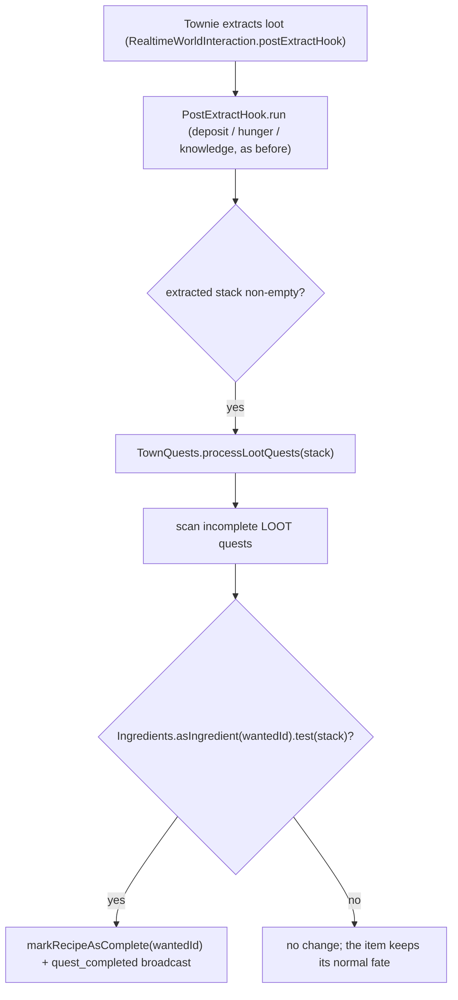

# Quest completion — top match, and the onboarding superset path

Room quests complete on the **recipe id** a room matches, not on the room. A
room can match several recipes at once (a "contains" superset test:
`NoMCRomRecipe.foundMatchRecipe`), so `getTopMatch` picks exactly one — the
highest-weight recipe — and that recipe is the room's identity. Completion
routes through that single top match, which is why the storeroom tiers are the
only recipes where one room can satisfy several quests at once.

## Top match (the rule)

- **Top match = the most elaborate recipe the room contains.** Storeroom tiers
  share the `forge:chests` tag, so weight scales with chest count and a 6-chest
  room's top match is always `store_room_huge`. `getTopMatch` is used for
  completion, messages, the `FirstJobBlock` advancement, and upgrade conversion
  (`roomRecipeChanged` → `markRecipeAsConverted`).
- **Completion is keyed on the recipe id, not the room.** `QuestBatch.markRecipeAsComplete`
  matches `getWantedId`, so completing one recipe and then another can never
  complete the same quest twice — which is what makes the superset path below
  safe alongside the top-match path.
- **Track/dedup quests by `getWantedId()` (recipe id), never by `getBatchUUID()`.**
  A `MCQuestBatch` carries *several* quests (e.g. the kickoff batch holds
  `job_board`, `store_room`, and `town_gate` under one batch UUID), so the batch
  UUID is shared across them. Keying a "done" set on the batch UUID marks every
  quest in the batch done after the first one completes. The recipe id is the
  per-quest identity; the batch UUID is the grouping.

## The `empty_room` wildcard is weight 0 on purpose

`questown:empty_room` (the D#2 "build any room" early quest) is a
zero-ingredient recipe, so it matches any room and its cost sums to 0
(`QuestBatchSeed.computeQuestCost`). The 0 is load-bearing: at the default
item weight (100) it would tie every real room recipe's cost, and
`Stream.max` keeps the first on a tie - stream order, not merit (the same
tie that makes the board's synthetic `block_room/...` recipe win, see
town/entity/COMPLEX.md "on the spot"). Weight 0 makes it the loser of every
tie, so a real recipe always wins the top match. `computeQuestCost`
therefore warns "Recipe weight is 0" only for NON-empty recipes (commit
c4934342).

## Startup double-fill guard (`QuestBatches.markRecipeAsComplete`)

The aggregate's `markRecipeAsComplete(room, recipeId)` (used by backfill, the
top-match completion, and the campfire/town-gate specials) returns early **only
when no batch holds an open quest for this recipe**. That is the surviving
intent of the 2023 startup double-fill guard (commit `96a74471`, "Make sure
room recipes don't get double-filled on server start"): re-announcing a room
recipe with nothing open must not re-mark or re-reward. The guard's old form
returned when *any* quest for this recipe had been completed on this room —
which, because room objects keep their identity across rescans, bounced
re-issued quests against their own earlier completions and stalled the
`kitchen_stocked` chain (2026-10-10).

- `room` may be `null` (backfill/specials) — the open-quest check is room-agnostic.
- Per-batch matching is still keyed on `getWantedId()` only; the guard adds
  no room equality of any kind.
- Regression tests: `QuestBatchesTest.markRecipeAsComplete_completesOpenQuest_evenWhenSameRoomAndRecipeWereCompletedBefore`
  (open quest completes despite a prior completion on the same room) and
  `markRecipeAsComplete_hasNoEffect_whenNoOpenQuestRemainsForRecipe`
  (the 2023 intent: no re-mark when all complete).

## Onboarding flag: stored but not wired (as of 2026-09-07)

Randomly generated quests keep exact matching ("the villagers want this
specific room"). Onboarding quests (the tutorial phases and the kickoff batch,
all built in `TownQuests`) are flagged `onboarding` — but **that flag is not
read by the completion path.** It is set in `TownQuests.markOnboarding` and
carried through `completed()` / `lost()` / NBT, but `isOnboarding()` is read
only in `MCQuest` for NBT serialization, never in `QuestBatch.markRecipeAsComplete`
or `roomRecipeCreated`. The superset-completion described below is **not
implemented**; it is the design the closed issue
`.scratch/storeroom-quest-completion/storeroom-quest-superset-completion.md`
recorded, and it still needs wiring. Treat the flag as a dead field until a
commit actually gates completion on it.

What completion *does* do today is **exact-match on the room's top match**, and
only on a **re-detection** — see `commands/test/COMPLEX.md` "Room-recipe quests
complete on *re-detection*, not the initial door scan". The tutorial-batch room
quests (`store_room`, `job_board`, `town_gate`) complete there, not via any
superset path. The superset design below is the intended-but-unbuilt behaviour:

- **The gate would be `onboarding`, not the recipe id** (design intent). The
  same `store_room` id can be an onboarding quest (superset) or a random quest
  (exact); only the flag differs. Today the flag has no effect.
- **Superset set = the storeroom chain** (`store_room`, `medium`, `big`,
  `huge`, `warehouse`, `storeage_facility`), not "any room with `forge:chests`"
  — that would also match `armory`, `range`, `kitchen_stocked`,
  `bakery_stocked`.
- **Upgrade quests are onboarding too.** The phase 6 quest
  (`store_room → store_room_medium`) is satisfied by a `big`/`huge` room (which
  contains `medium`), unlocking phase 7.
- A unit test drives the mechanism (match the room's recipe IDs against each
  onboarding quest's wanted id, complete on match) through
  `markQuestAsComplete`; the full `roomRecipeCreated` path needs a live world
  and is covered by play-test.

## Deferred: superset-present UI

The quest UI should show **"a superset of this room exists, but not this exact
room"** as a distinct status from active / completed / lost. Deferred to a
later change; it needs a new `QuestStatus` and rendering in the flag's quest
tab (`TownQuestsContainer`).

## LOOT quests — completion on extraction, not chest deposit

Item quests come in two contracts. An `ITEM` quest completes when the wanted
item is **deposited in a store-room chest** (`processItemQuests`). A `LOOT`
quest completes the moment a townie **extracts** matching loot from their job
— no deposit, no accumulation, first match wins. The raw-food onboarding quest
(`#questown:villager_simple_furnace_food_raw`) is a LOOT quest.

- **Matching goes through `Ingredients.asIngredient(wantedId)`** — an item id
  resolves to a single-item ingredient, a tag id to a tag ingredient. LOOT
  quests want a tag, so any tag member (mutton, porkchop, beef, …) satisfies
  the quest. `ITEM` quest matching uses the same resolution
  (`questMatchesStack`), so an ITEM quest with a tag want matches its members
  too.
- **The hook runs after the extract path, not instead of it.**
  `PostExtractHook.run` decides the item's fate (deposit, hunger, knowledge)
  first; quest completion is a side observation on the already-extracted stack
  and never consumes it.
- **The chest path never sees LOOT quests.** `QuestBatches.processItemQuests`
  filters to `type == ITEM`, so the extraction hook is the only completion
  route for a LOOT quest — a LOOT quest going COMPLETED is, by construction,
  proof the extraction path fired.

## JOB_UNLOCK quests — a different completion trigger

`JOB_UNLOCK` quests (the "a townie can't find work" diagnostic, posted by
`TownQuests` when a root sits stuck in `UNMET_ITEM` past a grace) complete on
neither of the triggers above: **no room match and no item deposit**. They
complete when some townie *unlocks the wanted root job*
(`TownQuests.processJobUnlocks`) and are lost when the stuck state clears. The
state machine (grace, onboarding gate, dedupe, loss) is mapped in
`town/entity/COMPLEX.md`, "Stuck townie -> JOB_UNLOCK quest".

# Quest garden bed-posting — shortfall-aware, not one-per-batch

`AbstractQuestGarden.doGrow` posts the next quest each grow tick. Bed satisfaction was
previously a boolean (`hasEnoughBeds`): when it was false the garden posted **one** bed
quest and the `hasBedAlready(batch)` guard kept it from posting another in the same
batch, so covering N missing beds took N separate batches. With 2 villagers the town
sat under-bedded (day-1 playtest: "we have two villagers but only one bedroom quest").

Fix: the garden is now **shortfall-aware**. `grow`/`doGrow` take `Supplier<Integer>
missingBeds` instead of `Supplier<Boolean> hasEnoughBeds` (0 = enough, N = how many more
complete beds are needed). `doGrow` posts a bed quest each tick while
`bedQuestCount(batch) < missingBeds`, then switches to room quests once the batch covers
the shortfall. `hasBedAlready` (boolean) was replaced by `bedQuestCount` (int). The
shortfall comes from `TownRoomsHandle.missingBeds(numVillagers)` =
`max(0, villagers - bedBlocks/2)`, surfaced via `TownFlagBlockEntity.missingBeds()` /
`TownInterface.missingBeds()`. Bed satisfaction itself (`beds/2 >= villagers`) is
unchanged. Pinned by `QuestGardenTest.testShouldAcceptMultipleBeds_UntilShortfallCovered`
and `testShouldAcceptOneBedPerGrowTick_WhenOnlyOneMissing`.

Ticket: `.scratch/day1-playtest-2026-10-11/bedroom-quests-under-posted.md`.

## Quest type is load-bearing; world-load rebuild must preserve it (2026-10-14)

A quest's `QuestType` (not just its `wantedId`) drives the card name, the icon strip, the
completion trigger, and the day-2 completion check (`markFirstWorkRequestCompleteIfActive`
skips any quest that is not `FIRST_WORK_REQUEST`). `QuestBatches.initialize ->
filterOutDuplicateCompletion` rebuilds every quest on world load through a type switch; the
`FIRST_WORK_REQUEST` and `CONCURRENT_JOBS` cases used to route through the generic
`addNewQuest`, which mints a `ROOM`-typed recipe quest. Consequences (user playtest,
2026-10-14): the day-2 card showed the raw id `questown:special_quest.first_work_request`
(ROOM path = `RoomRecipes.getName(wantedId)`, no lang key), a "No recipe found for quest"
WARN on every quests-tab open, and the quest could never complete. `CONCURRENT_JOBS` was
silently worse: its job list lives in `MCQuest.concurrentJobIdsEncoded` (outside the wanted
id), so the rebuild lost the job ids entirely.

Fix: dedicated factory methods (`QuestFactory.newFirstWorkRequestQuest` /
`newConcurrentJobsQuest` + `QuestBatch.addFirstWorkRequestQuest` /
`addConcurrentJobsQuest`) that the rebuild switch now calls, plus a base
`Quest.getConcurrentJobIds() = empty` (MCQuest overrides from the encoded field) so the
generic path can ask any quest for its job list without a cast. Pinned by
`QuestBatchesInitializeTypeTest` (red-verified: both asserts fail on the pre-fix switch).
