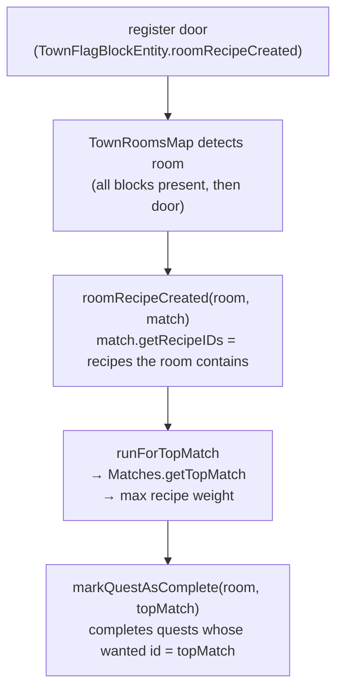
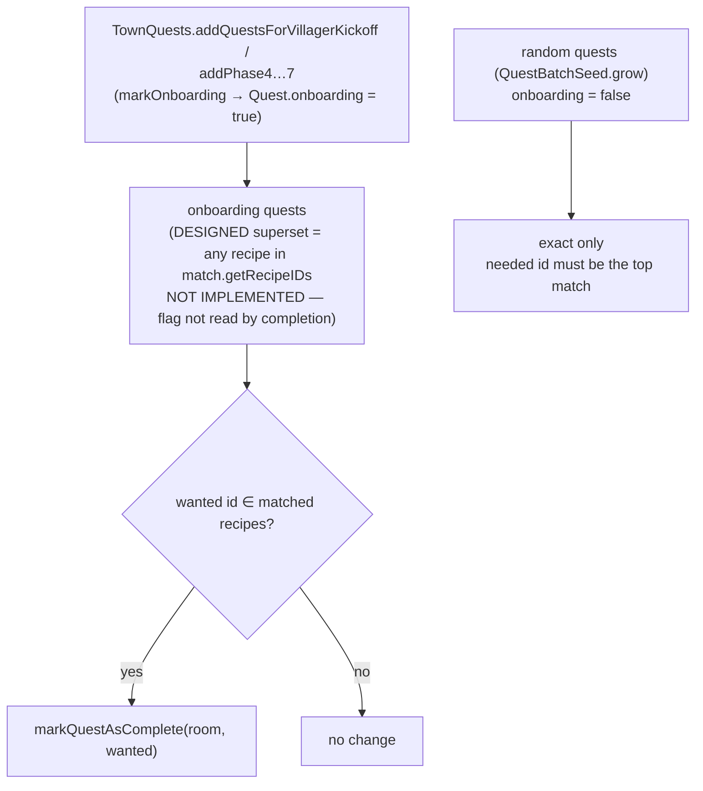

# Quest completion — top match, and the onboarding superset path

Room quests complete on the **recipe id** a room matches, not on the room. A
room can match several recipes at once (a "contains" superset test:
`NoMCRomRecipe.foundMatchRecipe`), so `getTopMatch` picks exactly one — the
highest-weight recipe — and that recipe is the room's identity. Completion
routes through that single top match, which is why the storeroom tiers are the
only recipes where one room can satisfy several quests at once.

## Top match (the rule)

- **Top match = the most elaborate recipe the room contains.** Storeroom tiers
  share the `forge:chests` tag, so weight scales with chest count and a 6-chest
  room's top match is always `store_room_huge`. `getTopMatch` is used for
  completion, messages, the `FirstJobBlock` advancement, and upgrade conversion
  (`roomRecipeChanged` → `markRecipeAsConverted`).
- **Completion is keyed on the recipe id, not the room.** `QuestBatch.markRecipeAsComplete`
  matches `getWantedId`, so completing one recipe and then another can never
  complete the same quest twice — which is what makes the superset path below
  safe alongside the top-match path.
- **Track/dedup quests by `getWantedId()` (recipe id), never by `getBatchUUID()`.**
  A `MCQuestBatch` carries *several* quests (e.g. the kickoff batch holds
  `job_board`, `store_room`, and `town_gate` under one batch UUID), so the batch
  UUID is shared across them. Keying a "done" set on the batch UUID marks every
  quest in the batch done after the first one completes. The recipe id is the
  per-quest identity; the batch UUID is the grouping.

## Onboarding flag: stored but not wired (as of 2026-09-07)

Randomly generated quests keep exact matching ("the villagers want this
specific room"). Onboarding quests (the tutorial phases and the kickoff batch,
all built in `TownQuests`) are flagged `onboarding` — but **that flag is not
read by the completion path.** It is set in `TownQuests.markOnboarding` and
carried through `completed()` / `lost()` / NBT, but `isOnboarding()` is read
only in `MCQuest` for NBT serialization, never in `QuestBatch.markRecipeAsComplete`
or `roomRecipeCreated`. The superset-completion described below is **not
implemented**; it is the design the closed issue
`.scratch/storeroom-quest-completion/storeroom-quest-superset-completion.md`
recorded, and it still needs wiring. Treat the flag as a dead field until a
commit actually gates completion on it.

What completion *does* do today is **exact-match on the room's top match**, and
only on a **re-detection** — see `commands/test/COMPLEX.md` "Room-recipe quests
complete on *re-detection*, not the initial door scan". The tutorial-batch room
quests (`store_room`, `job_board`, `town_gate`) complete there, not via any
superset path. The superset design below is the intended-but-unbuilt behaviour:

- **The gate would be `onboarding`, not the recipe id** (design intent). The
  same `store_room` id can be an onboarding quest (superset) or a random quest
  (exact); only the flag differs. Today the flag has no effect.
- **Superset set = the storeroom chain** (`store_room`, `medium`, `big`,
  `huge`, `warehouse`, `storeage_facility`), not "any room with `forge:chests`"
  — that would also match `armory`, `range`, `kitchen_stocked`,
  `bakery_stocked`.
- **Upgrade quests are onboarding too.** The phase 6 quest
  (`store_room → store_room_medium`) is satisfied by a `big`/`huge` room (which
  contains `medium`), unlocking phase 7.
- A unit test drives the mechanism (match the room's recipe IDs against each
  onboarding quest's wanted id, complete on match) through
  `markQuestAsComplete`; the full `roomRecipeCreated` path needs a live world
  and is covered by play-test.

## Deferred: superset-present UI

The quest UI should show **"a superset of this room exists, but not this exact
room"** as a distinct status from active / completed / lost. Deferred to a
later change; it needs a new `QuestStatus` and rendering in the flag's quest
tab (`TownQuestsContainer`).
