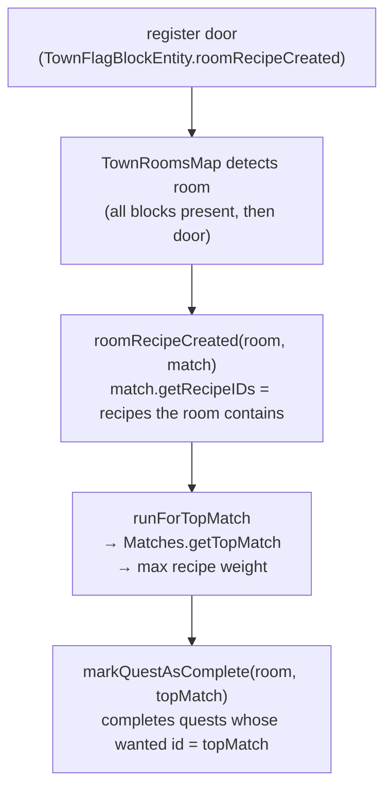
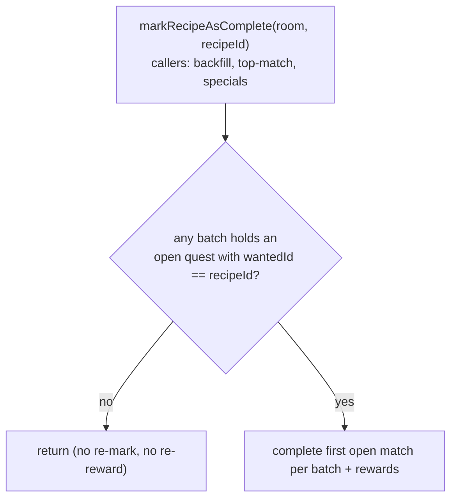
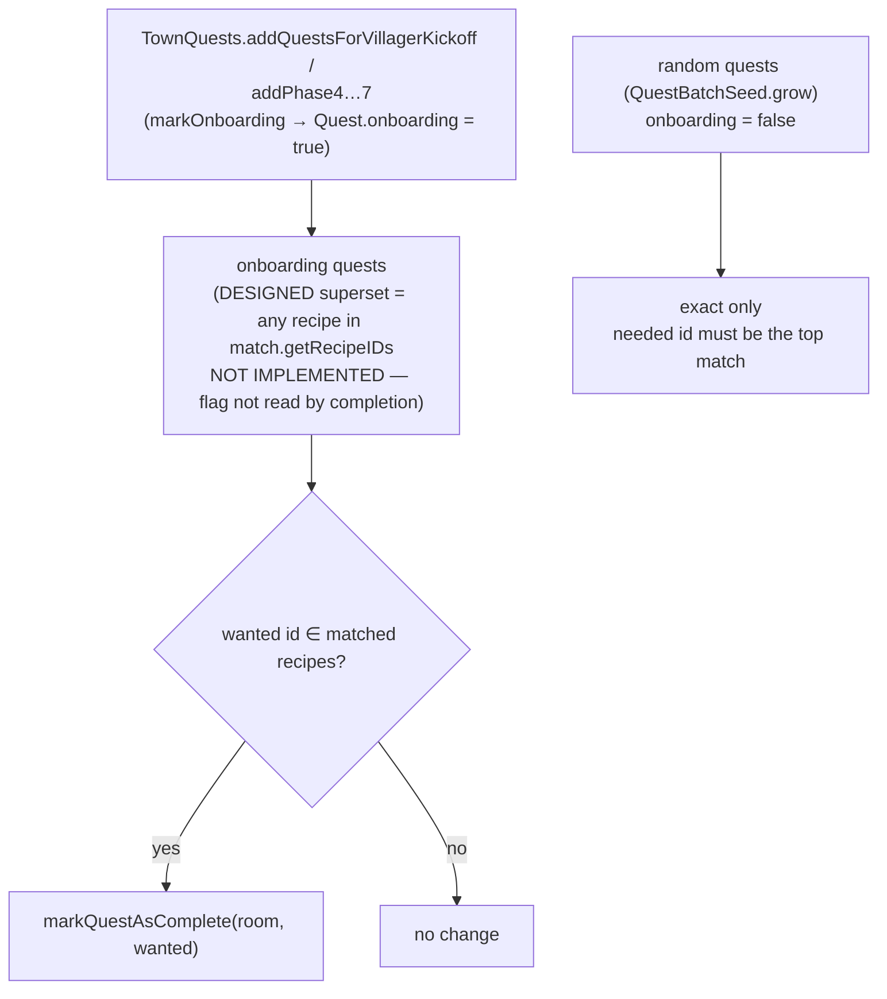
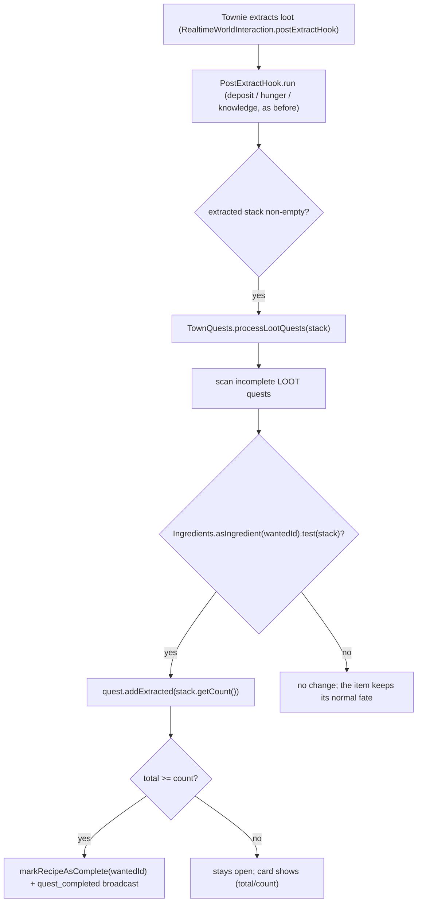

# Quest completion — top match, and the onboarding superset path

Room quests complete on the **recipe id** a room matches, not on the room. A
room can match several recipes at once (a "contains" superset test:
`NoMCRomRecipe.foundMatchRecipe`), so `getTopMatch` picks exactly one — the
highest-weight recipe — and that recipe is the room's identity. Completion
routes through that single top match, which is why the storeroom tiers are the
only recipes where one room can satisfy several quests at once.

## Top match (the rule)

- **Top match = the most elaborate recipe the room contains.** Storeroom tiers
  share the `forge:chests` tag, so weight scales with chest count and a 6-chest
  room's top match is always `store_room_huge`. `getTopMatch` is used for
  completion, messages, the `FirstJobBlock` advancement, and upgrade conversion
  (`roomRecipeChanged` → `markRecipeAsConverted`).
- **Completion is keyed on the recipe id, not the room.** `QuestBatch.markRecipeAsComplete`
  matches `getWantedId`, so completing one recipe and then another can never
  complete the same quest twice — which is what makes the superset path below
  safe alongside the top-match path.
- **Track/dedup quests by `getWantedId()` (recipe id), never by `getBatchUUID()`.**
  A `MCQuestBatch` carries *several* quests (e.g. the kickoff batch holds
  `job_board`, `store_room`, and `town_gate` under one batch UUID), so the batch
  UUID is shared across them. Keying a "done" set on the batch UUID marks every
  quest in the batch done after the first one completes. The recipe id is the
  per-quest identity; the batch UUID is the grouping.

## The `empty_room` wildcard is weight 0 on purpose

`questown:empty_room` (the D#2 "build any room" early quest) is a
zero-ingredient recipe, so it matches any room and its cost sums to 0
(`QuestBatchSeed.computeQuestCost`). The 0 is load-bearing: at the default
item weight (100) it would tie every real room recipe's cost, and
`Stream.max` keeps the first on a tie - stream order, not merit (the same
tie that makes the board's synthetic `block_room/...` recipe win, see
town/entity/COMPLEX.md "on the spot"). Weight 0 makes it the loser of every
tie, so a real recipe always wins the top match. `computeQuestCost`
therefore warns "Recipe weight is 0" only for NON-empty recipes (commit
c4934342).

## Startup double-fill guard (`QuestBatches.markRecipeAsComplete`)

The aggregate's `markRecipeAsComplete(room, recipeId)` (used by backfill, the
top-match completion, and the campfire/town-gate specials) returns early **only
when no batch holds an open quest for this recipe**. That is the surviving
intent of the 2023 startup double-fill guard (commit `96a74471`, "Make sure
room recipes don't get double-filled on server start"): re-announcing a room
recipe with nothing open must not re-mark or re-reward. The guard's old form
returned when *any* quest for this recipe had been completed on this room —
which, because room objects keep their identity across rescans, bounced
re-issued quests against their own earlier completions and stalled the
`kitchen_stocked` chain (2026-10-10).

- `room` may be `null` (backfill/specials) — the open-quest check is room-agnostic.
- Per-batch matching is still keyed on `getWantedId()` only; the guard adds
  no room equality of any kind.
- Regression tests: `QuestBatchesTest.markRecipeAsComplete_completesOpenQuest_evenWhenSameRoomAndRecipeWereCompletedBefore`
  (open quest completes despite a prior completion on the same room) and
  `markRecipeAsComplete_hasNoEffect_whenNoOpenQuestRemainsForRecipe`
  (the 2023 intent: no re-mark when all complete).

## Load-time replay: `markRecipeAsCompleteForReplay` (no reward claim)

On every flag load, `MCQuestBatches.SERIALIZER.deserializeNBT` rebuilds each
persisted batch (`new MCQuestBatch()` + `initialize(batchUUID, allQuests,
reward)`, reward restored WITH its `reward_applied` flag) and
`QuestBatches.initialize` -> `filterOutDuplicateCompletion` re-marks every
persisted completed quest. That re-mark must use
`QuestBatch.markRecipeAsCompleteForReplay`, NOT `markRecipeAsComplete`:
completion and reward application are synchronous, so "quest complete on
disk" implies "reward already applied on disk" - the ordinary path's
`reward.claim()` at batch-close would trip the once-guard on every load of a
post-onboarding world (the 2026-10-13 playtest noise: 3x ERROR "Refusing to
apply reward more than once" + 3x stale WARN "instant-type reward loaded
from disk", the latter removed from `MCInstantReward`'s deserializer ctor as
it was the normal state). The replay variant re-marks the quest and fires
NO listener events (no `questCompleted`/`questBatchCompleted` - so no chat
broadcast and no `completedProceduralBatches` increment on load; that
counter is NBT-persisted separately). Also removed here: a vestigial
`ImmutableList.Builder eqb` in `filterOutDuplicateCompletion` that was built
but never read. Regression test:
`QuestBatchesLoadReplayTest.loadReplay_completedBatch_remarksQuest_withoutReclaimingReward`
(RED-verified pre-fix: the second `claim()` attempt, `expected: <1> but was:
<2>`, plus the guard's own ERROR line in the test log).

## Onboarding flag: stored but not wired to completion (as of 2026-09-07)

Randomly generated quests keep exact matching ("the villagers want this
specific room"). Onboarding quests (the tutorial phases and the kickoff batch,
all built in `TownQuests`) are flagged `onboarding` — but **that flag is not
read by the completion path.** It is set in `TownQuests.markOnboarding` and
carried through `completed()` / `lost()` / NBT, but `isOnboarding()` is never
read in `QuestBatch.markRecipeAsComplete`
or `roomRecipeCreated`. The superset-completion described below is **not
implemented**; it is the design the closed issue
`.scratch/storeroom-quest-completion/storeroom-quest-superset-completion.md`
recorded, and it still needs wiring. Treat the flag as dead **for completion**
until a commit actually gates completion on it.

**Two non-completion readers exist (do not treat the flag as wholly dead):**
`TownQuests.onboardingJobChangeGuarantee` (ruling D, 2026-10-13 — an open
onboarding JOB_CHANGE quest's root fills the BOP-spend guarantee slot) and
the `onboardingDriving` gate that suppresses JOB_UNLOCK posts while
onboarding assigns jobs. This is why **every** tutorial-phase batch must
`markOnboarding` - the 2026-10-14 playtest regression (pre-roll fisher beat
the intended first hunter) was exactly `addHunterGatherer` missing the call;
pinned by `TownQuestsHunterGathererOnboardingTest`.

What completion *does* do today is **exact-match on the room's top match**, and
only on a **re-detection** — see `commands/test/COMPLEX.md` "Room-recipe quests
complete on *re-detection*, not the initial door scan". The tutorial-batch room
quests (`store_room`, `job_board`, `town_gate`) complete there, not via any
superset path. The superset design below is the intended-but-unbuilt behaviour:

- **The gate would be `onboarding`, not the recipe id** (design intent). The
  same `store_room` id can be an onboarding quest (superset) or a random quest
  (exact); only the flag differs. Today the flag has no effect.
- **Superset set = the storeroom chain** (`store_room`, `medium`, `big`,
  `huge`, `warehouse`, `storeage_facility`), not "any room with `forge:chests`"
  — that would also match `armory`, `range`, `kitchen_stocked`,
  `bakery_stocked`.
- **Upgrade quests are onboarding too.** The phase 6 quest
  (`store_room → store_room_medium`) is satisfied by a `big`/`huge` room (which
  contains `medium`), unlocking phase 7.
- A unit test drives the mechanism (match the room's recipe IDs against each
  onboarding quest's wanted id, complete on match) through
  `markQuestAsComplete`; the full `roomRecipeCreated` path needs a live world
  and is covered by play-test.

## Deferred: superset-present UI

The quest UI should show **"a superset of this room exists, but not this exact
room"** as a distinct status from active / completed / lost. Deferred to a
later change; it needs a new `QuestStatus` and rendering in the flag's quest
tab (`TownQuestsContainer`).

## LOOT quests — completion on extraction, accumulating to the count

Item quests come in two contracts. An `ITEM` quest completes when the wanted
item is **deposited in a store-room chest** (`processItemQuests`). A `LOOT`
quest accumulates on every **extraction** of matching loot: each extraction
credits the quest's extracted total (persisted with the quest) and the quest
completes once the total reaches its count (2026-10-15 ruling, reversing the
2026-10-04 close-on-first-extraction; a count-1 quest keeps that behaviour,
1 >= 1). No deposit required. The raw-food onboarding quest
(`#questown:villager_simple_furnace_food_raw`, count 1) is a LOOT quest.

- **Matching goes through `Ingredients.asIngredient(wantedId)`** — an item id
  resolves to a single-item ingredient, a tag id to a tag ingredient. LOOT
  quests want a tag, so any tag member (mutton, porkchop, beef, …) satisfies
  the quest. `ITEM` quest matching uses the same resolution
  (`questMatchesStack`), so an ITEM quest with a tag want matches its members
  too.
- **The hook runs after the extract path, not instead of it.**
  `PostExtractHook.run` decides the item's fate (deposit, hunger, knowledge)
  first; quest completion is a side observation on the already-extracted stack
  and never consumes it.
- **The chest path never sees LOOT quests.** `QuestBatches.processItemQuests`
  filters to `type == ITEM`, so the extraction hook is the only completion
  route for a LOOT quest — a LOOT quest going COMPLETED is, by construction,
  proof the extraction path fired.

## JOB_UNLOCK quests — a different completion trigger

`JOB_UNLOCK` quests (the "a townie can't find work" diagnostic, posted by
`TownQuests` when a root sits stuck in `UNMET_ITEM` past a grace) complete on
neither of the triggers above: **no room match and no item deposit**. They
complete when some townie *unlocks the wanted root job*
(`TownQuests.processJobUnlocks`) and are lost when the stuck state clears. The
state machine (grace, onboarding gate, dedupe, loss) is mapped in
`town/entity/COMPLEX.md`, "Stuck townie -> JOB_UNLOCK quest".

# Quest garden bed-posting — shortfall-aware, not one-per-batch

`AbstractQuestGarden.doGrow` posts the next quest each grow tick. Bed satisfaction was
previously a boolean (`hasEnoughBeds`): when it was false the garden posted **one** bed
quest and the `hasBedAlready(batch)` guard kept it from posting another in the same
batch, so covering N missing beds took N separate batches. With 2 villagers the town
sat under-bedded (day-1 playtest: "we have two villagers but only one bedroom quest").

Fix: the garden is now **shortfall-aware**. `grow`/`doGrow` take `Supplier<Integer>
missingBeds` instead of `Supplier<Boolean> hasEnoughBeds` (0 = enough, N = how many more
complete beds are needed). `doGrow` posts a bed quest each tick while
`bedQuestCount(batch) < missingBeds`, then switches to room quests once the batch covers
the shortfall. `hasBedAlready` (boolean) was replaced by `bedQuestCount` (int). The
shortfall comes from `TownRoomsHandle.missingBeds(numVillagers)` =
`max(0, villagers - bedBlocks/2)`, surfaced via `TownFlagBlockEntity.missingBeds()` /
`TownInterface.missingBeds()`. Bed satisfaction itself (`beds/2 >= villagers`) is
unchanged. Pinned by `QuestGardenTest.testShouldAcceptMultipleBeds_UntilShortfallCovered`
and `testShouldAcceptOneBedPerGrowTick_WhenOnlyOneMissing`.

Ticket: `.scratch/day1-playtest-2026-10-11/bedroom-quests-under-posted.md`.

## Quest type is load-bearing; world-load rebuild must preserve it (2026-10-14)

A quest's `QuestType` (not just its `wantedId`) drives the card name, the icon strip, the
completion trigger, and the day-2 completion check (`markFirstWorkRequestCompleteIfActive`
skips any quest that is not `FIRST_WORK_REQUEST`). `QuestBatches.initialize ->
filterOutDuplicateCompletion` rebuilds every quest on world load through a type switch; the
`FIRST_WORK_REQUEST` and `CONCURRENT_JOBS` cases used to route through the generic
`addNewQuest`, which mints a `ROOM`-typed recipe quest. Consequences (user playtest,
2026-10-14): the day-2 card showed the raw id `questown:special_quest.first_work_request`
(ROOM path = `RoomRecipes.getName(wantedId)`, no lang key), a "No recipe found for quest"
WARN on every quests-tab open, and the quest could never complete. `CONCURRENT_JOBS` was
silently worse: its job list lives in `MCQuest.concurrentJobIdsEncoded` (outside the wanted
id), so the rebuild lost the job ids entirely.

Fix: dedicated factory methods (`QuestFactory.newFirstWorkRequestQuest` /
`newConcurrentJobsQuest` + `QuestBatch.addFirstWorkRequestQuest` /
`addConcurrentJobsQuest`) that the rebuild switch now calls, plus a base
`Quest.getConcurrentJobIds() = empty` (MCQuest overrides from the encoded field) so the
generic path can ask any quest for its job list without a cast. Pinned by
`QuestBatchesInitializeTypeTest` (red-verified: both asserts fail on the pre-fix switch).

**The type does not take part in matching, though: a wanted id must be unique within its batch.**
`QuestBatch.markRecipeAsComplete` and the load replay match on wanted id alone and take the first
open match. Two quest types in one batch that share an id (a JOB_CHANGE and a SKILL_UNLOCK both
on `cook_qt_extract`, 2026-10-25) can close each other. Give a new quest type its own id space
(`questown:skill_unlock/<root>`, see "SKILL_UNLOCK" below).

## A complete quest is perma-done: `markRecipeAsLost` skips it (2026-10-14)

`QuestBatch.markRecipeAsLost(oldRoom, recipeID)` matched the quest by
`oldRoom.equals(q.completedOn) && recipeID.equals(q.getWantedId())` with no status
check. Playtest (server-18 03:47:37): the empty-room quest had just completed, then
the player put a chest in that same room and re-wand-registered it - the room re-typed
`empty_room` → `store_room`, and the room-change path called `markRecipeAsLost` on the
old room. The COMPLETED quest was lost ("Quest lost: Empty Room" on a perma-done
quest), the lost placeholder re-completed the same tick, and the batch reward fired
again (rejected by the once-guard: "Refusing to apply reward more than once"). The
campfire quest only looked immune because its block room never re-types. Fix: the
match adds `&& !q.isComplete()`. Pinned by
`QuestBatchesTest.markRecipeAsLost_doesNotLoseAnAlreadyCompleteQuest` (red-verified
against the pre-fix matcher via a stashed variant).

## Post-cook miner beat (phase 2.7, 2026-10-14 playtest)

The fixed onboarding step between the cook beat (2.5) and the need-driven
top-need batch (2.75): when two job changes have completed (hunter + cook),
3+ townies exist, and NO JOB_CHANGE is open, `TownQuests.tryPhase2_7_miner`
posts the miner batch (`addMiner`): JOB_CHANGE(miner/coal) + 4 wooden
pickaxes + 8 coal + the miner's room (mineshaft). It is markOnboarding-flagged
so the open miner JOB_CHANGE fills the BOP-spend guarantee slot (the same
mechanism as the hunter/cook beats; `TownQuestsMinerOnboardingTest` pins the
flag + the guarantee). The reward rides `PHASE_MINER` ->
`defaultQuestCompletionRewards` (BOP + next villager), same as the other
post-kickoff phases. The coal pain the beat answers: the kitchen makes coal
the town's top need the moment it starts feeding, so the need-driven
top-need batch below it now picks up whichever need is NOT coal.
`TutorialPhaseGateTest` walks the full ladder through the miner beat (the
phase-ladder helpers post + complete it so later phases still advance).

**Posted once (2026-10-22 agent playtest).** The phase had no "already posted"
check: after the beat completed, every batch request (`questRequests`, which
`tick` hands to `addTutorialBatches` first) re-posted it. The town already had
the mineshaft, pickaxes, coal and a miner, so per-tick backfill closed each copy
at once and its `PHASE_MINER` reward brought another villager with another
request: 3 -> 11 -> 18 villagers over two mornings, and the later phases (2.75
on) never ran. `minerBeatPosted()` (any JOB_CHANGE for `ONBOARDING_MINER_JOB`)
now returns `null`, the same hand-off as the in-flight case. Pinned by
`TutorialPhaseGateTest.whenMinerBeatDone_itIsNotPostedAgain`; the
`questsWithTwoJobChangesDone` helper lost its extra walk, which the replay used
to absorb and which now posts the crafter phase.

## SKILL_UNLOCK: the cook batch asks for a cook skill (2026-10-25)

Dev ask: onboarding asks the player to unlock any skill on the cook's skill tree, which teaches
skill unlocking with a Block of Progress. It is a new quest type, `SKILL_UNLOCK`. It first rode
the miner batch. The same day, after the r19 playtest, the dev moved it into the cook batch
(`addQuestsForJobChangeAndFood`), beside Cooked Food x8, because it helps fill that quest: the
onboarding cook knows only mutton, and a second recipe cooks the hunter's other raw meat. The
cook can take a skill once its first meals level it (skills unlock from level 2,
`Work.DEFAULT_AVAILABLE_AT_LEVEL`).

**Split out of the cook batch (r20, 2026-10-25).** Dev: "The cook's batch is too bulky. The
'food x 8' and 'unlock a cook skill' quests should not show up until the cook itself has been
unlocked." The cook batch (`addQuestsForJobChangeAndFood`) now holds the cook JOB_CHANGE, the
small kitchen and the storeroom upgrade, and its reward is one Block of Progress
(`PHASE_COOK_JOB`; the cook skill costs one). Cooked Food x8, the cook skill and the
Bedroom -> Big Bedroom upgrade ride a follow-up batch (`addCookFollowUpBatch`) whose reward is
still villager 3 (`PHASE_JOB_CHANGE_FOOD`), so the miner beat (3 villagers) still waits for the
whole cook beat. `TownQuests.postCookFollowUpIfDue` runs every `tick`, because the phase ladder
only runs on a batch request: it posts the follow-up once an onboarding cook JOB_CHANGE is
complete, by any completion path, and does nothing once any onboarding cooked-food LOOT quest
exists. That also keeps an old-shape cook batch (which carried those quests) from getting a
second copy. Pinned by `TutorialPhaseGateTest.cookFollowUp_*`.

**It also waits for a cook (r22, 2026-10-26).** The JOB_CHANGE quest closes at the BOP spend, but
a non-instant root change applies the next morning, so the follow-up showed "Food 0/8" and the cook
skill to a town with no cook (dev: "They won't be a cook until morning"). `postCookFollowUpIfDue`
also needs `TutorialTownView.anyVillagerOnRoot("cook")` (the adapter reads
`VillagerHolder.getJobs()`). Onboarding changes are instant since r22 (`town/entity/COMPLEX.md`),
so in a fresh town both hold in the same tick; the gate covers any morning-applied path. Pinned by
`cookFollowUp_waitsForTheMorningJobChange`. The food quest asks for 4 (`COOKED_FOOD_COUNT`; dev r22:
"should probably only ask for 4").

**Its own wanted id: `questown:skill_unlock/<root>`.** Batch completion
(`QuestBatch.markRecipeAsComplete`) and load replay match a quest by wanted id alone and take
the first open match. The first build used the tree root's job RL (`cook_qt_extract`), the
same id as the cook batch's JOB_CHANGE quest, so completing the job change could close the
skill quest. `MCQuest.skillTreeRoot` reads the root back, and also accepts the old job-RL form
for r19 saves. The card ("Unlock a Cook skill", lang `menu.quests.skill_unlock`) and the chat
name translate `jobs.<root>`.

**Completion trigger: the player's spend only.** `UnlockJobMessage` (the skills tab's
confirm) now calls `TownFlagBlockEntity.unlockSkillFromPlayer`, which unlocks and then
calls `TownQuests.markSkillUnlocked(id)`. That closes every open SKILL_UNLOCK quest whose
root matches `id`'s root. The other unlock paths do not count: a job change's default work,
`TestExecutor` and blueprint setup all call `VillagerHolder.unlockJob` directly. That is
the same rule as the first-work-request quest, where only the player's request counts.
There is no backfill. A cook skill bought before the batch posts does not count, but the
cook tree has more nodes than a new cook's default work, so a later spend closes it.

**Flag-BOP spend for agents.** `spendBopToUnlockSkill(villager, job)` spends one of the
flag's deposited BOPs, like `spendBopToRequestJobChange`. It accepts only a node in
`VillagerHolder.getUnlockableSkills`, which is the skills tab's own set
(`TownVillagerUIsHandle.unlockableSkills`, extracted from the two `showUI` copies): known
children of the villager's job, gated by `available_at_level`. Callers are `_qtdev
unlock_skill <villager> <root/job>` and the `village/growth` driver
(`spendBopOnOpenSkillUnlock`, after the job-change spend so an open job change gets the BOP
first). The rebuild path has its own factory (`newSkillUnlockQuest`), per the section
above. Pinned by `TownQuestsSkillUnlockTest` (completion, other-root no-op, load rebuild,
`completingTheCookJobChange_leavesTheSkillQuestOpen`, and the old-id read) and
`TutorialPhaseGateTest.whenHunterDoneAndThreeVillagers_jobChangeAndFoodAdded` (the batch carries it).

## World-load replay re-claims finished batches' rewards (every load, by construction)

`QuestBatches.initialize` (the quest-deserializer's rebuild, NOT the flag
initializer chain) re-creates every batch and replays each on-disk
completed quest through `markRecipeAsComplete` — so the *last* quest of a
finished batch re-fires `reward.claim()` on the restored, already-applied
reward, and `Reward.claim()`'s once-guard logs "Refusing to apply reward
more than once" at ERROR on **every load** of a post-onboarding world
(guard works: no double spawn/posting). Completion + claim are synchronous,
so "quest complete on disk" ⇒ "reward applied on disk" always; the replay
never needs to claim. Companion noise: the `MCInstantReward` deserializer
ctor WARNs on any persisted applied instant reward ("unexpected" is stale
— normal now). Options A (quiet guard) vs B (replay path that marks
complete without claiming) + recommendation: ticket
`.scratch/day1-playtest-2026-10-11/load-time-reward-reclaim-error-noise.md`
(HOLDING on the decision; drive-by: `filterOutDuplicateCompletion`'s
`eqb` builder is vestigial, never read).

## Procedural-batch milestone ladder (1/5/10/20)

`TownQuests.questBatchCompleted` counts completed **procedural** batches on the
flag (`TownFlagBlockEntity.completedProceduralBatches`; a batch is procedural
when any member quest's wanted id is not a special-quest id — `isProceduralBatch`
in `TownQuests`; campfire/gate-type special batches never count, pinned by
`TutorialPhaseGateTest.campfireBatch_isNotProceduralBatch`). At 5/10/20 it
fires the chapter advancement triggers (`TutorialTrigger.Chapter2..4`). The
**first** batch posts no broadcast: the "Your village is thriving!" line
(`messages.tutorial.complete`) was dropped 2026-10-15 on the user's playtest
ruling — it carried no information the per-quest "Quest completed: …"
broadcasts (`TownMessages.questCompleted`) didn't already, and read as ambient
flavor (ticket `.scratch/day1-playtest-2026-10-11/village-is-thriving-message-confusing.md`).
Note the counter is also the input to `QuestBatchSeed` (quest gating below
batch 3), so it keeps incrementing from 1 even though batch 1 now does nothing.

## Load replay keeps onboarding, flavor text and LOOT progress (2026-10-17)

`QuestBatches.filterOutDuplicateCompletion` (run from `initialize` on every flag load) rebuilds
each saved batch quest-by-quest through the typed factories (`addNewQuest`, `addLootQuest`, …),
which only take type/id/count. Everything else the save carried was dropped on every reload:

- **the onboarding marker** — `TownQuests.isArrivalGateOpen` opens the arrival gate when no quest
  is onboarding, so after a real flag reload villager 2 arrived with Raw Food still open
  (village/day1, once its reload became a real unload: instrumented morning dumps showed
  `town_gate[onb=true]` before the reload and every quest `onb=false` after);
- the flavor text;
- LOOT extraction progress (`MCQuest.lootExtracted` — a count-4 raw-food quest restarted at 0).

The NBT layer was never the problem (`MCQuestOnboardingPersistenceTest` round-trips it). The
replay now calls `newestQuest().carrySavedStateFrom(saved)` after each rebuild; `Quest` copies
onboarding + flavor text, `MCQuest` adds `lootExtracted`. Pinned by `QuestBatchesLoadReplayTest`
`loadReplay_keeps{TheOnboardingMarker,TheFlavorText,LootProgress}` (all three red before).

## Only procedurally generated quest batches are discardable (2026-10-21)

The quest card's "Remove request" x discards a whole batch (`TownQuestsHandle.requestRemovalOfQuestAtIndex`
→ confirm → `doRemove`, which sets `playerDiscardedLastBatch` so the next precompiled batch arrives).
It was offered on every batched quest, including the onboarding Town Gate (even when completed).
Now `Quest.discardable` (persisted as `discardable` beside `onboarding` in `MCQuest.Serializer`,
copied by `completed()`/`lost()`/`carrySavedStateFrom`) is set only where `TownQuests.tick` hands
out a precompiled procedural batch. `UIQuest.removableBatch` sends the card a batch id only for a
discardable quest (the card uses that id for nothing else, so no x otherwise), and the server
refuses removal of a non-discardable batch. Worlds saved before this load their procedural batches
as non-discardable (no x) until replaced. Pins: `MCQuestDiscardableTest` (red against the old card:
a tutorial quest offered its batch).
