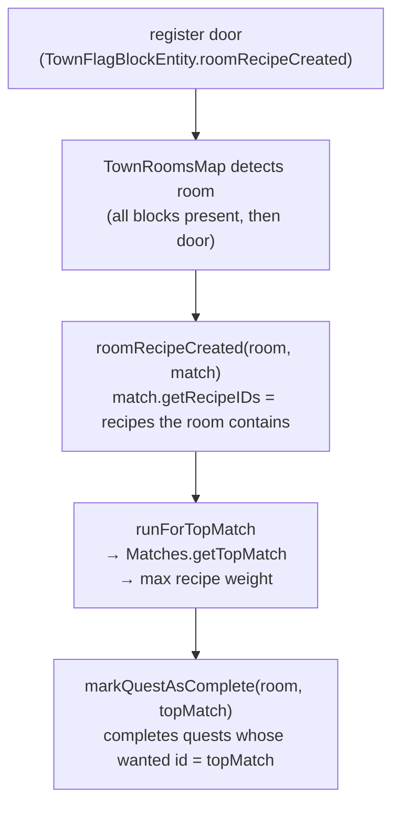
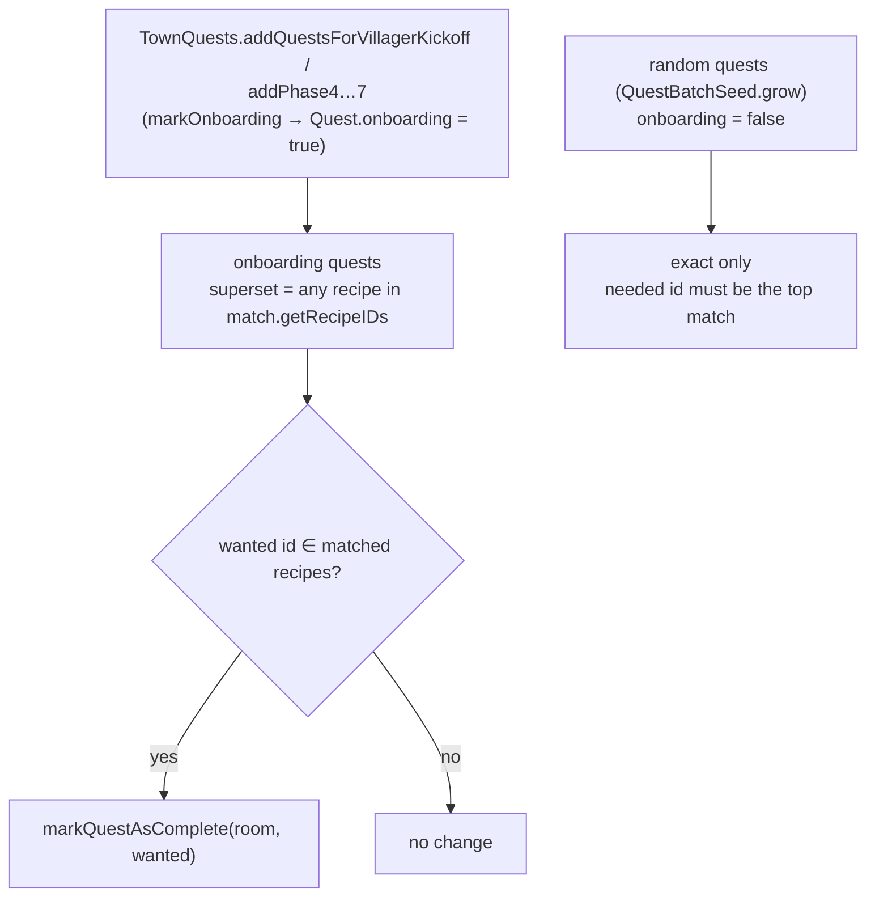

# Quest completion — top match, and the onboarding superset path

Room quests complete on the **recipe id** a room matches, not on the room. A
room can match several recipes at once (a "contains" superset test:
`NoMCRomRecipe.foundMatchRecipe`), so `getTopMatch` picks exactly one — the
highest-weight recipe — and that recipe is the room's identity. Completion
routes through that single top match, which is why the storeroom tiers are the
only recipes where one room can satisfy several quests at once.

## Top match (the rule)

- **Top match = the most elaborate recipe the room contains.** Storeroom tiers
  share the `forge:chests` tag, so weight scales with chest count and a 6-chest
  room's top match is always `store_room_huge`. `getTopMatch` is used for
  completion, messages, the `FirstJobBlock` advancement, and upgrade conversion
  (`roomRecipeChanged` → `markRecipeAsConverted`).
- **Completion is keyed on the recipe id, not the room.** `QuestBatch.markRecipeAsComplete`
  matches `getWantedId`, so completing one recipe and then another can never
  complete the same quest twice — which is what makes the superset path below
  safe alongside the top-match path.

## Onboarding superset (the exception)

Randomly generated quests keep exact matching ("the villagers want this
specific room"). Onboarding quests (the tutorial phases and the kickoff batch,
all built in `TownQuests`) are flagged `onboarding` and complete on **any
recipe the room contains**, so a bigger storeroom completes the small-storeroom
and storage-upgrade quests instead of stalling.

- **The gate is `onboarding`, not the recipe id.** The same `store_room` id can
  be an onboarding quest (superset) or a random quest (exact); only the flag
  differs. It is set at the tutorial/kickoff batch-creation sites and carried
  through `completed()` / `lost()` and NBT.
- **Superset set = the storeroom chain** (`store_room`, `medium`, `big`,
  `huge`, `warehouse`, `storeage_facility`), not "any room with `forge:chests`"
  — that would also match `armory`, `range`, `kitchen_stocked`,
  `bakery_stocked`.
- **Upgrade quests are onboarding too.** The phase 6 quest
  (`store_room → store_room_medium`) is satisfied by a `big`/`huge` room (which
  contains `medium`), unlocking phase 7.
- A unit test drives the mechanism (match the room's recipe IDs against each
  onboarding quest's wanted id, complete on match) through
  `markQuestAsComplete`; the full `roomRecipeCreated` path needs a live world
  and is covered by play-test.

## Deferred: superset-present UI

The quest UI should show **"a superset of this room exists, but not this exact
room"** as a distinct status from active / completed / lost. Deferred to a
later change; it needs a new `QuestStatus` and rendering in the flag's quest
tab (`TownQuestsContainer`).
