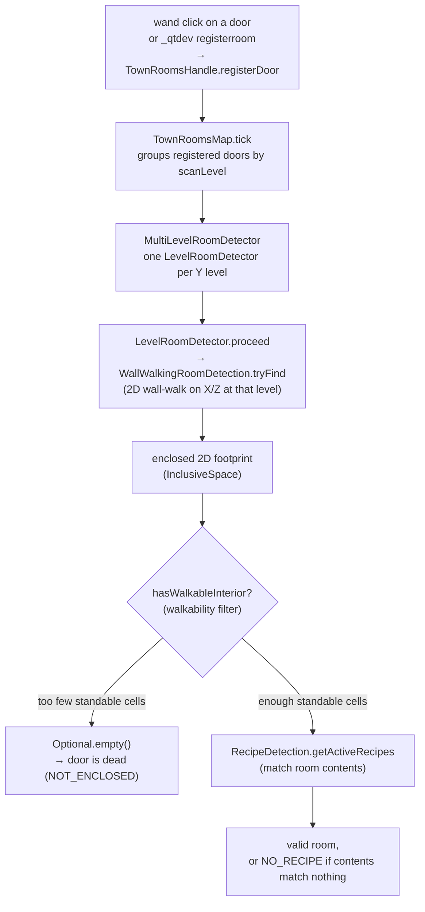
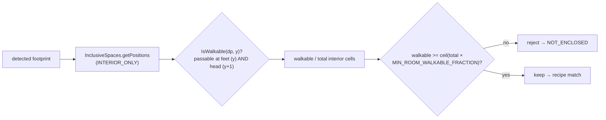

# Room detection — door → wall-walk → walkable room

A registered door becomes a town room through a per-level 2D wall-walk, a
walkability filter, and a recipe match. The scan is spread across ticks:
`TownRoomsMap.tick` builds one `MultiLevelRoomDetector` and steps it with
`pendingRooms.proceed(...)` (one level-detector step per tick) rather than
scanning a whole town in one burst.

## Happy path

- **A wall is two solid blocks; interior is anything that is not a wall.**
  `WallDetection.IsWall(dp, y)` reads the block at `y` and at `y+1`: both solid
  (or a door) makes a wall. Anything else — including a cell empty at `y` but
  solid at `y+1` — reads as interior. That last case is the gap the walkability
  filter closes.
- The scan is resumable: `proceed()` returns null until a level finishes, and
  `TownRoomsMap` re-queues the detector, so a large town does not stall the
  flag tick.
- A door with no room (`NOT_ENCLOSED`) or a room that matches no recipe
  (`NO_RECIPE`) surfaces as a world-space bubble over the door (ADR-0011); the
  scan never deregisters it on those grounds.

## The walkability filter (rejects villager-unreachable rooms)

- **Why it exists.** The wall-walk is 2D: a room roofed one block above its
  floor has interior cells that are empty at the feet level (so "not a wall")
  but solid at the head level — enclosed, yet a two-block-tall villager can
  never step inside. Before this filter such a room detected, and could even
  match a recipe, so the town assigned villagers a room they could not enter.
- **Some minimum, not every cell.** `Config.MIN_ROOM_WALKABLE_FRACTION`
  (default 0.5) is the fraction of interior floor cells that must be standable,
  so a room with a low overhang over only part of its floor still counts while
  a fully low-roofed room (0 standable) is rejected. `0.0` disables the check.
- The filter runs in `MultiLevelRoomDetector.handleNewRooms`, so a rejected
  room never reaches recipe matching. It surfaces as the existing
  `DoorTrouble.NOT_ENCLOSED` (no new trouble type), pointing the player at the
  door to rebuild taller. Regression guard: the `flag/too_short_room_dead`
  autotest builds the exact 1-block-tall structure and asserts the rejection.
